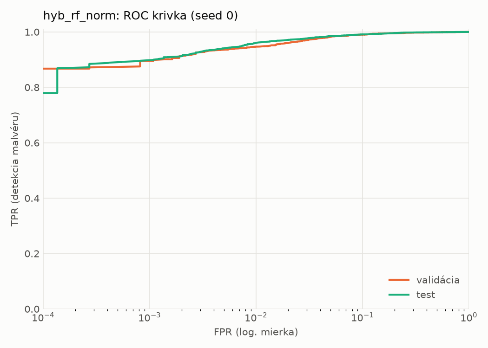
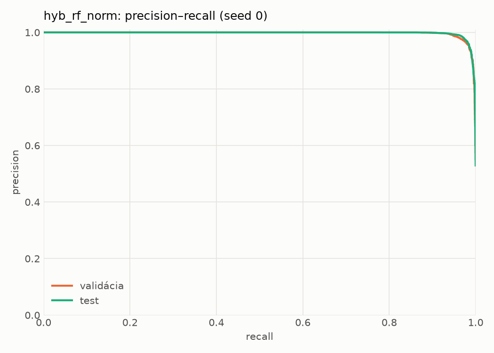
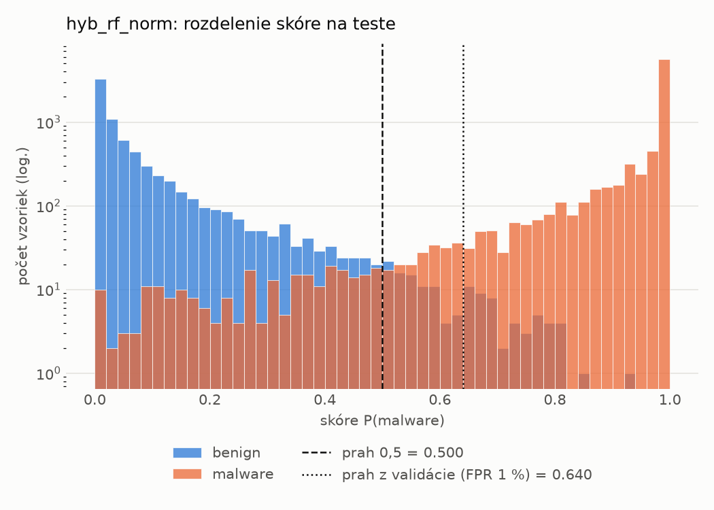
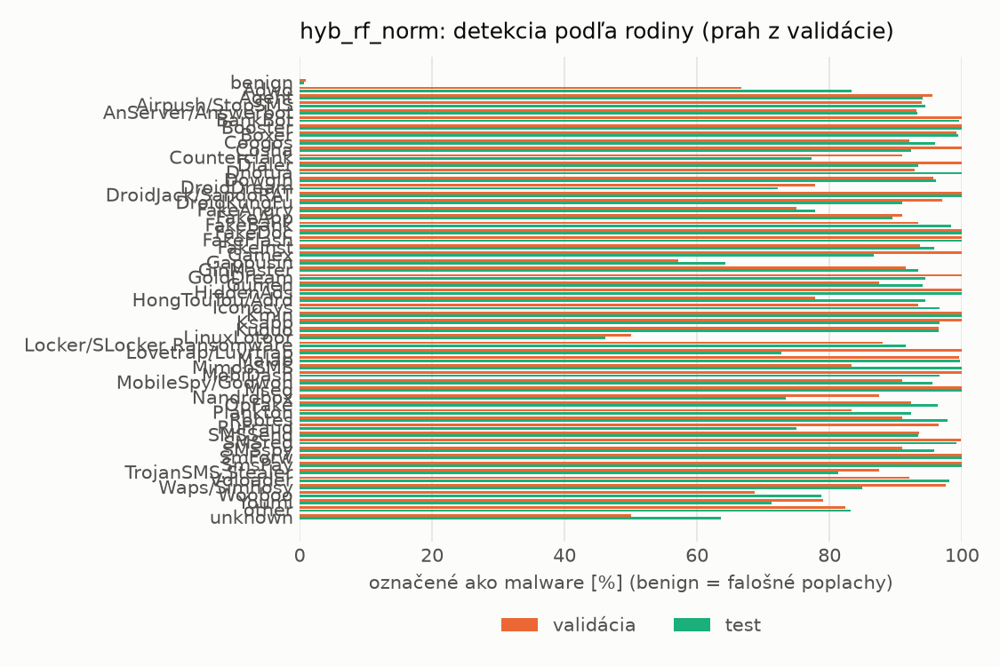
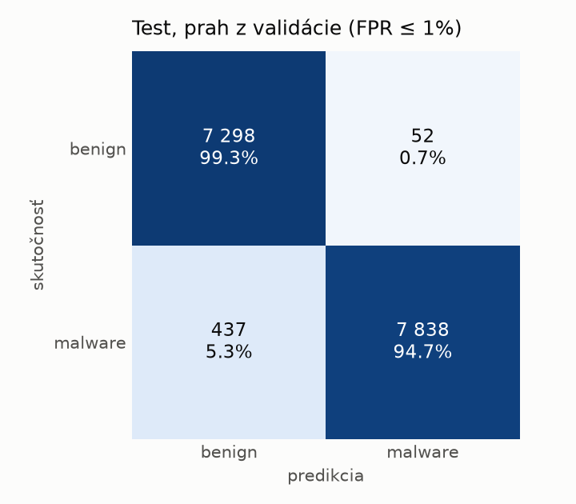
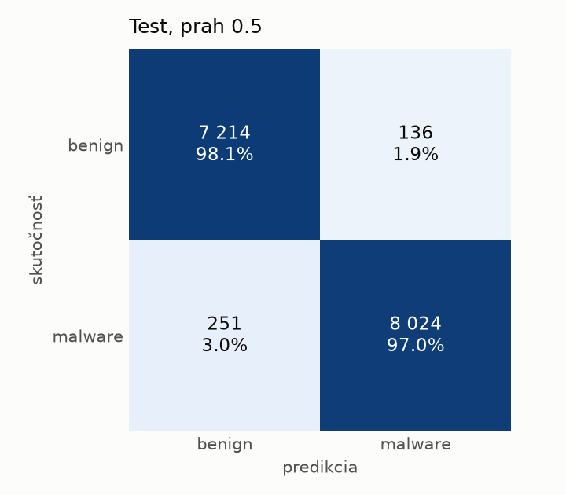

# hybrid_norm/hyb_rf_norm – beh `20261122-202426`

> Automaticky generované (`src/training/run_tabular.py`). Konfigurácia: `config.yaml`, protokol: `protocol.yaml`.

- **Model:** `random_forest` – hybrid rf s dynamikou ako podiely systémových volaní (kontrola artefaktu množstva aktivity)
- **Ladenie:** bez ladenia – hyperparametre prevzaté z `runs_v4/real_full/full/hybrid/rf/20261122-195013`
- **Finálne modely:** seedy [0, 1, 2]; hodnoty sú priemer ± smerodajná odchýlka cez seedy
- **Najlepšie hyperparametre:** `{"n_estimators": 150, "max_depth": 32, "min_samples_leaf": 1, "max_features": 0.05}`

## Detekčná kvalita (bez prahu)
| metrika | train (podvzorka) | validácia | test |
|---|---|---|---|
| ROC-AUC | 1.0000 ± 0.0000 | 0.9956 ± 0.0001 | 0.9963 ± 0.0000 |
| PR-AUC | 1.0000 ± 0.0000 | 0.9967 ± 0.0000 | 0.9972 ± 0.0000 |
| TPR pri FPR 1 % | 1.0000 ± 0.0000 | 0.9455 ± 0.0022 | 0.9587 ± 0.0006 |
| TPR pri FPR 0,1 % | 1.0000 ± 0.0000 | 0.8950 ± 0.0087 | 0.8971 ± 0.0067 |
| log loss | 0.0269 ± 0.0003 | 0.0960 ± 0.0014 | 0.0918 ± 0.0004 |
| Brier skóre | 0.0033 ± 0.0000 | 0.0243 ± 0.0001 | 0.0229 ± 0.0001 |

Rozdiel ROC-AUC train − validácia: **0.0044** (veľký rozdiel = preučenie).

## Pri prahu z validácie (FPR ≤ 1% na validácii)
| metrika | train (podvzorka) | validácia | test |
|---|---|---|---|
| accuracy | 0.9972 ± 0.0009 | 0.9668 ± 0.0010 | 0.9682 ± 0.0013 |
| balanced accuracy | 0.9974 ± 0.0009 | 0.9682 ± 0.0009 | 0.9697 ± 0.0013 |
| precision | 1.0000 ± 0.0000 | 0.9915 ± 0.0005 | 0.9942 ± 0.0007 |
| recall (TPR) | 0.9947 ± 0.0017 | 0.9455 ± 0.0022 | 0.9455 ± 0.0029 |
| FPR | 0.0000 ± 0.0000 | 0.0092 ± 0.0006 | 0.0062 ± 0.0007 |
| F1 | 0.9974 ± 0.0009 | 0.9679 ± 0.0010 | 0.9693 ± 0.0013 |
| MCC | 0.9945 ± 0.0018 | 0.9347 ± 0.0019 | 0.9377 ± 0.0025 |

## Pri pevnom prahu 0.5
| metrika | train (podvzorka) | validácia | test |
|---|---|---|---|
| accuracy | 1.0000 ± 0.0000 | 0.9703 ± 0.0007 | 0.9753 ± 0.0002 |
| balanced accuracy | 1.0000 ± 0.0000 | 0.9705 ± 0.0007 | 0.9757 ± 0.0002 |
| precision | 1.0000 ± 0.0000 | 0.9770 ± 0.0009 | 0.9838 ± 0.0005 |
| recall (TPR) | 1.0000 ± 0.0000 | 0.9667 ± 0.0005 | 0.9693 ± 0.0004 |
| FPR | 0.0000 ± 0.0000 | 0.0256 ± 0.0010 | 0.0180 ± 0.0005 |
| F1 | 1.0000 ± 0.0000 | 0.9718 ± 0.0007 | 0.9765 ± 0.0002 |
| MCC | 1.0000 ± 0.0000 | 0.9405 ± 0.0014 | 0.9505 ± 0.0004 |

## Výpočtové nároky (seed 0, testovacia množina)
| meranie | hodnota |
|---|---|
| tréning finálneho modelu | 1.8 s (priemer cez seedy) |
| ladenie spolu | 0 s |
| počet parametrov / uzlov | 741 444 |
| veľkosť modelu na disku | 59.60 MB |
| CPU latencia modelu (batch 1, 1 vlákno) | 4.905 ms (p95 5.189) |
| CPU priepustnosť (24 vlákien) | 238 476 vzoriek/s |

## Grafy
| | |
|---|---|
|  |  |
|  |  |
|  |  |
|  |  |

## Súbory
`metrics.json` (všetky metriky po seedoch vrátane rodín), `timing.json`, `hpo_trials.csv`,
`predictions/<časť>_seed<N>.parquet` (sha256, family, label, score), `model/seed_<N>/`, `log.txt`.
