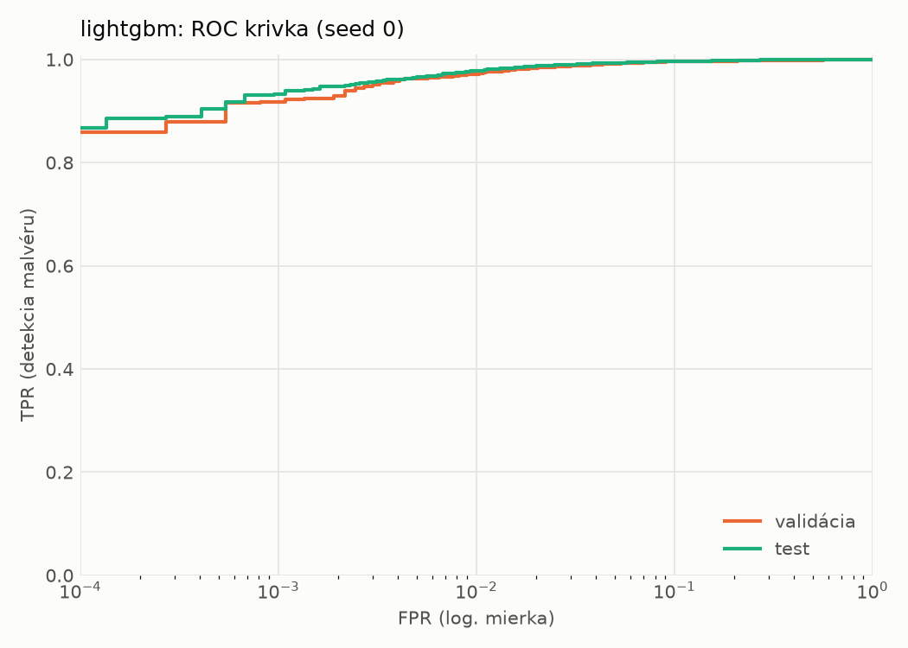
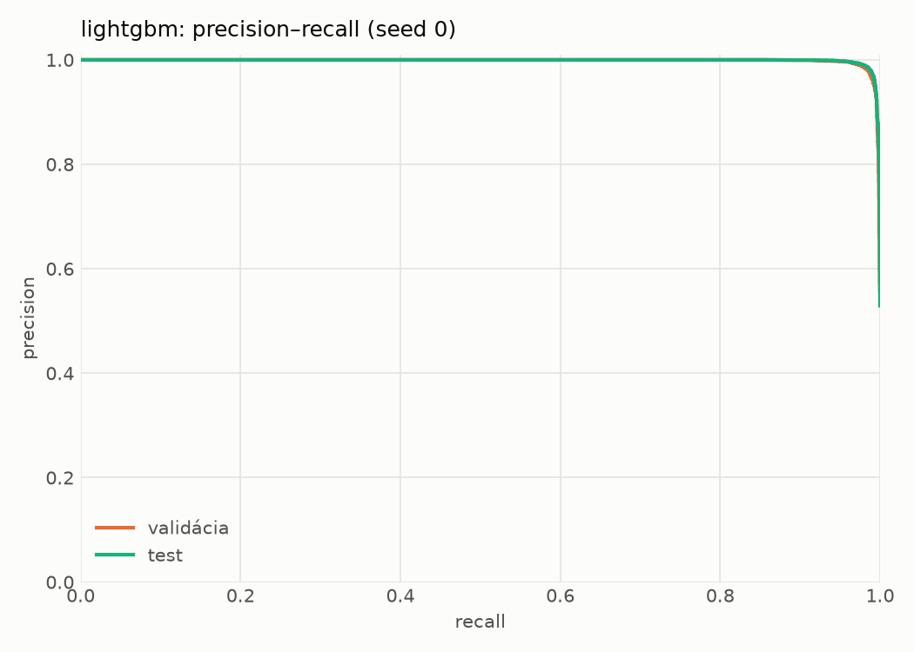
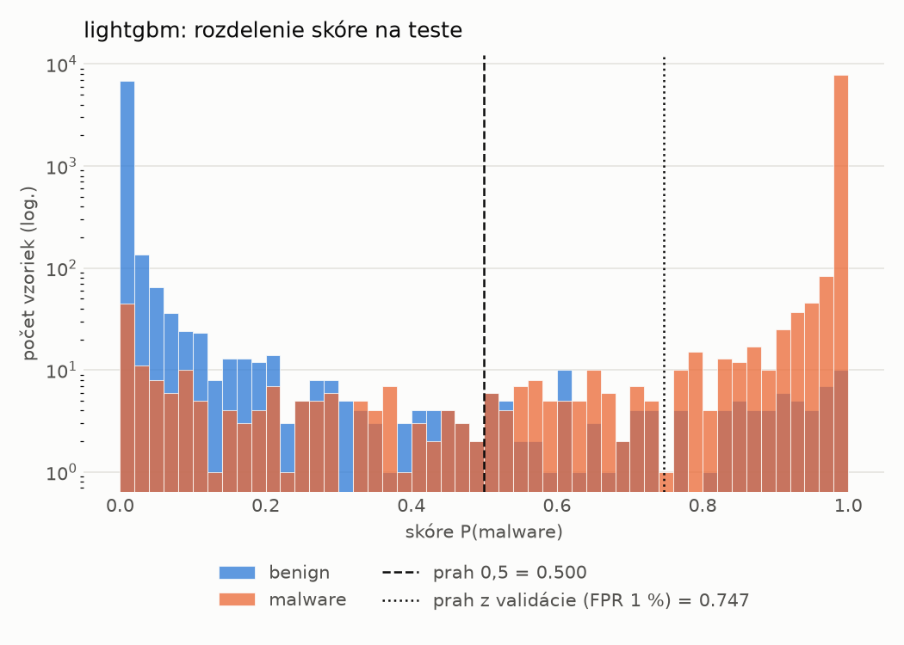
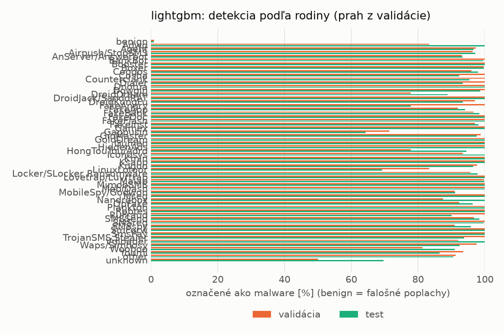
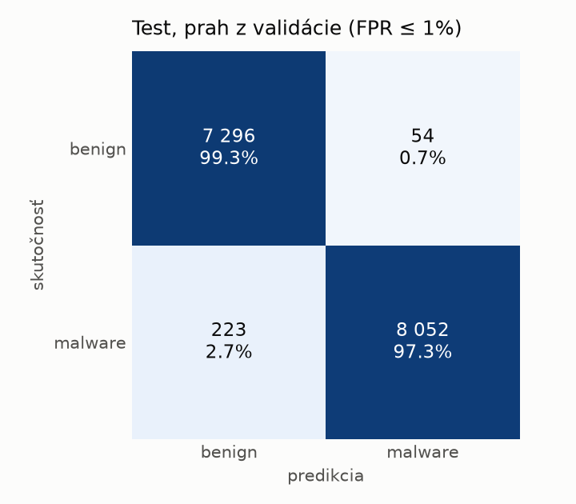
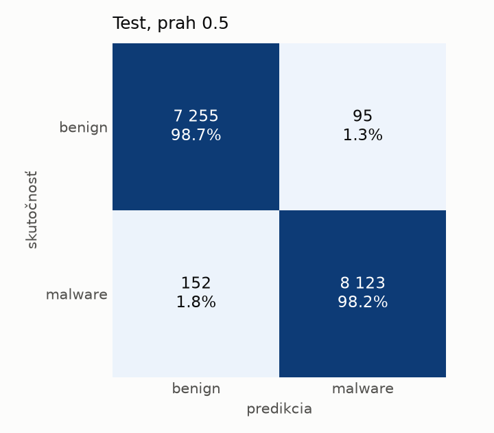
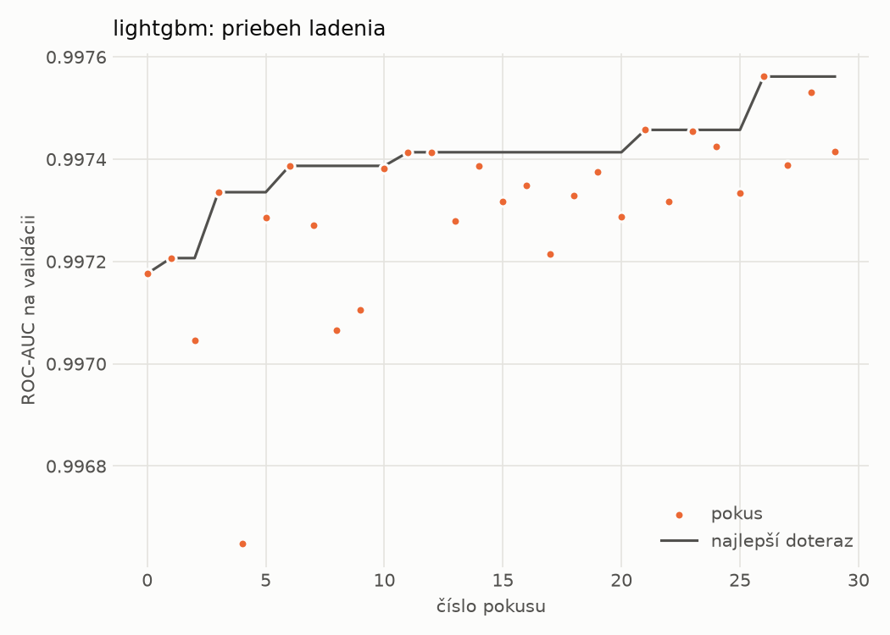
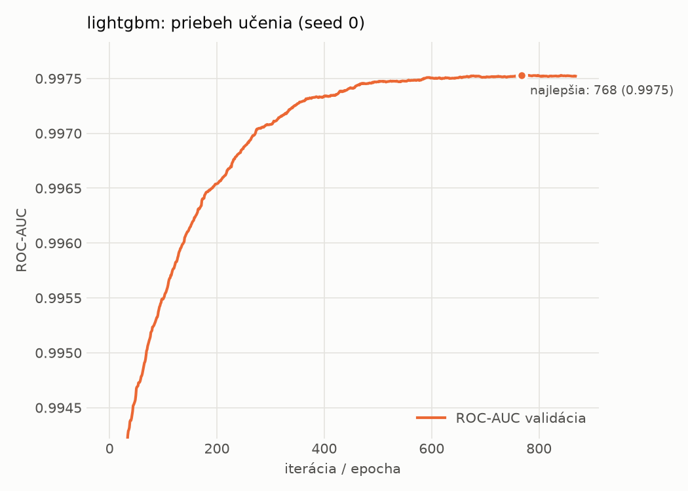

# hybrid/lightgbm – beh `20261122-195127`

> Automaticky generované (`src/training/run_tabular.py`). Konfigurácia: `config.yaml`, protokol: `protocol.yaml`.

- **Model:** `lightgbm` – LightGBM, gradient boosting stromov s early stopping na validácii (pôvodné hodnoty príznakov)
- **Ladenie:** 30 dokončených pokusov (Optuna TPE), cieľ ROC-AUC na validácii, 15.8 min
- **Finálne modely:** seedy [0, 1, 2]; hodnoty sú priemer ± smerodajná odchýlka cez seedy
- **Najlepšie hyperparametre:** `{"num_boost_round": 5000, "early_stopping_rounds": 100, "learning_rate": 0.018196998780495684, "num_leaves": 233, "min_child_samples": 23, "feature_fraction": 0.6390322800765896, "bagging_fraction": 0.9532240144545877, "lambda_l1": 0.008505404243799093, "lambda_l2": 0.007794186652208281}`

## Detekčná kvalita (bez prahu)
| metrika | train (podvzorka) | validácia | test |
|---|---|---|---|
| ROC-AUC | 1.0000 ± 0.0000 | 0.9975 ± 0.0000 | 0.9983 ± 0.0000 |
| PR-AUC | 1.0000 ± 0.0000 | 0.9982 ± 0.0000 | 0.9987 ± 0.0000 |
| TPR pri FPR 1 % | 1.0000 ± 0.0000 | 0.9720 ± 0.0005 | 0.9781 ± 0.0004 |
| TPR pri FPR 0,1 % | 1.0000 ± 0.0000 | 0.9197 ± 0.0048 | 0.9330 ± 0.0031 |
| log loss | 0.0016 ± 0.0011 | 0.0583 ± 0.0030 | 0.0503 ± 0.0021 |
| Brier skóre | 0.0000 ± 0.0000 | 0.0144 ± 0.0001 | 0.0126 ± 0.0001 |

Rozdiel ROC-AUC train − validácia: **0.0025** (veľký rozdiel = preučenie).

## Pri prahu z validácie (FPR ≤ 1% na validácii)
| metrika | train (podvzorka) | validácia | test |
|---|---|---|---|
| accuracy | 1.0000 ± 0.0000 | 0.9807 ± 0.0001 | 0.9818 ± 0.0005 |
| balanced accuracy | 1.0000 ± 0.0000 | 0.9812 ± 0.0001 | 0.9824 ± 0.0005 |
| precision | 1.0000 ± 0.0000 | 0.9914 ± 0.0002 | 0.9931 ± 0.0005 |
| recall (TPR) | 1.0000 ± 0.0000 | 0.9720 ± 0.0005 | 0.9724 ± 0.0006 |
| FPR | 0.0000 ± 0.0000 | 0.0095 ± 0.0003 | 0.0076 ± 0.0005 |
| F1 | 1.0000 ± 0.0000 | 0.9816 ± 0.0001 | 0.9826 ± 0.0005 |
| MCC | 1.0000 ± 0.0000 | 0.9615 ± 0.0002 | 0.9638 ± 0.0010 |

## Pri pevnom prahu 0.5
| metrika | train (podvzorka) | validácia | test |
|---|---|---|---|
| accuracy | 1.0000 ± 0.0000 | 0.9819 ± 0.0005 | 0.9843 ± 0.0001 |
| balanced accuracy | 1.0000 ± 0.0000 | 0.9820 ± 0.0006 | 0.9845 ± 0.0002 |
| precision | 1.0000 ± 0.0000 | 0.9854 ± 0.0011 | 0.9890 ± 0.0005 |
| recall (TPR) | 1.0000 ± 0.0000 | 0.9804 ± 0.0002 | 0.9812 ± 0.0004 |
| FPR | 0.0000 ± 0.0000 | 0.0164 ± 0.0012 | 0.0123 ± 0.0005 |
| F1 | 1.0000 ± 0.0000 | 0.9829 ± 0.0005 | 0.9851 ± 0.0001 |
| MCC | 1.0000 ± 0.0000 | 0.9637 ± 0.0011 | 0.9685 ± 0.0003 |

## Výpočtové nároky (seed 0, testovacia množina)
| meranie | hodnota |
|---|---|
| tréning finálneho modelu | 19.1 s (priemer cez seedy) |
| ladenie spolu | 949 s |
| počet parametrov / uzlov | 357 120 |
| veľkosť modelu na disku | 19.88 MB |
| CPU latencia modelu (batch 1, 1 vlákno) | 0.137 ms (p95 0.168) |
| CPU priepustnosť (24 vlákien) | 108 719 vzoriek/s |

## Grafy
| | |
|---|---|
|  |  |
|  |  |
|  |  |
|  |  |

## Súbory
`metrics.json` (všetky metriky po seedoch vrátane rodín), `timing.json`, `hpo_trials.csv`,
`predictions/<časť>_seed<N>.parquet` (sha256, family, label, score), `model/seed_<N>/`, `log.txt`.
