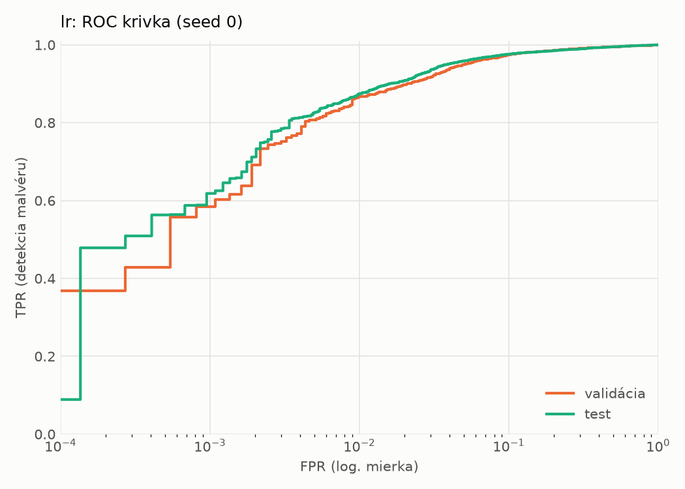
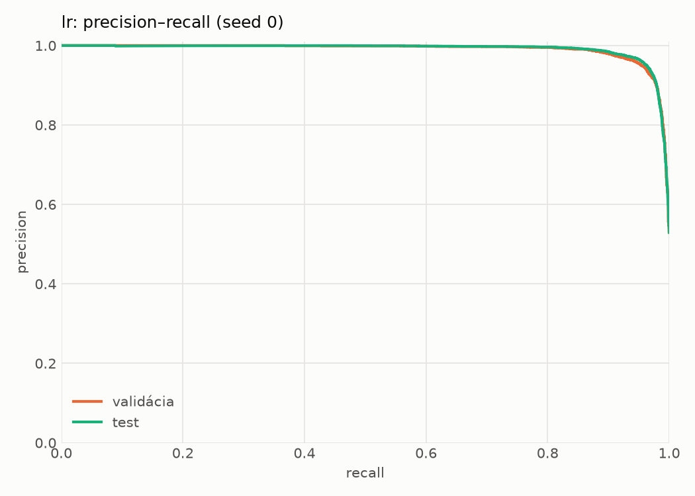
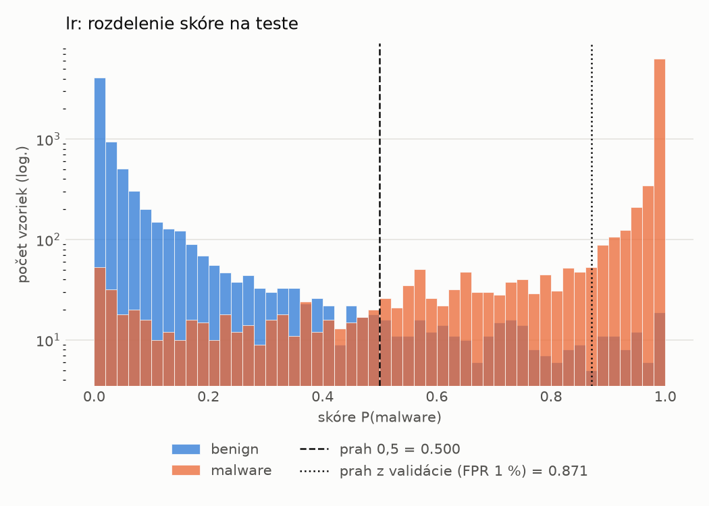
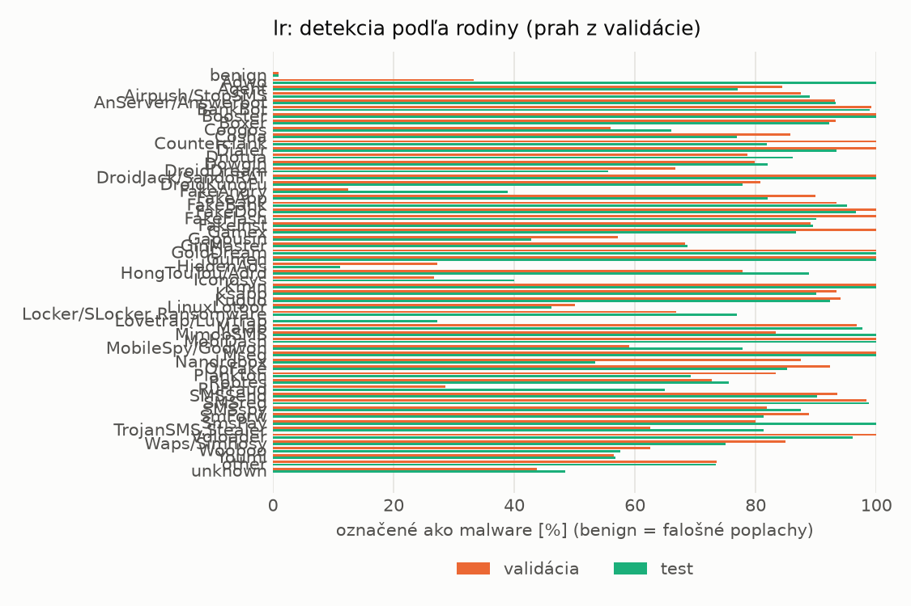
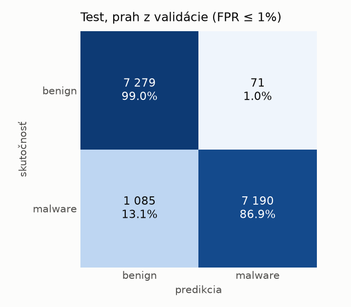
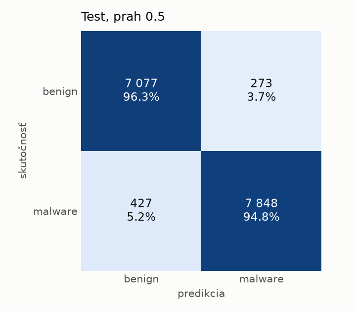
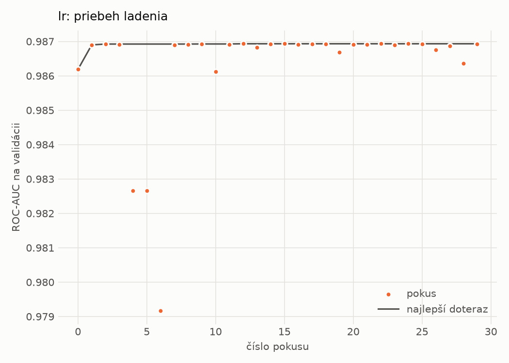

# hybrid/lr – beh `20261122-195001`

> Automaticky generované (`src/training/run_tabular.py`). Konfigurácia: `config.yaml`, protokol: `protocol.yaml`.

- **Model:** `logreg` – logistická regresia s L2 regularizáciou (vstup signed log1p + štandardizácia)
- **Ladenie:** 30 dokončených pokusov (Optuna TPE), cieľ ROC-AUC na validácii, 0.1 min
- **Finálne modely:** seedy [0, 1, 2]; hodnoty sú priemer ± smerodajná odchýlka cez seedy
- **Najlepšie hyperparametre:** `{"max_iter": 2000, "C": 0.30240503427727145}`

## Detekčná kvalita (bez prahu)
| metrika | train (podvzorka) | validácia | test |
|---|---|---|---|
| ROC-AUC | 0.9890 ± 0.0000 | 0.9869 ± 0.0000 | 0.9878 ± 0.0000 |
| PR-AUC | 0.9913 ± 0.0000 | 0.9899 ± 0.0000 | 0.9906 ± 0.0000 |
| TPR pri FPR 1 % | 0.8794 ± 0.0000 | 0.8652 ± 0.0000 | 0.8740 ± 0.0000 |
| TPR pri FPR 0,1 % | 0.6202 ± 0.0000 | 0.5849 ± 0.0000 | 0.6184 ± 0.0000 |
| log loss | 0.1282 ± 0.0000 | 0.1409 ± 0.0000 | 0.1321 ± 0.0000 |
| Brier skóre | 0.0358 ± 0.0000 | 0.0388 ± 0.0000 | 0.0358 ± 0.0000 |

Rozdiel ROC-AUC train − validácia: **0.0020** (veľký rozdiel = preučenie).

## Pri prahu z validácie (FPR ≤ 1% na validácii)
| metrika | train (podvzorka) | validácia | test |
|---|---|---|---|
| accuracy | 0.9251 ± 0.0000 | 0.9240 ± 0.0000 | 0.9260 ± 0.0000 |
| balanced accuracy | 0.9283 ± 0.0000 | 0.9277 ± 0.0000 | 0.9296 ± 0.0000 |
| precision | 0.9915 ± 0.0000 | 0.9900 ± 0.0000 | 0.9902 ± 0.0000 |
| recall (TPR) | 0.8649 ± 0.0000 | 0.8652 ± 0.0000 | 0.8689 ± 0.0000 |
| FPR | 0.0082 ± 0.0000 | 0.0098 ± 0.0000 | 0.0097 ± 0.0000 |
| F1 | 0.9239 ± 0.0000 | 0.9234 ± 0.0000 | 0.9256 ± 0.0000 |
| MCC | 0.8585 ± 0.0000 | 0.8562 ± 0.0000 | 0.8599 ± 0.0000 |

## Pri pevnom prahu 0.5
| metrika | train (podvzorka) | validácia | test |
|---|---|---|---|
| accuracy | 0.9525 ± 0.0000 | 0.9487 ± 0.0000 | 0.9552 ± 0.0000 |
| balanced accuracy | 0.9530 ± 0.0000 | 0.9493 ± 0.0000 | 0.9556 ± 0.0000 |
| precision | 0.9655 ± 0.0000 | 0.9633 ± 0.0000 | 0.9664 ± 0.0000 |
| recall (TPR) | 0.9433 ± 0.0000 | 0.9389 ± 0.0000 | 0.9484 ± 0.0000 |
| FPR | 0.0373 ± 0.0000 | 0.0403 ± 0.0000 | 0.0371 ± 0.0000 |
| F1 | 0.9543 ± 0.0000 | 0.9509 ± 0.0000 | 0.9573 ± 0.0000 |
| MCC | 0.9051 ± 0.0000 | 0.8975 ± 0.0000 | 0.9104 ± 0.0000 |

## Výpočtové nároky (seed 0, testovacia množina)
| meranie | hodnota |
|---|---|
| tréning finálneho modelu | 0.4 s (priemer cez seedy) |
| ladenie spolu | 9 s |
| počet parametrov / uzlov | 296 |
| veľkosť modelu na disku | 0.01 MB |
| transformácia vstupu – latencia (1 vlákno) | 0.007 ms |
| transformácia vstupu – priepustnosť | 491 419 vzoriek/s |
| CPU latencia modelu (batch 1, 1 vlákno) | 0.004 ms (p95 0.005) |
| CPU priepustnosť (24 vlákien) | 2 158 805 vzoriek/s |

## Grafy
| | |
|---|---|
|  |  |
|  |  |
|  |  |
|  |  |

## Súbory
`metrics.json` (všetky metriky po seedoch vrátane rodín), `timing.json`, `hpo_trials.csv`,
`predictions/<časť>_seed<N>.parquet` (sha256, family, label, score), `model/seed_<N>/`, `log.txt`.
