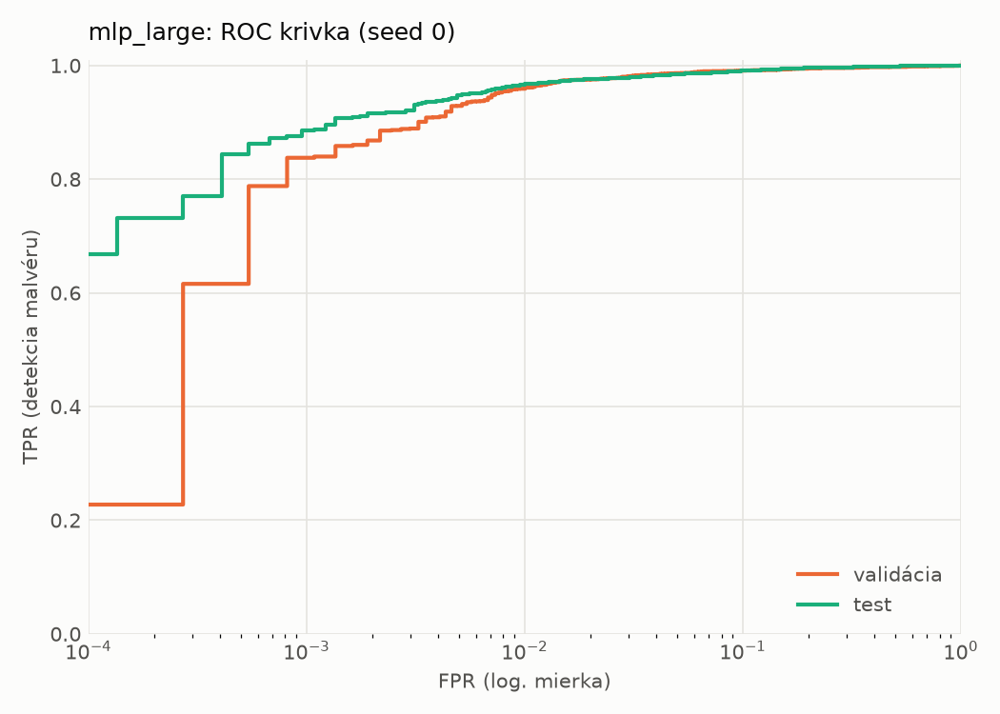
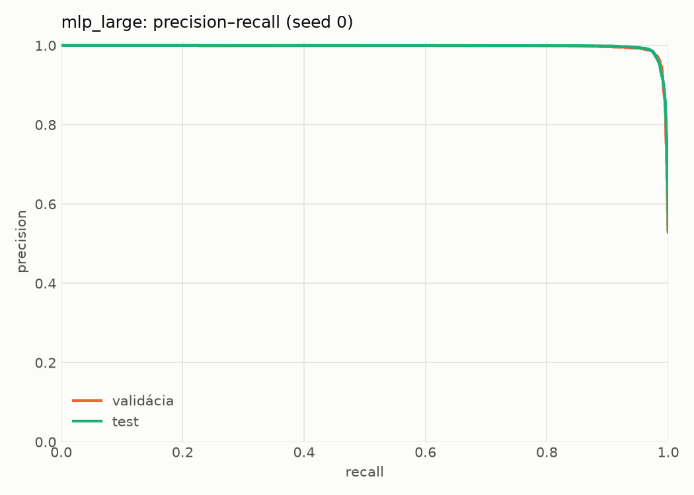
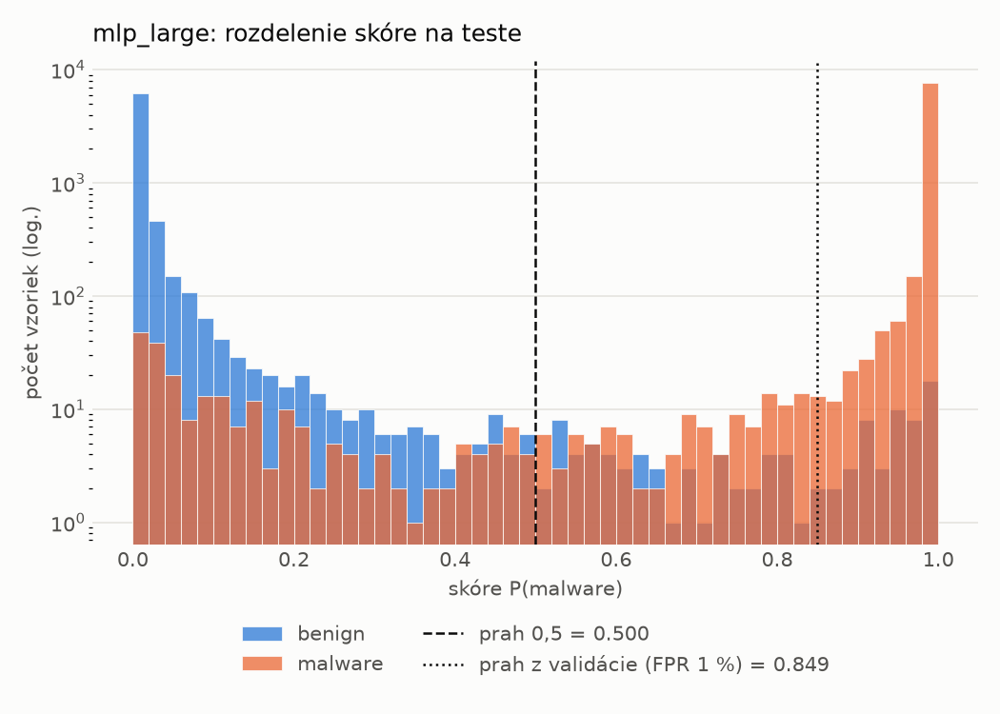
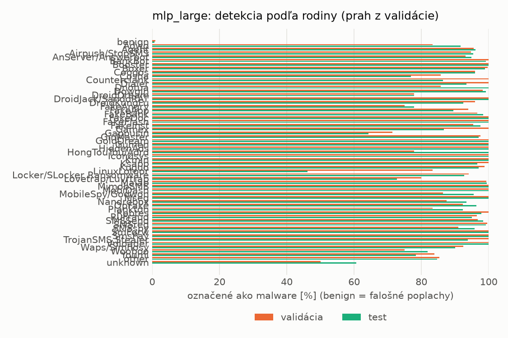
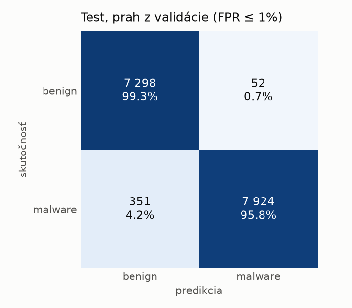
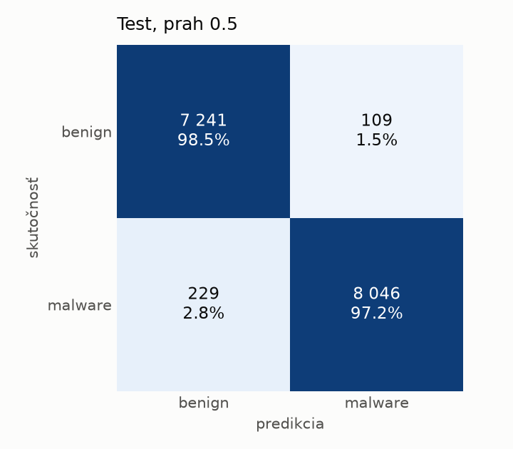
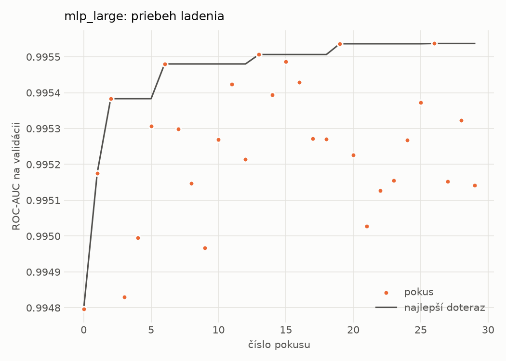
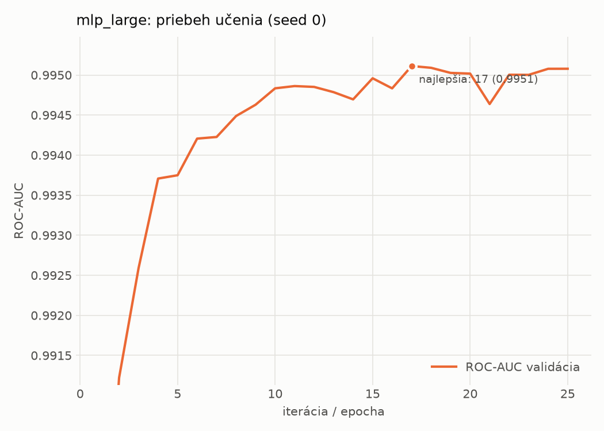

# hybrid/mlp_large – beh `20261122-201300`

> Automaticky generované (`src/training/run_tabular.py`). Konfigurácia: `config.yaml`, protokol: `protocol.yaml`.

- **Model:** `mlp` – veľká neurónová sieť (3–5 skrytých vrstiev, 512–2048 neurónov), kandidát na učiteľa
- **Ladenie:** 30 dokončených pokusov (Optuna TPE), cieľ ROC-AUC na validácii, 4.6 min
- **Finálne modely:** seedy [0, 1, 2]; hodnoty sú priemer ± smerodajná odchýlka cez seedy
- **Najlepšie hyperparametre:** `{"max_epochs": 100, "patience": 8, "hidden_layers": 3, "hidden_width": 512, "width_decay": 0.5, "dropout": 0.18171623767667733, "lr": 0.00010022812541545209, "weight_decay": 7.819097276436122e-06, "batch_size": 256}`

## Detekčná kvalita (bez prahu)
| metrika | train (podvzorka) | validácia | test |
|---|---|---|---|
| ROC-AUC | 0.9991 ± 0.0003 | 0.9952 ± 0.0002 | 0.9962 ± 0.0002 |
| PR-AUC | 0.9993 ± 0.0002 | 0.9961 ± 0.0007 | 0.9972 ± 0.0001 |
| TPR pri FPR 1 % | 0.9890 ± 0.0027 | 0.9626 ± 0.0031 | 0.9663 ± 0.0018 |
| TPR pri FPR 0,1 % | 0.9676 ± 0.0131 | 0.8202 ± 0.0156 | 0.8937 ± 0.0077 |
| log loss | 0.0322 ± 0.0066 | 0.0744 ± 0.0021 | 0.0695 ± 0.0012 |
| Brier skóre | 0.0083 ± 0.0017 | 0.0178 ± 0.0004 | 0.0175 ± 0.0006 |

Rozdiel ROC-AUC train − validácia: **0.0038** (veľký rozdiel = preučenie).

## Pri prahu z validácie (FPR ≤ 1% na validácii)
| metrika | train (podvzorka) | validácia | test |
|---|---|---|---|
| accuracy | 0.9859 ± 0.0028 | 0.9756 ± 0.0016 | 0.9756 ± 0.0013 |
| balanced accuracy | 0.9866 ± 0.0027 | 0.9765 ± 0.0015 | 0.9765 ± 0.0013 |
| precision | 0.9988 ± 0.0004 | 0.9911 ± 0.0001 | 0.9934 ± 0.0006 |
| recall (TPR) | 0.9744 ± 0.0051 | 0.9626 ± 0.0031 | 0.9603 ± 0.0024 |
| FPR | 0.0013 ± 0.0004 | 0.0097 ± 0.0002 | 0.0072 ± 0.0006 |
| F1 | 0.9864 ± 0.0028 | 0.9767 ± 0.0016 | 0.9765 ± 0.0013 |
| MCC | 0.9722 ± 0.0056 | 0.9516 ± 0.0031 | 0.9517 ± 0.0026 |

## Pri pevnom prahu 0.5
| metrika | train (podvzorka) | validácia | test |
|---|---|---|---|
| accuracy | 0.9898 ± 0.0018 | 0.9778 ± 0.0008 | 0.9786 ± 0.0007 |
| balanced accuracy | 0.9901 ± 0.0017 | 0.9780 ± 0.0008 | 0.9790 ± 0.0007 |
| precision | 0.9965 ± 0.0010 | 0.9838 ± 0.0001 | 0.9870 ± 0.0009 |
| recall (TPR) | 0.9841 ± 0.0024 | 0.9741 ± 0.0016 | 0.9723 ± 0.0005 |
| FPR | 0.0038 ± 0.0011 | 0.0180 ± 0.0002 | 0.0144 ± 0.0010 |
| F1 | 0.9903 ± 0.0017 | 0.9789 ± 0.0008 | 0.9796 ± 0.0007 |
| MCC | 0.9797 ± 0.0035 | 0.9555 ± 0.0016 | 0.9571 ± 0.0014 |

## Výpočtové nároky (seed 0, testovacia množina)
| meranie | hodnota |
|---|---|
| tréning finálneho modelu | 13.7 s (priemer cez seedy) |
| ladenie spolu | 279 s |
| počet parametrov / uzlov | 317 697 |
| veľkosť modelu na disku | 1.29 MB |
| transformácia vstupu – latencia (1 vlákno) | 0.017 ms |
| transformácia vstupu – priepustnosť | 312 033 vzoriek/s |
| CPU latencia modelu (batch 1, 1 vlákno) | 0.143 ms (p95 0.160) |
| CPU priepustnosť (24 vlákien) | 568 790 vzoriek/s |
| GPU latencia (batch 1) | 0.464 ms (p95 0.965) |
| GPU priepustnosť | 999 475 vzoriek/s |
| GPU špičková pamäť | 220 MB |

## Grafy
| | |
|---|---|
|  |  |
|  |  |
|  |  |
|  |  |

## Súbory
`metrics.json` (všetky metriky po seedoch vrátane rodín), `timing.json`, `hpo_trials.csv`,
`predictions/<časť>_seed<N>.parquet` (sha256, family, label, score), `model/seed_<N>/`, `log.txt`.
