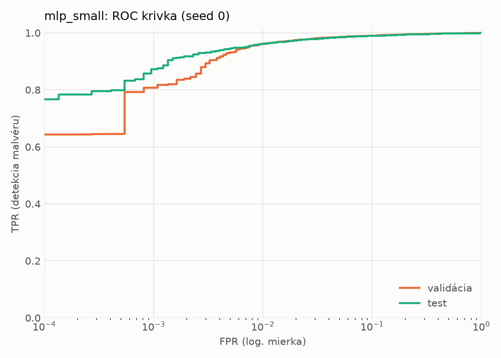
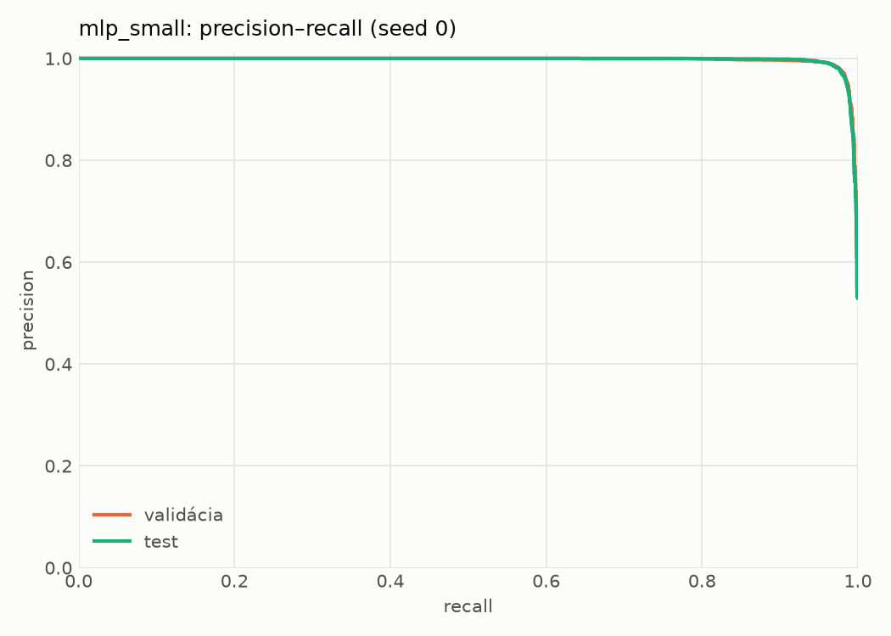
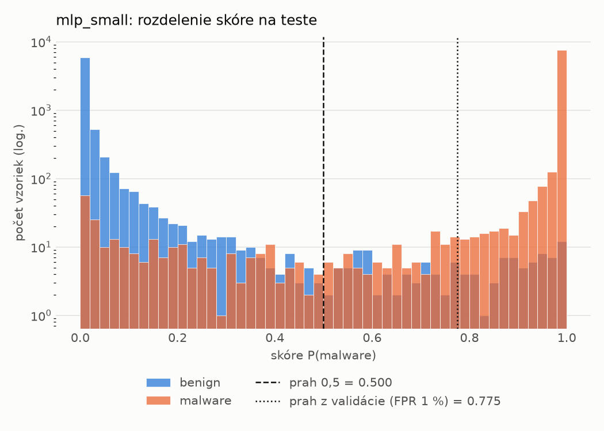
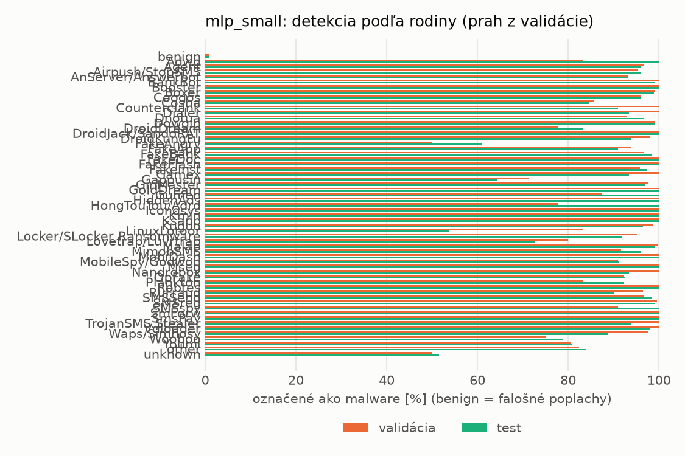
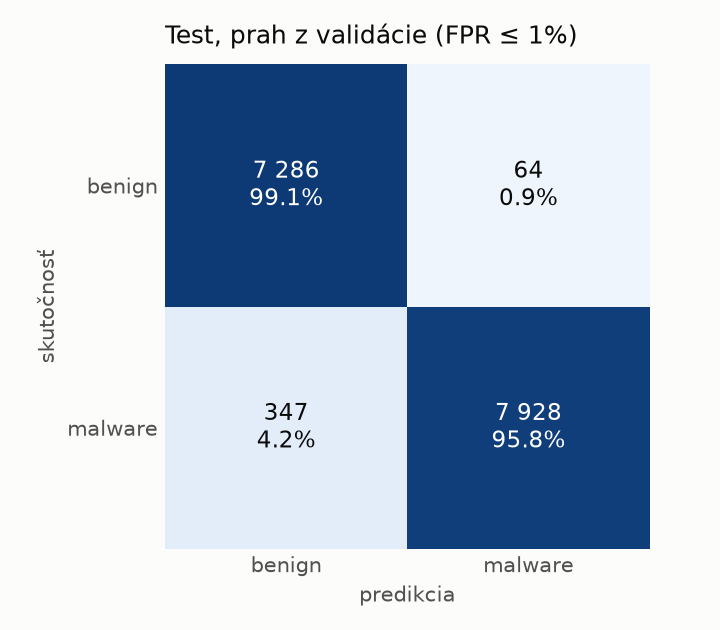
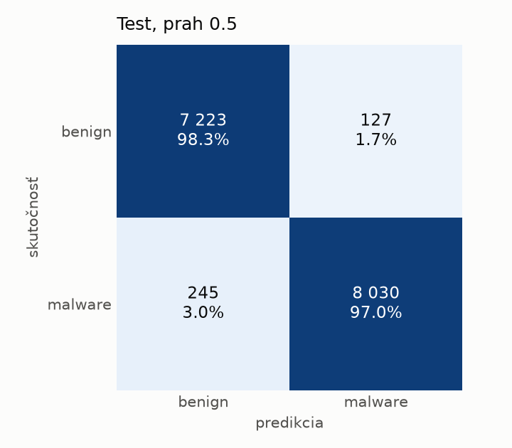
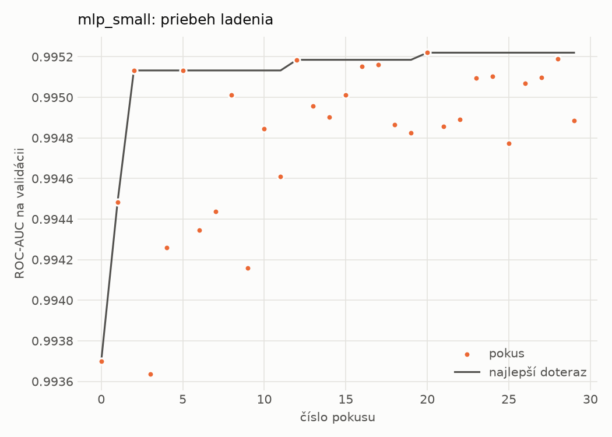
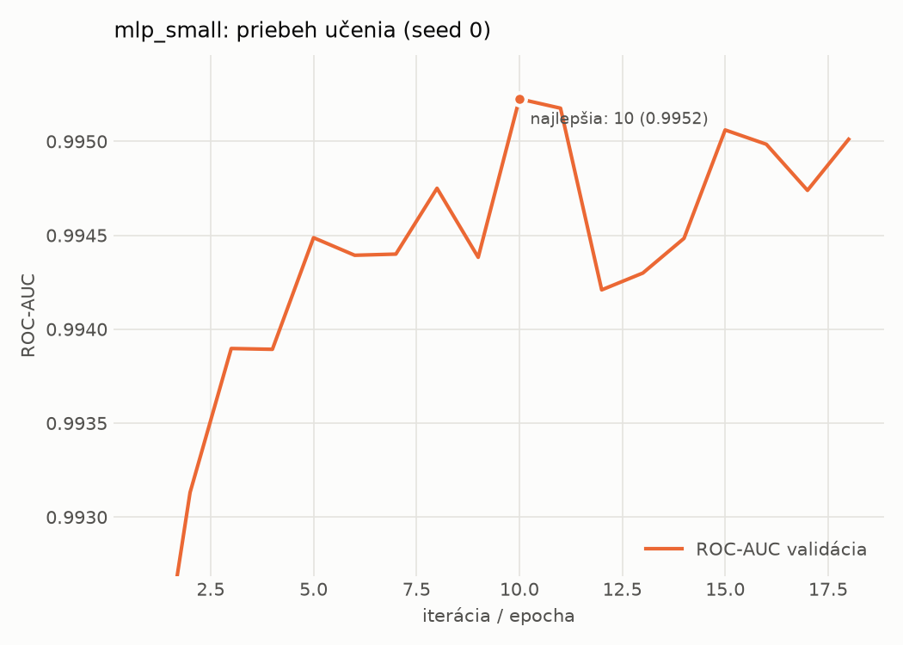

# hybrid/mlp_small – beh `20261122-200826`

> Automaticky generované (`src/training/run_tabular.py`). Konfigurácia: `config.yaml`, protokol: `protocol.yaml`.

- **Model:** `mlp` – malá neurónová sieť (1–2 skryté vrstvy), kandidát na ľahkého študenta
- **Ladenie:** 30 dokončených pokusov (Optuna TPE), cieľ ROC-AUC na validácii, 4.0 min
- **Finálne modely:** seedy [0, 1, 2]; hodnoty sú priemer ± smerodajná odchýlka cez seedy
- **Najlepšie hyperparametre:** `{"width_decay": 0.5, "max_epochs": 100, "patience": 8, "hidden_layers": 2, "hidden_width": 256, "dropout": 0.19625503285105284, "lr": 0.0008594281758471675, "weight_decay": 0.001025897876119634, "batch_size": 256}`

## Detekčná kvalita (bez prahu)
| metrika | train (podvzorka) | validácia | test |
|---|---|---|---|
| ROC-AUC | 0.9991 ± 0.0006 | 0.9950 ± 0.0003 | 0.9956 ± 0.0007 |
| PR-AUC | 0.9993 ± 0.0004 | 0.9960 ± 0.0005 | 0.9969 ± 0.0004 |
| TPR pri FPR 1 % | 0.9899 ± 0.0061 | 0.9616 ± 0.0013 | 0.9655 ± 0.0040 |
| TPR pri FPR 0,1 % | 0.9742 ± 0.0092 | 0.7276 ± 0.1130 | 0.8821 ± 0.0089 |
| log loss | 0.0295 ± 0.0095 | 0.0820 ± 0.0041 | 0.0750 ± 0.0036 |
| Brier skóre | 0.0076 ± 0.0025 | 0.0178 ± 0.0007 | 0.0175 ± 0.0012 |

Rozdiel ROC-AUC train − validácia: **0.0041** (veľký rozdiel = preučenie).

## Pri prahu z validácie (FPR ≤ 1% na validácii)
| metrika | train (podvzorka) | validácia | test |
|---|---|---|---|
| accuracy | 0.9858 ± 0.0028 | 0.9750 ± 0.0007 | 0.9746 ± 0.0008 |
| balanced accuracy | 0.9864 ± 0.0027 | 0.9759 ± 0.0007 | 0.9756 ± 0.0008 |
| precision | 0.9990 ± 0.0010 | 0.9910 ± 0.0000 | 0.9927 ± 0.0007 |
| recall (TPR) | 0.9740 ± 0.0044 | 0.9616 ± 0.0013 | 0.9592 ± 0.0011 |
| FPR | 0.0011 ± 0.0010 | 0.0098 ± 0.0000 | 0.0080 ± 0.0007 |
| F1 | 0.9863 ± 0.0027 | 0.9761 ± 0.0007 | 0.9756 ± 0.0008 |
| MCC | 0.9719 ± 0.0055 | 0.9505 ± 0.0014 | 0.9498 ± 0.0016 |

## Pri pevnom prahu 0.5
| metrika | train (podvzorka) | validácia | test |
|---|---|---|---|
| accuracy | 0.9904 ± 0.0030 | 0.9780 ± 0.0009 | 0.9783 ± 0.0019 |
| balanced accuracy | 0.9907 ± 0.0029 | 0.9782 ± 0.0009 | 0.9786 ± 0.0019 |
| precision | 0.9963 ± 0.0025 | 0.9833 ± 0.0006 | 0.9860 ± 0.0014 |
| recall (TPR) | 0.9854 ± 0.0033 | 0.9750 ± 0.0012 | 0.9728 ± 0.0021 |
| FPR | 0.0041 ± 0.0027 | 0.0186 ± 0.0007 | 0.0156 ± 0.0016 |
| F1 | 0.9908 ± 0.0028 | 0.9792 ± 0.0009 | 0.9794 ± 0.0018 |
| MCC | 0.9808 ± 0.0059 | 0.9560 ± 0.0018 | 0.9565 ± 0.0038 |

## Výpočtové nároky (seed 0, testovacia množina)
| meranie | hodnota |
|---|---|
| tréning finálneho modelu | 9.8 s (priemer cez seedy) |
| ladenie spolu | 243 s |
| počet parametrov / uzlov | 109 569 |
| veľkosť modelu na disku | 0.45 MB |
| transformácia vstupu – latencia (1 vlákno) | 0.007 ms |
| transformácia vstupu – priepustnosť | 282 230 vzoriek/s |
| CPU latencia modelu (batch 1, 1 vlákno) | 0.101 ms (p95 0.113) |
| CPU priepustnosť (24 vlákien) | 1 081 547 vzoriek/s |
| GPU latencia (batch 1) | 0.594 ms (p95 0.729) |
| GPU priepustnosť | 1 082 904 vzoriek/s |
| GPU špičková pamäť | 128 MB |

## Grafy
| | |
|---|---|
|  |  |
|  |  |
|  |  |
|  |  |

## Súbory
`metrics.json` (všetky metriky po seedoch vrátane rodín), `timing.json`, `hpo_trials.csv`,
`predictions/<časť>_seed<N>.parquet` (sha256, family, label, score), `model/seed_<N>/`, `log.txt`.
