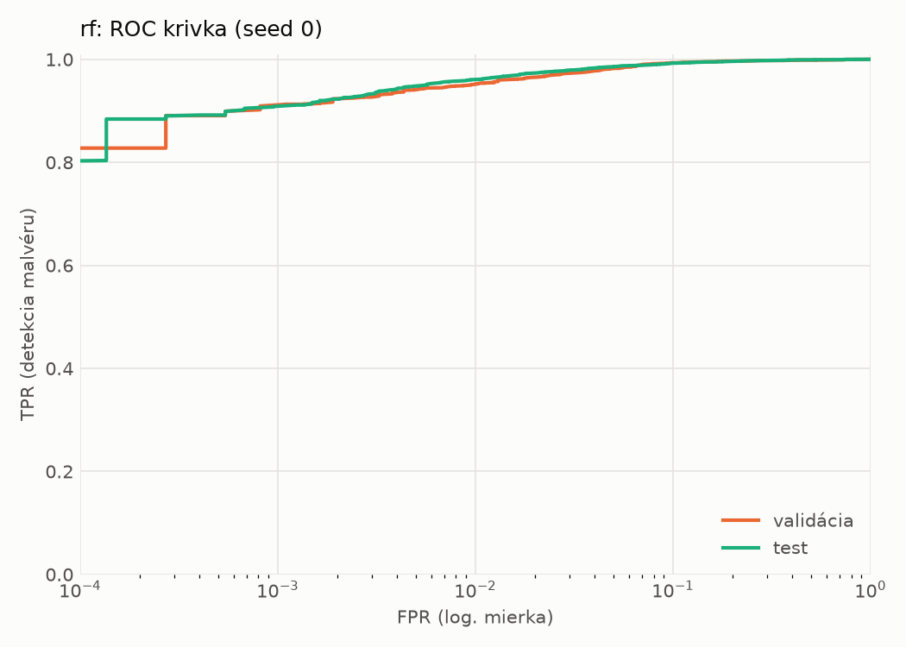
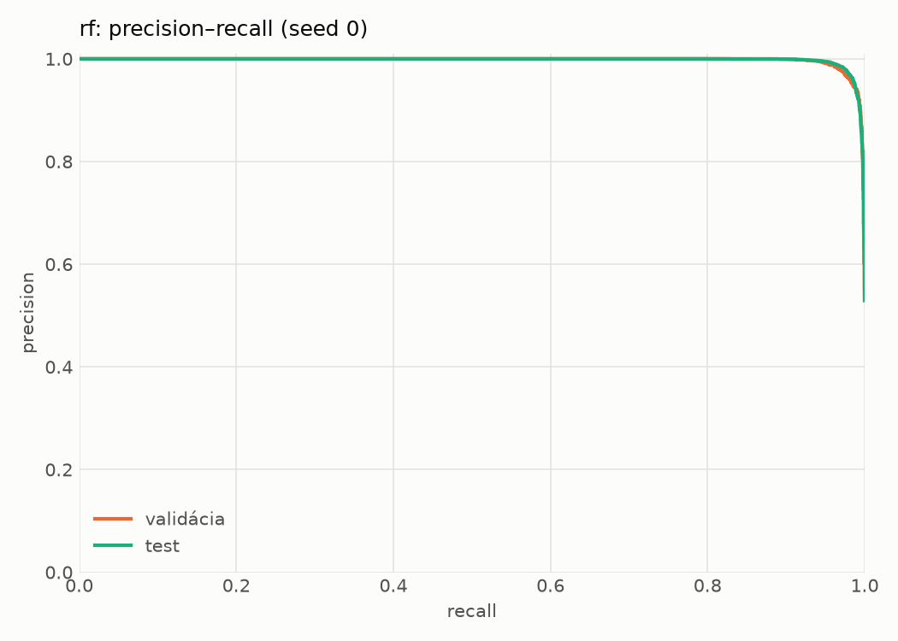
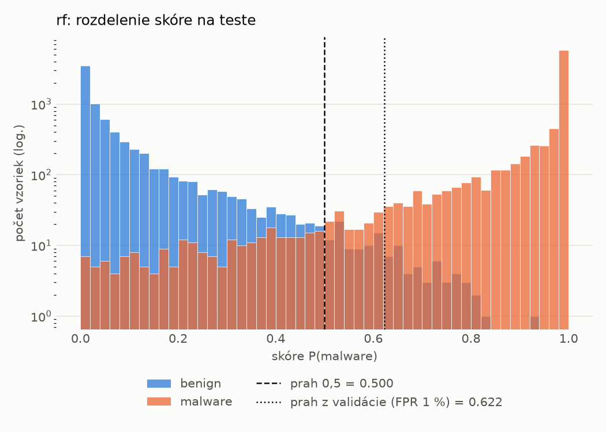
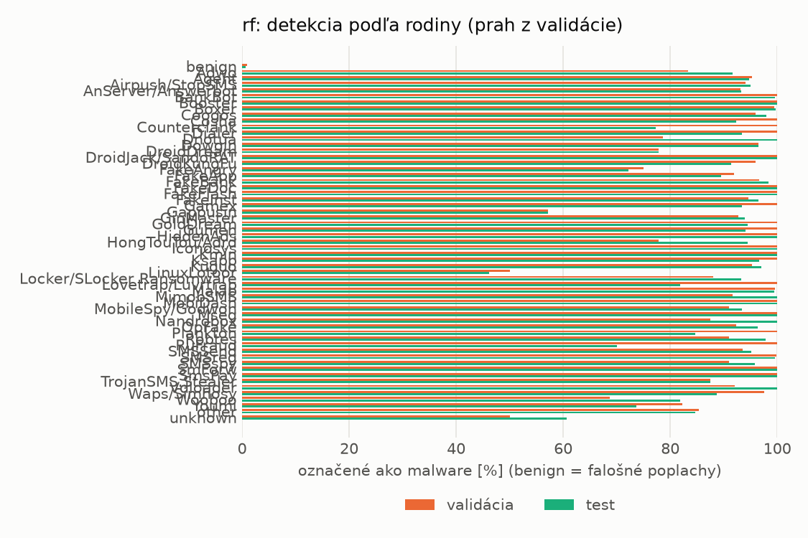
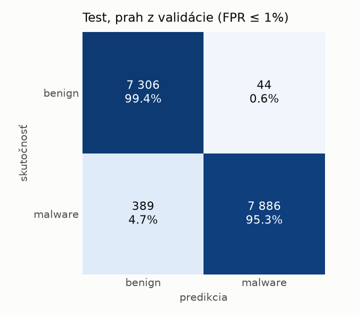
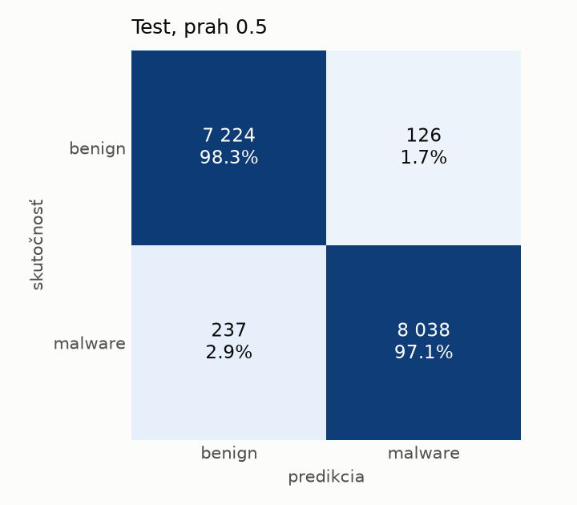
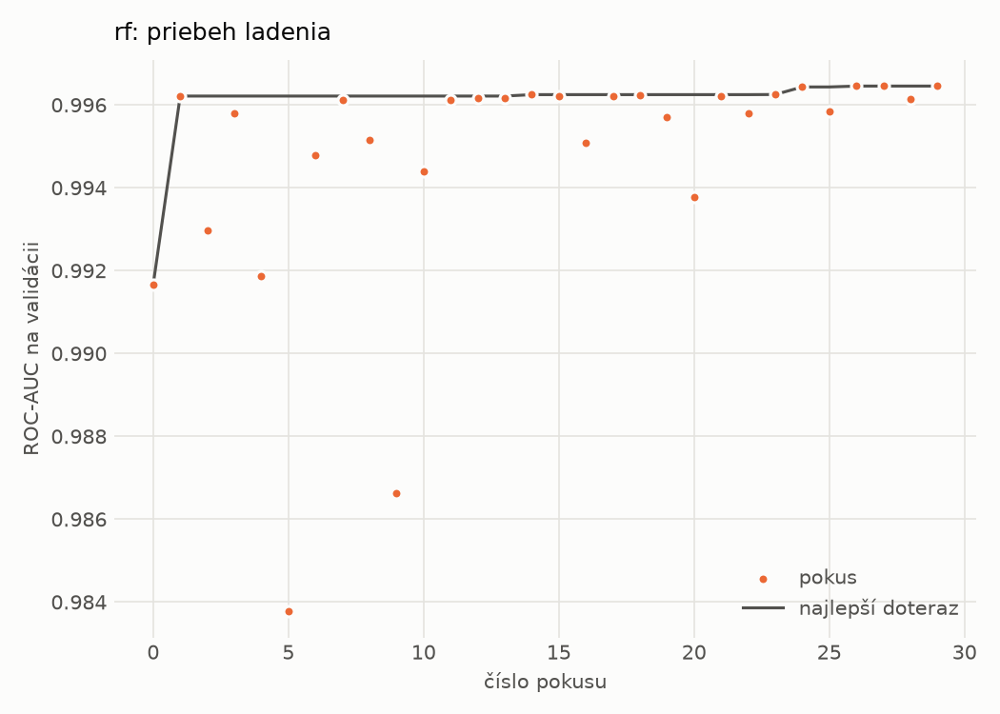

# hybrid/rf – beh `20261122-195013`

> Automaticky generované (`src/training/run_tabular.py`). Konfigurácia: `config.yaml`, protokol: `protocol.yaml`.

- **Model:** `random_forest` – Random Forest (pôvodné hodnoty príznakov)
- **Ladenie:** 30 dokončených pokusov (Optuna TPE), cieľ ROC-AUC na validácii, 1.1 min
- **Finálne modely:** seedy [0, 1, 2]; hodnoty sú priemer ± smerodajná odchýlka cez seedy
- **Najlepšie hyperparametre:** `{"n_estimators": 150, "max_depth": 32, "min_samples_leaf": 1, "max_features": 0.05}`

## Detekčná kvalita (bez prahu)
| metrika | train (podvzorka) | validácia | test |
|---|---|---|---|
| ROC-AUC | 1.0000 ± 0.0000 | 0.9962 ± 0.0001 | 0.9968 ± 0.0001 |
| PR-AUC | 1.0000 ± 0.0000 | 0.9972 ± 0.0000 | 0.9976 ± 0.0001 |
| TPR pri FPR 1 % | 1.0000 ± 0.0000 | 0.9513 ± 0.0006 | 0.9621 ± 0.0014 |
| TPR pri FPR 0,1 % | 1.0000 ± 0.0000 | 0.8986 ± 0.0124 | 0.9109 ± 0.0047 |
| log loss | 0.0253 ± 0.0002 | 0.0898 ± 0.0004 | 0.0858 ± 0.0005 |
| Brier skóre | 0.0031 ± 0.0001 | 0.0226 ± 0.0001 | 0.0214 ± 0.0002 |

Rozdiel ROC-AUC train − validácia: **0.0038** (veľký rozdiel = preučenie).

## Pri prahu z validácie (FPR ≤ 1% na validácii)
| metrika | train (podvzorka) | validácia | test |
|---|---|---|---|
| accuracy | 0.9985 ± 0.0005 | 0.9697 ± 0.0003 | 0.9727 ± 0.0007 |
| balanced accuracy | 0.9986 ± 0.0004 | 0.9709 ± 0.0002 | 0.9738 ± 0.0006 |
| precision | 1.0000 ± 0.0000 | 0.9912 ± 0.0002 | 0.9941 ± 0.0007 |
| recall (TPR) | 0.9971 ± 0.0009 | 0.9513 ± 0.0006 | 0.9541 ± 0.0020 |
| FPR | 0.0000 ± 0.0000 | 0.0095 ± 0.0003 | 0.0064 ± 0.0008 |
| F1 | 0.9986 ± 0.0004 | 0.9708 ± 0.0003 | 0.9737 ± 0.0007 |
| MCC | 0.9970 ± 0.0009 | 0.9402 ± 0.0005 | 0.9462 ± 0.0012 |

## Pri pevnom prahu 0.5
| metrika | train (podvzorka) | validácia | test |
|---|---|---|---|
| accuracy | 1.0000 ± 0.0001 | 0.9726 ± 0.0003 | 0.9768 ± 0.0004 |
| balanced accuracy | 1.0000 ± 0.0001 | 0.9729 ± 0.0004 | 0.9772 ± 0.0005 |
| precision | 1.0000 ± 0.0000 | 0.9804 ± 0.0010 | 0.9850 ± 0.0008 |
| recall (TPR) | 0.9999 ± 0.0001 | 0.9675 ± 0.0007 | 0.9710 ± 0.0003 |
| FPR | 0.0000 ± 0.0000 | 0.0218 ± 0.0012 | 0.0167 ± 0.0009 |
| F1 | 1.0000 ± 0.0001 | 0.9739 ± 0.0003 | 0.9780 ± 0.0004 |
| MCC | 0.9999 ± 0.0001 | 0.9451 ± 0.0007 | 0.9536 ± 0.0009 |

## Výpočtové nároky (seed 0, testovacia množina)
| meranie | hodnota |
|---|---|
| tréning finálneho modelu | 1.5 s (priemer cez seedy) |
| ladenie spolu | 65 s |
| počet parametrov / uzlov | 790 326 |
| veľkosť modelu na disku | 63.51 MB |
| CPU latencia modelu (batch 1, 1 vlákno) | 4.760 ms (p95 4.976) |
| CPU priepustnosť (24 vlákien) | 243 821 vzoriek/s |

## Grafy
| | |
|---|---|
|  |  |
|  |  |
|  |  |
|  |  |

## Súbory
`metrics.json` (všetky metriky po seedoch vrátane rodín), `timing.json`, `hpo_trials.csv`,
`predictions/<časť>_seed<N>.parquet` (sha256, family, label, score), `model/seed_<N>/`, `log.txt`.
