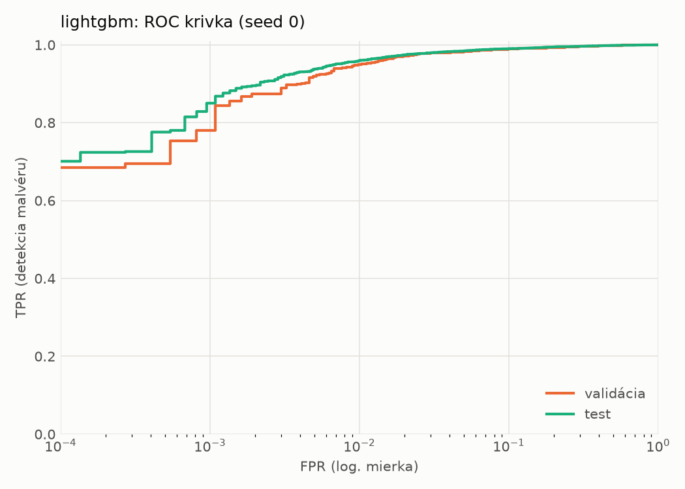
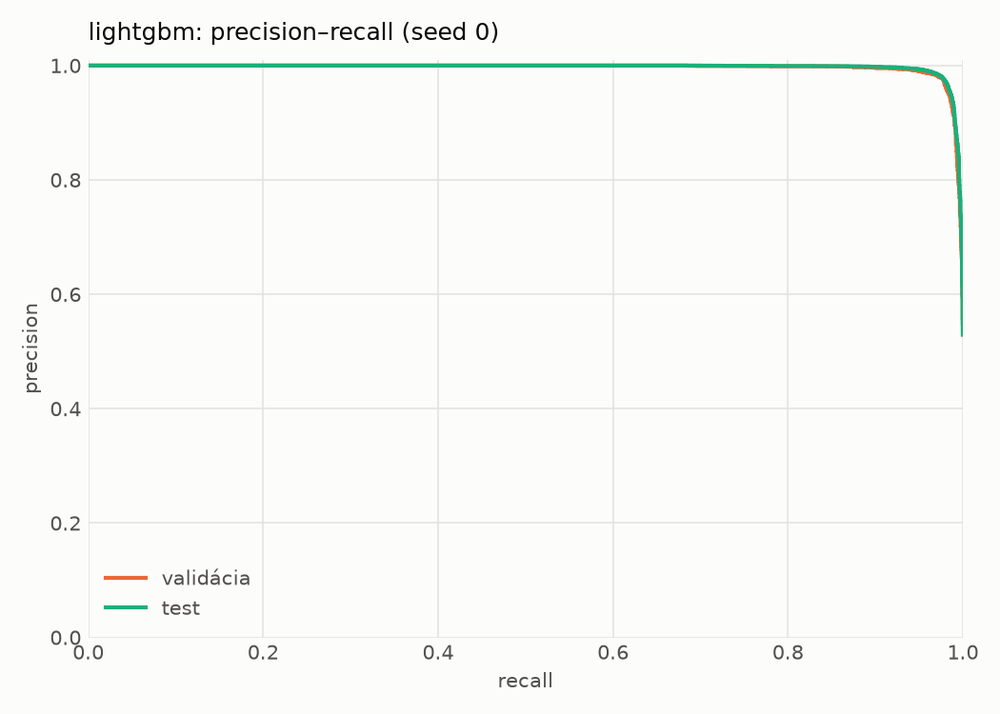
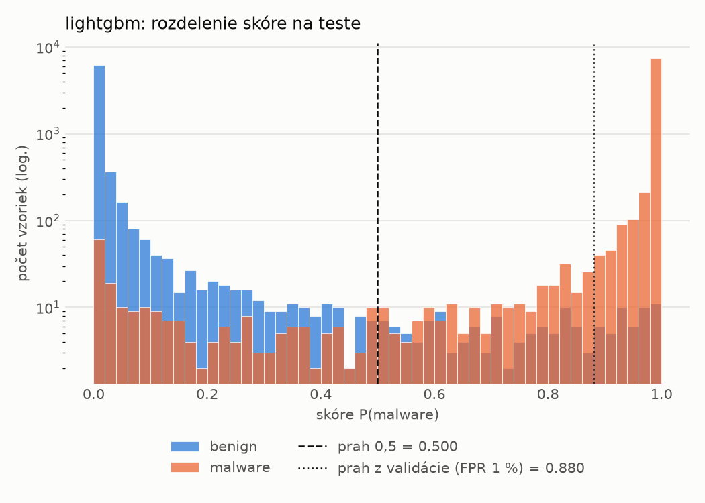
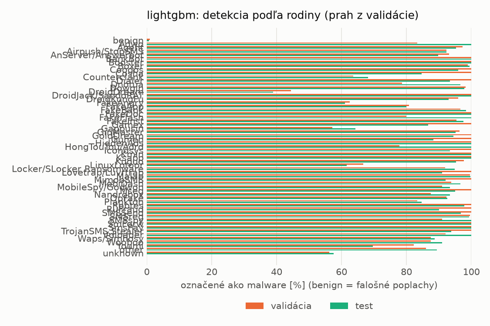
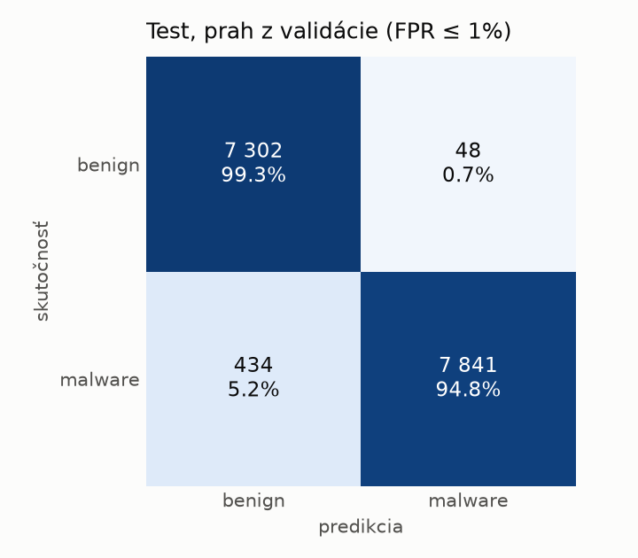
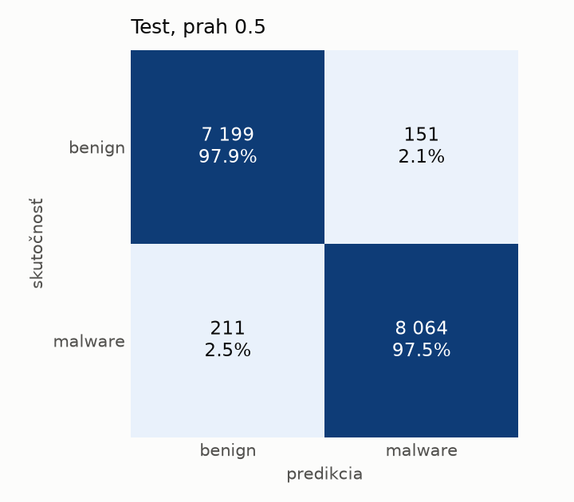
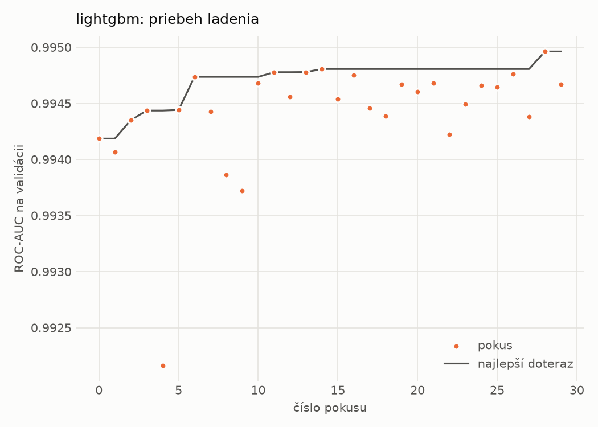
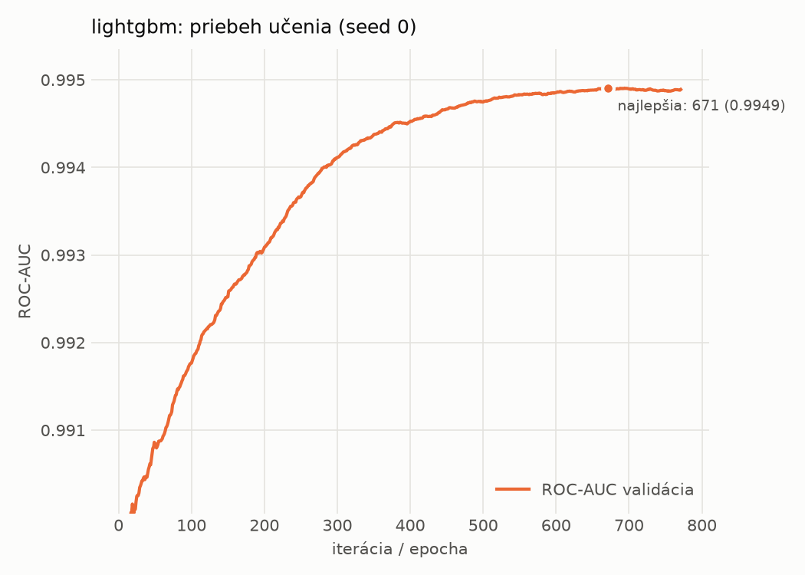

# static/lightgbm – beh `20261122-184829`

> Automaticky generované (`src/training/run_tabular.py`). Konfigurácia: `config.yaml`, protokol: `protocol.yaml`.

- **Model:** `lightgbm` – LightGBM, gradient boosting stromov s early stopping na validácii (pôvodné hodnoty príznakov)
- **Ladenie:** 30 dokončených pokusov (Optuna TPE), cieľ ROC-AUC na validácii, 12.1 min
- **Finálne modely:** seedy [0, 1, 2]; hodnoty sú priemer ± smerodajná odchýlka cez seedy
- **Najlepšie hyperparametre:** `{"num_boost_round": 5000, "early_stopping_rounds": 100, "learning_rate": 0.015567978603457627, "num_leaves": 372, "min_child_samples": 12, "feature_fraction": 0.7551391358223217, "bagging_fraction": 0.6871892431836363, "lambda_l1": 1.3651906778474808e-06, "lambda_l2": 0.003382199534052785}`

## Detekčná kvalita (bez prahu)
| metrika | train (podvzorka) | validácia | test |
|---|---|---|---|
| ROC-AUC | 1.0000 ± 0.0000 | 0.9950 ± 0.0000 | 0.9958 ± 0.0001 |
| PR-AUC | 1.0000 ± 0.0000 | 0.9963 ± 0.0000 | 0.9969 ± 0.0000 |
| TPR pri FPR 1 % | 0.9999 ± 0.0001 | 0.9480 ± 0.0023 | 0.9603 ± 0.0010 |
| TPR pri FPR 0,1 % | 0.9998 ± 0.0000 | 0.7852 ± 0.0038 | 0.8542 ± 0.0038 |
| log loss | 0.0056 ± 0.0029 | 0.0863 ± 0.0034 | 0.0757 ± 0.0021 |
| Brier skóre | 0.0005 ± 0.0004 | 0.0205 ± 0.0001 | 0.0186 ± 0.0001 |

Rozdiel ROC-AUC train − validácia: **0.0050** (veľký rozdiel = preučenie).

## Pri prahu z validácie (FPR ≤ 1% na validácii)
| metrika | train (podvzorka) | validácia | test |
|---|---|---|---|
| accuracy | 0.9938 ± 0.0022 | 0.9678 ± 0.0012 | 0.9685 ± 0.0019 |
| balanced accuracy | 0.9941 ± 0.0021 | 0.9691 ± 0.0011 | 0.9699 ± 0.0018 |
| precision | 1.0000 ± 0.0000 | 0.9909 ± 0.0000 | 0.9942 ± 0.0005 |
| recall (TPR) | 0.9881 ± 0.0042 | 0.9480 ± 0.0023 | 0.9459 ± 0.0040 |
| FPR | 0.0000 ± 0.0000 | 0.0098 ± 0.0000 | 0.0062 ± 0.0005 |
| F1 | 0.9940 ± 0.0021 | 0.9690 ± 0.0012 | 0.9695 ± 0.0019 |
| MCC | 0.9876 ± 0.0044 | 0.9366 ± 0.0023 | 0.9382 ± 0.0035 |

## Pri pevnom prahu 0.5
| metrika | train (podvzorka) | validácia | test |
|---|---|---|---|
| accuracy | 0.9998 ± 0.0001 | 0.9756 ± 0.0001 | 0.9769 ± 0.0001 |
| balanced accuracy | 0.9998 ± 0.0001 | 0.9756 ± 0.0001 | 0.9770 ± 0.0001 |
| precision | 0.9999 ± 0.0001 | 0.9790 ± 0.0004 | 0.9816 ± 0.0001 |
| recall (TPR) | 0.9996 ± 0.0000 | 0.9749 ± 0.0002 | 0.9746 ± 0.0001 |
| FPR | 0.0001 ± 0.0001 | 0.0236 ± 0.0004 | 0.0206 ± 0.0001 |
| F1 | 0.9998 ± 0.0001 | 0.9769 ± 0.0001 | 0.9781 ± 0.0001 |
| MCC | 0.9995 ± 0.0001 | 0.9510 ± 0.0002 | 0.9536 ± 0.0001 |

## Výpočtové nároky (seed 0, testovacia množina)
| meranie | hodnota |
|---|---|
| tréning finálneho modelu | 13.4 s (priemer cez seedy) |
| ladenie spolu | 725 s |
| počet parametrov / uzlov | 498 553 |
| veľkosť modelu na disku | 27.62 MB |
| CPU latencia modelu (batch 1, 1 vlákno) | 0.141 ms (p95 0.179) |
| CPU priepustnosť (24 vlákien) | 106 000 vzoriek/s |

## Grafy
| | |
|---|---|
|  |  |
|  |  |
|  |  |
|  |  |

## Súbory
`metrics.json` (všetky metriky po seedoch vrátane rodín), `timing.json`, `hpo_trials.csv`,
`predictions/<časť>_seed<N>.parquet` (sha256, family, label, score), `model/seed_<N>/`, `log.txt`.
