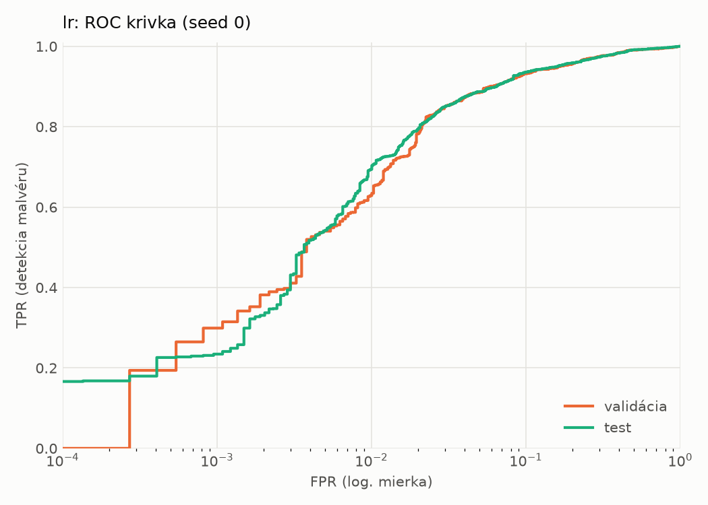
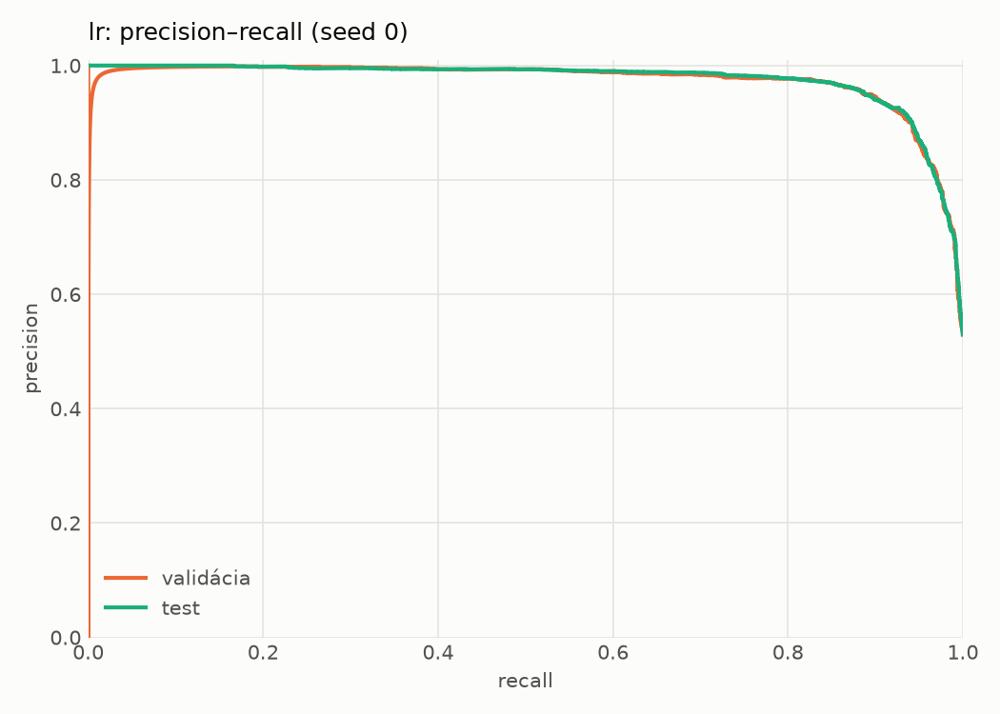
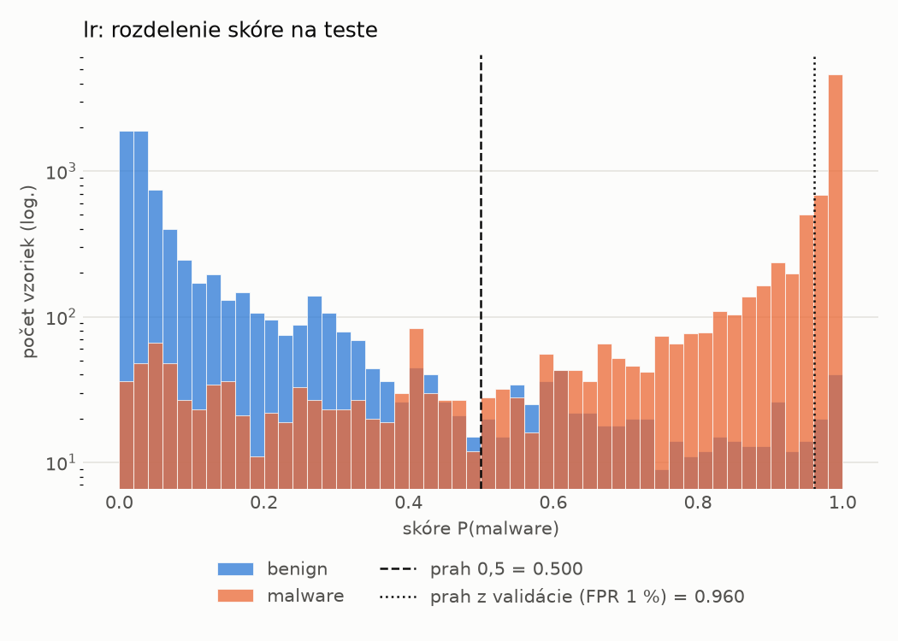
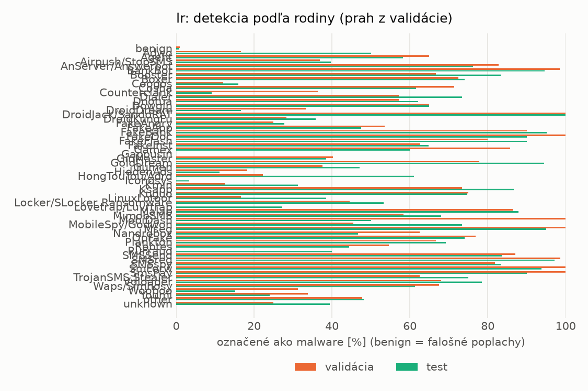
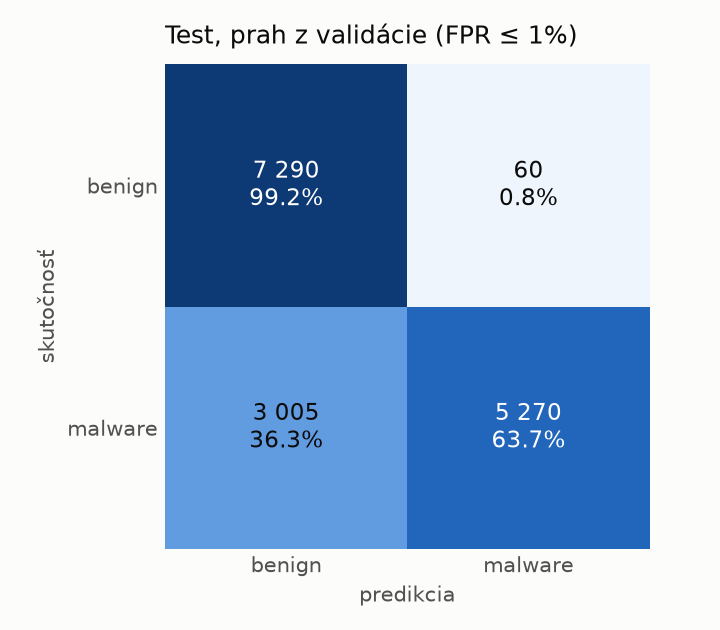
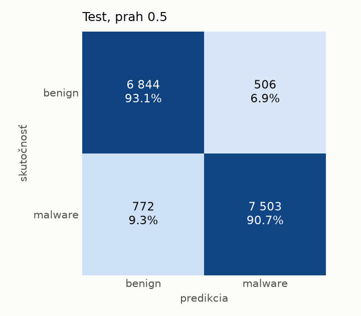
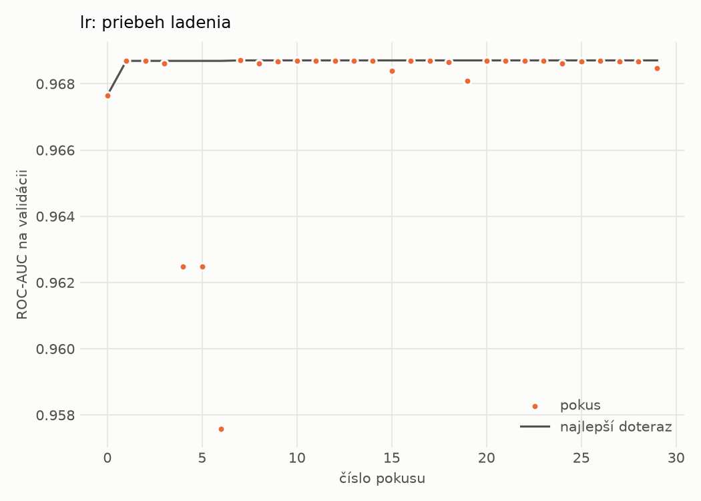

# static/lr – beh `20261122-184714`

> Automaticky generované (`src/training/run_tabular.py`). Konfigurácia: `config.yaml`, protokol: `protocol.yaml`.

- **Model:** `logreg` – logistická regresia s L2 regularizáciou (vstup signed log1p + štandardizácia)
- **Ladenie:** 30 dokončených pokusov (Optuna TPE), cieľ ROC-AUC na validácii, 0.1 min
- **Finálne modely:** seedy [0, 1, 2]; hodnoty sú priemer ± smerodajná odchýlka cez seedy
- **Najlepšie hyperparametre:** `{"max_iter": 2000, "C": 2.1423021757741068}`

## Detekčná kvalita (bez prahu)
| metrika | train (podvzorka) | validácia | test |
|---|---|---|---|
| ROC-AUC | 0.9721 ± 0.0000 | 0.9687 ± 0.0000 | 0.9697 ± 0.0000 |
| PR-AUC | 0.9761 ± 0.0000 | 0.9736 ± 0.0000 | 0.9751 ± 0.0000 |
| TPR pri FPR 1 % | 0.6849 ± 0.0000 | 0.6287 ± 0.0000 | 0.6940 ± 0.0000 |
| TPR pri FPR 0,1 % | 0.3585 ± 0.0000 | 0.2991 ± 0.0000 | 0.2344 ± 0.0000 |
| log loss | 0.2126 ± 0.0000 | 0.2245 ± 0.0000 | 0.2201 ± 0.0000 |
| Brier skóre | 0.0607 ± 0.0000 | 0.0624 ± 0.0000 | 0.0618 ± 0.0000 |

Rozdiel ROC-AUC train − validácia: **0.0034** (veľký rozdiel = preučenie).

## Pri prahu z validácie (FPR ≤ 1% na validácii)
| metrika | train (podvzorka) | validácia | test |
|---|---|---|---|
| accuracy | 0.7909 ± 0.0000 | 0.7987 ± 0.0000 | 0.8038 ± 0.0000 |
| balanced accuracy | 0.8007 ± 0.0000 | 0.8094 ± 0.0000 | 0.8143 ± 0.0000 |
| precision | 0.9901 ± 0.0000 | 0.9864 ± 0.0000 | 0.9887 ± 0.0000 |
| recall (TPR) | 0.6082 ± 0.0000 | 0.6287 ± 0.0000 | 0.6369 ± 0.0000 |
| FPR | 0.0067 ± 0.0000 | 0.0098 ± 0.0000 | 0.0082 ± 0.0000 |
| F1 | 0.7535 ± 0.0000 | 0.7679 ± 0.0000 | 0.7747 ± 0.0000 |
| MCC | 0.6423 ± 0.0000 | 0.6532 ± 0.0000 | 0.6619 ± 0.0000 |

## Pri pevnom prahu 0.5
| metrika | train (podvzorka) | validácia | test |
|---|---|---|---|
| accuracy | 0.9215 ± 0.0000 | 0.9177 ± 0.0000 | 0.9182 ± 0.0000 |
| balanced accuracy | 0.9222 ± 0.0000 | 0.9184 ± 0.0000 | 0.9189 ± 0.0000 |
| precision | 0.9401 ± 0.0000 | 0.9355 ± 0.0000 | 0.9368 ± 0.0000 |
| recall (TPR) | 0.9085 ± 0.0000 | 0.9072 ± 0.0000 | 0.9067 ± 0.0000 |
| FPR | 0.0641 ± 0.0000 | 0.0705 ± 0.0000 | 0.0688 ± 0.0000 |
| F1 | 0.9240 ± 0.0000 | 0.9211 ± 0.0000 | 0.9215 ± 0.0000 |
| MCC | 0.8434 ± 0.0000 | 0.8356 ± 0.0000 | 0.8367 ± 0.0000 |

## Výpočtové nároky (seed 0, testovacia množina)
| meranie | hodnota |
|---|---|
| tréning finálneho modelu | 0.2 s (priemer cez seedy) |
| ladenie spolu | 5 s |
| počet parametrov / uzlov | 165 |
| veľkosť modelu na disku | 0.01 MB |
| transformácia vstupu – latencia (1 vlákno) | 0.005 ms |
| transformácia vstupu – priepustnosť | 1 072 608 vzoriek/s |
| CPU latencia modelu (batch 1, 1 vlákno) | 0.004 ms (p95 0.004) |
| CPU priepustnosť (24 vlákien) | 3 855 169 vzoriek/s |

## Grafy
| | |
|---|---|
|  |  |
|  |  |
|  |  |
|  |  |

## Súbory
`metrics.json` (všetky metriky po seedoch vrátane rodín), `timing.json`, `hpo_trials.csv`,
`predictions/<časť>_seed<N>.parquet` (sha256, family, label, score), `model/seed_<N>/`, `log.txt`.
