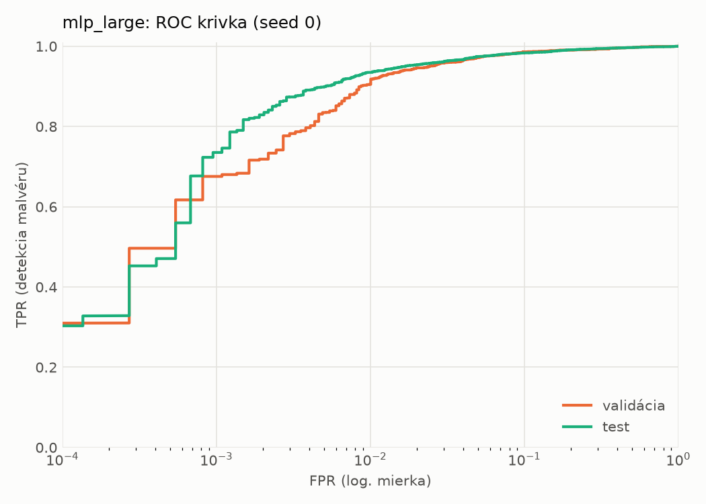
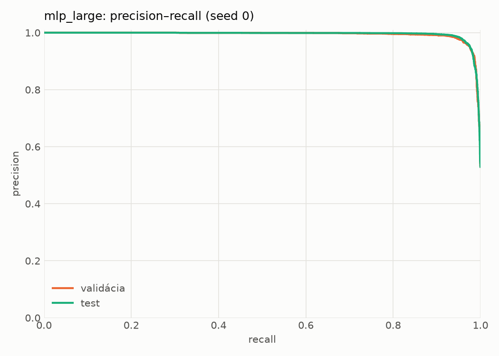
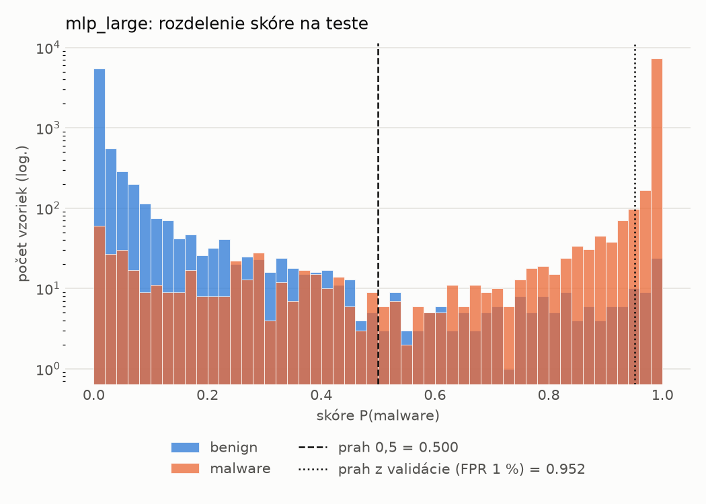
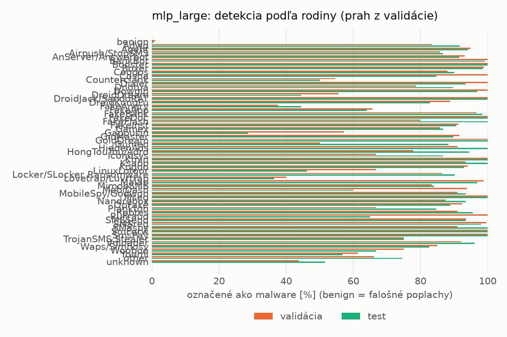
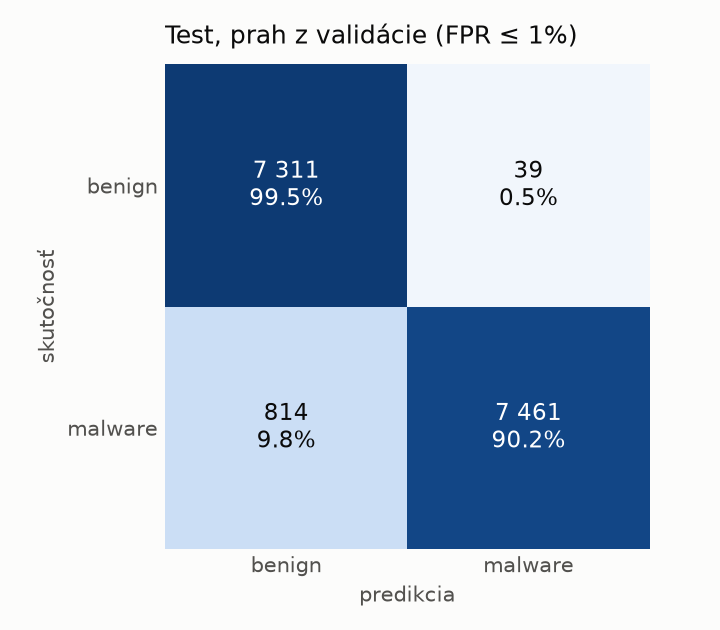
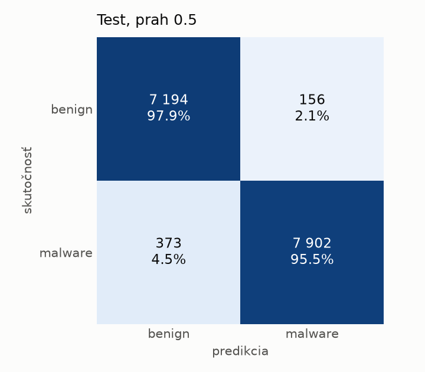
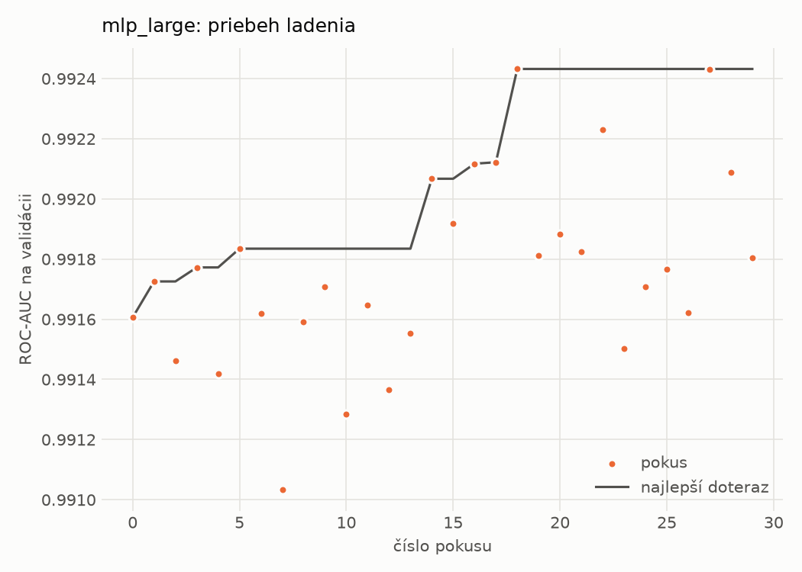
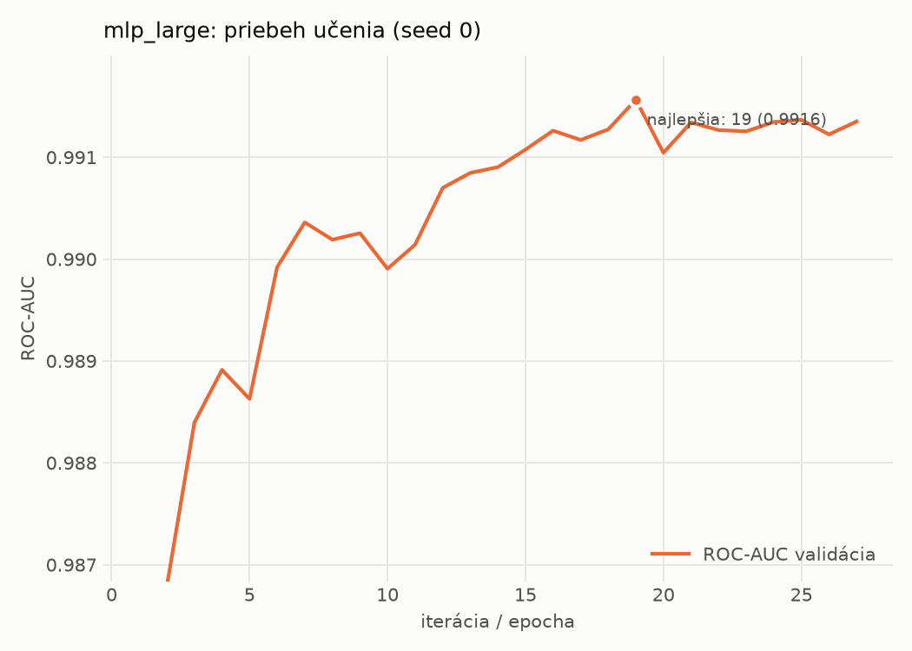

# static/mlp_large – beh `20261122-190815`

> Automaticky generované (`src/training/run_tabular.py`). Konfigurácia: `config.yaml`, protokol: `protocol.yaml`.

- **Model:** `mlp` – veľká neurónová sieť (3–5 skrytých vrstiev, 512–2048 neurónov), kandidát na učiteľa
- **Ladenie:** 30 dokončených pokusov (Optuna TPE), cieľ ROC-AUC na validácii, 6.2 min
- **Finálne modely:** seedy [0, 1, 2]; hodnoty sú priemer ± smerodajná odchýlka cez seedy
- **Najlepšie hyperparametre:** `{"max_epochs": 100, "patience": 8, "hidden_layers": 3, "hidden_width": 512, "width_decay": 0.5, "dropout": 0.18301180344828658, "lr": 0.000378062291460712, "weight_decay": 1.421525321060219e-06, "batch_size": 256}`

## Detekčná kvalita (bez prahu)
| metrika | train (podvzorka) | validácia | test |
|---|---|---|---|
| ROC-AUC | 0.9980 ± 0.0002 | 0.9918 ± 0.0003 | 0.9919 ± 0.0004 |
| PR-AUC | 0.9985 ± 0.0002 | 0.9934 ± 0.0004 | 0.9940 ± 0.0002 |
| TPR pri FPR 1 % | 0.9747 ± 0.0030 | 0.9086 ± 0.0041 | 0.9369 ± 0.0025 |
| TPR pri FPR 0,1 % | 0.9341 ± 0.0138 | 0.6249 ± 0.0464 | 0.7349 ± 0.0117 |
| log loss | 0.0511 ± 0.0028 | 0.1133 ± 0.0022 | 0.1061 ± 0.0053 |
| Brier skóre | 0.0141 ± 0.0008 | 0.0278 ± 0.0007 | 0.0258 ± 0.0006 |

Rozdiel ROC-AUC train − validácia: **0.0062** (veľký rozdiel = preučenie).

## Pri prahu z validácie (FPR ≤ 1% na validácii)
| metrika | train (podvzorka) | validácia | test |
|---|---|---|---|
| accuracy | 0.9566 ± 0.0038 | 0.9470 ± 0.0022 | 0.9471 ± 0.0035 |
| balanced accuracy | 0.9587 ± 0.0036 | 0.9494 ± 0.0021 | 0.9497 ± 0.0033 |
| precision | 0.9995 ± 0.0003 | 0.9906 ± 0.0002 | 0.9943 ± 0.0005 |
| recall (TPR) | 0.9178 ± 0.0071 | 0.9086 ± 0.0041 | 0.9054 ± 0.0069 |
| FPR | 0.0005 ± 0.0003 | 0.0097 ± 0.0002 | 0.0059 ± 0.0005 |
| F1 | 0.9569 ± 0.0039 | 0.9478 ± 0.0023 | 0.9477 ± 0.0037 |
| MCC | 0.9167 ± 0.0069 | 0.8977 ± 0.0040 | 0.8985 ± 0.0064 |

## Pri pevnom prahu 0.5
| metrika | train (podvzorka) | validácia | test |
|---|---|---|---|
| accuracy | 0.9815 ± 0.0010 | 0.9643 ± 0.0006 | 0.9676 ± 0.0014 |
| balanced accuracy | 0.9821 ± 0.0010 | 0.9646 ± 0.0006 | 0.9682 ± 0.0014 |
| precision | 0.9932 ± 0.0012 | 0.9741 ± 0.0014 | 0.9814 ± 0.0007 |
| recall (TPR) | 0.9715 ± 0.0008 | 0.9580 ± 0.0013 | 0.9569 ± 0.0024 |
| FPR | 0.0074 ± 0.0013 | 0.0287 ± 0.0016 | 0.0204 ± 0.0008 |
| F1 | 0.9822 ± 0.0009 | 0.9660 ± 0.0005 | 0.9690 ± 0.0014 |
| MCC | 0.9633 ± 0.0020 | 0.9285 ± 0.0012 | 0.9353 ± 0.0028 |

## Výpočtové nároky (seed 0, testovacia množina)
| meranie | hodnota |
|---|---|
| tréning finálneho modelu | 14.4 s (priemer cez seedy) |
| ladenie spolu | 370 s |
| počet parametrov / uzlov | 250 625 |
| veľkosť modelu na disku | 1.02 MB |
| transformácia vstupu – latencia (1 vlákno) | 0.014 ms |
| transformácia vstupu – priepustnosť | 621 792 vzoriek/s |
| CPU latencia modelu (batch 1, 1 vlákno) | 0.114 ms (p95 0.313) |
| CPU priepustnosť (24 vlákien) | 786 856 vzoriek/s |
| GPU latencia (batch 1) | 0.502 ms (p95 0.537) |
| GPU priepustnosť | 1 453 191 vzoriek/s |
| GPU špičková pamäť | 145 MB |

## Grafy
| | |
|---|---|
|  |  |
|  |  |
|  |  |
|  |  |

## Súbory
`metrics.json` (všetky metriky po seedoch vrátane rodín), `timing.json`, `hpo_trials.csv`,
`predictions/<časť>_seed<N>.parquet` (sha256, family, label, score), `model/seed_<N>/`, `log.txt`.
