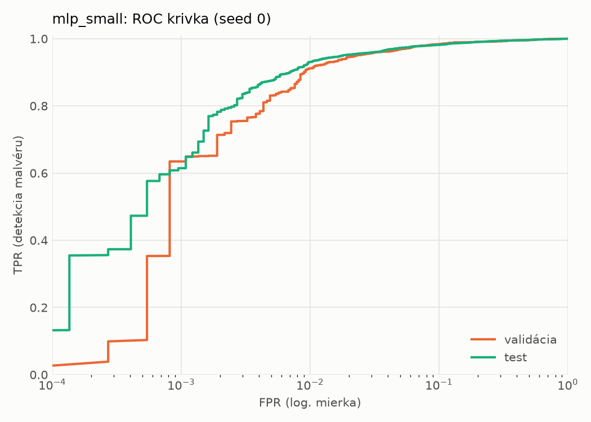
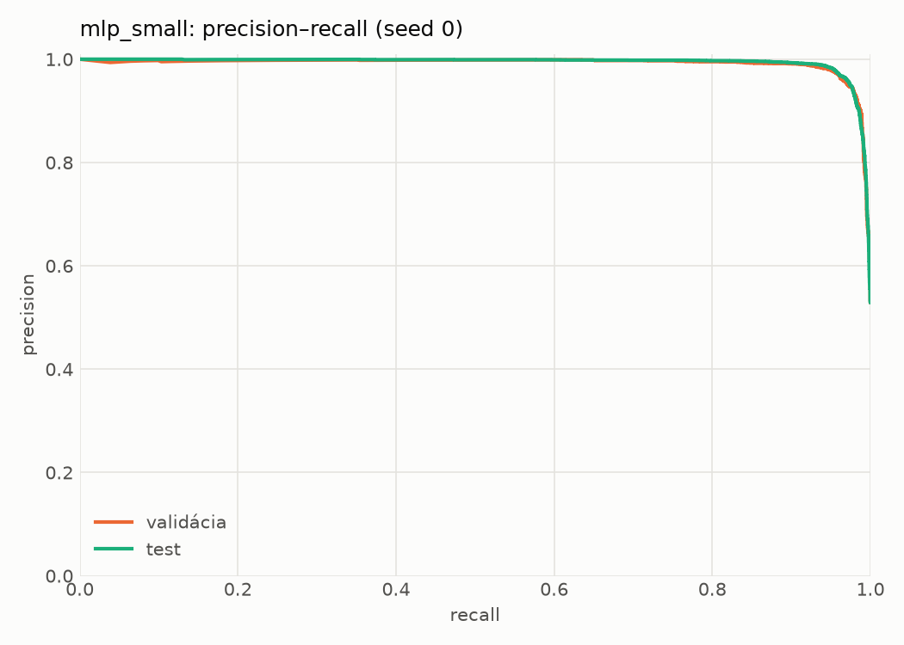
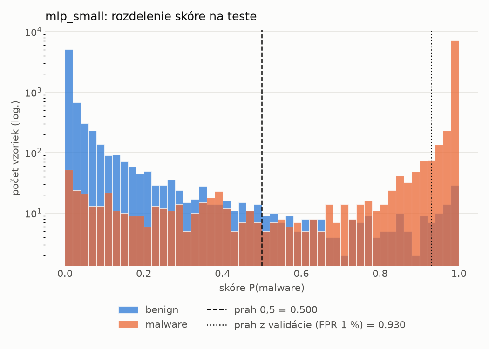
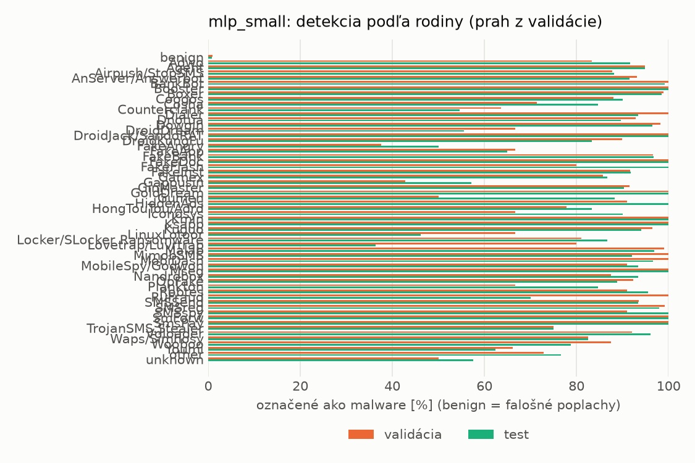
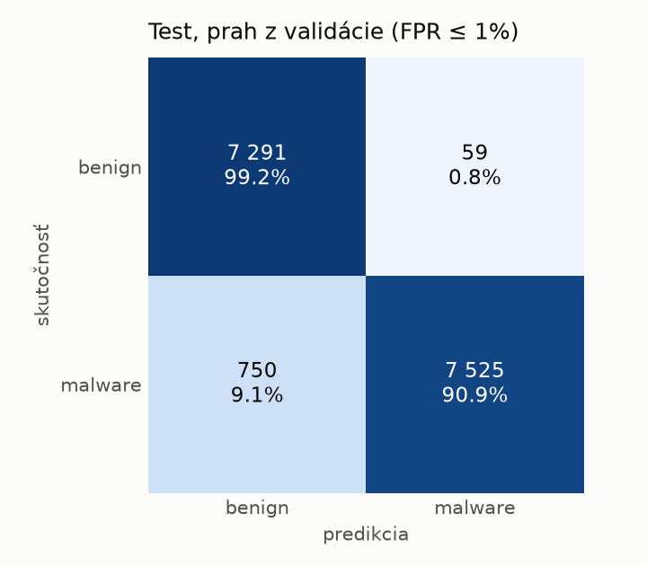
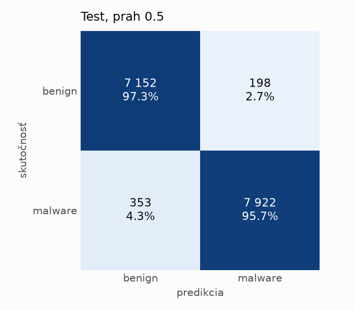
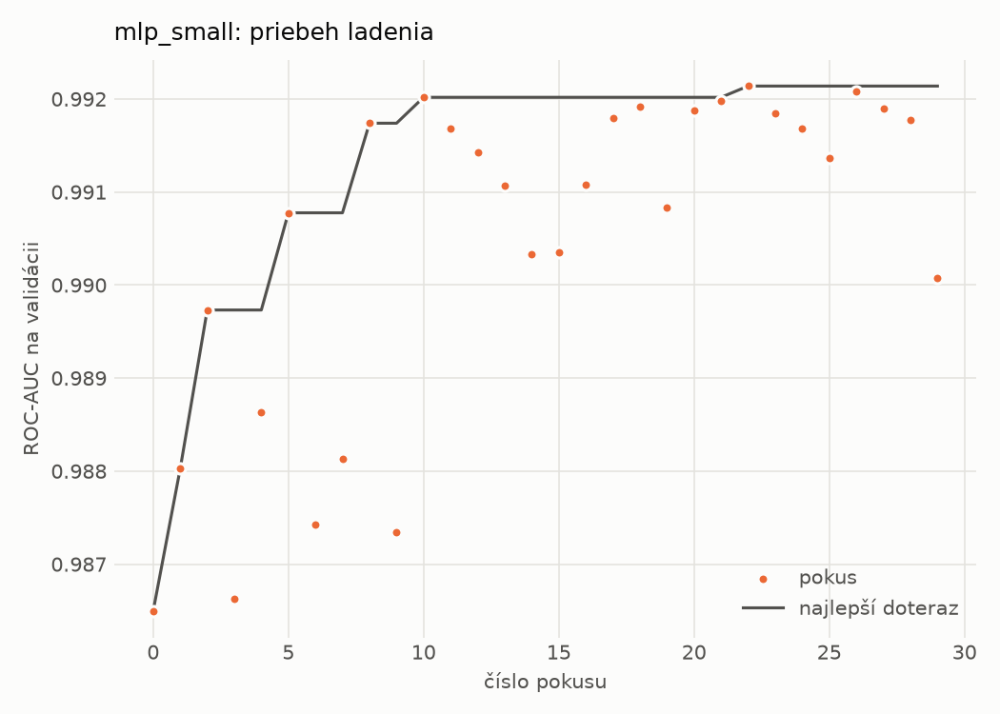
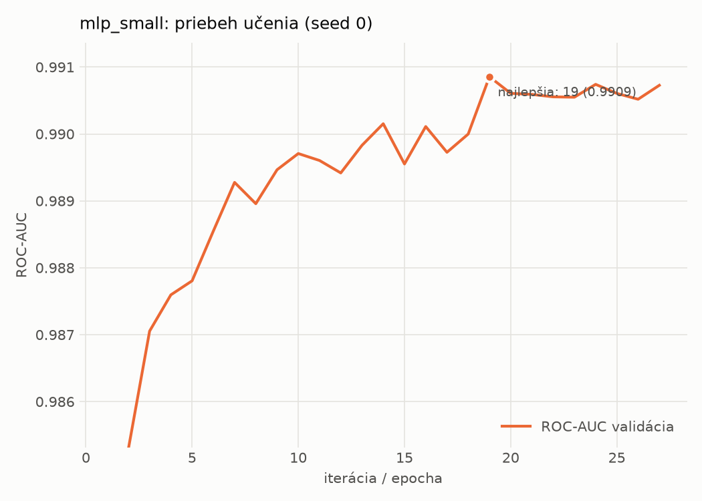

# static/mlp_small – beh `20261122-190134`

> Automaticky generované (`src/training/run_tabular.py`). Konfigurácia: `config.yaml`, protokol: `protocol.yaml`.

- **Model:** `mlp` – malá neurónová sieť (1–2 skryté vrstvy), kandidát na ľahkého študenta
- **Ladenie:** 30 dokončených pokusov (Optuna TPE), cieľ ROC-AUC na validácii, 6.0 min
- **Finálne modely:** seedy [0, 1, 2]; hodnoty sú priemer ± smerodajná odchýlka cez seedy
- **Najlepšie hyperparametre:** `{"width_decay": 0.5, "max_epochs": 100, "patience": 8, "hidden_layers": 2, "hidden_width": 256, "dropout": 0.05428236214064427, "lr": 0.00041374253133077954, "weight_decay": 5.569517746104647e-06, "batch_size": 256}`

## Detekčná kvalita (bez prahu)
| metrika | train (podvzorka) | validácia | test |
|---|---|---|---|
| ROC-AUC | 0.9982 ± 0.0005 | 0.9915 ± 0.0007 | 0.9919 ± 0.0008 |
| PR-AUC | 0.9986 ± 0.0004 | 0.9926 ± 0.0006 | 0.9938 ± 0.0007 |
| TPR pri FPR 1 % | 0.9769 ± 0.0056 | 0.9167 ± 0.0048 | 0.9382 ± 0.0079 |
| TPR pri FPR 0,1 % | 0.9437 ± 0.0303 | 0.5877 ± 0.0449 | 0.7139 ± 0.0882 |
| log loss | 0.0478 ± 0.0074 | 0.1140 ± 0.0016 | 0.1064 ± 0.0062 |
| Brier skóre | 0.0128 ± 0.0021 | 0.0278 ± 0.0011 | 0.0253 ± 0.0018 |

Rozdiel ROC-AUC train − validácia: **0.0067** (veľký rozdiel = preučenie).

## Pri prahu z validácie (FPR ≤ 1% na validácii)
| metrika | train (podvzorka) | validácia | test |
|---|---|---|---|
| accuracy | 0.9608 ± 0.0041 | 0.9513 ± 0.0026 | 0.9505 ± 0.0028 |
| balanced accuracy | 0.9626 ± 0.0039 | 0.9535 ± 0.0024 | 0.9528 ± 0.0026 |
| precision | 0.9991 ± 0.0003 | 0.9906 ± 0.0000 | 0.9930 ± 0.0009 |
| recall (TPR) | 0.9262 ± 0.0076 | 0.9167 ± 0.0048 | 0.9129 ± 0.0044 |
| FPR | 0.0009 ± 0.0003 | 0.0098 ± 0.0000 | 0.0073 ± 0.0009 |
| F1 | 0.9612 ± 0.0042 | 0.9522 ± 0.0026 | 0.9513 ± 0.0028 |
| MCC | 0.9244 ± 0.0076 | 0.9055 ± 0.0047 | 0.9044 ± 0.0052 |

## Pri pevnom prahu 0.5
| metrika | train (podvzorka) | validácia | test |
|---|---|---|---|
| accuracy | 0.9826 ± 0.0028 | 0.9640 ± 0.0014 | 0.9681 ± 0.0031 |
| balanced accuracy | 0.9830 ± 0.0028 | 0.9642 ± 0.0014 | 0.9686 ± 0.0030 |
| precision | 0.9914 ± 0.0020 | 0.9705 ± 0.0017 | 0.9781 ± 0.0023 |
| recall (TPR) | 0.9753 ± 0.0037 | 0.9613 ± 0.0013 | 0.9614 ± 0.0042 |
| FPR | 0.0093 ± 0.0022 | 0.0329 ± 0.0020 | 0.0243 ± 0.0025 |
| F1 | 0.9833 ± 0.0027 | 0.9659 ± 0.0013 | 0.9697 ± 0.0029 |
| MCC | 0.9652 ± 0.0056 | 0.9279 ± 0.0027 | 0.9363 ± 0.0061 |

## Výpočtové nároky (seed 0, testovacia množina)
| meranie | hodnota |
|---|---|
| tréning finálneho modelu | 12.7 s (priemer cez seedy) |
| ladenie spolu | 361 s |
| počet parametrov / uzlov | 76 033 |
| veľkosť modelu na disku | 0.32 MB |
| transformácia vstupu – latencia (1 vlákno) | 0.015 ms |
| transformácia vstupu – priepustnosť | 552 663 vzoriek/s |
| CPU latencia modelu (batch 1, 1 vlákno) | 0.122 ms (p95 0.143) |
| CPU priepustnosť (24 vlákien) | 1 044 242 vzoriek/s |
| GPU latencia (batch 1) | 0.658 ms (p95 0.748) |
| GPU priepustnosť | 2 059 200 vzoriek/s |
| GPU špičková pamäť | 86 MB |

## Grafy
| | |
|---|---|
|  |  |
|  |  |
|  |  |
|  |  |

## Súbory
`metrics.json` (všetky metriky po seedoch vrátane rodín), `timing.json`, `hpo_trials.csv`,
`predictions/<časť>_seed<N>.parquet` (sha256, family, label, score), `model/seed_<N>/`, `log.txt`.
