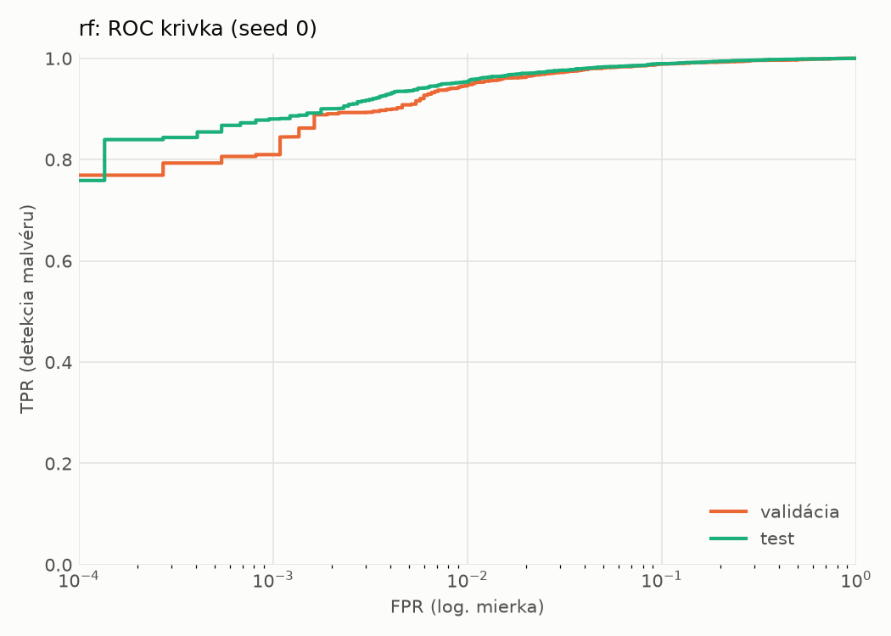
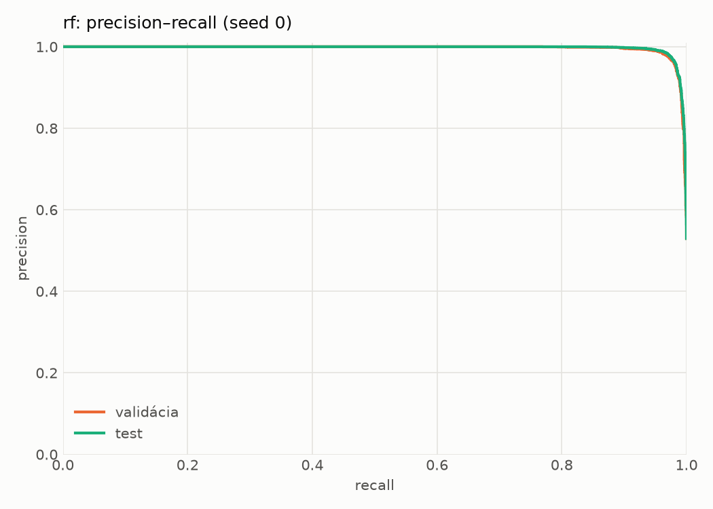
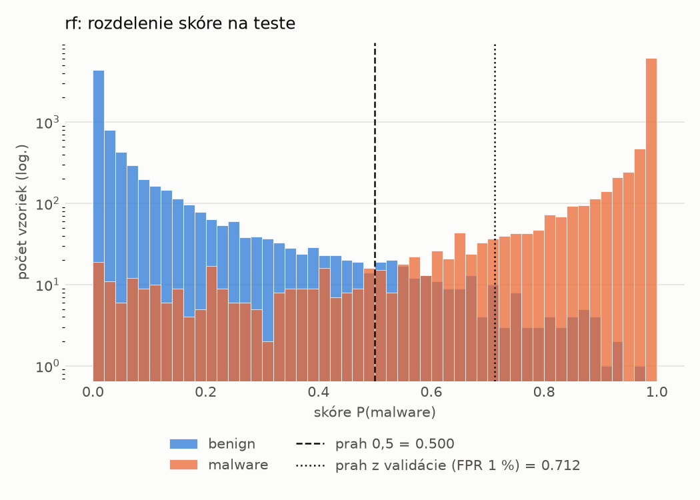
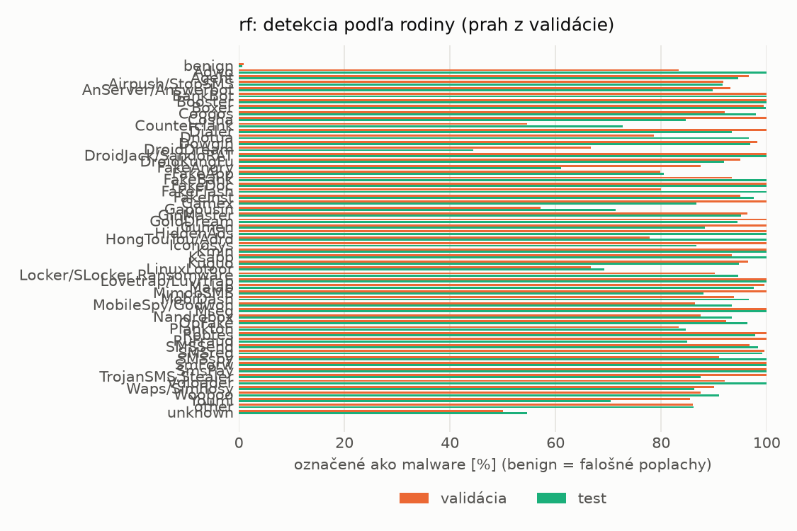
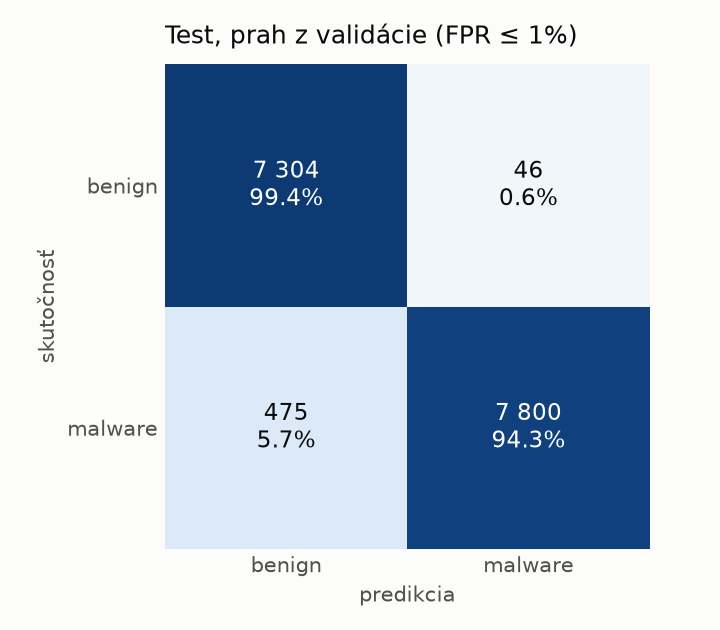
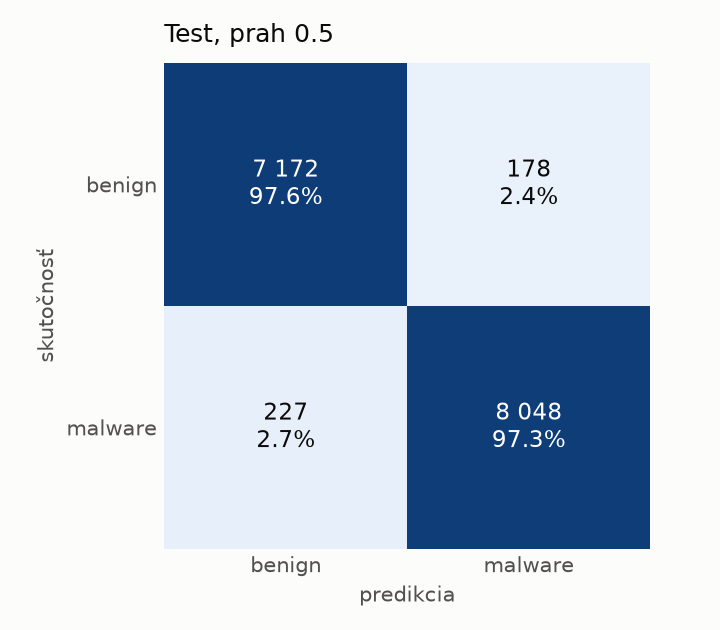
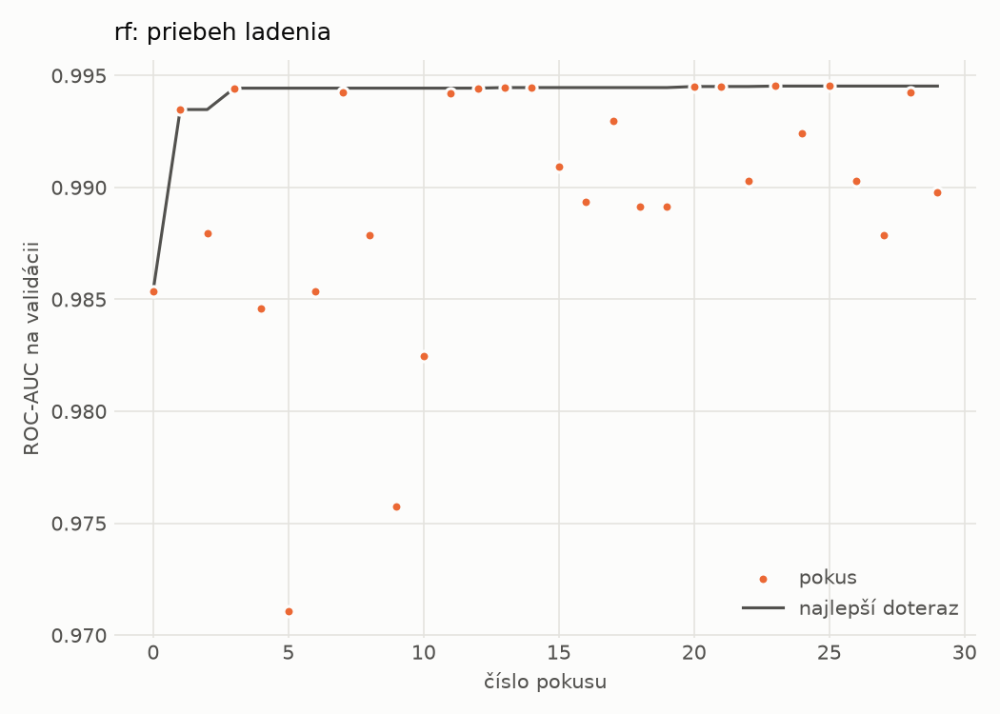

# static/rf – beh `20261122-184723`

> Automaticky generované (`src/training/run_tabular.py`). Konfigurácia: `config.yaml`, protokol: `protocol.yaml`.

- **Model:** `random_forest` – Random Forest (pôvodné hodnoty príznakov)
- **Ladenie:** 30 dokončených pokusov (Optuna TPE), cieľ ROC-AUC na validácii, 0.8 min
- **Finálne modely:** seedy [0, 1, 2]; hodnoty sú priemer ± smerodajná odchýlka cez seedy
- **Najlepšie hyperparametre:** `{"n_estimators": 400, "max_depth": 32, "min_samples_leaf": 1, "max_features": "sqrt"}`

## Detekčná kvalita (bez prahu)
| metrika | train (podvzorka) | validácia | test |
|---|---|---|---|
| ROC-AUC | 1.0000 ± 0.0000 | 0.9945 ± 0.0000 | 0.9955 ± 0.0000 |
| PR-AUC | 1.0000 ± 0.0000 | 0.9960 ± 0.0000 | 0.9967 ± 0.0000 |
| TPR pri FPR 1 % | 1.0000 ± 0.0000 | 0.9461 ± 0.0004 | 0.9554 ± 0.0022 |
| TPR pri FPR 0,1 % | 1.0000 ± 0.0000 | 0.8256 ± 0.0139 | 0.8787 ± 0.0027 |
| log loss | 0.0252 ± 0.0002 | 0.0895 ± 0.0001 | 0.0848 ± 0.0002 |
| Brier skóre | 0.0036 ± 0.0001 | 0.0234 ± 0.0000 | 0.0219 ± 0.0001 |

Rozdiel ROC-AUC train − validácia: **0.0055** (veľký rozdiel = preučenie).

## Pri prahu z validácie (FPR ≤ 1% na validácii)
| metrika | train (podvzorka) | validácia | test |
|---|---|---|---|
| accuracy | 0.9917 ± 0.0006 | 0.9669 ± 0.0003 | 0.9659 ± 0.0007 |
| balanced accuracy | 0.9921 ± 0.0006 | 0.9682 ± 0.0003 | 0.9675 ± 0.0006 |
| precision | 1.0000 ± 0.0000 | 0.9910 ± 0.0001 | 0.9945 ± 0.0003 |
| recall (TPR) | 0.9842 ± 0.0012 | 0.9461 ± 0.0004 | 0.9408 ± 0.0015 |
| FPR | 0.0000 ± 0.0000 | 0.0097 ± 0.0002 | 0.0059 ± 0.0003 |
| F1 | 0.9920 ± 0.0006 | 0.9680 ± 0.0003 | 0.9669 ± 0.0007 |
| MCC | 0.9835 ± 0.0012 | 0.9348 ± 0.0006 | 0.9333 ± 0.0012 |

## Pri pevnom prahu 0.5
| metrika | train (podvzorka) | validácia | test |
|---|---|---|---|
| accuracy | 0.9992 ± 0.0002 | 0.9710 ± 0.0003 | 0.9739 ± 0.0001 |
| balanced accuracy | 0.9992 ± 0.0002 | 0.9709 ± 0.0003 | 0.9740 ± 0.0001 |
| precision | 1.0000 ± 0.0000 | 0.9723 ± 0.0003 | 0.9785 ± 0.0002 |
| recall (TPR) | 0.9985 ± 0.0004 | 0.9729 ± 0.0002 | 0.9721 ± 0.0004 |
| FPR | 0.0000 ± 0.0000 | 0.0312 ± 0.0003 | 0.0240 ± 0.0002 |
| F1 | 0.9992 ± 0.0002 | 0.9726 ± 0.0003 | 0.9753 ± 0.0001 |
| MCC | 0.9984 ± 0.0004 | 0.9418 ± 0.0005 | 0.9477 ± 0.0003 |

## Výpočtové nároky (seed 0, testovacia množina)
| meranie | hodnota |
|---|---|
| tréning finálneho modelu | 2.2 s (priemer cez seedy) |
| ladenie spolu | 51 s |
| počet parametrov / uzlov | 2 643 426 |
| veľkosť modelu na disku | 211.85 MB |
| CPU latencia modelu (batch 1, 1 vlákno) | 12.189 ms (p95 12.527) |
| CPU priepustnosť (24 vlákien) | 151 388 vzoriek/s |

## Grafy
| | |
|---|---|
|  |  |
|  |  |
|  |  |
|  |  |

## Súbory
`metrics.json` (všetky metriky po seedoch vrátane rodín), `timing.json`, `hpo_trials.csv`,
`predictions/<časť>_seed<N>.parquet` (sha256, family, label, score), `model/seed_<N>/`, `log.txt`.
