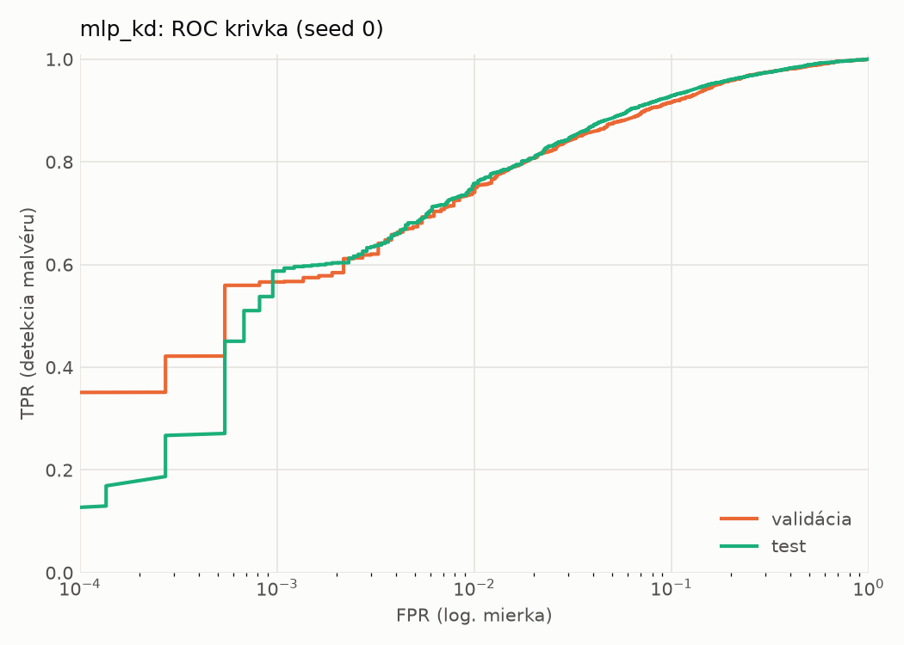
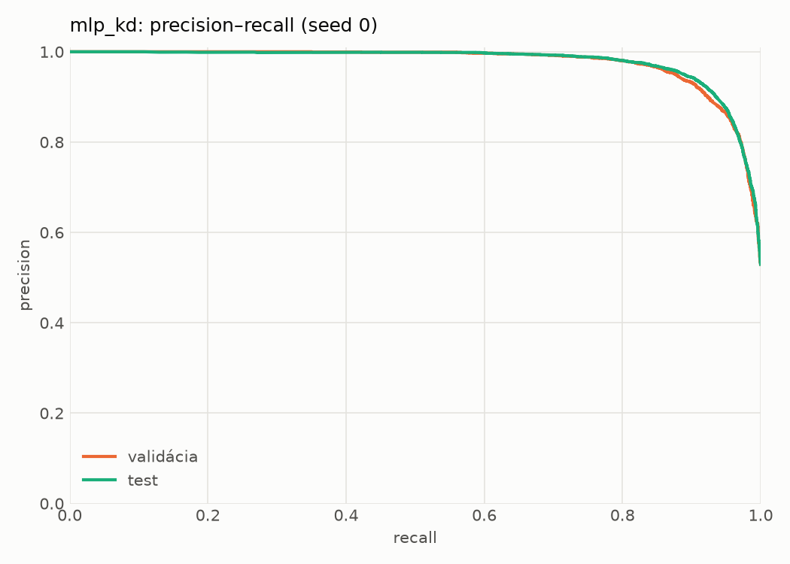
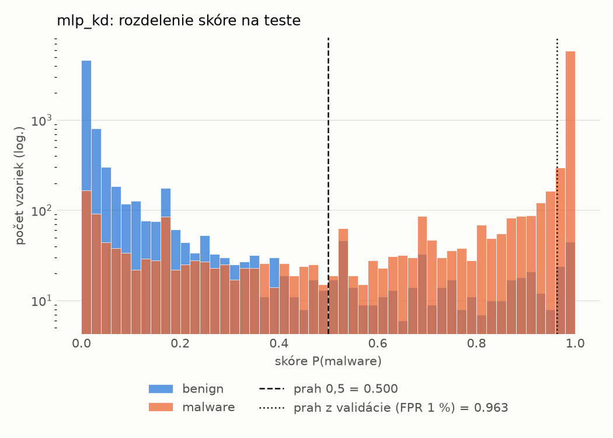
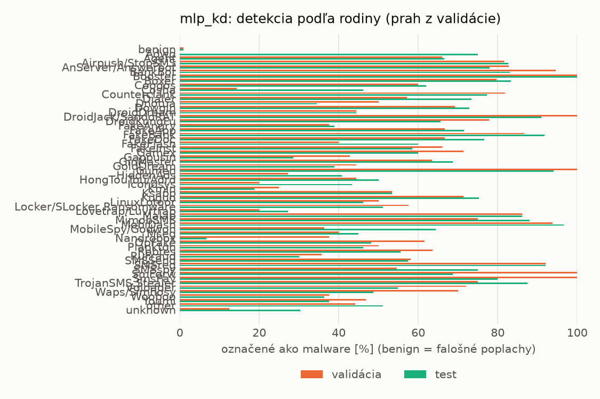
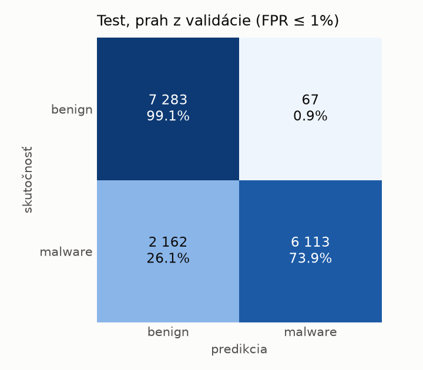
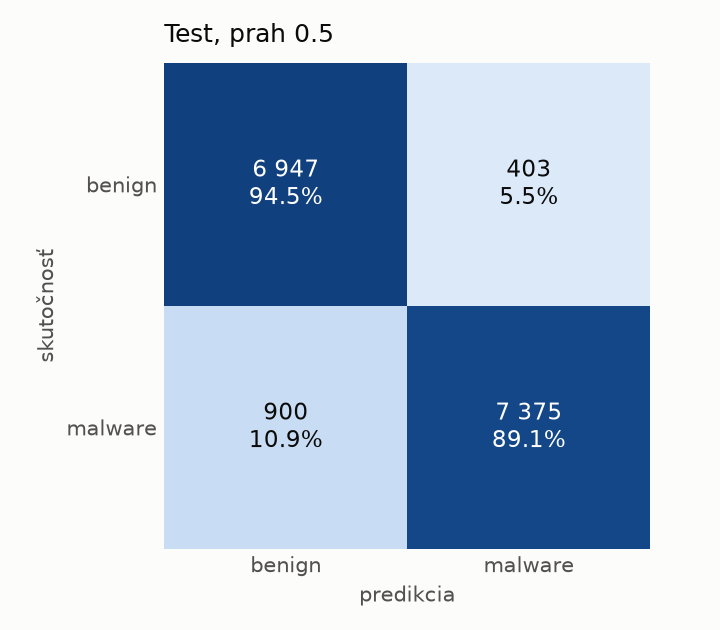
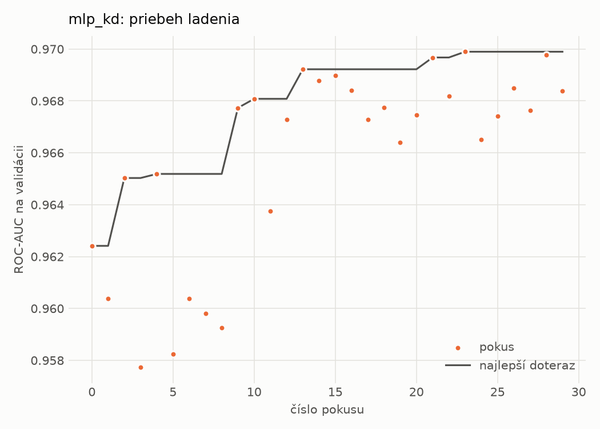
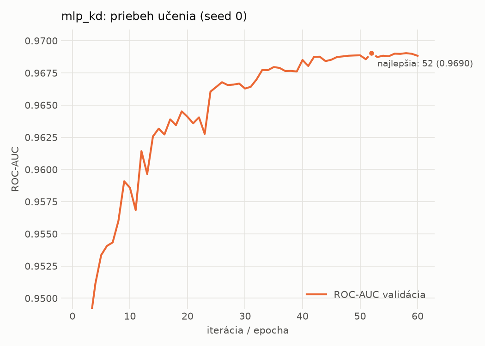

# dynamic/mlp_kd – beh `20261122-205301`

> Automaticky generované (`src/training/run_tabular.py`). Konfigurácia: `config.yaml`, protokol: `protocol.yaml`.

- **Model:** `mlp` – študent – malé MLP učené destiláciou z hybridného učiteľa
- **Ladenie:** 30 dokončených pokusov (Optuna TPE), cieľ ROC-AUC na validácii, 5.6 min
- **Finálne modely:** seedy [0, 1, 2]; hodnoty sú priemer ± smerodajná odchýlka cez seedy
- **Najlepšie hyperparametre:** `{"hidden_layers": 1, "max_epochs": 100, "patience": 8, "hidden_width": 64, "dropout": 0.03643763137351852, "lr": 0.0028753520300020953, "weight_decay": 0.00022273244560059002, "batch_size": 512, "kd_alpha": 0.33129867518829337, "kd_temperature": 1.9602594769462303}`

## Detekčná kvalita (bez prahu)
| metrika | train (podvzorka) | validácia | test |
|---|---|---|---|
| ROC-AUC | 0.9763 ± 0.0009 | 0.9698 ± 0.0008 | 0.9722 ± 0.0013 |
| PR-AUC | 0.9820 ± 0.0009 | 0.9771 ± 0.0005 | 0.9785 ± 0.0009 |
| TPR pri FPR 1 % | 0.8092 ± 0.0060 | 0.7524 ± 0.0105 | 0.7549 ± 0.0049 |
| TPR pri FPR 0,1 % | 0.5965 ± 0.0372 | 0.5698 ± 0.0086 | 0.5760 ± 0.0290 |
| log loss | 0.2040 ± 0.0039 | 0.2519 ± 0.0030 | 0.2353 ± 0.0055 |
| Brier skóre | 0.0542 ± 0.0013 | 0.0675 ± 0.0008 | 0.0634 ± 0.0013 |

Rozdiel ROC-AUC train − validácia: **0.0065** (veľký rozdiel = preučenie).

## Pri prahu z validácie (FPR ≤ 1% na validácii)
| metrika | train (podvzorka) | validácia | test |
|---|---|---|---|
| accuracy | 0.8744 ± 0.0050 | 0.8643 ± 0.0056 | 0.8626 ± 0.0048 |
| balanced accuracy | 0.8803 ± 0.0048 | 0.8713 ± 0.0053 | 0.8697 ± 0.0045 |
| precision | 0.9937 ± 0.0006 | 0.9886 ± 0.0002 | 0.9886 ± 0.0005 |
| recall (TPR) | 0.7659 ± 0.0099 | 0.7524 ± 0.0105 | 0.7492 ± 0.0095 |
| FPR | 0.0053 ± 0.0005 | 0.0098 ± 0.0000 | 0.0098 ± 0.0006 |
| F1 | 0.8650 ± 0.0062 | 0.8545 ± 0.0069 | 0.8524 ± 0.0060 |
| MCC | 0.7737 ± 0.0081 | 0.7557 ± 0.0090 | 0.7529 ± 0.0076 |

## Pri pevnom prahu 0.5
| metrika | train (podvzorka) | validácia | test |
|---|---|---|---|
| accuracy | 0.9308 ± 0.0030 | 0.9112 ± 0.0015 | 0.9178 ± 0.0018 |
| balanced accuracy | 0.9320 ± 0.0029 | 0.9125 ± 0.0013 | 0.9194 ± 0.0017 |
| precision | 0.9590 ± 0.0011 | 0.9393 ± 0.0041 | 0.9503 ± 0.0022 |
| recall (TPR) | 0.9071 ± 0.0062 | 0.8898 ± 0.0062 | 0.8914 ± 0.0044 |
| FPR | 0.0430 ± 0.0013 | 0.0648 ± 0.0050 | 0.0525 ± 0.0026 |
| F1 | 0.9323 ± 0.0032 | 0.9139 ± 0.0017 | 0.9199 ± 0.0019 |
| MCC | 0.8630 ± 0.0057 | 0.8236 ± 0.0025 | 0.8374 ± 0.0034 |

## Výpočtové nároky (seed 0, testovacia množina)
| meranie | hodnota |
|---|---|
| tréning finálneho modelu | 13.2 s (priemer cez seedy) |
| ladenie spolu | 334 s |
| počet parametrov / uzlov | 8 641 |
| veľkosť modelu na disku | 0.04 MB |
| transformácia vstupu – latencia (1 vlákno) | 0.015 ms |
| transformácia vstupu – priepustnosť | 1 179 753 vzoriek/s |
| CPU latencia modelu (batch 1, 1 vlákno) | 0.066 ms (p95 0.073) |
| CPU priepustnosť (24 vlákien) | 6 561 542 vzoriek/s |
| GPU latencia (batch 1) | 0.270 ms (p95 0.297) |
| GPU priepustnosť | 2 983 977 vzoriek/s |
| GPU špičková pamäť | 63 MB |

## Grafy
| | |
|---|---|
|  |  |
|  |  |
|  |  |
|  |  |

## Súbory
`metrics.json` (všetky metriky po seedoch vrátane rodín), `timing.json`, `hpo_trials.csv`,
`predictions/<časť>_seed<N>.parquet` (sha256, family, label, score), `model/seed_<N>/`, `log.txt`.
