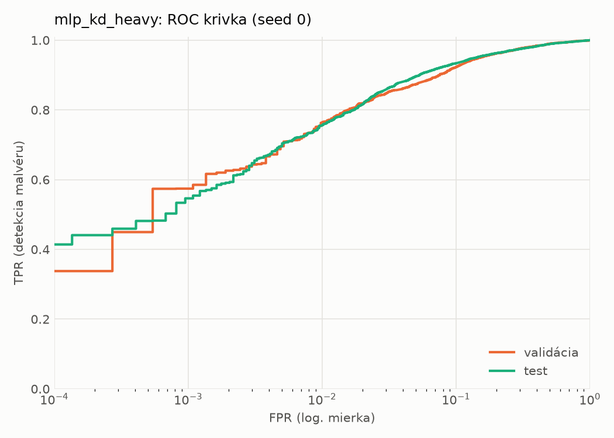
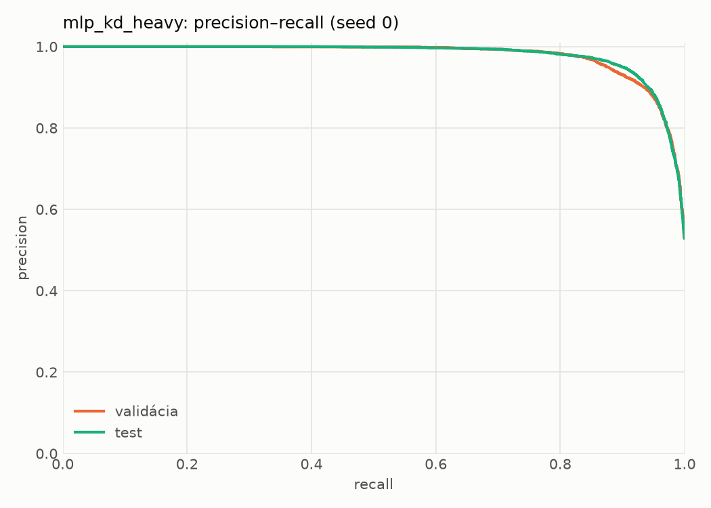
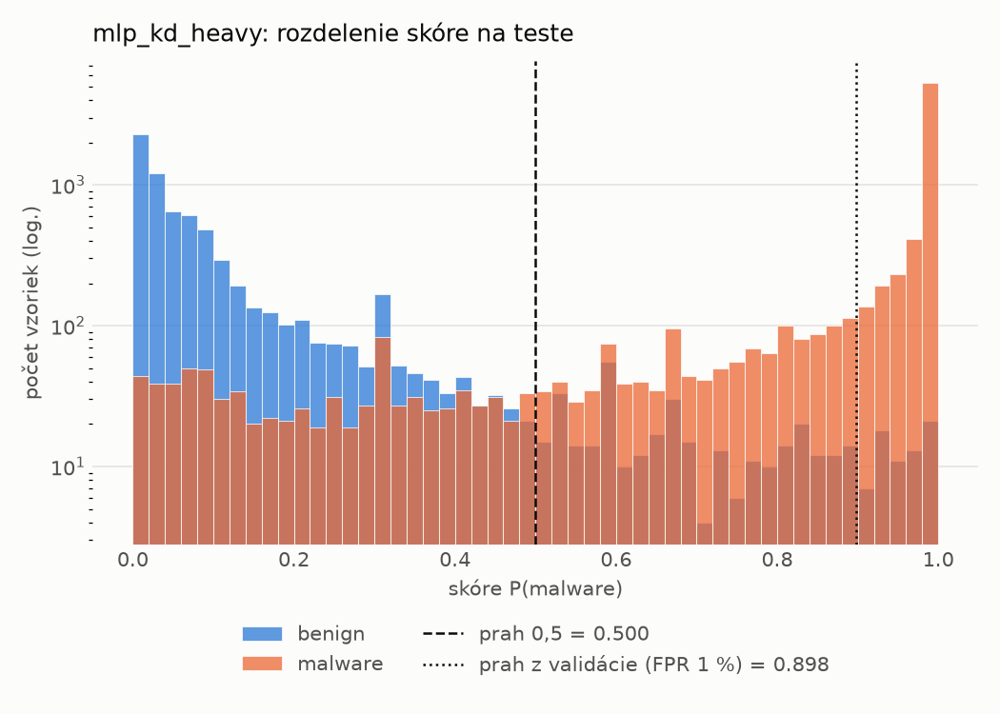
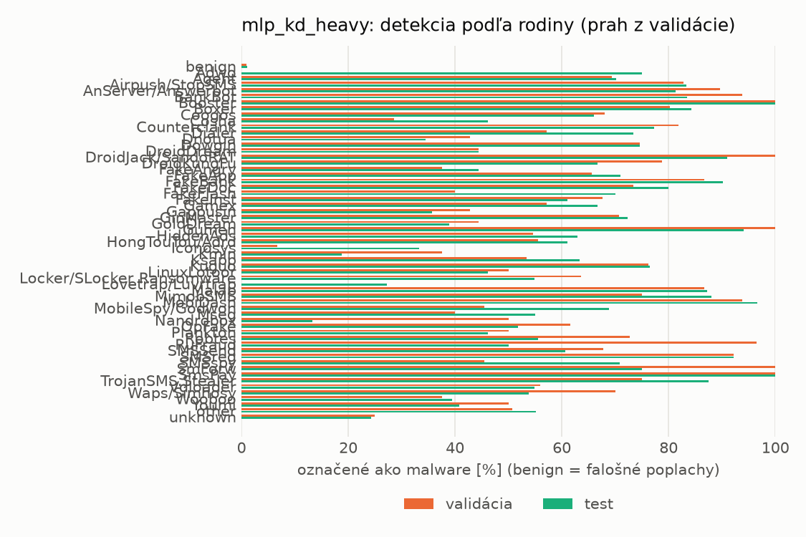
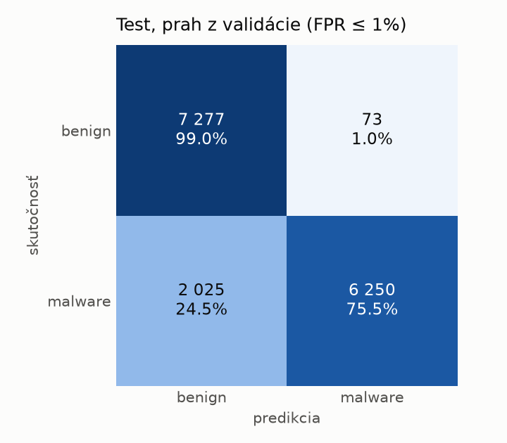
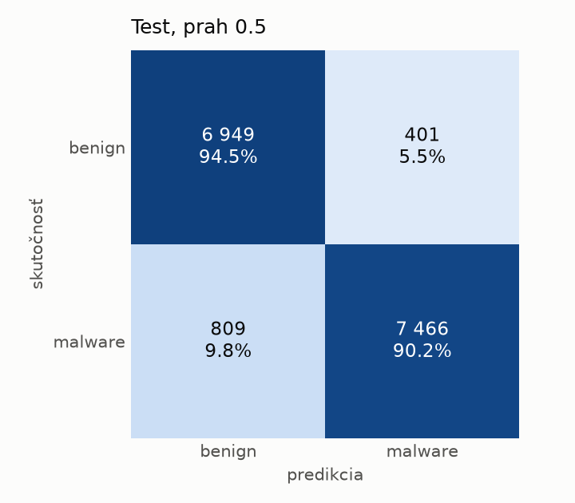
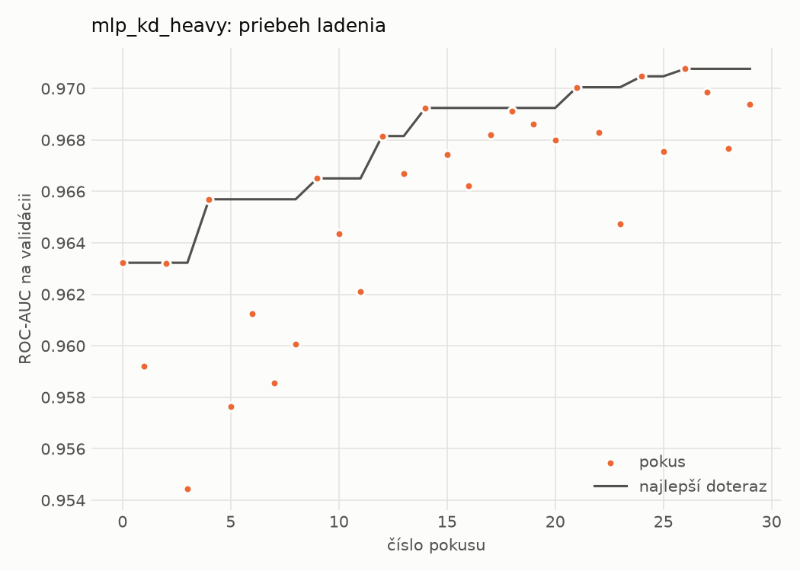
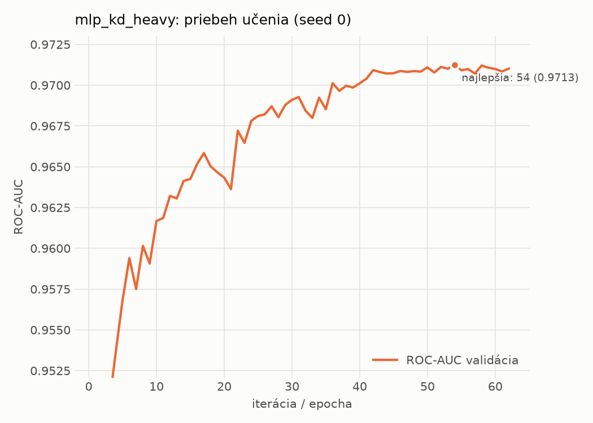

# dynamic/mlp_kd_heavy – beh `20261122-211545`

> Automaticky generované (`src/training/run_tabular.py`). Konfigurácia: `config.yaml`, protokol: `protocol.yaml`.

- **Model:** `mlp` – študent – malé MLP učené destiláciou z mlp_large hybridu (V4)
- **Ladenie:** 30 dokončených pokusov (Optuna TPE), cieľ ROC-AUC na validácii, 7.5 min
- **Finálne modely:** seedy [0, 1, 2]; hodnoty sú priemer ± smerodajná odchýlka cez seedy
- **Najlepšie hyperparametre:** `{"hidden_layers": 1, "max_epochs": 100, "patience": 8, "hidden_width": 64, "dropout": 0.029123066185724737, "lr": 0.0017081972585601675, "weight_decay": 1.0334419171964511e-06, "batch_size": 256, "kd_alpha": 0.8514630095462001, "kd_temperature": 1.2684929468645387}`

## Detekčná kvalita (bez prahu)
| metrika | train (podvzorka) | validácia | test |
|---|---|---|---|
| ROC-AUC | 0.9788 ± 0.0007 | 0.9708 ± 0.0004 | 0.9731 ± 0.0004 |
| PR-AUC | 0.9841 ± 0.0004 | 0.9779 ± 0.0002 | 0.9796 ± 0.0002 |
| TPR pri FPR 1 % | 0.8283 ± 0.0023 | 0.7594 ± 0.0097 | 0.7614 ± 0.0050 |
| TPR pri FPR 0,1 % | 0.6720 ± 0.0308 | 0.5590 ± 0.0143 | 0.5614 ± 0.0193 |
| log loss | 0.1765 ± 0.0032 | 0.2148 ± 0.0005 | 0.2059 ± 0.0019 |
| Brier skóre | 0.0506 ± 0.0009 | 0.0630 ± 0.0004 | 0.0596 ± 0.0004 |

Rozdiel ROC-AUC train − validácia: **0.0079** (veľký rozdiel = preučenie).

## Pri prahu z validácie (FPR ≤ 1% na validácii)
| metrika | train (podvzorka) | validácia | test |
|---|---|---|---|
| accuracy | 0.8784 ± 0.0056 | 0.8680 ± 0.0051 | 0.8636 ± 0.0052 |
| balanced accuracy | 0.8841 ± 0.0053 | 0.8748 ± 0.0048 | 0.8707 ± 0.0049 |
| precision | 0.9951 ± 0.0002 | 0.9887 ± 0.0001 | 0.9892 ± 0.0010 |
| recall (TPR) | 0.7725 ± 0.0108 | 0.7594 ± 0.0097 | 0.7507 ± 0.0107 |
| FPR | 0.0042 ± 0.0002 | 0.0098 ± 0.0000 | 0.0093 ± 0.0010 |
| F1 | 0.8697 ± 0.0068 | 0.8590 ± 0.0063 | 0.8536 ± 0.0066 |
| MCC | 0.7806 ± 0.0090 | 0.7617 ± 0.0083 | 0.7548 ± 0.0081 |

## Pri pevnom prahu 0.5
| metrika | train (podvzorka) | validácia | test |
|---|---|---|---|
| accuracy | 0.9354 ± 0.0022 | 0.9128 ± 0.0018 | 0.9215 ± 0.0011 |
| balanced accuracy | 0.9364 ± 0.0021 | 0.9138 ± 0.0019 | 0.9228 ± 0.0010 |
| precision | 0.9576 ± 0.0013 | 0.9355 ± 0.0029 | 0.9486 ± 0.0012 |
| recall (TPR) | 0.9177 ± 0.0036 | 0.8973 ± 0.0019 | 0.9005 ± 0.0026 |
| FPR | 0.0450 ± 0.0014 | 0.0697 ± 0.0034 | 0.0550 ± 0.0015 |
| F1 | 0.9373 ± 0.0022 | 0.9160 ± 0.0017 | 0.9239 ± 0.0011 |
| MCC | 0.8717 ± 0.0043 | 0.8263 ± 0.0037 | 0.8441 ± 0.0020 |

## Výpočtové nároky (seed 0, testovacia množina)
| meranie | hodnota |
|---|---|
| tréning finálneho modelu | 24.4 s (priemer cez seedy) |
| ladenie spolu | 449 s |
| počet parametrov / uzlov | 8 641 |
| veľkosť modelu na disku | 0.04 MB |
| transformácia vstupu – latencia (1 vlákno) | 0.014 ms |
| transformácia vstupu – priepustnosť | 730 857 vzoriek/s |
| CPU latencia modelu (batch 1, 1 vlákno) | 0.067 ms (p95 0.158) |
| CPU priepustnosť (24 vlákien) | 8 295 286 vzoriek/s |
| GPU latencia (batch 1) | 0.270 ms (p95 0.466) |
| GPU priepustnosť | 2 062 080 vzoriek/s |
| GPU špičková pamäť | 96 MB |

## Grafy
| | |
|---|---|
|  |  |
|  |  |
|  |  |
|  |  |

## Súbory
`metrics.json` (všetky metriky po seedoch vrátane rodín), `timing.json`, `hpo_trials.csv`,
`predictions/<časť>_seed<N>.parquet` (sha256, family, label, score), `model/seed_<N>/`, `log.txt`.
