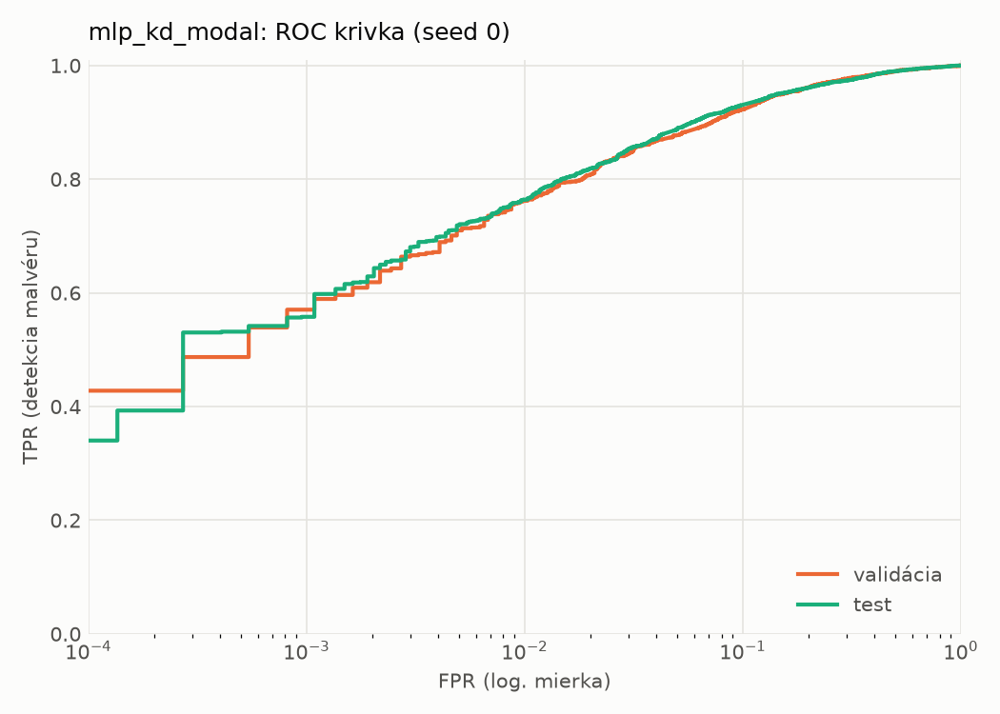
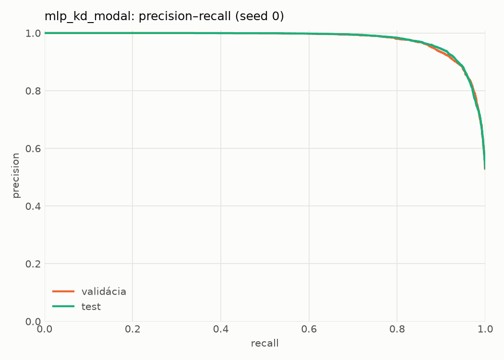
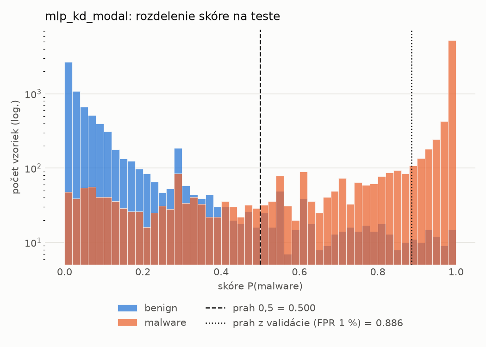
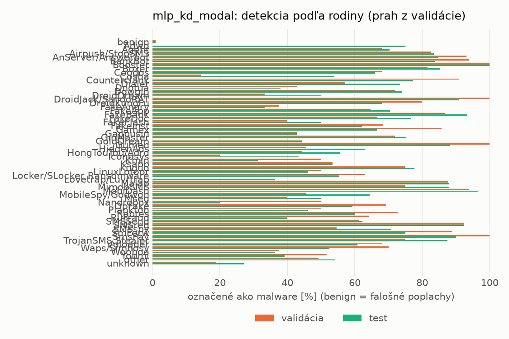
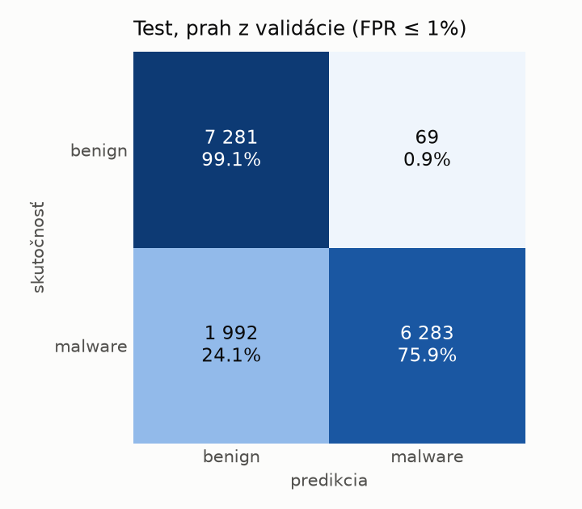
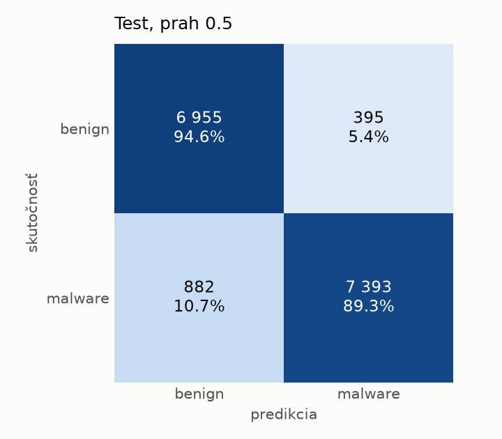
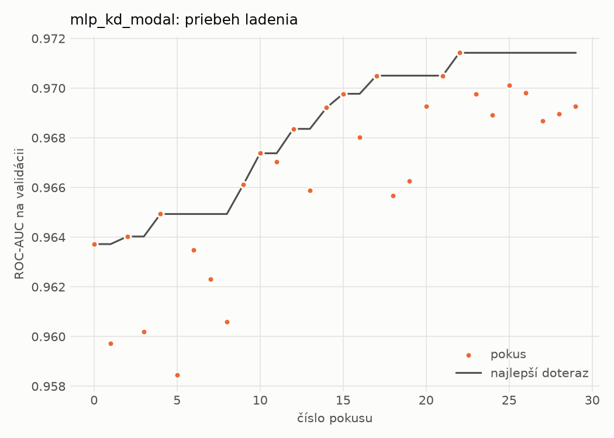
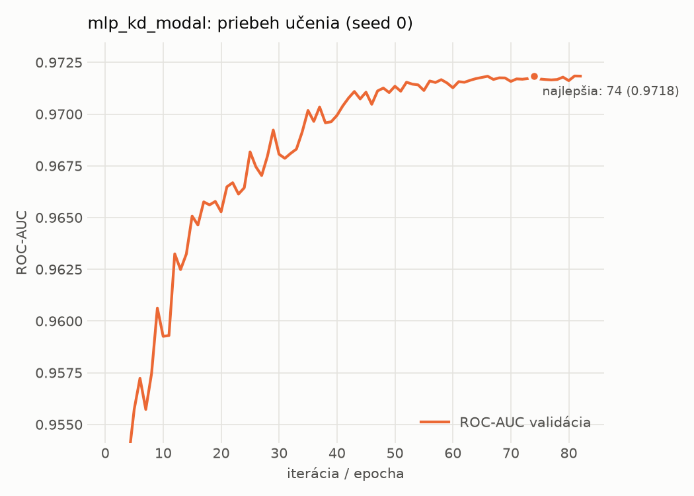

# dynamic/mlp_kd_modal – beh `20261122-210858`

> Automaticky generované (`src/training/run_tabular.py`). Konfigurácia: `config.yaml`, protokol: `protocol.yaml`.

- **Model:** `mlp` – študent – malé MLP učené destiláciou z učiteľa rovnakej modality (variant A)
- **Ladenie:** 30 dokončených pokusov (Optuna TPE), cieľ ROC-AUC na validácii, 6.0 min
- **Finálne modely:** seedy [0, 1, 2]; hodnoty sú priemer ± smerodajná odchýlka cez seedy
- **Najlepšie hyperparametre:** `{"hidden_layers": 1, "max_epochs": 100, "patience": 8, "hidden_width": 64, "dropout": 0.014842517384265013, "lr": 0.0018389280483922955, "weight_decay": 7.464279126466132e-05, "batch_size": 512, "kd_alpha": 0.45301900884301544, "kd_temperature": 1.2914074151312493}`

## Detekčná kvalita (bez prahu)
| metrika | train (podvzorka) | validácia | test |
|---|---|---|---|
| ROC-AUC | 0.9777 ± 0.0004 | 0.9716 ± 0.0002 | 0.9731 ± 0.0004 |
| PR-AUC | 0.9832 ± 0.0004 | 0.9784 ± 0.0002 | 0.9793 ± 0.0002 |
| TPR pri FPR 1 % | 0.8219 ± 0.0012 | 0.7650 ± 0.0034 | 0.7667 ± 0.0057 |
| TPR pri FPR 0,1 % | 0.6178 ± 0.0561 | 0.5655 ± 0.0508 | 0.5697 ± 0.0209 |
| log loss | 0.1822 ± 0.0018 | 0.2143 ± 0.0004 | 0.2060 ± 0.0017 |
| Brier skóre | 0.0523 ± 0.0007 | 0.0631 ± 0.0002 | 0.0606 ± 0.0007 |

Rozdiel ROC-AUC train − validácia: **0.0061** (veľký rozdiel = preučenie).

## Pri prahu z validácie (FPR ≤ 1% na validácii)
| metrika | train (podvzorka) | validácia | test |
|---|---|---|---|
| accuracy | 0.8820 ± 0.0012 | 0.8709 ± 0.0018 | 0.8693 ± 0.0012 |
| balanced accuracy | 0.8874 ± 0.0012 | 0.8776 ± 0.0017 | 0.8761 ± 0.0011 |
| precision | 0.9929 ± 0.0003 | 0.9888 ± 0.0000 | 0.9892 ± 0.0008 |
| recall (TPR) | 0.7810 ± 0.0022 | 0.7650 ± 0.0034 | 0.7615 ± 0.0025 |
| FPR | 0.0062 ± 0.0002 | 0.0098 ± 0.0000 | 0.0094 ± 0.0007 |
| F1 | 0.8743 ± 0.0015 | 0.8626 ± 0.0022 | 0.8605 ± 0.0014 |
| MCC | 0.7857 ± 0.0021 | 0.7664 ± 0.0029 | 0.7639 ± 0.0018 |

## Pri pevnom prahu 0.5
| metrika | train (podvzorka) | validácia | test |
|---|---|---|---|
| accuracy | 0.9333 ± 0.0019 | 0.9127 ± 0.0003 | 0.9184 ± 0.0008 |
| balanced accuracy | 0.9345 ± 0.0019 | 0.9138 ± 0.0003 | 0.9200 ± 0.0007 |
| precision | 0.9599 ± 0.0030 | 0.9378 ± 0.0012 | 0.9495 ± 0.0010 |
| recall (TPR) | 0.9111 ± 0.0021 | 0.8945 ± 0.0007 | 0.8935 ± 0.0025 |
| FPR | 0.0421 ± 0.0033 | 0.0668 ± 0.0014 | 0.0535 ± 0.0012 |
| F1 | 0.9348 ± 0.0018 | 0.9156 ± 0.0002 | 0.9207 ± 0.0009 |
| MCC | 0.8678 ± 0.0039 | 0.8262 ± 0.0006 | 0.8386 ± 0.0013 |

## Výpočtové nároky (seed 0, testovacia množina)
| meranie | hodnota |
|---|---|
| tréning finálneho modelu | 14.0 s (priemer cez seedy) |
| ladenie spolu | 362 s |
| počet parametrov / uzlov | 8 641 |
| veľkosť modelu na disku | 0.04 MB |
| transformácia vstupu – latencia (1 vlákno) | 0.015 ms |
| transformácia vstupu – priepustnosť | 725 156 vzoriek/s |
| CPU latencia modelu (batch 1, 1 vlákno) | 0.068 ms (p95 0.157) |
| CPU priepustnosť (24 vlákien) | 5 830 877 vzoriek/s |
| GPU latencia (batch 1) | 0.452 ms (p95 0.473) |
| GPU priepustnosť | 2 827 133 vzoriek/s |
| GPU špičková pamäť | 63 MB |

## Grafy
| | |
|---|---|
|  |  |
|  |  |
|  |  |
|  |  |

## Súbory
`metrics.json` (všetky metriky po seedoch vrátane rodín), `timing.json`, `hpo_trials.csv`,
`predictions/<časť>_seed<N>.parquet` (sha256, family, label, score), `model/seed_<N>/`, `log.txt`.
