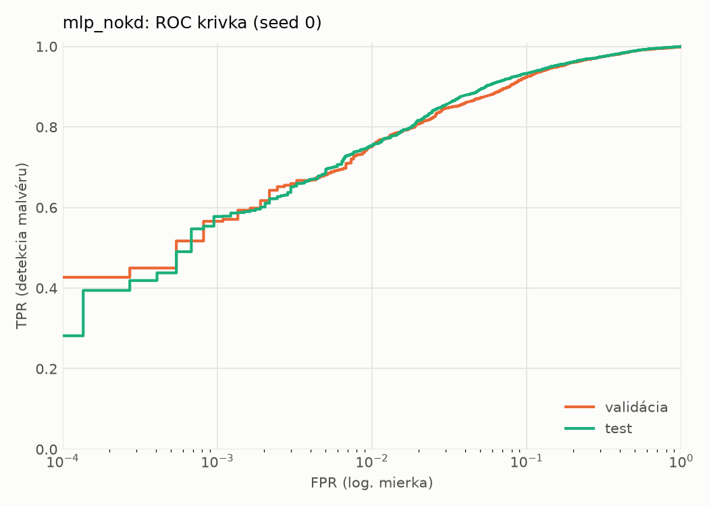
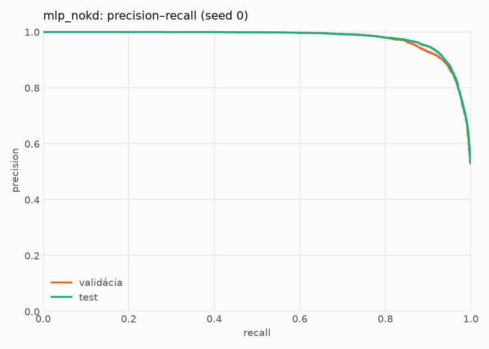
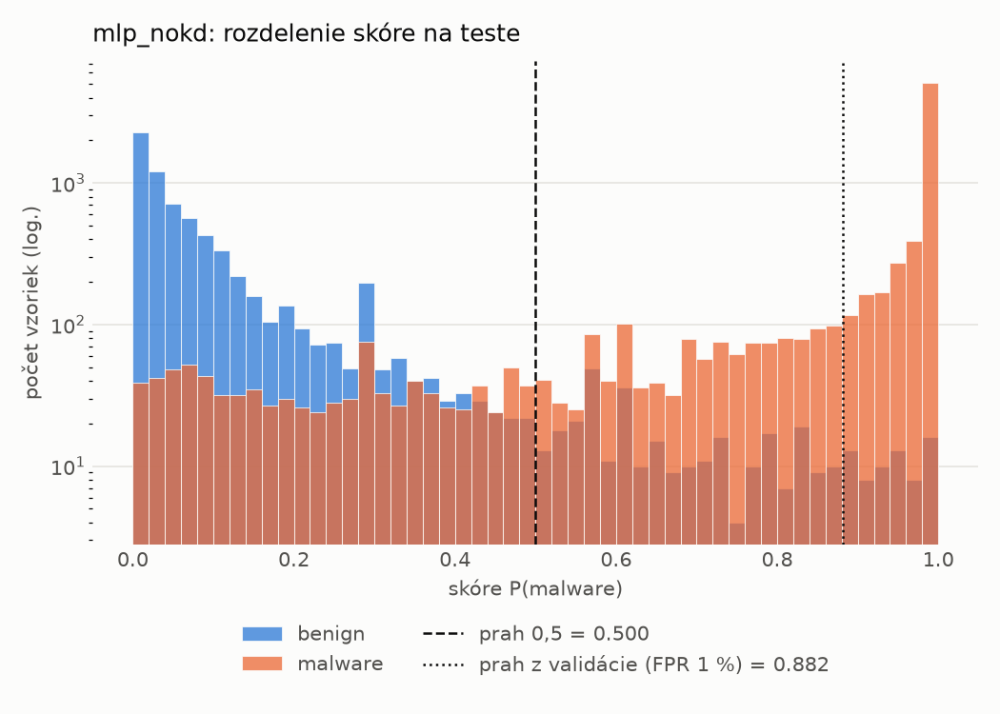
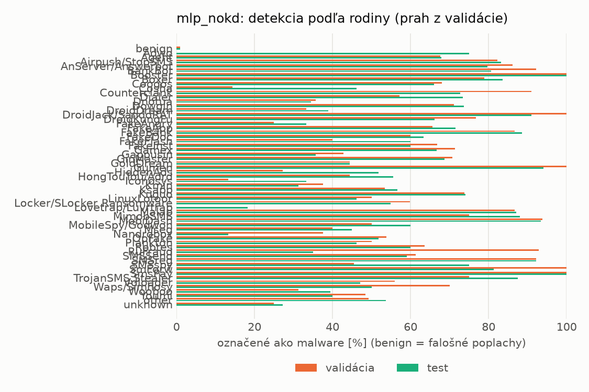
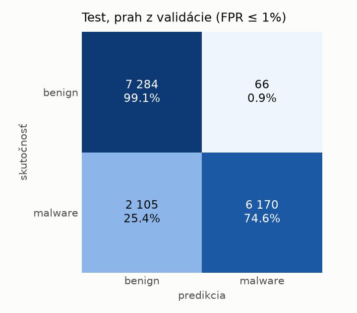
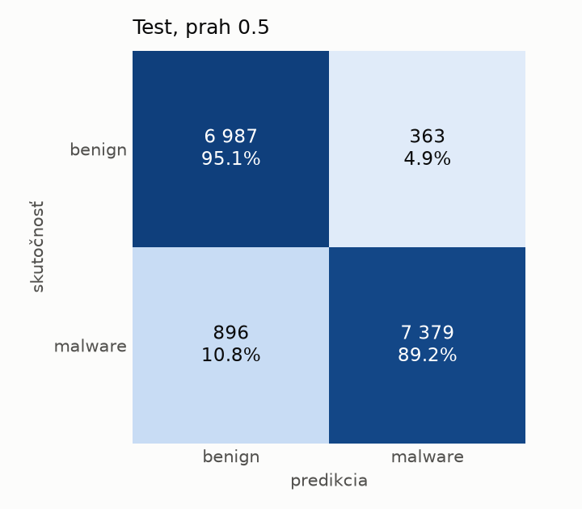
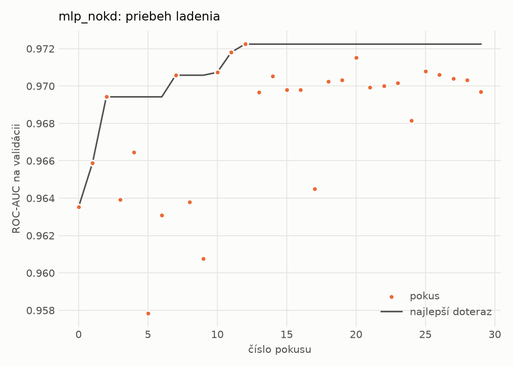
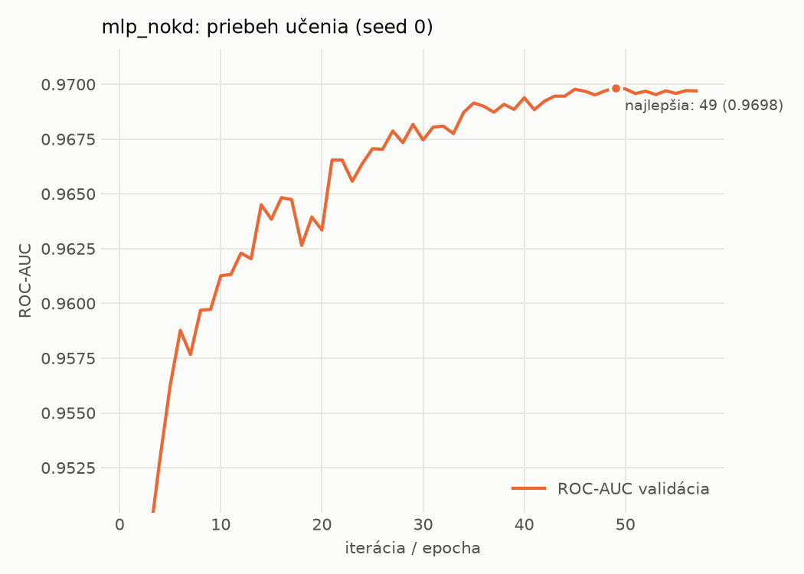

# dynamic/mlp_nokd – beh `20261122-205917`

> Automaticky generované (`src/training/run_tabular.py`). Konfigurácia: `config.yaml`, protokol: `protocol.yaml`.

- **Model:** `mlp` – kontrola – rovnaké malé MLP bez destilácie (iba skutočné označenia)
- **Ladenie:** 30 dokončených pokusov (Optuna TPE), cieľ ROC-AUC na validácii, 8.7 min
- **Finálne modely:** seedy [0, 1, 2]; hodnoty sú priemer ± smerodajná odchýlka cez seedy
- **Najlepšie hyperparametre:** `{"hidden_layers": 1, "max_epochs": 100, "patience": 8, "hidden_width": 64, "dropout": 0.014622282919838341, "lr": 0.0013105433289036465, "weight_decay": 1.7870054646247664e-05, "batch_size": 256}`

## Detekčná kvalita (bez prahu)
| metrika | train (podvzorka) | validácia | test |
|---|---|---|---|
| ROC-AUC | 0.9795 ± 0.0010 | 0.9710 ± 0.0010 | 0.9736 ± 0.0013 |
| PR-AUC | 0.9847 ± 0.0008 | 0.9780 ± 0.0006 | 0.9799 ± 0.0008 |
| TPR pri FPR 1 % | 0.8359 ± 0.0074 | 0.7538 ± 0.0081 | 0.7639 ± 0.0116 |
| TPR pri FPR 0,1 % | 0.6766 ± 0.0230 | 0.5335 ± 0.0438 | 0.5711 ± 0.0059 |
| log loss | 0.1752 ± 0.0057 | 0.2176 ± 0.0040 | 0.2055 ± 0.0054 |
| Brier skóre | 0.0502 ± 0.0018 | 0.0633 ± 0.0012 | 0.0595 ± 0.0016 |

Rozdiel ROC-AUC train − validácia: **0.0086** (veľký rozdiel = preučenie).

## Pri prahu z validácie (FPR ≤ 1% na validácii)
| metrika | train (podvzorka) | validácia | test |
|---|---|---|---|
| accuracy | 0.8770 ± 0.0029 | 0.8650 ± 0.0043 | 0.8618 ± 0.0036 |
| balanced accuracy | 0.8828 ± 0.0027 | 0.8720 ± 0.0040 | 0.8691 ± 0.0033 |
| precision | 0.9958 ± 0.0011 | 0.9886 ± 0.0001 | 0.9903 ± 0.0018 |
| recall (TPR) | 0.7691 ± 0.0064 | 0.7538 ± 0.0081 | 0.7465 ± 0.0079 |
| FPR | 0.0036 ± 0.0010 | 0.0098 ± 0.0000 | 0.0083 ± 0.0016 |
| F1 | 0.8679 ± 0.0036 | 0.8554 ± 0.0052 | 0.8512 ± 0.0046 |
| MCC | 0.7785 ± 0.0044 | 0.7568 ± 0.0069 | 0.7524 ± 0.0052 |

## Pri pevnom prahu 0.5
| metrika | train (podvzorka) | validácia | test |
|---|---|---|---|
| accuracy | 0.9357 ± 0.0024 | 0.9132 ± 0.0023 | 0.9213 ± 0.0022 |
| balanced accuracy | 0.9369 ± 0.0022 | 0.9145 ± 0.0025 | 0.9230 ± 0.0019 |
| precision | 0.9636 ± 0.0045 | 0.9406 ± 0.0082 | 0.9536 ± 0.0049 |
| recall (TPR) | 0.9121 ± 0.0077 | 0.8926 ± 0.0079 | 0.8950 ± 0.0085 |
| FPR | 0.0382 ± 0.0051 | 0.0636 ± 0.0097 | 0.0490 ± 0.0059 |
| F1 | 0.9371 ± 0.0026 | 0.9160 ± 0.0022 | 0.9234 ± 0.0026 |
| MCC | 0.8728 ± 0.0043 | 0.8277 ± 0.0050 | 0.8445 ± 0.0038 |

## Výpočtové nároky (seed 0, testovacia množina)
| meranie | hodnota |
|---|---|
| tréning finálneho modelu | 19.7 s (priemer cez seedy) |
| ladenie spolu | 521 s |
| počet parametrov / uzlov | 8 641 |
| veľkosť modelu na disku | 0.04 MB |
| transformácia vstupu – latencia (1 vlákno) | 0.015 ms |
| transformácia vstupu – priepustnosť | 704 842 vzoriek/s |
| CPU latencia modelu (batch 1, 1 vlákno) | 0.068 ms (p95 0.158) |
| CPU priepustnosť (24 vlákien) | 6 024 213 vzoriek/s |
| GPU latencia (batch 1) | 0.281 ms (p95 0.318) |
| GPU priepustnosť | 2 824 476 vzoriek/s |
| GPU špičková pamäť | 96 MB |

## Grafy
| | |
|---|---|
|  |  |
|  |  |
|  |  |
|  |  |

## Súbory
`metrics.json` (všetky metriky po seedoch vrátane rodín), `timing.json`, `hpo_trials.csv`,
`predictions/<časť>_seed<N>.parquet` (sha256, family, label, score), `model/seed_<N>/`, `log.txt`.
