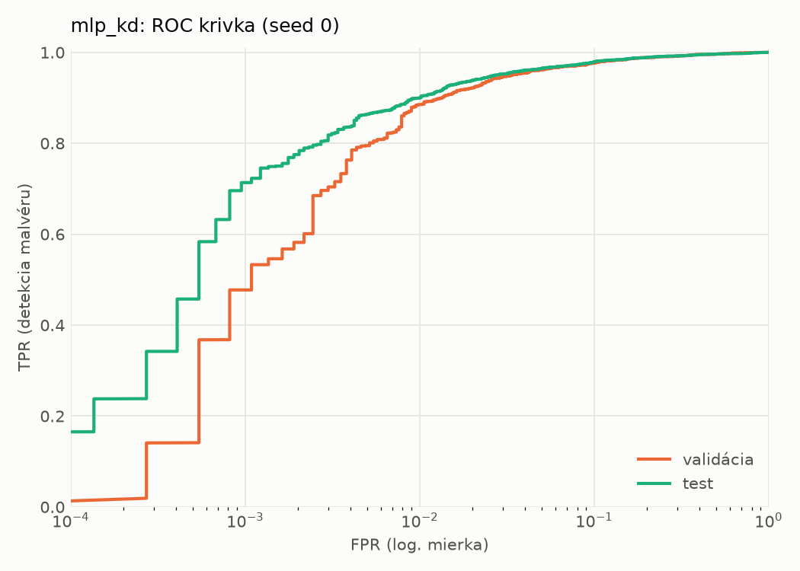
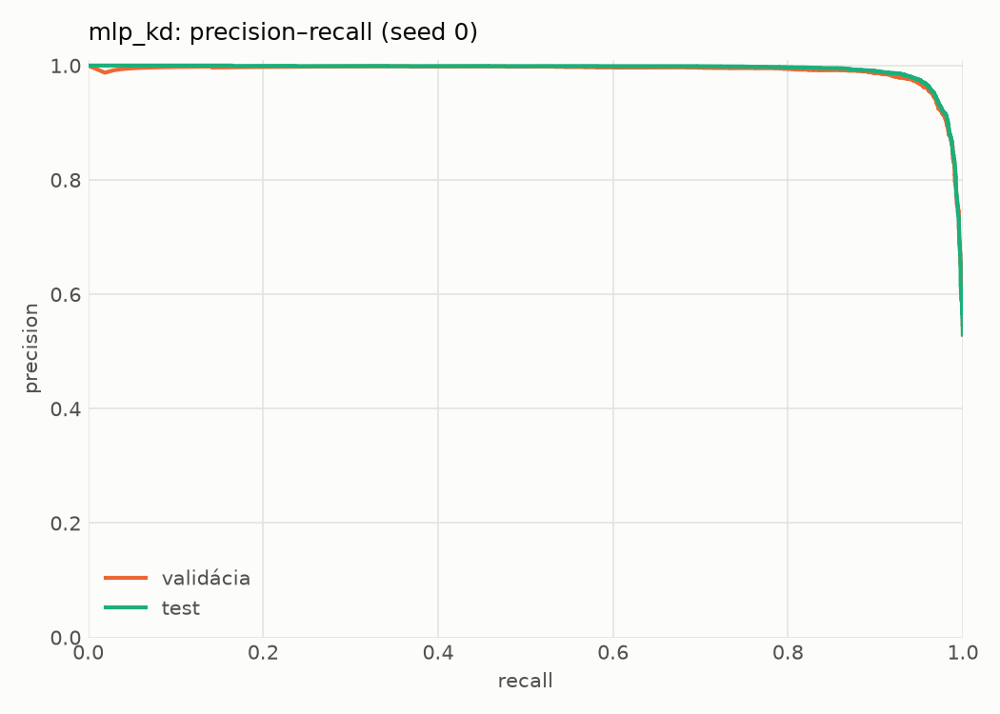
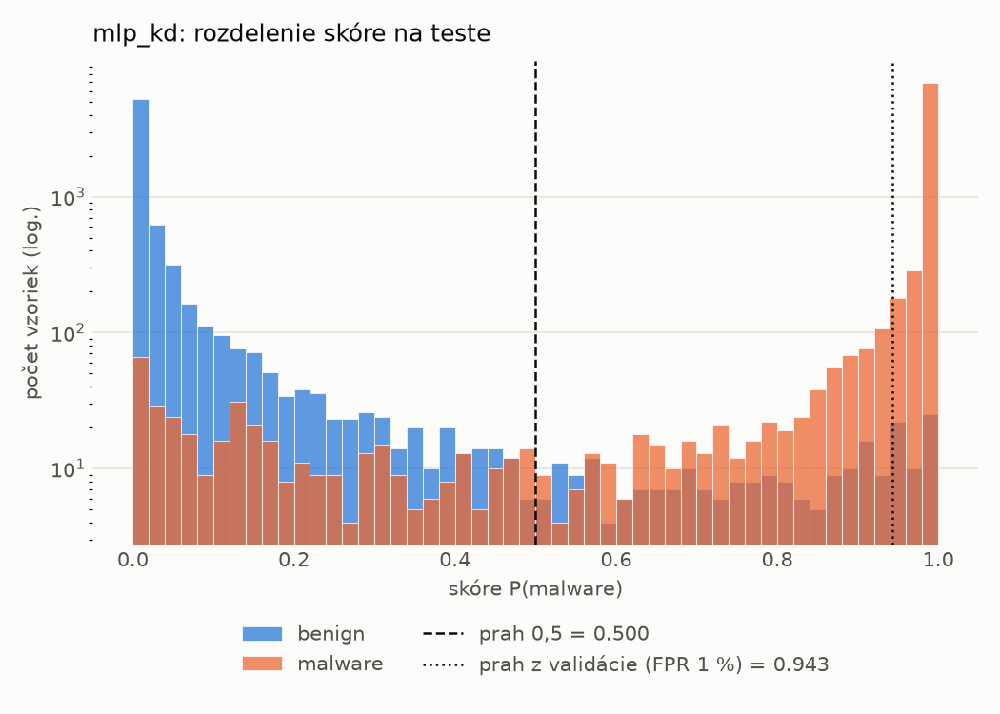
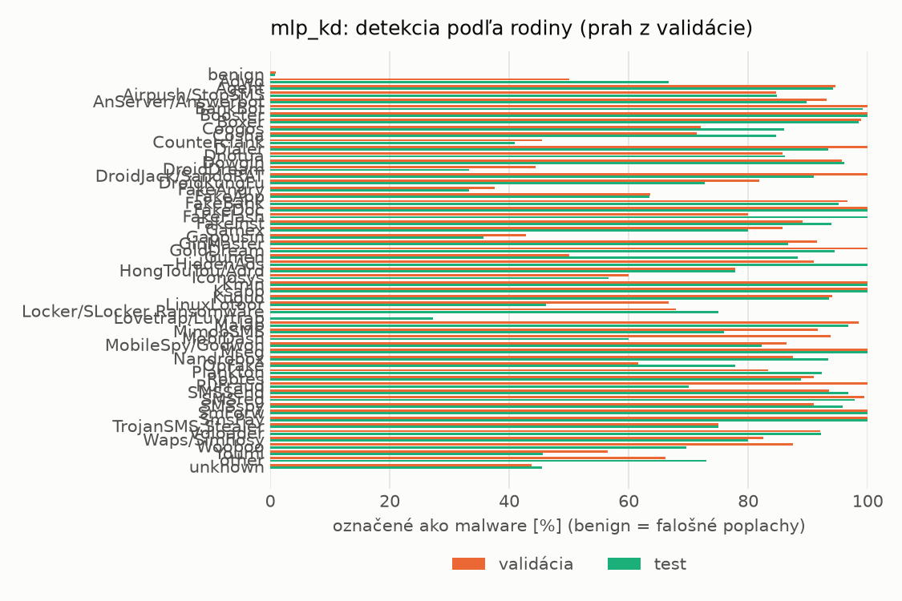
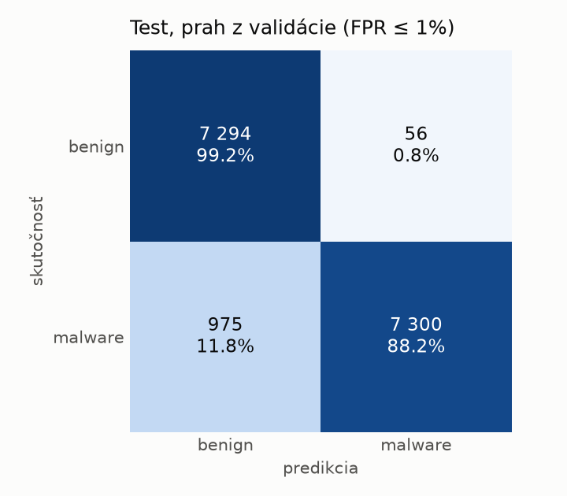
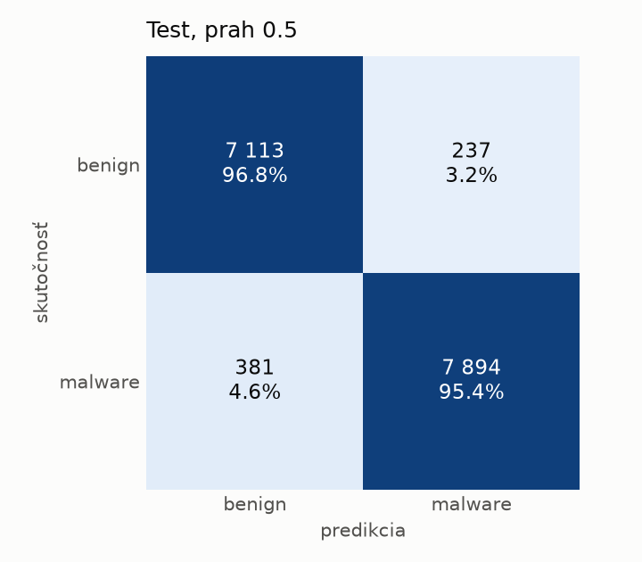
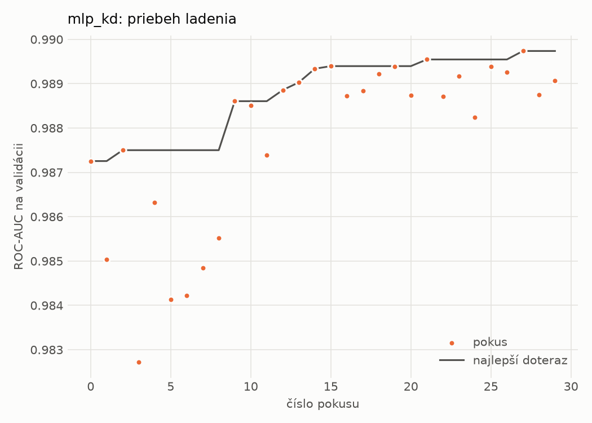
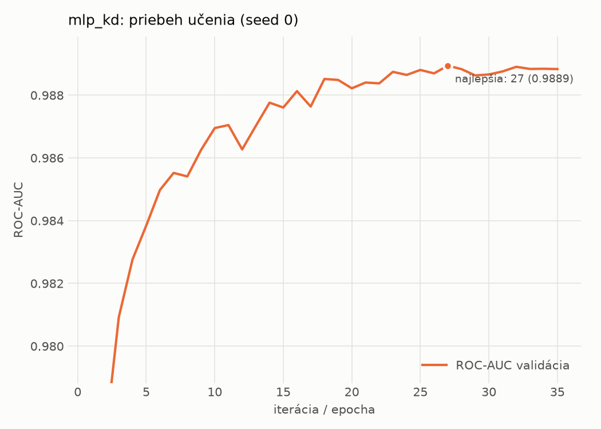

# static/mlp_kd – beh `20261122-203423`

> Automaticky generované (`src/training/run_tabular.py`). Konfigurácia: `config.yaml`, protokol: `protocol.yaml`.

- **Model:** `mlp` – študent – malé MLP učené destiláciou z hybridného učiteľa
- **Ladenie:** 30 dokončených pokusov (Optuna TPE), cieľ ROC-AUC na validácii, 4.1 min
- **Finálne modely:** seedy [0, 1, 2]; hodnoty sú priemer ± smerodajná odchýlka cez seedy
- **Najlepšie hyperparametre:** `{"hidden_layers": 1, "max_epochs": 100, "patience": 8, "hidden_width": 64, "dropout": 0.018096880153353218, "lr": 0.002445898909575082, "weight_decay": 6.315937377471515e-05, "batch_size": 1024, "kd_alpha": 0.6461462865023861, "kd_temperature": 1.5048732616232385}`

## Detekčná kvalita (bez prahu)
| metrika | train (podvzorka) | validácia | test |
|---|---|---|---|
| ROC-AUC | 0.9947 ± 0.0005 | 0.9896 ± 0.0006 | 0.9903 ± 0.0003 |
| PR-AUC | 0.9960 ± 0.0004 | 0.9906 ± 0.0007 | 0.9924 ± 0.0001 |
| TPR pri FPR 1 % | 0.9460 ± 0.0060 | 0.8857 ± 0.0044 | 0.9020 ± 0.0061 |
| TPR pri FPR 0,1 % | 0.8514 ± 0.0133 | 0.4630 ± 0.0126 | 0.6682 ± 0.0446 |
| log loss | 0.0839 ± 0.0046 | 0.1315 ± 0.0006 | 0.1206 ± 0.0030 |
| Brier skóre | 0.0225 ± 0.0014 | 0.0335 ± 0.0004 | 0.0307 ± 0.0006 |

Rozdiel ROC-AUC train − validácia: **0.0052** (veľký rozdiel = preučenie).

## Pri prahu z validácie (FPR ≤ 1% na validácii)
| metrika | train (podvzorka) | validácia | test |
|---|---|---|---|
| accuracy | 0.9402 ± 0.0040 | 0.9349 ± 0.0023 | 0.9348 ± 0.0031 |
| balanced accuracy | 0.9430 ± 0.0038 | 0.9380 ± 0.0022 | 0.9380 ± 0.0029 |
| precision | 0.9977 ± 0.0011 | 0.9903 ± 0.0000 | 0.9927 ± 0.0004 |
| recall (TPR) | 0.8882 ± 0.0076 | 0.8857 ± 0.0044 | 0.8834 ± 0.0063 |
| FPR | 0.0022 ± 0.0011 | 0.0098 ± 0.0000 | 0.0073 ± 0.0005 |
| F1 | 0.9398 ± 0.0043 | 0.9351 ± 0.0025 | 0.9348 ± 0.0034 |
| MCC | 0.8867 ± 0.0072 | 0.8756 ± 0.0042 | 0.8760 ± 0.0056 |

## Pri pevnom prahu 0.5
| metrika | train (podvzorka) | validácia | test |
|---|---|---|---|
| accuracy | 0.9713 ± 0.0020 | 0.9578 ± 0.0007 | 0.9615 ± 0.0010 |
| balanced accuracy | 0.9718 ± 0.0021 | 0.9579 ± 0.0007 | 0.9620 ± 0.0010 |
| precision | 0.9825 ± 0.0035 | 0.9649 ± 0.0011 | 0.9720 ± 0.0010 |
| recall (TPR) | 0.9625 ± 0.0020 | 0.9550 ± 0.0007 | 0.9549 ± 0.0008 |
| FPR | 0.0190 ± 0.0038 | 0.0391 ± 0.0013 | 0.0310 ± 0.0011 |
| F1 | 0.9724 ± 0.0019 | 0.9599 ± 0.0007 | 0.9634 ± 0.0009 |
| MCC | 0.9427 ± 0.0041 | 0.9153 ± 0.0014 | 0.9230 ± 0.0019 |

## Výpočtové nároky (seed 0, testovacia množina)
| meranie | hodnota |
|---|---|
| tréning finálneho modelu | 5.2 s (priemer cez seedy) |
| ladenie spolu | 243 s |
| počet parametrov / uzlov | 10 753 |
| veľkosť modelu na disku | 0.05 MB |
| transformácia vstupu – latencia (1 vlákno) | 0.006 ms |
| transformácia vstupu – priepustnosť | 937 909 vzoriek/s |
| CPU latencia modelu (batch 1, 1 vlákno) | 0.066 ms (p95 0.159) |
| CPU priepustnosť (24 vlákien) | 3 184 097 vzoriek/s |
| GPU latencia (batch 1) | 0.279 ms (p95 0.295) |
| GPU priepustnosť | 1 925 803 vzoriek/s |
| GPU špičková pamäť | 73 MB |

## Grafy
| | |
|---|---|
|  |  |
|  |  |
|  |  |
|  |  |

## Súbory
`metrics.json` (všetky metriky po seedoch vrátane rodín), `timing.json`, `hpo_trials.csv`,
`predictions/<časť>_seed<N>.parquet` (sha256, family, label, score), `model/seed_<N>/`, `log.txt`.
