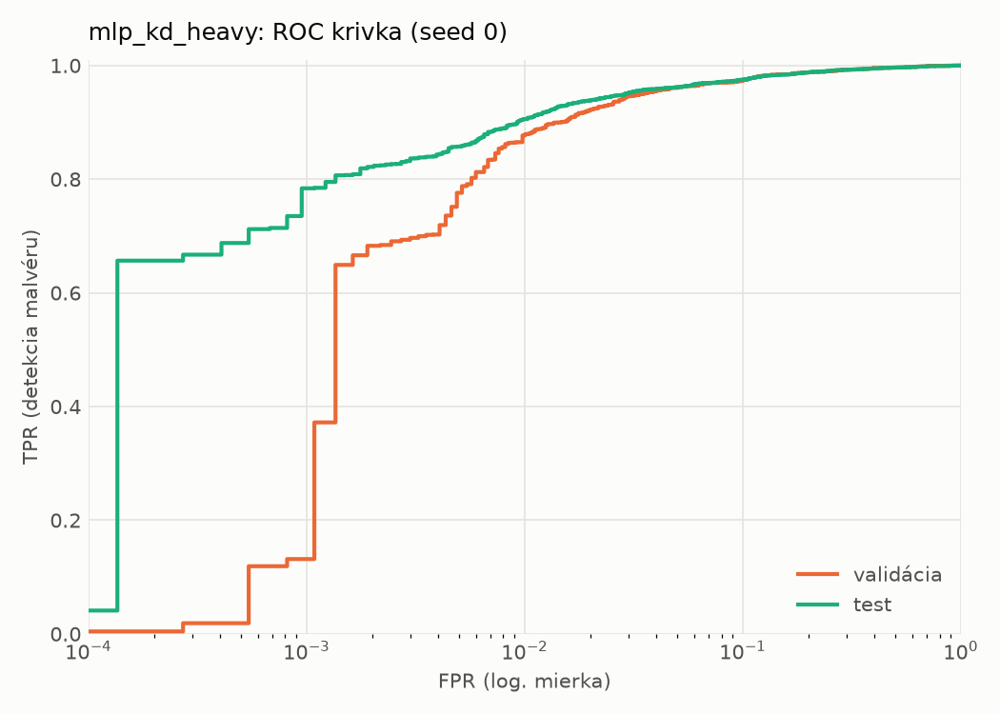
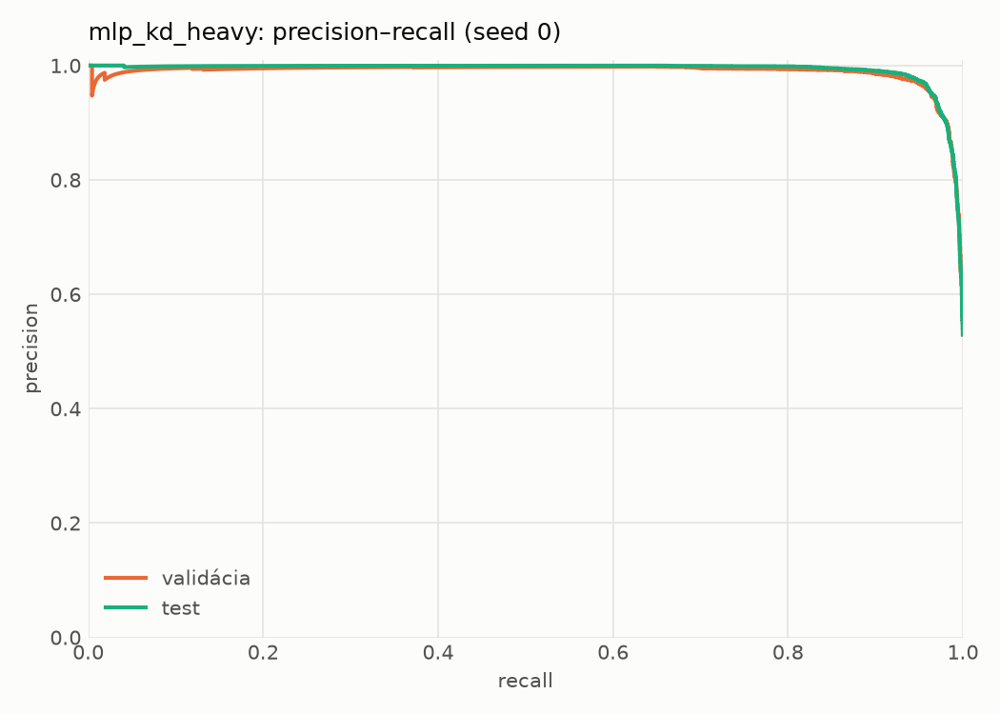
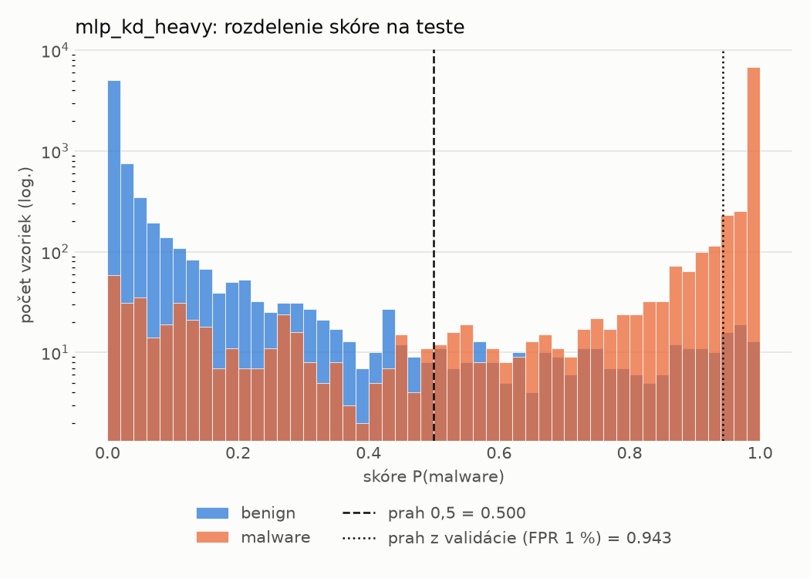
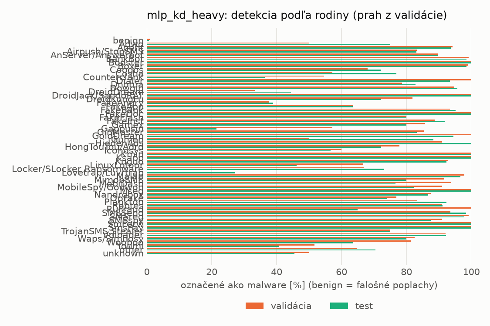
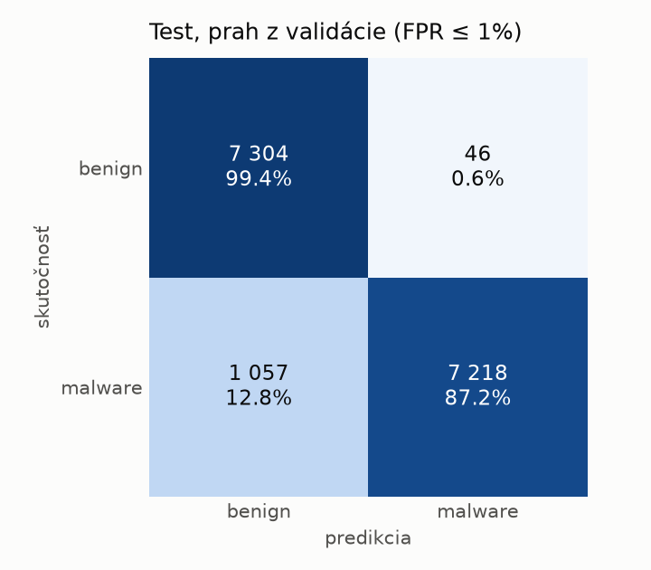
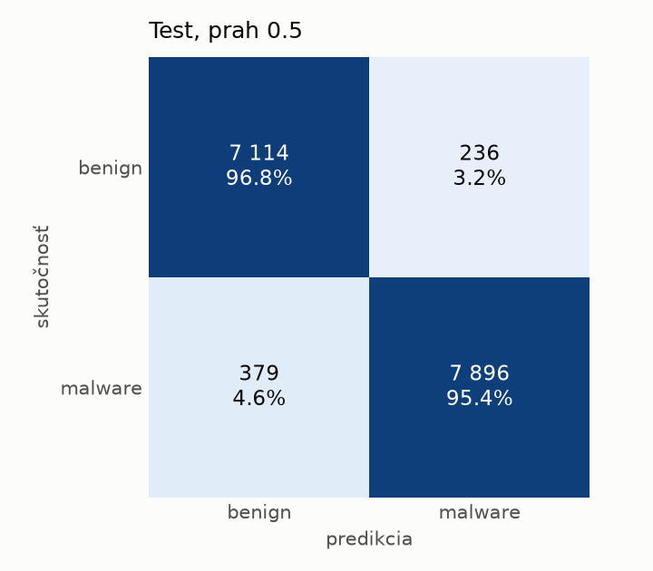
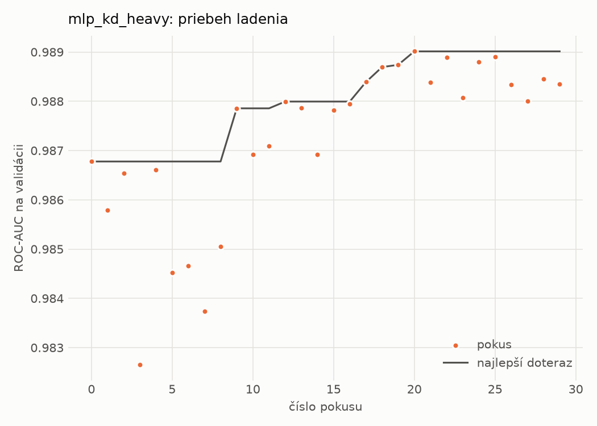
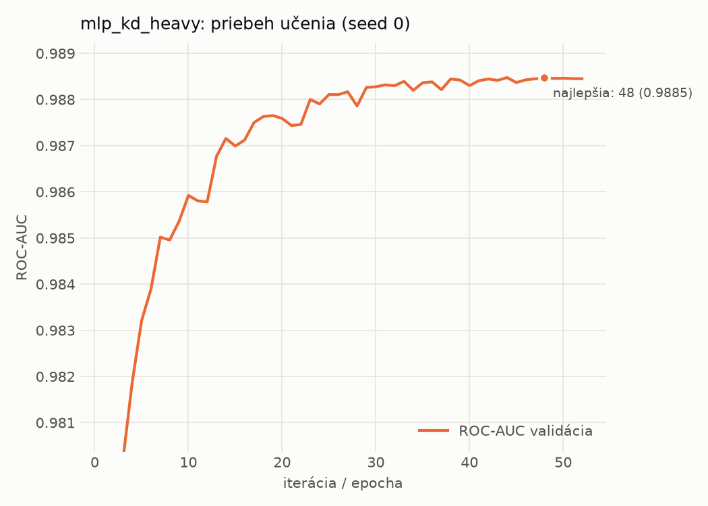

# static/mlp_kd_heavy – beh `20261122-204855`

> Automaticky generované (`src/training/run_tabular.py`). Konfigurácia: `config.yaml`, protokol: `protocol.yaml`.

- **Model:** `mlp` – študent – malé MLP učené destiláciou z mlp_large hybridu (V4)
- **Ladenie:** 30 dokončených pokusov (Optuna TPE), cieľ ROC-AUC na validácii, 3.8 min
- **Finálne modely:** seedy [0, 1, 2]; hodnoty sú priemer ± smerodajná odchýlka cez seedy
- **Najlepšie hyperparametre:** `{"hidden_layers": 1, "max_epochs": 100, "patience": 8, "hidden_width": 64, "dropout": 0.04239795529418809, "lr": 0.0021920597062990285, "weight_decay": 0.0001469802566586536, "batch_size": 1024, "kd_alpha": 0.8931311185241001, "kd_temperature": 5.447798930063548}`

## Detekčná kvalita (bez prahu)
| metrika | train (podvzorka) | validácia | test |
|---|---|---|---|
| ROC-AUC | 0.9942 ± 0.0001 | 0.9887 ± 0.0002 | 0.9897 ± 0.0008 |
| PR-AUC | 0.9955 ± 0.0001 | 0.9892 ± 0.0008 | 0.9922 ± 0.0005 |
| TPR pri FPR 1 % | 0.9375 ± 0.0005 | 0.8728 ± 0.0119 | 0.8988 ± 0.0072 |
| TPR pri FPR 0,1 % | 0.8218 ± 0.0180 | 0.3129 ± 0.1669 | 0.7441 ± 0.0370 |
| log loss | 0.0896 ± 0.0005 | 0.1300 ± 0.0007 | 0.1212 ± 0.0069 |
| Brier skóre | 0.0247 ± 0.0002 | 0.0344 ± 0.0001 | 0.0318 ± 0.0006 |

Rozdiel ROC-AUC train − validácia: **0.0055** (veľký rozdiel = preučenie).

## Pri prahu z validácie (FPR ≤ 1% na validácii)
| metrika | train (podvzorka) | validácia | test |
|---|---|---|---|
| accuracy | 0.9329 ± 0.0052 | 0.9280 ± 0.0063 | 0.9292 ± 0.0033 |
| balanced accuracy | 0.9360 ± 0.0049 | 0.9315 ± 0.0060 | 0.9328 ± 0.0030 |
| precision | 0.9973 ± 0.0002 | 0.9901 ± 0.0001 | 0.9934 ± 0.0016 |
| recall (TPR) | 0.8747 ± 0.0100 | 0.8728 ± 0.0119 | 0.8721 ± 0.0077 |
| FPR | 0.0026 ± 0.0002 | 0.0098 ± 0.0000 | 0.0065 ± 0.0016 |
| F1 | 0.9320 ± 0.0056 | 0.9278 ± 0.0068 | 0.9288 ± 0.0037 |
| MCC | 0.8736 ± 0.0091 | 0.8634 ± 0.0112 | 0.8662 ± 0.0055 |

## Pri pevnom prahu 0.5
| metrika | train (podvzorka) | validácia | test |
|---|---|---|---|
| accuracy | 0.9689 ± 0.0004 | 0.9574 ± 0.0005 | 0.9607 ± 0.0013 |
| balanced accuracy | 0.9694 ± 0.0004 | 0.9576 ± 0.0006 | 0.9611 ± 0.0012 |
| precision | 0.9807 ± 0.0007 | 0.9645 ± 0.0015 | 0.9705 ± 0.0006 |
| recall (TPR) | 0.9598 ± 0.0007 | 0.9547 ± 0.0008 | 0.9548 ± 0.0022 |
| FPR | 0.0209 ± 0.0008 | 0.0396 ± 0.0017 | 0.0327 ± 0.0006 |
| F1 | 0.9701 ± 0.0004 | 0.9596 ± 0.0005 | 0.9626 ± 0.0013 |
| MCC | 0.9380 ± 0.0008 | 0.9146 ± 0.0011 | 0.9213 ± 0.0025 |

## Výpočtové nároky (seed 0, testovacia množina)
| meranie | hodnota |
|---|---|
| tréning finálneho modelu | 4.8 s (priemer cez seedy) |
| ladenie spolu | 226 s |
| počet parametrov / uzlov | 10 753 |
| veľkosť modelu na disku | 0.05 MB |
| transformácia vstupu – latencia (1 vlákno) | 0.015 ms |
| transformácia vstupu – priepustnosť | 615 046 vzoriek/s |
| CPU latencia modelu (batch 1, 1 vlákno) | 0.066 ms (p95 0.073) |
| CPU priepustnosť (24 vlákien) | 2 622 172 vzoriek/s |
| GPU latencia (batch 1) | 0.475 ms (p95 0.495) |
| GPU priepustnosť | 2 621 292 vzoriek/s |
| GPU špičková pamäť | 114 MB |

## Grafy
| | |
|---|---|
|  |  |
|  |  |
|  |  |
|  |  |

## Súbory
`metrics.json` (všetky metriky po seedoch vrátane rodín), `timing.json`, `hpo_trials.csv`,
`predictions/<časť>_seed<N>.parquet` (sha256, family, label, score), `model/seed_<N>/`, `log.txt`.
