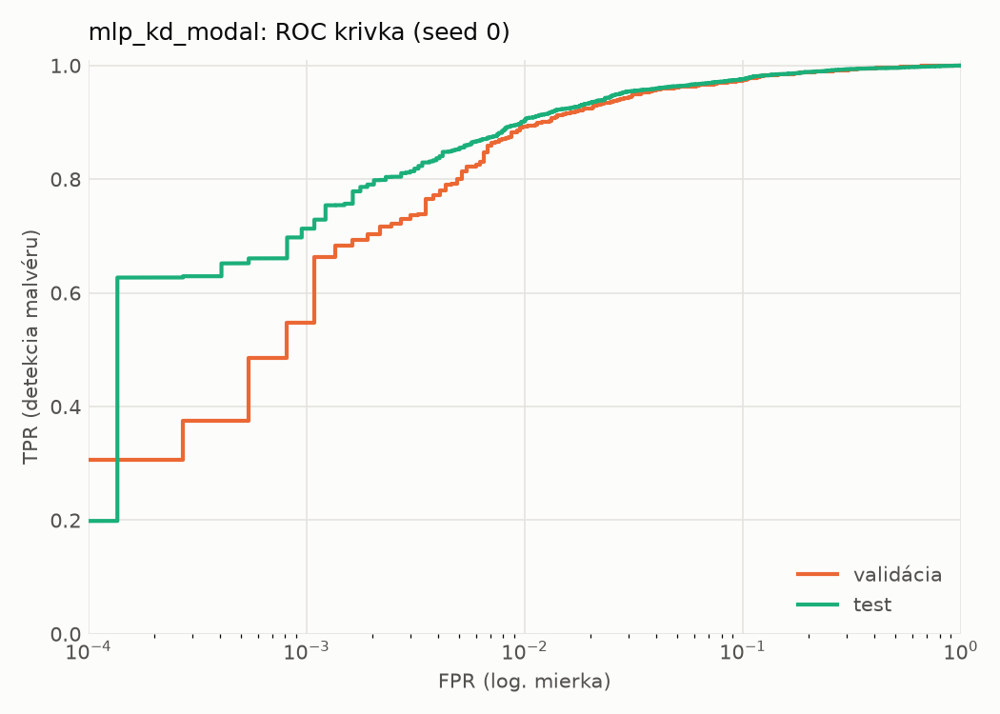
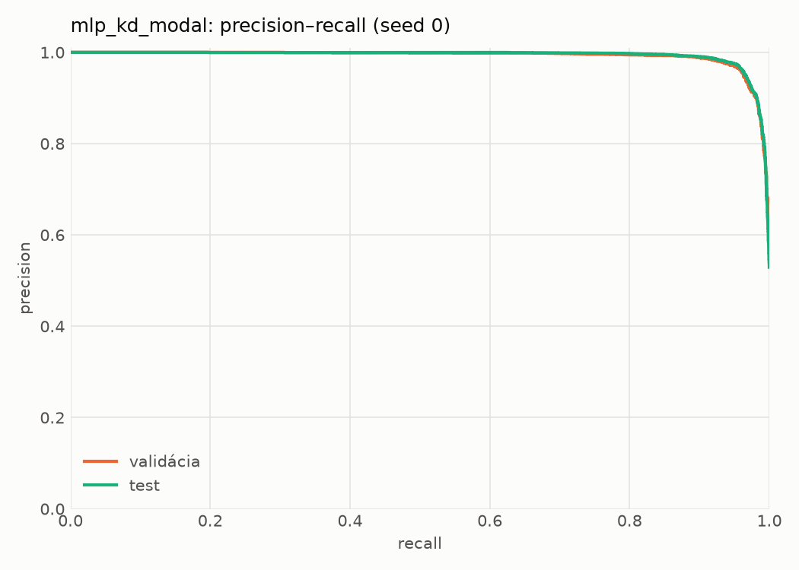
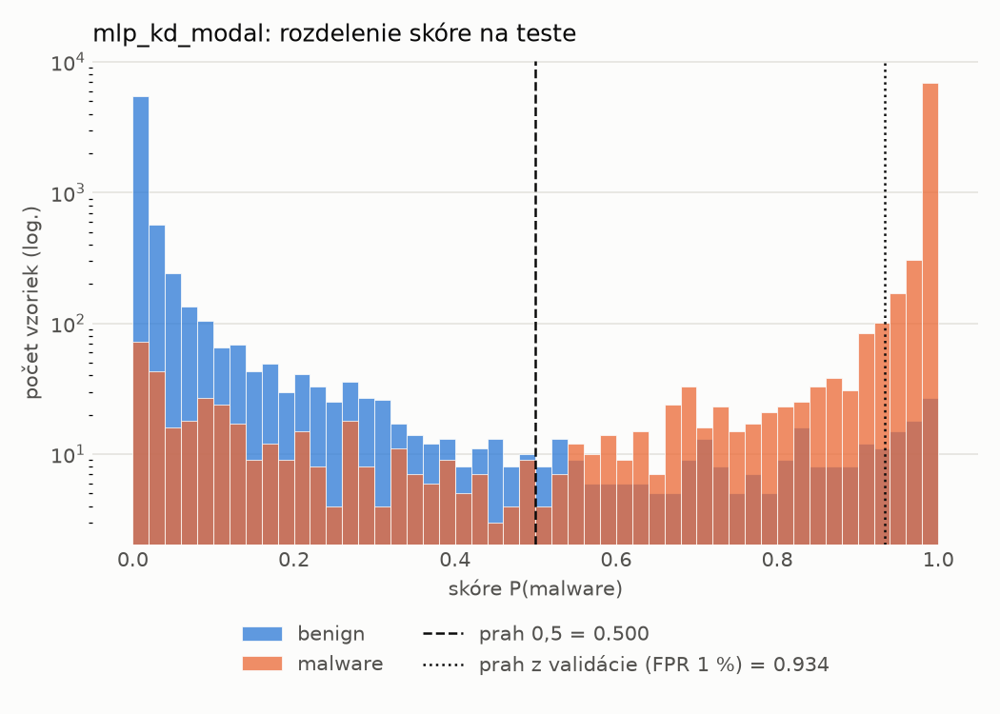
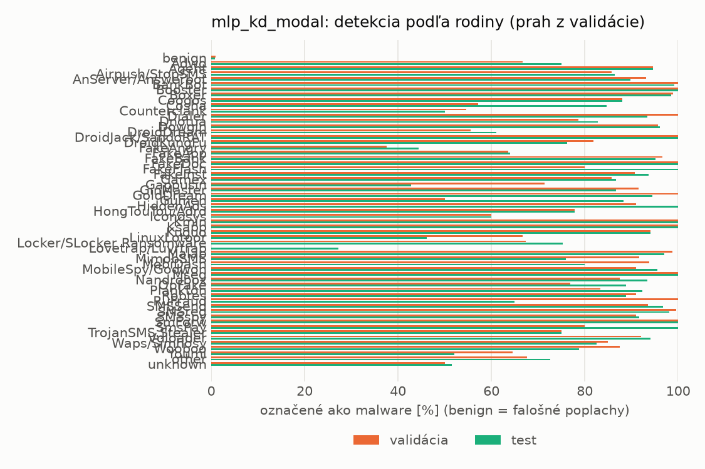
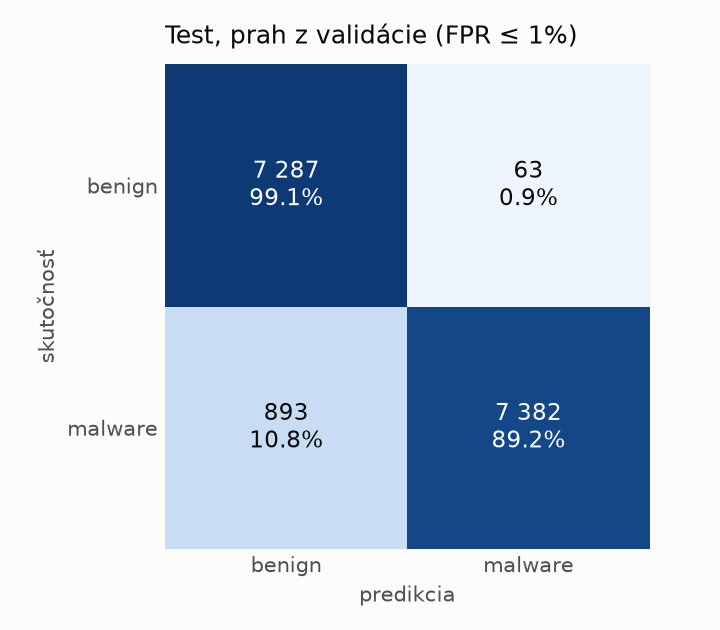
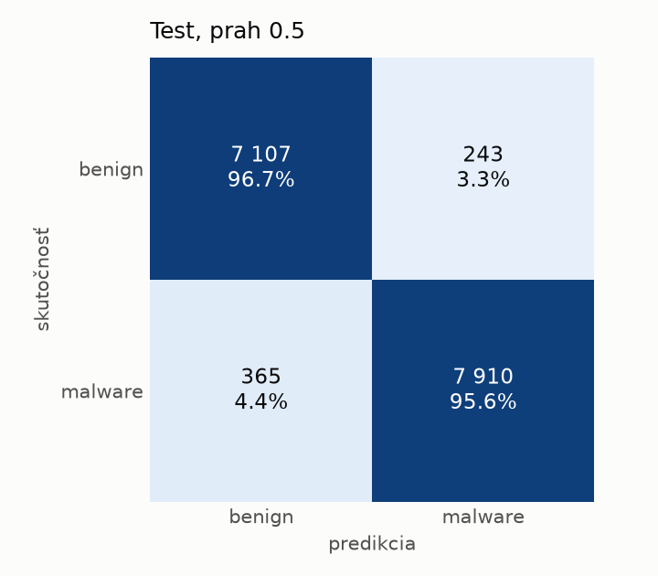
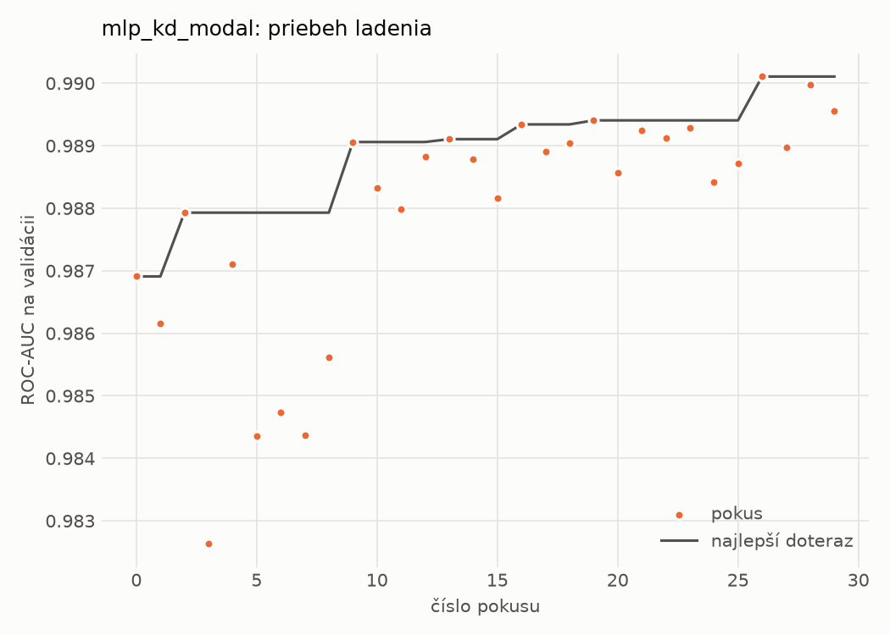
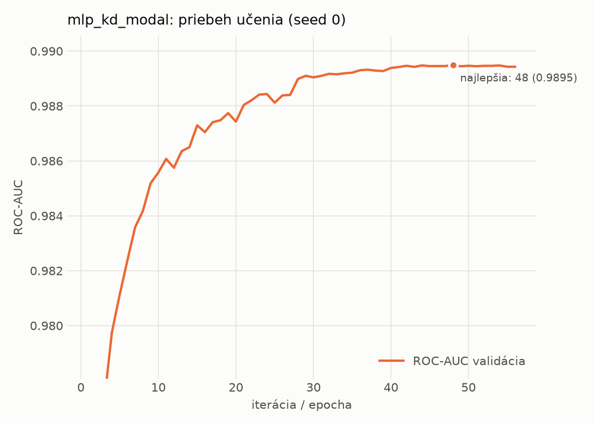

# static/mlp_kd_modal – beh `20261122-204432`

> Automaticky generované (`src/training/run_tabular.py`). Konfigurácia: `config.yaml`, protokol: `protocol.yaml`.

- **Model:** `mlp` – študent – malé MLP učené destiláciou z učiteľa rovnakej modality (variant A)
- **Ladenie:** 30 dokončených pokusov (Optuna TPE), cieľ ROC-AUC na validácii, 4.1 min
- **Finálne modely:** seedy [0, 1, 2]; hodnoty sú priemer ± smerodajná odchýlka cez seedy
- **Najlepšie hyperparametre:** `{"hidden_layers": 1, "max_epochs": 100, "patience": 8, "hidden_width": 64, "dropout": 0.005196375734621726, "lr": 0.0014172842807441423, "weight_decay": 1.1835949733056038e-05, "batch_size": 1024, "kd_alpha": 0.5211229932470658, "kd_temperature": 1.6263320735090332}`

## Detekčná kvalita (bez prahu)
| metrika | train (podvzorka) | validácia | test |
|---|---|---|---|
| ROC-AUC | 0.9939 ± 0.0003 | 0.9895 ± 0.0002 | 0.9901 ± 0.0006 |
| PR-AUC | 0.9954 ± 0.0002 | 0.9916 ± 0.0003 | 0.9927 ± 0.0003 |
| TPR pri FPR 1 % | 0.9343 ± 0.0015 | 0.8835 ± 0.0080 | 0.9028 ± 0.0036 |
| TPR pri FPR 0,1 % | 0.8223 ± 0.0307 | 0.6120 ± 0.0690 | 0.7105 ± 0.0188 |
| log loss | 0.0931 ± 0.0024 | 0.1310 ± 0.0016 | 0.1233 ± 0.0054 |
| Brier skóre | 0.0251 ± 0.0006 | 0.0342 ± 0.0004 | 0.0315 ± 0.0006 |

Rozdiel ROC-AUC train − validácia: **0.0044** (veľký rozdiel = preučenie).

## Pri prahu z validácie (FPR ≤ 1% na validácii)
| metrika | train (podvzorka) | validácia | test |
|---|---|---|---|
| accuracy | 0.9380 ± 0.0041 | 0.9337 ± 0.0043 | 0.9345 ± 0.0037 |
| balanced accuracy | 0.9408 ± 0.0039 | 0.9369 ± 0.0040 | 0.9378 ± 0.0034 |
| precision | 0.9966 ± 0.0008 | 0.9903 ± 0.0001 | 0.9928 ± 0.0012 |
| recall (TPR) | 0.8849 ± 0.0086 | 0.8835 ± 0.0080 | 0.8829 ± 0.0081 |
| FPR | 0.0033 ± 0.0008 | 0.0098 ± 0.0000 | 0.0073 ± 0.0013 |
| F1 | 0.9375 ± 0.0045 | 0.9338 ± 0.0045 | 0.9346 ± 0.0040 |
| MCC | 0.8825 ± 0.0073 | 0.8735 ± 0.0076 | 0.8756 ± 0.0064 |

## Pri pevnom prahu 0.5
| metrika | train (podvzorka) | validácia | test |
|---|---|---|---|
| accuracy | 0.9682 ± 0.0011 | 0.9580 ± 0.0003 | 0.9611 ± 0.0012 |
| balanced accuracy | 0.9686 ± 0.0011 | 0.9582 ± 0.0004 | 0.9614 ± 0.0011 |
| precision | 0.9787 ± 0.0018 | 0.9649 ± 0.0009 | 0.9704 ± 0.0009 |
| recall (TPR) | 0.9604 ± 0.0003 | 0.9555 ± 0.0004 | 0.9557 ± 0.0013 |
| FPR | 0.0232 ± 0.0020 | 0.0391 ± 0.0010 | 0.0328 ± 0.0010 |
| F1 | 0.9695 ± 0.0010 | 0.9602 ± 0.0003 | 0.9630 ± 0.0011 |
| MCC | 0.9365 ± 0.0022 | 0.9159 ± 0.0007 | 0.9221 ± 0.0023 |

## Výpočtové nároky (seed 0, testovacia množina)
| meranie | hodnota |
|---|---|
| tréning finálneho modelu | 5.9 s (priemer cez seedy) |
| ladenie spolu | 244 s |
| počet parametrov / uzlov | 10 753 |
| veľkosť modelu na disku | 0.05 MB |
| transformácia vstupu – latencia (1 vlákno) | 0.015 ms |
| transformácia vstupu – priepustnosť | 622 175 vzoriek/s |
| CPU latencia modelu (batch 1, 1 vlákno) | 0.067 ms (p95 0.076) |
| CPU priepustnosť (24 vlákien) | 3 639 731 vzoriek/s |
| GPU latencia (batch 1) | 0.286 ms (p95 0.314) |
| GPU priepustnosť | 1 894 077 vzoriek/s |
| GPU špičková pamäť | 73 MB |

## Grafy
| | |
|---|---|
|  |  |
|  |  |
|  |  |
|  |  |

## Súbory
`metrics.json` (všetky metriky po seedoch vrátane rodín), `timing.json`, `hpo_trials.csv`,
`predictions/<časť>_seed<N>.parquet` (sha256, family, label, score), `model/seed_<N>/`, `log.txt`.
