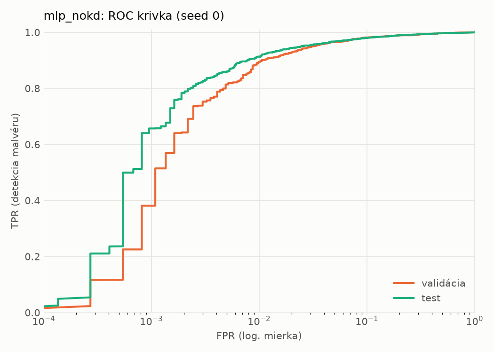
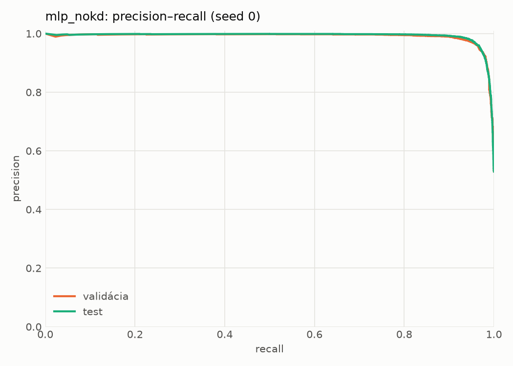
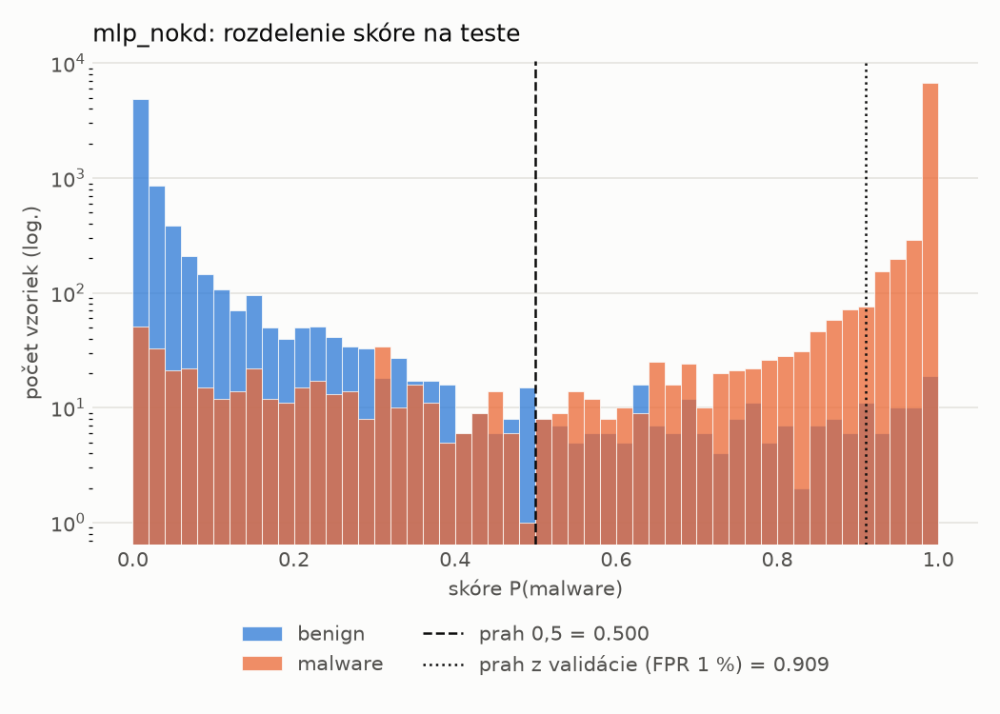
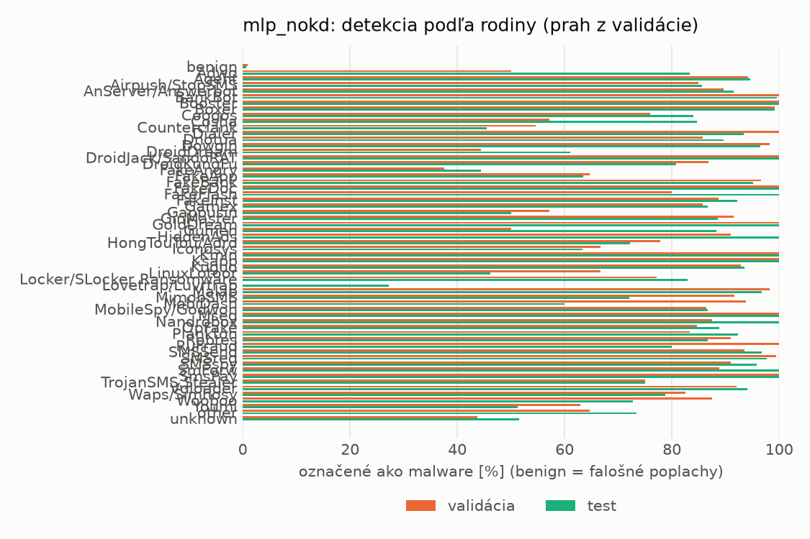
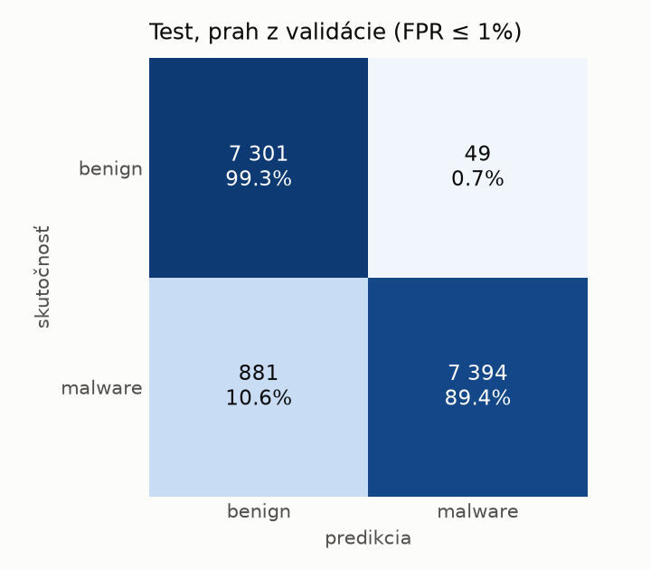
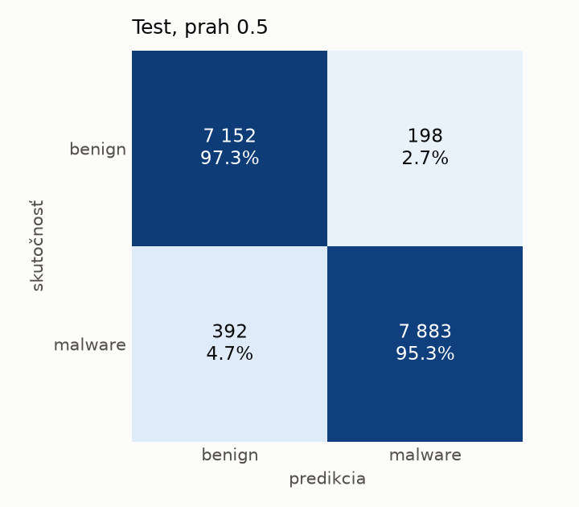
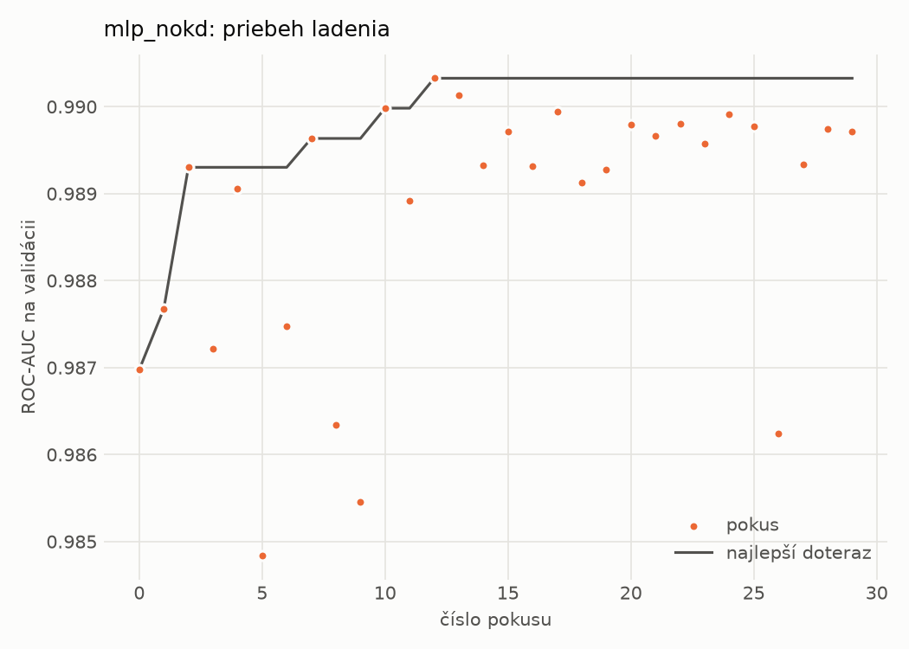
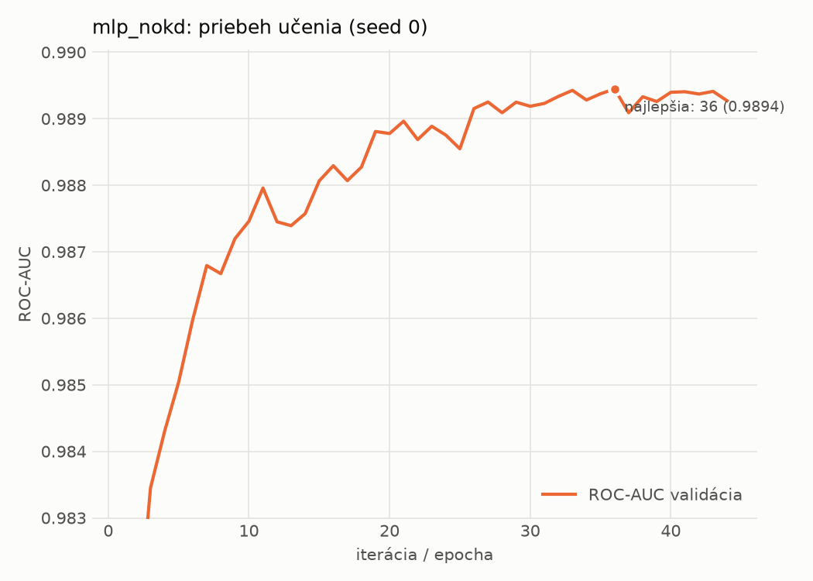

# static/mlp_nokd – beh `20261122-203844`

> Automaticky generované (`src/training/run_tabular.py`). Konfigurácia: `config.yaml`, protokol: `protocol.yaml`.

- **Model:** `mlp` – kontrola – rovnaké malé MLP bez destilácie (iba skutočné označenia)
- **Ladenie:** 30 dokončených pokusov (Optuna TPE), cieľ ROC-AUC na validácii, 5.0 min
- **Finálne modely:** seedy [0, 1, 2]; hodnoty sú priemer ± smerodajná odchýlka cez seedy
- **Najlepšie hyperparametre:** `{"hidden_layers": 1, "max_epochs": 100, "patience": 8, "hidden_width": 64, "dropout": 0.011630579234704915, "lr": 0.0010706598847019353, "weight_decay": 3.845140400781195e-05, "batch_size": 256}`

## Detekčná kvalita (bez prahu)
| metrika | train (podvzorka) | validácia | test |
|---|---|---|---|
| ROC-AUC | 0.9958 ± 0.0003 | 0.9894 ± 0.0000 | 0.9904 ± 0.0005 |
| PR-AUC | 0.9968 ± 0.0002 | 0.9902 ± 0.0003 | 0.9924 ± 0.0006 |
| TPR pri FPR 1 % | 0.9552 ± 0.0007 | 0.8812 ± 0.0185 | 0.9103 ± 0.0103 |
| TPR pri FPR 0,1 % | 0.8591 ± 0.0125 | 0.3241 ± 0.1719 | 0.5952 ± 0.1180 |
| log loss | 0.0756 ± 0.0021 | 0.1245 ± 0.0005 | 0.1145 ± 0.0033 |
| Brier skóre | 0.0204 ± 0.0005 | 0.0322 ± 0.0002 | 0.0294 ± 0.0004 |

Rozdiel ROC-AUC train − validácia: **0.0064** (veľký rozdiel = preučenie).

## Pri prahu z validácie (FPR ≤ 1% na validácii)
| metrika | train (podvzorka) | validácia | test |
|---|---|---|---|
| accuracy | 0.9423 ± 0.0066 | 0.9325 ± 0.0097 | 0.9355 ± 0.0070 |
| balanced accuracy | 0.9450 ± 0.0063 | 0.9358 ± 0.0092 | 0.9388 ± 0.0066 |
| precision | 0.9982 ± 0.0005 | 0.9903 ± 0.0000 | 0.9934 ± 0.0003 |
| recall (TPR) | 0.8918 ± 0.0131 | 0.8812 ± 0.0185 | 0.8841 ± 0.0134 |
| FPR | 0.0018 ± 0.0005 | 0.0097 ± 0.0002 | 0.0066 ± 0.0003 |
| F1 | 0.9419 ± 0.0071 | 0.9325 ± 0.0104 | 0.9356 ± 0.0075 |
| MCC | 0.8905 ± 0.0118 | 0.8715 ± 0.0173 | 0.8775 ± 0.0124 |

## Pri pevnom prahu 0.5
| metrika | train (podvzorka) | validácia | test |
|---|---|---|---|
| accuracy | 0.9738 ± 0.0014 | 0.9586 ± 0.0008 | 0.9633 ± 0.0013 |
| balanced accuracy | 0.9743 ± 0.0013 | 0.9588 ± 0.0009 | 0.9637 ± 0.0012 |
| precision | 0.9851 ± 0.0019 | 0.9657 ± 0.0029 | 0.9741 ± 0.0013 |
| recall (TPR) | 0.9648 ± 0.0026 | 0.9559 ± 0.0017 | 0.9561 ± 0.0032 |
| FPR | 0.0162 ± 0.0021 | 0.0383 ± 0.0034 | 0.0286 ± 0.0016 |
| F1 | 0.9748 ± 0.0013 | 0.9607 ± 0.0007 | 0.9650 ± 0.0013 |
| MCC | 0.9478 ± 0.0027 | 0.9171 ± 0.0016 | 0.9266 ± 0.0025 |

## Výpočtové nároky (seed 0, testovacia množina)
| meranie | hodnota |
|---|---|
| tréning finálneho modelu | 14.5 s (priemer cez seedy) |
| ladenie spolu | 302 s |
| počet parametrov / uzlov | 10 753 |
| veľkosť modelu na disku | 0.05 MB |
| transformácia vstupu – latencia (1 vlákno) | 0.015 ms |
| transformácia vstupu – priepustnosť | 615 681 vzoriek/s |
| CPU latencia modelu (batch 1, 1 vlákno) | 0.068 ms (p95 0.162) |
| CPU priepustnosť (24 vlákien) | 3 324 468 vzoriek/s |
| GPU latencia (batch 1) | 0.457 ms (p95 0.475) |
| GPU priepustnosť | 1 521 259 vzoriek/s |
| GPU špičková pamäť | 114 MB |

## Grafy
| | |
|---|---|
|  |  |
|  |  |
|  |  |
|  |  |

## Súbory
`metrics.json` (všetky metriky po seedoch vrátane rodín), `timing.json`, `hpo_trials.csv`,
`predictions/<časť>_seed<N>.parquet` (sha256, family, label, score), `model/seed_<N>/`, `log.txt`.
