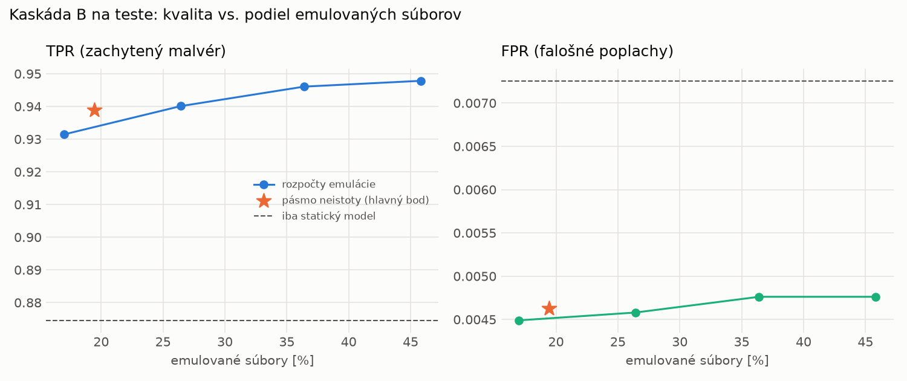

# Kaskáda B `b_baselines` – beh `20261122-214805`

> Generované `src/cascade/evaluate_b.py` (2026-11-22T21:48:05+01:00). Seedy: [0, 1, 2]; hodnoty = priemer ± sm. odchýlka.
> Všetky prahy a pásmo neistoty sú z validácie; test sa na nič nenastavuje. Postup: `docs/09_plan_v2.md`.

| rola | beh |
|---|---|
| static | `runs_v4/real_full/lofo/Airpush_StopSMS/static/lightgbm/20261122-213043` |
| dynamic | `runs_v4/real_full/lofo/Airpush_StopSMS/dynamic/lightgbm/20261122-213330` |
| hybrid | `runs_v4/real_full/lofo/Airpush_StopSMS/hybrid/lightgbm/20261122-213609` |

Druhý stupeň: **dynamic**. Pásmo neistoty statického modelu: FPR ≤ 0.1% nad `hi`,
najviac 1% malvéru validácie pod `lo` (seed 0: lo = 0.0438, hi = 0.9829, seed 1: lo = 0.0375, hi = 0.9926, seed 2: lo = 0.0266, hi = 0.9955).

## Test
| prístup | accuracy | balanced_accuracy | precision | recall_tpr | fpr | f1 | mcc |
|---|---|---|---|---|---|---|---|
| kaskáda B | 0.9655 ± 0.0004 | 0.9672 ± 0.0004 | 0.9956 ± 0.0001 | 0.9390 ± 0.0008 | 0.0046 ± 0.0001 | 0.9665 ± 0.0004 | 0.9327 ± 0.0008 |
| statický | 0.9302 ± 0.0032 | 0.9337 ± 0.0030 | 0.9927 ± 0.0003 | 0.8746 ± 0.0062 | 0.0073 ± 0.0003 | 0.9299 ± 0.0034 | 0.8677 ± 0.0056 |
| dynamický | 0.9254 ± 0.0012 | 0.9291 ± 0.0011 | 0.9913 ± 0.0002 | 0.8666 ± 0.0024 | 0.0085 ± 0.0002 | 0.9248 ± 0.0013 | 0.8590 ± 0.0021 |
| hybrid (každá vzorka) | 0.9731 ± 0.0001 | 0.9741 ± 0.0000 | 0.9931 ± 0.0002 | 0.9558 ± 0.0003 | 0.0075 ± 0.0002 | 0.9741 ± 0.0001 | 0.9468 ± 0.0001 |

- **emulované súbory: 19.46%** (ostatné rozhodne iba statický model); na hybrid ide 6.78% súborov
- chyby pri istom rozhodnutí statického modelu (seed 0): 194
- validácia: emulované 12.40%, na hybrid 3.00%

## Validácia
| prístup | accuracy | balanced_accuracy | precision | recall_tpr | fpr | f1 | mcc |
|---|---|---|---|---|---|---|---|
| kaskáda B | 0.9828 ± 0.0003 | 0.9823 ± 0.0003 | 0.9933 ± 0.0003 | 0.9706 ± 0.0005 | 0.0060 ± 0.0003 | 0.9818 ± 0.0003 | 0.9657 ± 0.0006 |
| statický | 0.9764 ± 0.0015 | 0.9757 ± 0.0015 | 0.9890 ± 0.0000 | 0.9612 ± 0.0031 | 0.0098 ± 0.0000 | 0.9749 ± 0.0016 | 0.9529 ± 0.0029 |
| dynamický | 0.9363 ± 0.0005 | 0.9338 ± 0.0005 | 0.9882 ± 0.0002 | 0.8772 ± 0.0011 | 0.0096 ± 0.0002 | 0.9294 ± 0.0006 | 0.8768 ± 0.0008 |
| hybrid (každá vzorka) | 0.9828 ± 0.0005 | 0.9824 ± 0.0005 | 0.9901 ± 0.0008 | 0.9737 ± 0.0003 | 0.0089 ± 0.0007 | 0.9819 ± 0.0005 | 0.9656 ± 0.0010 |

## Januárové vzorky vynechanej rodiny (iba malvér → TPR)
| prístup | TPR |
|---|---|
| kaskáda B | 0.8105 ± 0.0047 |
| statický | 0.4982 ± 0.0189 |
| dynamický | 0.8570 ± 0.0010 |
| hybrid (každá vzorka) | 0.8798 ± 0.0027 |

Podiel emulovaných: 79.83%

## Krivka rozpočtu emulácie (test, priemer cez seedy)
| budget_val | emulation_rate | hybrid_rate | recall_tpr | fpr | f1 |
|---|---|---|---|---|---|
| 0.1000 | 0.1700 | 0.0637 | 0.9314 | 0.0045 | 0.9625 |
| 0.2000 | 0.2643 | 0.0805 | 0.9401 | 0.0046 | 0.9671 |
| 0.3000 | 0.3640 | 0.0914 | 0.9461 | 0.0048 | 0.9702 |
| 0.4000 | 0.4582 | 0.0998 | 0.9478 | 0.0048 | 0.9711 |

## Výpočtové nároky
Čas dynamickej analýzy (beh v emulátore alebo na zariadení) dataset neuvádza, preto sa neodhaduje. Úspora kaskády B = podiel súborov s dynamickou analýzou: **19.46%** (ostatné prístupy 100 %).

_Chýba benchmark niektorého komponentu (v zero-day behoch sa nemeria)._

