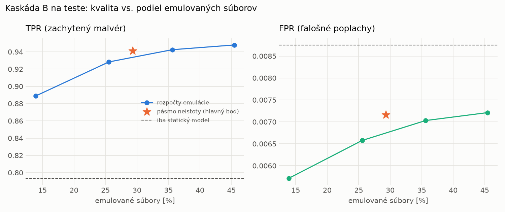

# Kaskáda B `b_direct` – beh `20261122-214800`

> Generované `src/cascade/evaluate_b.py` (2026-11-22T21:48:00+01:00). Seedy: [0, 1, 2]; hodnoty = priemer ± sm. odchýlka.
> Všetky prahy a pásmo neistoty sú z validácie; test sa na nič nenastavuje. Postup: `docs/09_plan_v2.md`.

| rola | beh |
|---|---|
| static | `runs_v4/real_full/lofo/Airpush_StopSMS/students_static/mlp_kd/20261122-214307` |
| hybrid | `runs_v4/real_full/lofo/Airpush_StopSMS/hybrid/lightgbm/20261122-213609` |

Druhý stupeň: **hybrid**. Pásmo neistoty statického modelu: FPR ≤ 0.1% nad `hi`,
najviac 1% malvéru validácie pod `lo` (seed 0: lo = 0.0393, hi = 0.9994, seed 1: lo = 0.0199, hi = 0.9965, seed 2: lo = 0.0255, hi = 0.9988).

## Test
| prístup | accuracy | balanced_accuracy | precision | recall_tpr | fpr | f1 | mcc |
|---|---|---|---|---|---|---|---|
| kaskáda B | 0.9655 ± 0.0016 | 0.9670 ± 0.0015 | 0.9933 ± 0.0004 | 0.9412 ± 0.0035 | 0.0072 ± 0.0005 | 0.9665 ± 0.0017 | 0.9324 ± 0.0030 |
| statický | 0.8865 ± 0.0011 | 0.8924 ± 0.0010 | 0.9903 ± 0.0002 | 0.7935 ± 0.0020 | 0.0088 ± 0.0002 | 0.8811 ± 0.0012 | 0.7925 ± 0.0018 |
| hybrid (každá vzorka) | 0.9731 ± 0.0001 | 0.9741 ± 0.0000 | 0.9931 ± 0.0002 | 0.9558 ± 0.0003 | 0.0075 ± 0.0002 | 0.9741 ± 0.0001 | 0.9468 ± 0.0001 |

- **emulované súbory: 29.31%** (ostatné rozhodne iba statický model); na hybrid ide 29.31% súborov
- chyby pri istom rozhodnutí statického modelu (seed 0): 236
- validácia: emulované 23.48%, na hybrid 23.48%

## Validácia
| prístup | accuracy | balanced_accuracy | precision | recall_tpr | fpr | f1 | mcc |
|---|---|---|---|---|---|---|---|
| kaskáda B | 0.9820 ± 0.0004 | 0.9815 ± 0.0003 | 0.9909 ± 0.0008 | 0.9712 ± 0.0002 | 0.0082 ± 0.0007 | 0.9810 ± 0.0004 | 0.9641 ± 0.0007 |
| statický | 0.9538 ± 0.0020 | 0.9521 ± 0.0021 | 0.9884 ± 0.0001 | 0.9139 ± 0.0042 | 0.0098 ± 0.0000 | 0.9497 ± 0.0023 | 0.9094 ± 0.0038 |
| hybrid (každá vzorka) | 0.9828 ± 0.0005 | 0.9824 ± 0.0005 | 0.9901 ± 0.0008 | 0.9737 ± 0.0003 | 0.0089 ± 0.0007 | 0.9819 ± 0.0005 | 0.9656 ± 0.0010 |

## Januárové vzorky vynechanej rodiny (iba malvér → TPR)
| prístup | TPR |
|---|---|
| kaskáda B | 0.8200 ± 0.0135 |
| statický | 0.2954 ± 0.0113 |
| hybrid (každá vzorka) | 0.8798 ± 0.0027 |

Podiel emulovaných: 83.90%

## Krivka rozpočtu emulácie (test, priemer cez seedy)
| budget_val | emulation_rate | hybrid_rate | recall_tpr | fpr | f1 |
|---|---|---|---|---|---|
| 0.1000 | 0.1392 | 0.1392 | 0.8888 | 0.0057 | 0.9386 |
| 0.2000 | 0.2554 | 0.2554 | 0.9283 | 0.0066 | 0.9599 |
| 0.3000 | 0.3561 | 0.3561 | 0.9425 | 0.0070 | 0.9673 |
| 0.4000 | 0.4545 | 0.4545 | 0.9480 | 0.0072 | 0.9701 |

## Výpočtové nároky
Čas dynamickej analýzy (beh v emulátore alebo na zariadení) dataset neuvádza, preto sa neodhaduje. Úspora kaskády B = podiel súborov s dynamickou analýzou: **29.31%** (ostatné prístupy 100 %).

_Chýba benchmark niektorého komponentu (v zero-day behoch sa nemeria)._

