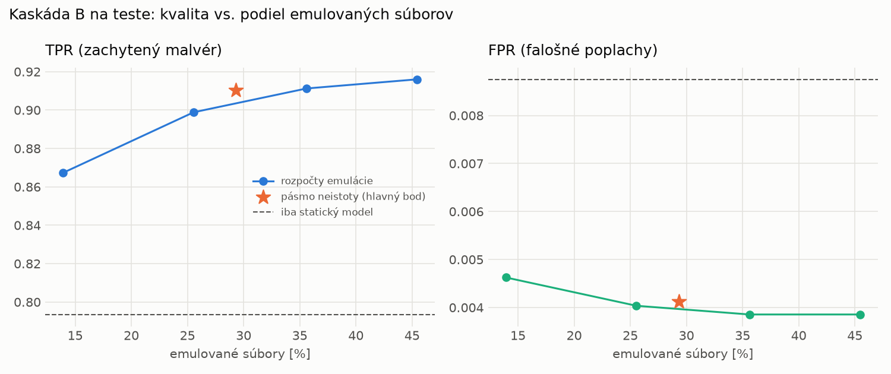

# Kaskáda B `b_heavy` – beh `20261122-214803`

> Generované `src/cascade/evaluate_b.py` (2026-11-22T21:48:03+01:00). Seedy: [0, 1, 2]; hodnoty = priemer ± sm. odchýlka.
> Všetky prahy a pásmo neistoty sú z validácie; test sa na nič nenastavuje. Postup: `docs/09_plan_v2.md`.

| rola | beh |
|---|---|
| static | `runs_v4/real_full/lofo/Airpush_StopSMS/students_static/mlp_kd/20261122-214307` |
| dynamic | `runs_v4/real_full/lofo/Airpush_StopSMS/students_dynamic/mlp_kd/20261122-214433` |
| hybrid | `runs_v4/real_full/lofo/Airpush_StopSMS/hybrid/mlp_large/20261122-213736` |

Druhý stupeň: **dynamic**. Pásmo neistoty statického modelu: FPR ≤ 0.1% nad `hi`,
najviac 1% malvéru validácie pod `lo` (seed 0: lo = 0.0393, hi = 0.9994, seed 1: lo = 0.0199, hi = 0.9965, seed 2: lo = 0.0255, hi = 0.9988).

## Test
| prístup | accuracy | balanced_accuracy | precision | recall_tpr | fpr | f1 | mcc |
|---|---|---|---|---|---|---|---|
| kaskáda B | 0.9506 ± 0.0016 | 0.9531 ± 0.0015 | 0.9960 ± 0.0003 | 0.9104 ± 0.0030 | 0.0041 ± 0.0003 | 0.9513 ± 0.0016 | 0.9052 ± 0.0029 |
| statický | 0.8865 ± 0.0011 | 0.8924 ± 0.0010 | 0.9903 ± 0.0002 | 0.7935 ± 0.0020 | 0.0088 ± 0.0002 | 0.8811 ± 0.0012 | 0.7925 ± 0.0018 |
| dynamický | 0.8572 ± 0.0007 | 0.8646 ± 0.0006 | 0.9885 ± 0.0002 | 0.7389 ± 0.0012 | 0.0097 ± 0.0001 | 0.8456 ± 0.0008 | 0.7442 ± 0.0011 |
| hybrid (každá vzorka) | 0.9664 ± 0.0011 | 0.9678 ± 0.0011 | 0.9919 ± 0.0010 | 0.9442 ± 0.0026 | 0.0087 ± 0.0011 | 0.9675 ± 0.0012 | 0.9339 ± 0.0022 |

- **emulované súbory: 29.31%** (ostatné rozhodne iba statický model); na hybrid ide 11.62% súborov
- chyby pri istom rozhodnutí statického modelu (seed 0): 236
- validácia: emulované 23.48%, na hybrid 6.59%

## Validácia
| prístup | accuracy | balanced_accuracy | precision | recall_tpr | fpr | f1 | mcc |
|---|---|---|---|---|---|---|---|
| kaskáda B | 0.9696 ± 0.0009 | 0.9684 ± 0.0010 | 0.9953 ± 0.0005 | 0.9409 ± 0.0016 | 0.0041 ± 0.0005 | 0.9673 ± 0.0010 | 0.9403 ± 0.0018 |
| statický | 0.9538 ± 0.0020 | 0.9521 ± 0.0021 | 0.9884 ± 0.0001 | 0.9139 ± 0.0042 | 0.0098 ± 0.0000 | 0.9497 ± 0.0023 | 0.9094 ± 0.0038 |
| dynamický | 0.8670 ± 0.0006 | 0.8613 ± 0.0006 | 0.9856 ± 0.0000 | 0.7323 ± 0.0012 | 0.0098 ± 0.0000 | 0.8403 ± 0.0008 | 0.7542 ± 0.0010 |
| hybrid (každá vzorka) | 0.9783 ± 0.0020 | 0.9777 ± 0.0021 | 0.9891 ± 0.0002 | 0.9651 ± 0.0042 | 0.0097 ± 0.0002 | 0.9770 ± 0.0022 | 0.9566 ± 0.0040 |

## Januárové vzorky vynechanej rodiny (iba malvér → TPR)
| prístup | TPR |
|---|---|
| kaskáda B | 0.7794 ± 0.0161 |
| statický | 0.2954 ± 0.0113 |
| dynamický | 0.8100 ± 0.0016 |
| hybrid (každá vzorka) | 0.8680 ± 0.0058 |

Podiel emulovaných: 83.90%

## Krivka rozpočtu emulácie (test, priemer cez seedy)
| budget_val | emulation_rate | hybrid_rate | recall_tpr | fpr | f1 |
|---|---|---|---|---|---|
| 0.1000 | 0.1392 | 0.0730 | 0.8673 | 0.0046 | 0.9269 |
| 0.2000 | 0.2554 | 0.1131 | 0.8989 | 0.0040 | 0.9449 |
| 0.3000 | 0.3561 | 0.1333 | 0.9113 | 0.0039 | 0.9519 |
| 0.4000 | 0.4545 | 0.1453 | 0.9160 | 0.0039 | 0.9545 |

## Výpočtové nároky
Čas dynamickej analýzy (beh v emulátore alebo na zariadení) dataset neuvádza, preto sa neodhaduje. Úspora kaskády B = podiel súborov s dynamickou analýzou: **29.31%** (ostatné prístupy 100 %).

_Chýba benchmark niektorého komponentu (v zero-day behoch sa nemeria)._

