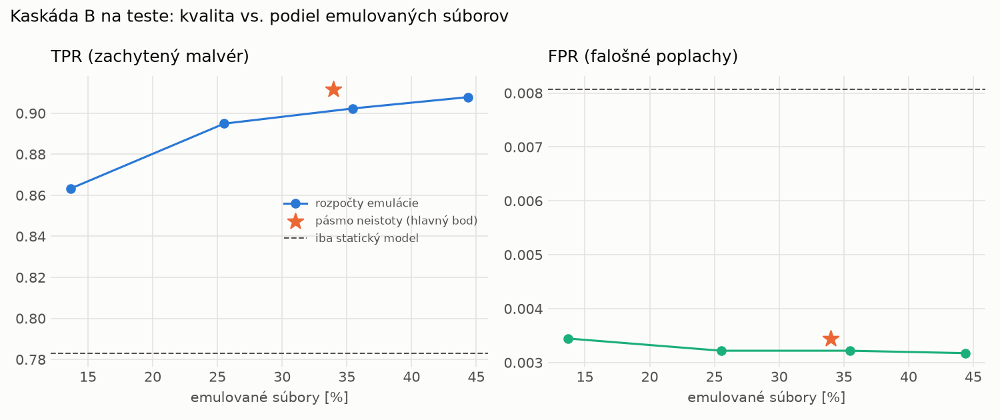

# Kaskáda B `b_heavyteacher` – beh `20261122-214810`

> Generované `src/cascade/evaluate_b.py` (2026-11-22T21:48:11+01:00). Seedy: [0, 1, 2]; hodnoty = priemer ± sm. odchýlka.
> Všetky prahy a pásmo neistoty sú z validácie; test sa na nič nenastavuje. Postup: `docs/09_plan_v2.md`.

| rola | beh |
|---|---|
| static | `runs_v4/real_full/lofo/Airpush_StopSMS/students_static/mlp_kd_heavy/20261122-214413` |
| dynamic | `runs_v4/real_full/lofo/Airpush_StopSMS/students_dynamic/mlp_kd_heavy/20261122-214629` |
| hybrid | `runs_v4/real_full/lofo/Airpush_StopSMS/hybrid/lightgbm/20261122-213609` |

Druhý stupeň: **dynamic**. Pásmo neistoty statického modelu: FPR ≤ 0.1% nad `hi`,
najviac 1% malvéru validácie pod `lo` (seed 0: lo = 0.0402, hi = 0.9989, seed 1: lo = 0.0352, hi = 0.9974, seed 2: lo = 0.0379, hi = 0.9993).

## Test
| prístup | accuracy | balanced_accuracy | precision | recall_tpr | fpr | f1 | mcc |
|---|---|---|---|---|---|---|---|
| kaskáda B | 0.9516 ± 0.0008 | 0.9541 ± 0.0008 | 0.9967 ± 0.0003 | 0.9117 ± 0.0012 | 0.0034 ± 0.0003 | 0.9523 ± 0.0008 | 0.9071 ± 0.0015 |
| statický | 0.8813 ± 0.0028 | 0.8875 ± 0.0026 | 0.9909 ± 0.0009 | 0.7830 ± 0.0052 | 0.0081 ± 0.0008 | 0.8748 ± 0.0033 | 0.7841 ± 0.0046 |
| dynamický | 0.8658 ± 0.0026 | 0.8728 ± 0.0025 | 0.9886 ± 0.0012 | 0.7554 ± 0.0048 | 0.0098 ± 0.0010 | 0.8564 ± 0.0032 | 0.7581 ± 0.0044 |
| hybrid (každá vzorka) | 0.9731 ± 0.0001 | 0.9741 ± 0.0000 | 0.9931 ± 0.0002 | 0.9558 ± 0.0003 | 0.0075 ± 0.0002 | 0.9741 ± 0.0001 | 0.9468 ± 0.0001 |

- **emulované súbory: 33.97%** (ostatné rozhodne iba statický model); na hybrid ide 12.52% súborov
- chyby pri istom rozhodnutí statického modelu (seed 0): 215
- validácia: emulované 28.24%, na hybrid 7.51%

## Validácia
| prístup | accuracy | balanced_accuracy | precision | recall_tpr | fpr | f1 | mcc |
|---|---|---|---|---|---|---|---|
| kaskáda B | 0.9716 ± 0.0015 | 0.9705 ± 0.0016 | 0.9952 ± 0.0008 | 0.9451 ± 0.0025 | 0.0042 ± 0.0007 | 0.9695 ± 0.0017 | 0.9440 ± 0.0030 |
| statický | 0.9494 ± 0.0020 | 0.9475 ± 0.0021 | 0.9884 ± 0.0001 | 0.9046 ± 0.0044 | 0.0097 ± 0.0002 | 0.9447 ± 0.0024 | 0.9012 ± 0.0038 |
| dynamický | 0.8780 ± 0.0022 | 0.8728 ± 0.0023 | 0.9860 ± 0.0001 | 0.7553 ± 0.0046 | 0.0098 ± 0.0000 | 0.8554 ± 0.0030 | 0.7731 ± 0.0038 |
| hybrid (každá vzorka) | 0.9828 ± 0.0005 | 0.9824 ± 0.0005 | 0.9901 ± 0.0008 | 0.9737 ± 0.0003 | 0.0089 ± 0.0007 | 0.9819 ± 0.0005 | 0.9656 ± 0.0010 |

## Januárové vzorky vynechanej rodiny (iba malvér → TPR)
| prístup | TPR |
|---|---|
| kaskáda B | 0.7837 ± 0.0023 |
| statický | 0.2785 ± 0.0194 |
| dynamický | 0.8217 ± 0.0023 |
| hybrid (každá vzorka) | 0.8798 ± 0.0027 |

Podiel emulovaných: 87.34%

## Krivka rozpočtu emulácie (test, priemer cez seedy)
| budget_val | emulation_rate | hybrid_rate | recall_tpr | fpr | f1 |
|---|---|---|---|---|---|
| 0.1000 | 0.1367 | 0.0730 | 0.8633 | 0.0034 | 0.9251 |
| 0.2000 | 0.2552 | 0.1122 | 0.8949 | 0.0032 | 0.9431 |
| 0.3000 | 0.3547 | 0.1276 | 0.9023 | 0.0032 | 0.9472 |
| 0.4000 | 0.4437 | 0.1388 | 0.9078 | 0.0032 | 0.9503 |

## Výpočtové nároky
Čas dynamickej analýzy (beh v emulátore alebo na zariadení) dataset neuvádza, preto sa neodhaduje. Úspora kaskády B = podiel súborov s dynamickou analýzou: **33.97%** (ostatné prístupy 100 %).

_Chýba benchmark niektorého komponentu (v zero-day behoch sa nemeria)._

