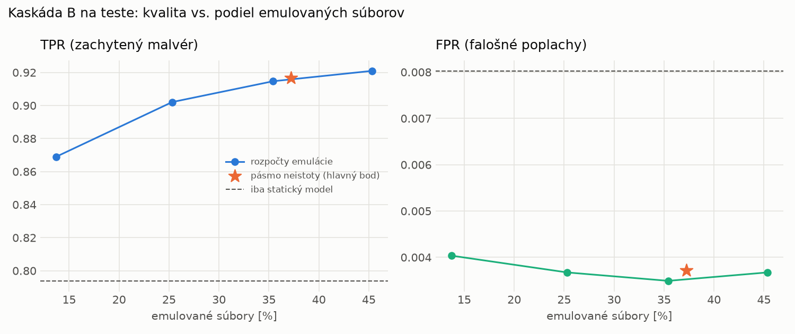

# Kaskáda B `b_nokd` – beh `20261122-214808`

> Generované `src/cascade/evaluate_b.py` (2026-11-22T21:48:08+01:00). Seedy: [0, 1, 2]; hodnoty = priemer ± sm. odchýlka.
> Všetky prahy a pásmo neistoty sú z validácie; test sa na nič nenastavuje. Postup: `docs/09_plan_v2.md`.

| rola | beh |
|---|---|
| static | `runs_v4/real_full/lofo/Airpush_StopSMS/students_static/mlp_nokd/20261122-214324` |
| dynamic | `runs_v4/real_full/lofo/Airpush_StopSMS/students_dynamic/mlp_nokd/20261122-214508` |
| hybrid | `runs_v4/real_full/lofo/Airpush_StopSMS/hybrid/lightgbm/20261122-213609` |

Druhý stupeň: **dynamic**. Pásmo neistoty statického modelu: FPR ≤ 0.1% nad `hi`,
najviac 1% malvéru validácie pod `lo` (seed 0: lo = 0.0327, hi = 0.9974, seed 1: lo = 0.0347, hi = 0.9997, seed 2: lo = 0.0364, hi = 0.9995).

## Test
| prístup | accuracy | balanced_accuracy | precision | recall_tpr | fpr | f1 | mcc |
|---|---|---|---|---|---|---|---|
| kaskáda B | 0.9541 ± 0.0014 | 0.9564 ± 0.0013 | 0.9964 ± 0.0003 | 0.9166 ± 0.0027 | 0.0037 ± 0.0003 | 0.9548 ± 0.0015 | 0.9116 ± 0.0026 |
| statický | 0.8871 ± 0.0041 | 0.8929 ± 0.0038 | 0.9911 ± 0.0013 | 0.7939 ± 0.0083 | 0.0080 ± 0.0012 | 0.8816 ± 0.0049 | 0.7937 ± 0.0066 |
| dynamický | 0.8655 ± 0.0018 | 0.8724 ± 0.0017 | 0.9876 ± 0.0009 | 0.7555 ± 0.0034 | 0.0107 ± 0.0008 | 0.8561 ± 0.0021 | 0.7573 ± 0.0029 |
| hybrid (každá vzorka) | 0.9731 ± 0.0001 | 0.9741 ± 0.0000 | 0.9931 ± 0.0002 | 0.9558 ± 0.0003 | 0.0075 ± 0.0002 | 0.9741 ± 0.0001 | 0.9468 ± 0.0001 |

- **emulované súbory: 37.22%** (ostatné rozhodne iba statický model); na hybrid ide 12.71% súborov
- chyby pri istom rozhodnutí statického modelu (seed 0): 182
- validácia: emulované 31.90%, na hybrid 7.88%

## Validácia
| prístup | accuracy | balanced_accuracy | precision | recall_tpr | fpr | f1 | mcc |
|---|---|---|---|---|---|---|---|
| kaskáda B | 0.9732 ± 0.0015 | 0.9722 ± 0.0016 | 0.9950 ± 0.0003 | 0.9487 ± 0.0031 | 0.0044 ± 0.0003 | 0.9713 ± 0.0017 | 0.9472 ± 0.0029 |
| statický | 0.9524 ± 0.0041 | 0.9507 ± 0.0042 | 0.9885 ± 0.0002 | 0.9111 ± 0.0085 | 0.0097 ± 0.0002 | 0.9482 ± 0.0046 | 0.9070 ± 0.0077 |
| dynamický | 0.8765 ± 0.0028 | 0.8712 ± 0.0029 | 0.9861 ± 0.0003 | 0.7520 ± 0.0056 | 0.0097 ± 0.0002 | 0.8533 ± 0.0037 | 0.7705 ± 0.0048 |
| hybrid (každá vzorka) | 0.9828 ± 0.0005 | 0.9824 ± 0.0005 | 0.9901 ± 0.0008 | 0.9737 ± 0.0003 | 0.0089 ± 0.0007 | 0.9819 ± 0.0005 | 0.9656 ± 0.0010 |

## Januárové vzorky vynechanej rodiny (iba malvér → TPR)
| prístup | TPR |
|---|---|
| kaskáda B | 0.7939 ± 0.0082 |
| statický | 0.3165 ± 0.0186 |
| dynamický | 0.8240 ± 0.0021 |
| hybrid (každá vzorka) | 0.8798 ± 0.0027 |

Podiel emulovaných: 86.81%

## Krivka rozpočtu emulácie (test, priemer cez seedy)
| budget_val | emulation_rate | hybrid_rate | recall_tpr | fpr | f1 |
|---|---|---|---|---|---|
| 0.1000 | 0.1371 | 0.0697 | 0.8690 | 0.0040 | 0.9281 |
| 0.2000 | 0.2532 | 0.1082 | 0.9021 | 0.0037 | 0.9469 |
| 0.3000 | 0.3542 | 0.1250 | 0.9147 | 0.0035 | 0.9539 |
| 0.4000 | 0.4533 | 0.1368 | 0.9210 | 0.0037 | 0.9572 |

## Výpočtové nároky
Čas dynamickej analýzy (beh v emulátore alebo na zariadení) dataset neuvádza, preto sa neodhaduje. Úspora kaskády B = podiel súborov s dynamickou analýzou: **37.22%** (ostatné prístupy 100 %).

_Chýba benchmark niektorého komponentu (v zero-day behoch sa nemeria)._

