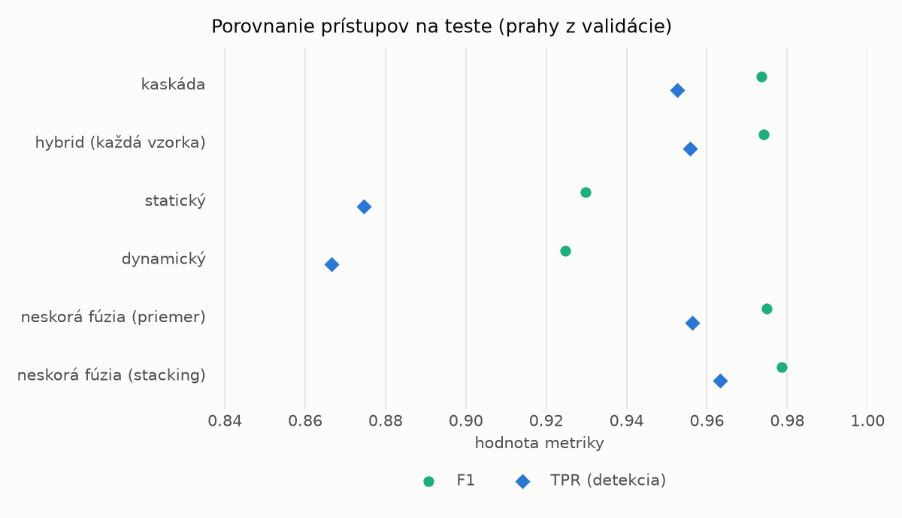
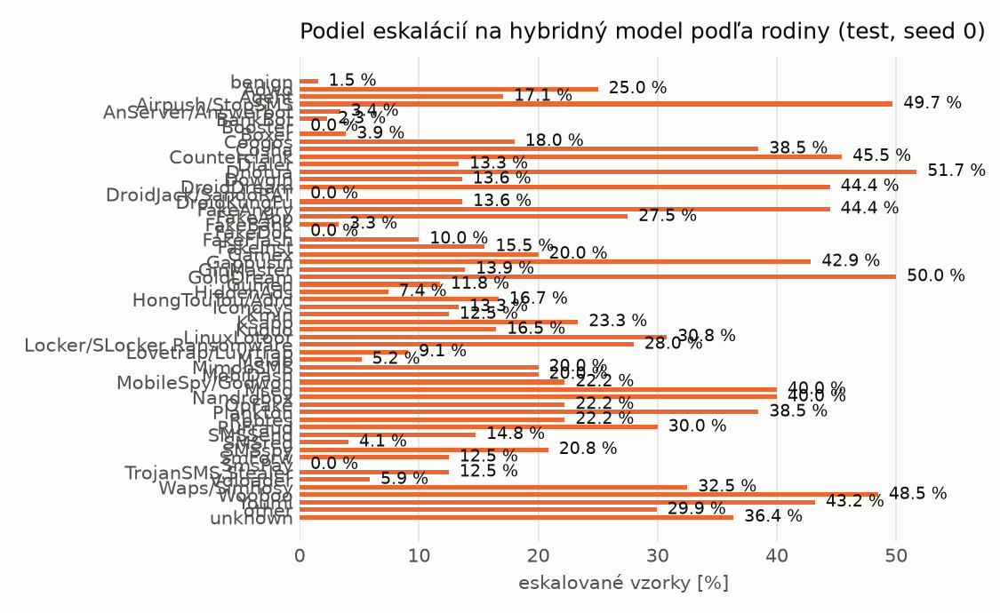

# Kaskáda `baselines` – beh `20261122-214752`

> Generované `src/cascade/evaluate.py` (2026-11-22T21:47:52+01:00). Seedy: [0, 1, 2]; hodnoty = priemer ± sm. odchýlka.
> Všetky prahy sú určené na validácii (FPR ≤ 1 %); test sa na nič nenastavuje.

| rola | beh |
|---|---|
| static | `runs_v4/real_full/lofo/Airpush_StopSMS/static/lightgbm/20261122-213043` |
| dynamic | `runs_v4/real_full/lofo/Airpush_StopSMS/dynamic/lightgbm/20261122-213330` |
| hybrid | `runs_v4/real_full/lofo/Airpush_StopSMS/hybrid/lightgbm/20261122-213609` |

## Test
| prístup | accuracy | balanced_accuracy | precision | recall_tpr | fpr | f1 | mcc |
|---|---|---|---|---|---|---|---|
| kaskáda | 0.9727 ± 0.0007 | 0.9740 ± 0.0006 | 0.9956 ± 0.0001 | 0.9527 ± 0.0012 | 0.0048 ± 0.0001 | 0.9737 ± 0.0006 | 0.9463 ± 0.0013 |
| hybrid (každá vzorka) | 0.9731 ± 0.0001 | 0.9741 ± 0.0000 | 0.9931 ± 0.0002 | 0.9558 ± 0.0003 | 0.0075 ± 0.0002 | 0.9741 ± 0.0001 | 0.9468 ± 0.0001 |
| statický | 0.9302 ± 0.0032 | 0.9337 ± 0.0030 | 0.9927 ± 0.0003 | 0.8746 ± 0.0062 | 0.0073 ± 0.0003 | 0.9299 ± 0.0034 | 0.8677 ± 0.0056 |
| dynamický | 0.9254 ± 0.0012 | 0.9291 ± 0.0011 | 0.9913 ± 0.0002 | 0.8666 ± 0.0024 | 0.0085 ± 0.0002 | 0.9248 ± 0.0013 | 0.8590 ± 0.0021 |
| neskorá fúzia (priemer) | 0.9740 ± 0.0006 | 0.9751 ± 0.0006 | 0.9943 ± 0.0001 | 0.9563 ± 0.0010 | 0.0061 ± 0.0001 | 0.9749 ± 0.0006 | 0.9487 ± 0.0012 |
| neskorá fúzia (stacking) | 0.9778 ± 0.0002 | 0.9787 ± 0.0002 | 0.9946 ± 0.0003 | 0.9633 ± 0.0003 | 0.0059 ± 0.0003 | 0.9787 ± 0.0002 | 0.9560 ± 0.0003 |

## Validácia
| prístup | accuracy | balanced_accuracy | precision | recall_tpr | fpr | f1 | mcc |
|---|---|---|---|---|---|---|---|
| kaskáda | 0.9835 ± 0.0001 | 0.9830 ± 0.0001 | 0.9934 ± 0.0003 | 0.9719 ± 0.0005 | 0.0059 ± 0.0003 | 0.9826 ± 0.0002 | 0.9671 ± 0.0003 |
| hybrid (každá vzorka) | 0.9828 ± 0.0005 | 0.9824 ± 0.0005 | 0.9901 ± 0.0008 | 0.9737 ± 0.0003 | 0.0089 ± 0.0007 | 0.9819 ± 0.0005 | 0.9656 ± 0.0010 |
| statický | 0.9764 ± 0.0015 | 0.9757 ± 0.0015 | 0.9890 ± 0.0000 | 0.9612 ± 0.0031 | 0.0098 ± 0.0000 | 0.9749 ± 0.0016 | 0.9529 ± 0.0029 |
| dynamický | 0.9363 ± 0.0005 | 0.9338 ± 0.0005 | 0.9882 ± 0.0002 | 0.8772 ± 0.0011 | 0.0096 ± 0.0002 | 0.9294 ± 0.0006 | 0.8768 ± 0.0008 |
| neskorá fúzia (priemer) | 0.9830 ± 0.0004 | 0.9827 ± 0.0004 | 0.9891 ± 0.0000 | 0.9751 ± 0.0007 | 0.0098 ± 0.0000 | 0.9821 ± 0.0004 | 0.9660 ± 0.0007 |
| neskorá fúzia (stacking) | 0.9853 ± 0.0001 | 0.9850 ± 0.0001 | 0.9898 ± 0.0005 | 0.9793 ± 0.0006 | 0.0093 ± 0.0005 | 0.9845 ± 0.0001 | 0.9705 ± 0.0002 |

## Správanie kaskády (test, seed 0)
- podiel eskalácií na hybrid: **11.67%** (1824 vzoriek)
- chyby pri zhode študentov (kaskáda ich nemôže opraviť): **238**
  (1.725% zo zhôd; FP 2, FN 236)
- úspešnosť na eskalovaných vzorkách: hybrid 0.8903508771929824, statický 0.5032894736842105,
  dynamický 0.4967105263157895  → prínos hybridu pri nezhode

## Výpočtové nároky (odhad z benchmarkov komponentov)
_Chýba benchmark niektorého komponentu (`python -m src.evaluation.benchmark`)._

