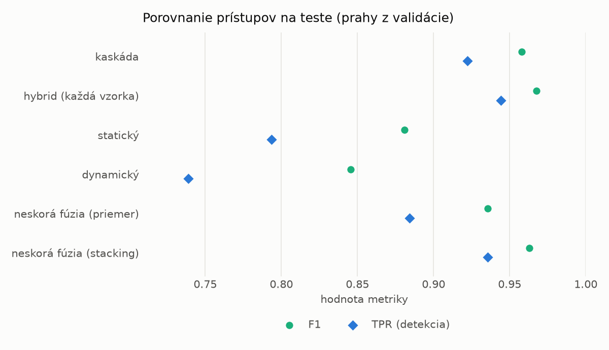
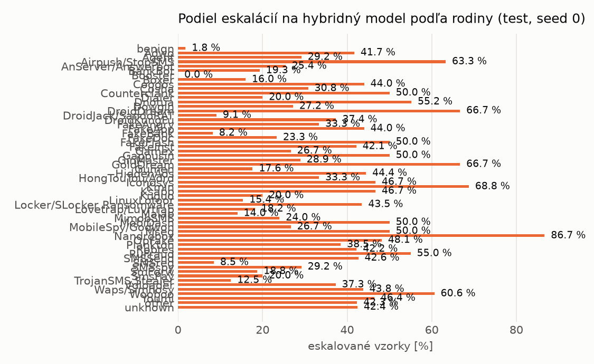

# Kaskáda `heavy` – beh `20261122-214749`

> Generované `src/cascade/evaluate.py` (2026-11-22T21:47:49+01:00). Seedy: [0, 1, 2]; hodnoty = priemer ± sm. odchýlka.
> Všetky prahy sú určené na validácii (FPR ≤ 1 %); test sa na nič nenastavuje.

| rola | beh |
|---|---|
| static | `runs_v4/real_full/lofo/Airpush_StopSMS/students_static/mlp_kd/20261122-214307` |
| dynamic | `runs_v4/real_full/lofo/Airpush_StopSMS/students_dynamic/mlp_kd/20261122-214433` |
| hybrid | `runs_v4/real_full/lofo/Airpush_StopSMS/hybrid/mlp_large/20261122-213736` |

## Test
| prístup | accuracy | balanced_accuracy | precision | recall_tpr | fpr | f1 | mcc |
|---|---|---|---|---|---|---|---|
| kaskáda | 0.9570 ± 0.0004 | 0.9592 ± 0.0004 | 0.9962 ± 0.0005 | 0.9223 ± 0.0004 | 0.0040 ± 0.0005 | 0.9578 ± 0.0004 | 0.9169 ± 0.0008 |
| hybrid (každá vzorka) | 0.9664 ± 0.0011 | 0.9678 ± 0.0011 | 0.9919 ± 0.0010 | 0.9442 ± 0.0026 | 0.0087 ± 0.0011 | 0.9675 ± 0.0012 | 0.9339 ± 0.0022 |
| statický | 0.8865 ± 0.0011 | 0.8924 ± 0.0010 | 0.9903 ± 0.0002 | 0.7935 ± 0.0020 | 0.0088 ± 0.0002 | 0.8811 ± 0.0012 | 0.7925 ± 0.0018 |
| dynamický | 0.8572 ± 0.0007 | 0.8646 ± 0.0006 | 0.9885 ± 0.0002 | 0.7389 ± 0.0012 | 0.0097 ± 0.0001 | 0.8456 ± 0.0008 | 0.7442 ± 0.0011 |
| neskorá fúzia (priemer) | 0.9356 ± 0.0013 | 0.9388 ± 0.0013 | 0.9933 ± 0.0004 | 0.8844 ± 0.0022 | 0.0068 ± 0.0004 | 0.9356 ± 0.0014 | 0.8775 ± 0.0025 |
| neskorá fúzia (stacking) | 0.9619 ± 0.0024 | 0.9635 ± 0.0022 | 0.9920 ± 0.0004 | 0.9355 ± 0.0042 | 0.0085 ± 0.0003 | 0.9630 ± 0.0024 | 0.9254 ± 0.0045 |

## Validácia
| prístup | accuracy | balanced_accuracy | precision | recall_tpr | fpr | f1 | mcc |
|---|---|---|---|---|---|---|---|
| kaskáda | 0.9703 ± 0.0013 | 0.9691 ± 0.0013 | 0.9953 ± 0.0005 | 0.9423 ± 0.0023 | 0.0041 ± 0.0005 | 0.9681 ± 0.0014 | 0.9416 ± 0.0025 |
| hybrid (každá vzorka) | 0.9783 ± 0.0020 | 0.9777 ± 0.0021 | 0.9891 ± 0.0002 | 0.9651 ± 0.0042 | 0.0097 ± 0.0002 | 0.9770 ± 0.0022 | 0.9566 ± 0.0040 |
| statický | 0.9538 ± 0.0020 | 0.9521 ± 0.0021 | 0.9884 ± 0.0001 | 0.9139 ± 0.0042 | 0.0098 ± 0.0000 | 0.9497 ± 0.0023 | 0.9094 ± 0.0038 |
| dynamický | 0.8670 ± 0.0006 | 0.8613 ± 0.0006 | 0.9856 ± 0.0000 | 0.7323 ± 0.0012 | 0.0098 ± 0.0000 | 0.8403 ± 0.0008 | 0.7542 ± 0.0010 |
| neskorá fúzia (priemer) | 0.9591 ± 0.0004 | 0.9577 ± 0.0005 | 0.9886 ± 0.0000 | 0.9251 ± 0.0009 | 0.0098 ± 0.0000 | 0.9558 ± 0.0005 | 0.9196 ± 0.0008 |
| neskorá fúzia (stacking) | 0.9755 ± 0.0002 | 0.9748 ± 0.0002 | 0.9891 ± 0.0002 | 0.9593 ± 0.0002 | 0.0097 ± 0.0002 | 0.9740 ± 0.0002 | 0.9513 ± 0.0003 |

## Správanie kaskády (test, seed 0)
- podiel eskalácií na hybrid: **18.69%** (2921 vzoriek)
- chyby pri zhode študentov (kaskáda ich nemôže opraviť): **533**
  (4.196% zo zhôd; FP 3, FN 530)
- úspešnosť na eskalovaných vzorkách: hybrid 0.953098254022595, statický 0.578226634714139,
  dynamický 0.421773365285861  → prínos hybridu pri nezhode

## Výpočtové nároky (odhad z benchmarkov komponentov)
_Chýba benchmark niektorého komponentu (`python -m src.evaluation.benchmark`)._

