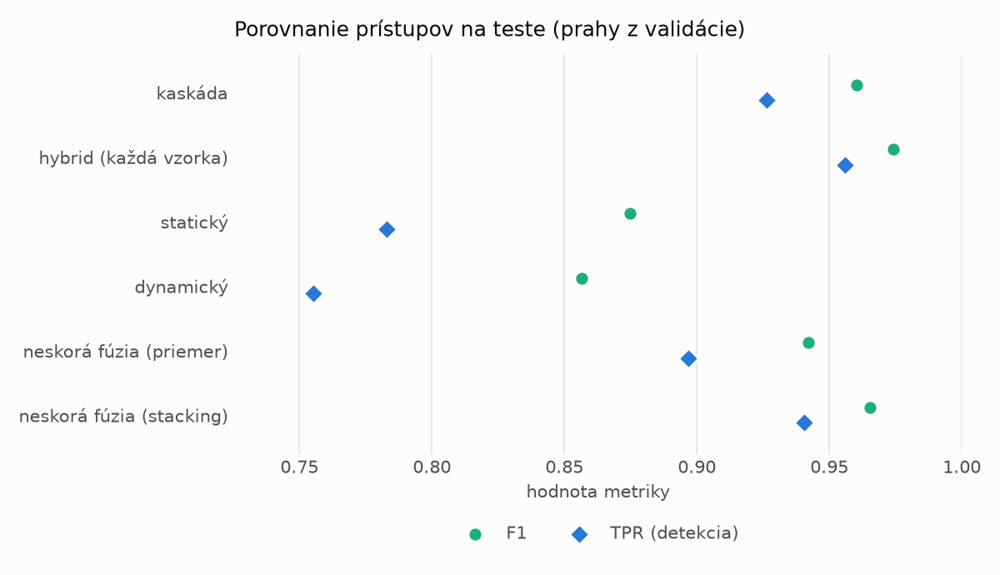
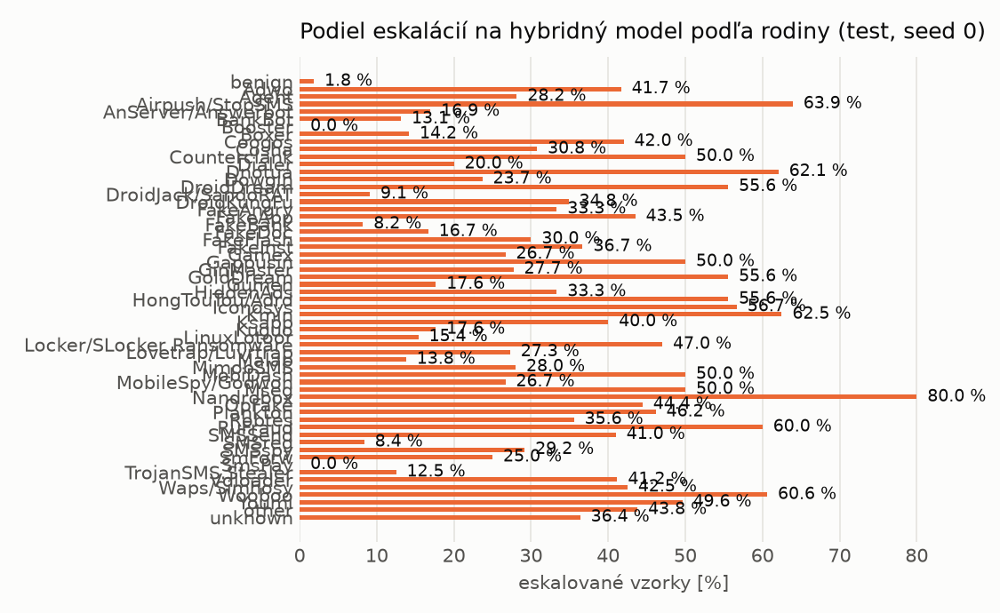

# Kaskáda `heavyteacher` – beh `20261122-214755`

> Generované `src/cascade/evaluate.py` (2026-11-22T21:47:55+01:00). Seedy: [0, 1, 2]; hodnoty = priemer ± sm. odchýlka.
> Všetky prahy sú určené na validácii (FPR ≤ 1 %); test sa na nič nenastavuje.

| rola | beh |
|---|---|
| static | `runs_v4/real_full/lofo/Airpush_StopSMS/students_static/mlp_kd_heavy/20261122-214413` |
| dynamic | `runs_v4/real_full/lofo/Airpush_StopSMS/students_dynamic/mlp_kd_heavy/20261122-214629` |
| hybrid | `runs_v4/real_full/lofo/Airpush_StopSMS/hybrid/lightgbm/20261122-213609` |

## Test
| prístup | accuracy | balanced_accuracy | precision | recall_tpr | fpr | f1 | mcc |
|---|---|---|---|---|---|---|---|
| kaskáda | 0.9594 ± 0.0004 | 0.9615 ± 0.0004 | 0.9967 ± 0.0004 | 0.9264 ± 0.0006 | 0.0034 ± 0.0004 | 0.9603 ± 0.0004 | 0.9215 ± 0.0009 |
| hybrid (každá vzorka) | 0.9731 ± 0.0001 | 0.9741 ± 0.0000 | 0.9931 ± 0.0002 | 0.9558 ± 0.0003 | 0.0075 ± 0.0002 | 0.9741 ± 0.0001 | 0.9468 ± 0.0001 |
| statický | 0.8813 ± 0.0028 | 0.8875 ± 0.0026 | 0.9909 ± 0.0009 | 0.7830 ± 0.0052 | 0.0081 ± 0.0008 | 0.8748 ± 0.0033 | 0.7841 ± 0.0046 |
| dynamický | 0.8658 ± 0.0026 | 0.8728 ± 0.0025 | 0.9886 ± 0.0012 | 0.7554 ± 0.0048 | 0.0098 ± 0.0010 | 0.8564 ± 0.0032 | 0.7581 ± 0.0044 |
| neskorá fúzia (priemer) | 0.9415 ± 0.0034 | 0.9443 ± 0.0032 | 0.9920 ± 0.0005 | 0.8967 ± 0.0069 | 0.0081 ± 0.0005 | 0.9420 ± 0.0036 | 0.8879 ± 0.0061 |
| neskorá fúzia (stacking) | 0.9641 ± 0.0019 | 0.9656 ± 0.0018 | 0.9912 ± 0.0004 | 0.9406 ± 0.0035 | 0.0094 ± 0.0004 | 0.9653 ± 0.0019 | 0.9296 ± 0.0037 |

## Validácia
| prístup | accuracy | balanced_accuracy | precision | recall_tpr | fpr | f1 | mcc |
|---|---|---|---|---|---|---|---|
| kaskáda | 0.9729 ± 0.0015 | 0.9718 ± 0.0015 | 0.9953 ± 0.0006 | 0.9477 ± 0.0025 | 0.0041 ± 0.0005 | 0.9709 ± 0.0016 | 0.9466 ± 0.0029 |
| hybrid (každá vzorka) | 0.9828 ± 0.0005 | 0.9824 ± 0.0005 | 0.9901 ± 0.0008 | 0.9737 ± 0.0003 | 0.0089 ± 0.0007 | 0.9819 ± 0.0005 | 0.9656 ± 0.0010 |
| statický | 0.9494 ± 0.0020 | 0.9475 ± 0.0021 | 0.9884 ± 0.0001 | 0.9046 ± 0.0044 | 0.0097 ± 0.0002 | 0.9447 ± 0.0024 | 0.9012 ± 0.0038 |
| dynamický | 0.8780 ± 0.0022 | 0.8728 ± 0.0023 | 0.9860 ± 0.0001 | 0.7553 ± 0.0046 | 0.0098 ± 0.0000 | 0.8554 ± 0.0030 | 0.7731 ± 0.0038 |
| neskorá fúzia (priemer) | 0.9656 ± 0.0032 | 0.9644 ± 0.0033 | 0.9887 ± 0.0001 | 0.9386 ± 0.0067 | 0.0098 ± 0.0000 | 0.9630 ± 0.0035 | 0.9320 ± 0.0061 |
| neskorá fúzia (stacking) | 0.9771 ± 0.0012 | 0.9765 ± 0.0013 | 0.9890 ± 0.0000 | 0.9628 ± 0.0026 | 0.0098 ± 0.0000 | 0.9757 ± 0.0013 | 0.9544 ± 0.0024 |

## Správanie kaskády (test, seed 0)
- podiel eskalácií na hybrid: **18.29%** (2858 vzoriek)
- chyby pri zhode študentov (kaskáda ich nemôže opraviť): **511**
  (4.003% zo zhôd; FP 1, FN 510)
- úspešnosť na eskalovaných vzorkách: hybrid 0.9597620713785864, statický 0.5472358292512246,
  dynamický 0.45276417074877534  → prínos hybridu pri nezhode

## Výpočtové nároky (odhad z benchmarkov komponentov)
_Chýba benchmark niektorého komponentu (`python -m src.evaluation.benchmark`)._

