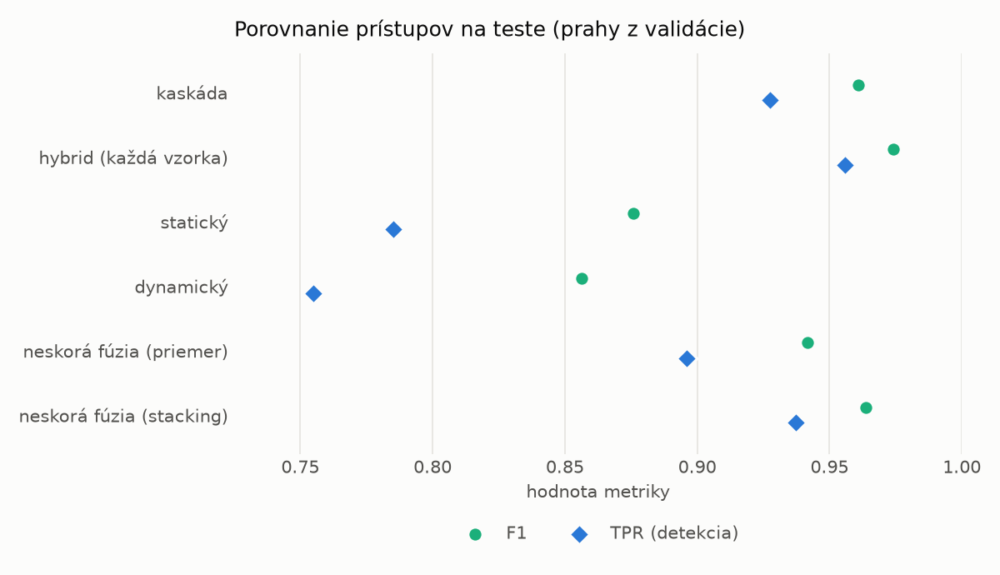
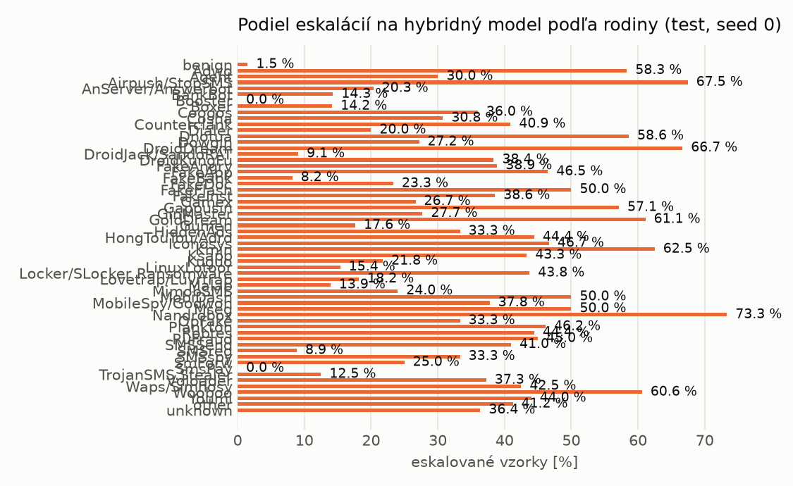

# Kaskáda `modal` – beh `20261122-214746`

> Generované `src/cascade/evaluate.py` (2026-11-22T21:47:47+01:00). Seedy: [0, 1, 2]; hodnoty = priemer ± sm. odchýlka.
> Všetky prahy sú určené na validácii (FPR ≤ 1 %); test sa na nič nenastavuje.

| rola | beh |
|---|---|
| static | `runs_v4/real_full/lofo/Airpush_StopSMS/students_static/mlp_kd_modal/20261122-214356` |
| dynamic | `runs_v4/real_full/lofo/Airpush_StopSMS/students_dynamic/mlp_kd_modal/20261122-214555` |
| hybrid | `runs_v4/real_full/lofo/Airpush_StopSMS/hybrid/lightgbm/20261122-213609` |

## Test
| prístup | accuracy | balanced_accuracy | precision | recall_tpr | fpr | f1 | mcc |
|---|---|---|---|---|---|---|---|
| kaskáda | 0.9600 ± 0.0017 | 0.9621 ± 0.0016 | 0.9969 ± 0.0006 | 0.9275 ± 0.0036 | 0.0033 ± 0.0006 | 0.9609 ± 0.0018 | 0.9227 ± 0.0032 |
| hybrid (každá vzorka) | 0.9731 ± 0.0001 | 0.9741 ± 0.0000 | 0.9931 ± 0.0002 | 0.9558 ± 0.0003 | 0.0075 ± 0.0002 | 0.9741 ± 0.0001 | 0.9468 ± 0.0001 |
| statický | 0.8820 ± 0.0031 | 0.8881 ± 0.0028 | 0.9899 ± 0.0018 | 0.7853 ± 0.0071 | 0.0090 ± 0.0017 | 0.8758 ± 0.0038 | 0.7850 ± 0.0045 |
| dynamický | 0.8659 ± 0.0012 | 0.8729 ± 0.0011 | 0.9892 ± 0.0004 | 0.7550 ± 0.0026 | 0.0093 ± 0.0004 | 0.8564 ± 0.0015 | 0.7585 ± 0.0018 |
| neskorá fúzia (priemer) | 0.9412 ± 0.0037 | 0.9441 ± 0.0034 | 0.9923 ± 0.0006 | 0.8960 ± 0.0075 | 0.0078 ± 0.0007 | 0.9417 ± 0.0039 | 0.8875 ± 0.0065 |
| neskorá fúzia (stacking) | 0.9626 ± 0.0015 | 0.9643 ± 0.0014 | 0.9919 ± 0.0005 | 0.9371 ± 0.0034 | 0.0086 ± 0.0006 | 0.9637 ± 0.0015 | 0.9269 ± 0.0028 |

## Validácia
| prístup | accuracy | balanced_accuracy | precision | recall_tpr | fpr | f1 | mcc |
|---|---|---|---|---|---|---|---|
| kaskáda | 0.9735 ± 0.0004 | 0.9724 ± 0.0005 | 0.9952 ± 0.0004 | 0.9490 ± 0.0009 | 0.0042 ± 0.0003 | 0.9716 ± 0.0005 | 0.9477 ± 0.0008 |
| hybrid (každá vzorka) | 0.9828 ± 0.0005 | 0.9824 ± 0.0005 | 0.9901 ± 0.0008 | 0.9737 ± 0.0003 | 0.0089 ± 0.0007 | 0.9819 ± 0.0005 | 0.9656 ± 0.0010 |
| statický | 0.9535 ± 0.0019 | 0.9518 ± 0.0020 | 0.9884 ± 0.0000 | 0.9133 ± 0.0040 | 0.0098 ± 0.0000 | 0.9494 ± 0.0022 | 0.9089 ± 0.0036 |
| dynamický | 0.8748 ± 0.0018 | 0.8694 ± 0.0019 | 0.9859 ± 0.0001 | 0.7487 ± 0.0038 | 0.0098 ± 0.0000 | 0.8511 ± 0.0025 | 0.7676 ± 0.0031 |
| neskorá fúzia (priemer) | 0.9646 ± 0.0033 | 0.9634 ± 0.0034 | 0.9887 ± 0.0001 | 0.9365 ± 0.0069 | 0.0098 ± 0.0000 | 0.9619 ± 0.0037 | 0.9300 ± 0.0063 |
| neskorá fúzia (stacking) | 0.9751 ± 0.0011 | 0.9744 ± 0.0012 | 0.9892 ± 0.0003 | 0.9585 ± 0.0026 | 0.0096 ± 0.0003 | 0.9736 ± 0.0012 | 0.9505 ± 0.0022 |

## Správanie kaskády (test, seed 0)
- podiel eskalácií na hybrid: **18.70%** (2922 vzoriek)
- chyby pri zhode študentov (kaskáda ich nemôže opraviť): **545**
  (4.290% zo zhôd; FP 3, FN 542)
- úspešnosť na eskalovaných vzorkách: hybrid 0.9647501711156742, statický 0.5379876796714579,
  dynamický 0.4620123203285421  → prínos hybridu pri nezhode

## Výpočtové nároky (odhad z benchmarkov komponentov)
_Chýba benchmark niektorého komponentu (`python -m src.evaluation.benchmark`)._

