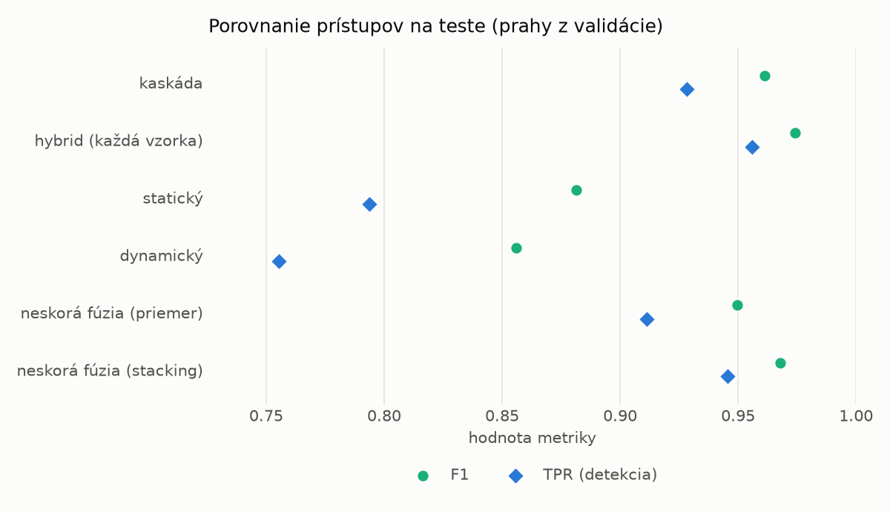
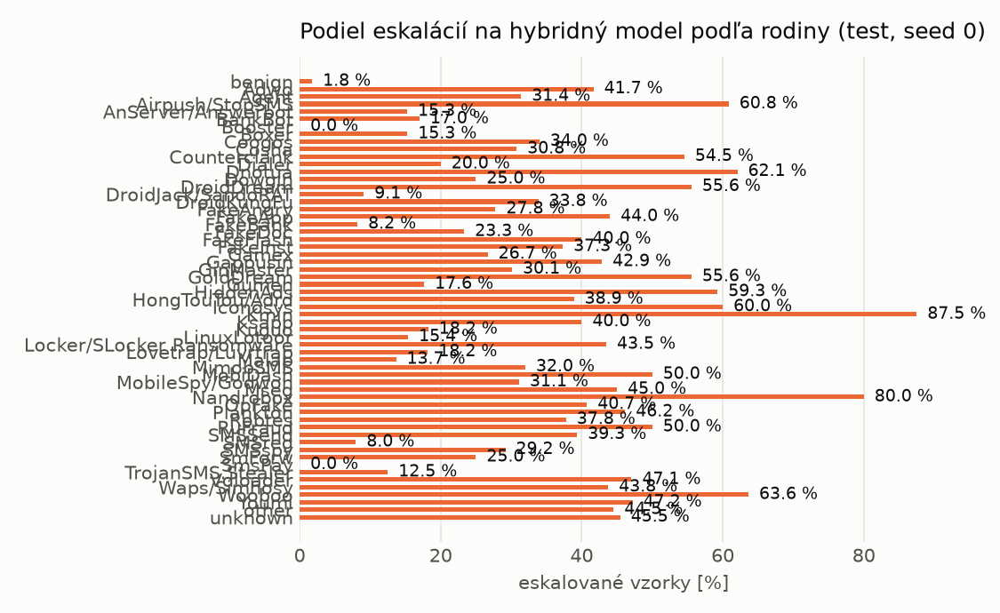

# Kaskáda `nokd` – beh `20261122-214744`

> Generované `src/cascade/evaluate.py` (2026-11-22T21:47:44+01:00). Seedy: [0, 1, 2]; hodnoty = priemer ± sm. odchýlka.
> Všetky prahy sú určené na validácii (FPR ≤ 1 %); test sa na nič nenastavuje.

| rola | beh |
|---|---|
| static | `runs_v4/real_full/lofo/Airpush_StopSMS/students_static/mlp_nokd/20261122-214324` |
| dynamic | `runs_v4/real_full/lofo/Airpush_StopSMS/students_dynamic/mlp_nokd/20261122-214508` |
| hybrid | `runs_v4/real_full/lofo/Airpush_StopSMS/hybrid/lightgbm/20261122-213609` |

## Test
| prístup | accuracy | balanced_accuracy | precision | recall_tpr | fpr | f1 | mcc |
|---|---|---|---|---|---|---|---|
| kaskáda | 0.9603 ± 0.0015 | 0.9623 ± 0.0014 | 0.9965 ± 0.0003 | 0.9284 ± 0.0026 | 0.0037 ± 0.0003 | 0.9612 ± 0.0015 | 0.9231 ± 0.0028 |
| hybrid (každá vzorka) | 0.9731 ± 0.0001 | 0.9741 ± 0.0000 | 0.9931 ± 0.0002 | 0.9558 ± 0.0003 | 0.0075 ± 0.0002 | 0.9741 ± 0.0001 | 0.9468 ± 0.0001 |
| statický | 0.8871 ± 0.0041 | 0.8929 ± 0.0038 | 0.9911 ± 0.0013 | 0.7939 ± 0.0083 | 0.0080 ± 0.0012 | 0.8816 ± 0.0049 | 0.7937 ± 0.0066 |
| dynamický | 0.8655 ± 0.0018 | 0.8724 ± 0.0017 | 0.9876 ± 0.0009 | 0.7555 ± 0.0034 | 0.0107 ± 0.0008 | 0.8561 ± 0.0021 | 0.7573 ± 0.0029 |
| neskorá fúzia (priemer) | 0.9490 ± 0.0020 | 0.9513 ± 0.0018 | 0.9917 ± 0.0006 | 0.9113 ± 0.0043 | 0.0086 ± 0.0007 | 0.9498 ± 0.0021 | 0.9014 ± 0.0035 |
| neskorá fúzia (stacking) | 0.9666 ± 0.0013 | 0.9679 ± 0.0013 | 0.9909 ± 0.0015 | 0.9456 ± 0.0023 | 0.0098 ± 0.0016 | 0.9677 ± 0.0013 | 0.9342 ± 0.0025 |

## Validácia
| prístup | accuracy | balanced_accuracy | precision | recall_tpr | fpr | f1 | mcc |
|---|---|---|---|---|---|---|---|
| kaskáda | 0.9743 ± 0.0014 | 0.9733 ± 0.0014 | 0.9949 ± 0.0002 | 0.9511 ± 0.0028 | 0.0044 ± 0.0002 | 0.9725 ± 0.0015 | 0.9493 ± 0.0027 |
| hybrid (každá vzorka) | 0.9828 ± 0.0005 | 0.9824 ± 0.0005 | 0.9901 ± 0.0008 | 0.9737 ± 0.0003 | 0.0089 ± 0.0007 | 0.9819 ± 0.0005 | 0.9656 ± 0.0010 |
| statický | 0.9524 ± 0.0041 | 0.9507 ± 0.0042 | 0.9885 ± 0.0002 | 0.9111 ± 0.0085 | 0.0097 ± 0.0002 | 0.9482 ± 0.0046 | 0.9070 ± 0.0077 |
| dynamický | 0.8765 ± 0.0028 | 0.8712 ± 0.0029 | 0.9861 ± 0.0003 | 0.7520 ± 0.0056 | 0.0097 ± 0.0002 | 0.8533 ± 0.0037 | 0.7705 ± 0.0048 |
| neskorá fúzia (priemer) | 0.9707 ± 0.0011 | 0.9698 ± 0.0011 | 0.9888 ± 0.0000 | 0.9493 ± 0.0022 | 0.0098 ± 0.0000 | 0.9687 ± 0.0012 | 0.9418 ± 0.0021 |
| neskorá fúzia (stacking) | 0.9785 ± 0.0009 | 0.9780 ± 0.0010 | 0.9890 ± 0.0000 | 0.9658 ± 0.0020 | 0.0098 ± 0.0000 | 0.9773 ± 0.0010 | 0.9572 ± 0.0018 |

## Správanie kaskády (test, seed 0)
- podiel eskalácií na hybrid: **18.21%** (2845 vzoriek)
- chyby pri zhode študentov (kaskáda ich nemôže opraviť): **500**
  (3.912% zo zhôd; FP 2, FN 498)
- úspešnosť na eskalovaných vzorkách: hybrid 0.957469244288225, statický 0.5739894551845343,
  dynamický 0.42601054481546574  → prínos hybridu pri nezhode

## Výpočtové nároky (odhad z benchmarkov komponentov)
_Chýba benchmark niektorého komponentu (`python -m src.evaluation.benchmark`)._

