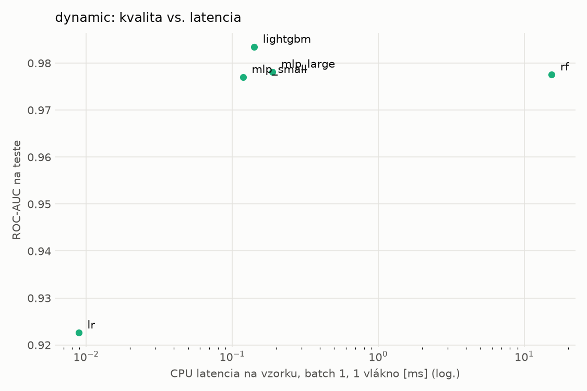
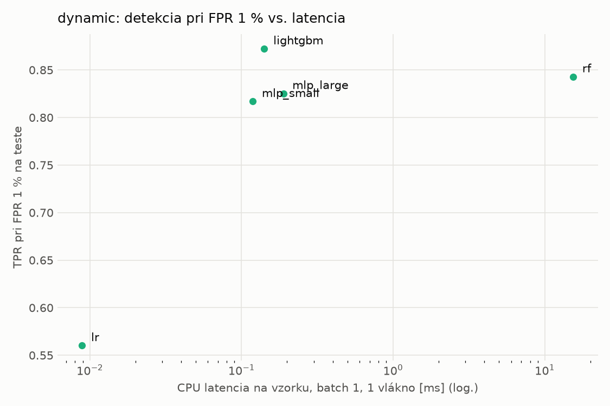
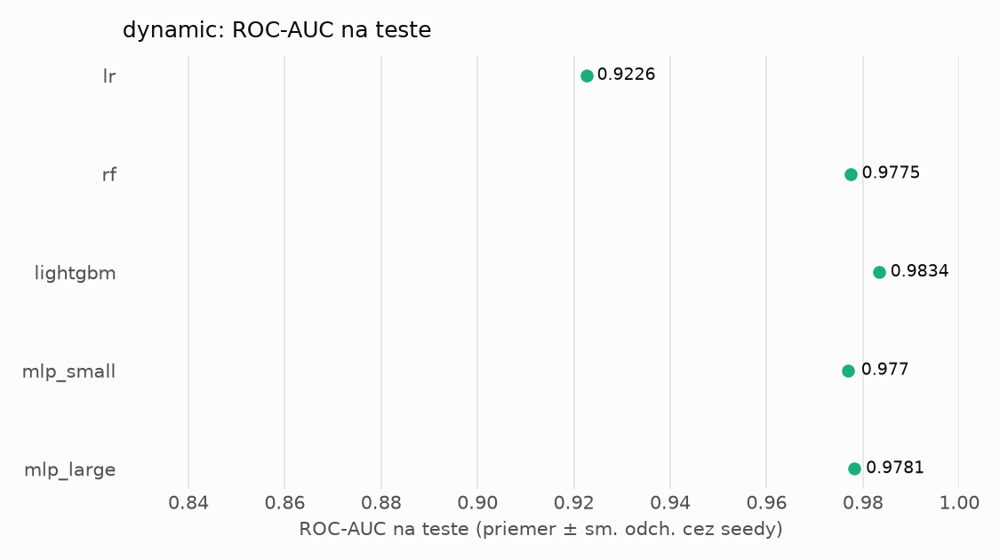
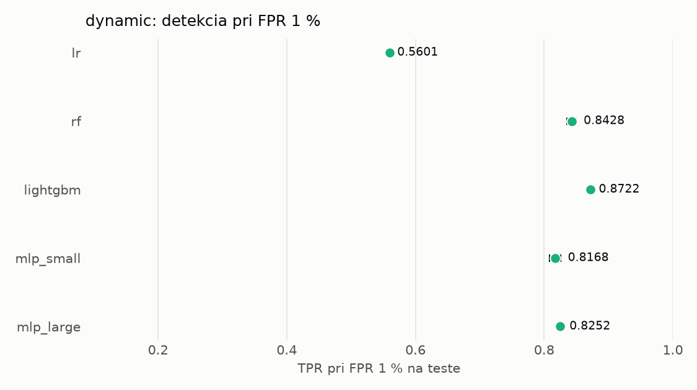

# Porovnanie modelov – dynamic

> Generované `src/evaluation/compare.py` (2026-11-22T21:35:56+01:00); použitý je posledný beh každého modelu.
> Metriky sú priemer cez seedy. \* = pri prahu určenom na validácii (FPR ≤ 1 %).
> CPU ms/vz. = medián latencie jednej vzorky na 1 vlákne vrátane transformácie vstupu (meranie hneď po tréningu,
> orientačné). Oficiálne merania spotreby sú v časti „Spotreba zdrojov pri inferencii“.

## Detekčná kvalita a orientačné časy
| model | ROC-AUC val | ROC-AUC test | TPR@FPR 1 % test | TPR@FPR 0,1 % test | F1 test* | FPR test* | gap train−val | CPU ms/vz. | CPU vz./s | GPU ms/vz. | parametre | MB | tréning s | ladenie min |
|---|---|---|---|---|---|---|---|---|---|---|---|---|---|---|
| [lr](../../dynamic/lr/20261122-213308/README.md) | 0.9238 | 0.9226 ± 0.0000 | 0.5601 | 0.4464 | 0.7215 | 0.0113 | -0.0003 | 0.009 | 4 023 432 | – | 132 | 0.01 | 0.3 | 0.0 |
| [rf](../../dynamic/rf/20261122-213310/README.md) | 0.9822 | 0.9775 ± 0.0000 | 0.8428 | 0.7627 | 0.9097 | 0.0076 | 0.0169 | 15.412 | 115 571 | – | 4 149 800 | 332.38 | 2.9 | 0.0 |
| [lightgbm](../../dynamic/lightgbm/20261122-213330/README.md) | 0.9856 | 0.9834 ± 0.0001 | 0.8722 | 0.7759 | 0.9248 | 0.0085 | 0.0137 | 0.142 | 110 442 | – | 367 233 | 20.15 | 16.9 | 0.0 |
| [mlp_small](../../dynamic/mlp_small/20261122-213436/README.md) | 0.9784 | 0.9770 ± 0.0004 | 0.8168 | 0.6645 | 0.8884 | 0.0081 | 0.0095 | 0.119 | 2 675 330 | 0.391 | 67 585 | 0.28 | 19.3 | 0.0 |
| [mlp_large](../../dynamic/mlp_large/20261122-213535/README.md) | 0.9798 | 0.9781 ± 0.0003 | 0.8252 | 0.6753 | 0.8915 | 0.0078 | 0.0117 | 0.189 | 649 413 | 0.551 | 596 481 | 2.41 | 5.9 | 0.0 |

## Nízka prevalencia malvéru (test, prah z validácie)
| model | TPR | FPR | precision @ 1 % | falošné na 1 skutočný poplach @ 1 % | precision @ 0.1 % | falošné na 1 skutočný poplach @ 0.1 % |
|---|---|---|---|---|---|---|
| lr | 0.5700 | 0.0113 | 0.338 | 1.96 | 0.048 | 19.79 |
| rf | 0.8401 | 0.0076 | 0.527 | 0.90 | 0.099 | 9.06 |
| lightgbm | 0.8666 | 0.0085 | 0.507 | 0.97 | 0.092 | 9.83 |
| mlp_small | 0.8050 | 0.0081 | 0.500 | 1.00 | 0.090 | 10.07 |
| mlp_large | 0.8099 | 0.0078 | 0.513 | 0.95 | 0.095 | 9.57 |

Prepočet: TPR a FPR nezávisia od podielu malvéru, preto sa dajú preniesť na nízku prevalenciu (v reálnej prevádzke je malvéru ~1 % alebo menej; v teste 54 %). „Falošné na 1 skutočný poplach“ = koľko neškodných súborov je označených na každý zachytený malvér.

## Spotreba zdrojov pri inferencii (benchmark, testovacia množina)
_Benchmark zatiaľ nebol spustený (`python -m src.evaluation.benchmark --approach dynamic`)._

## Grafy

