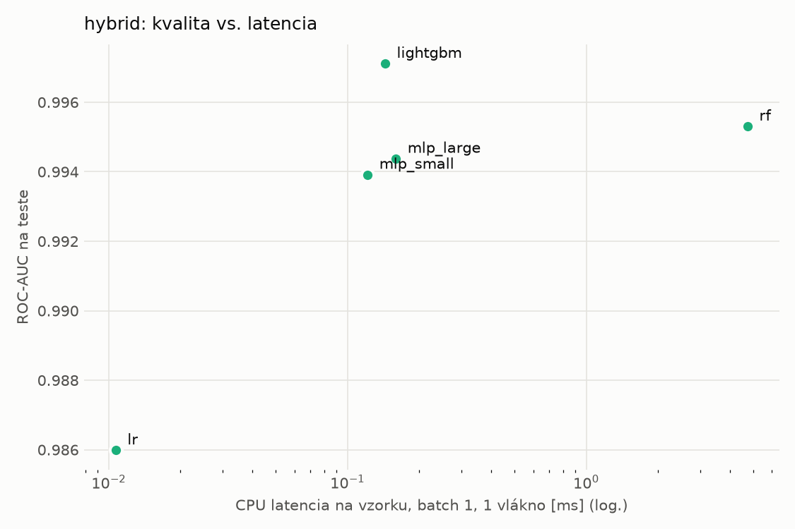
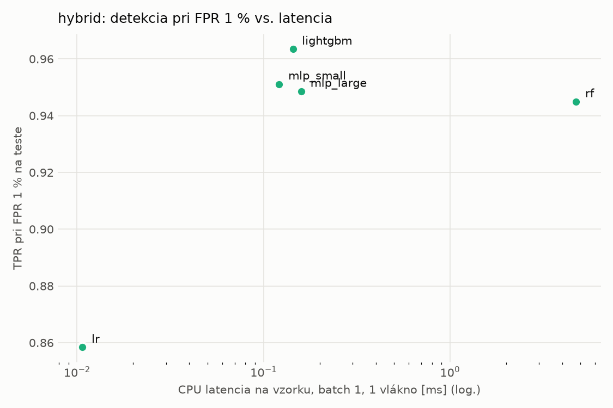
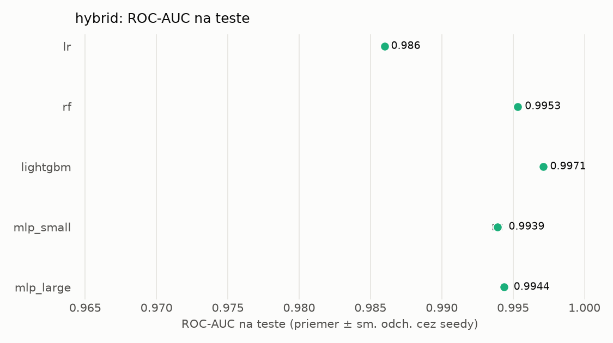
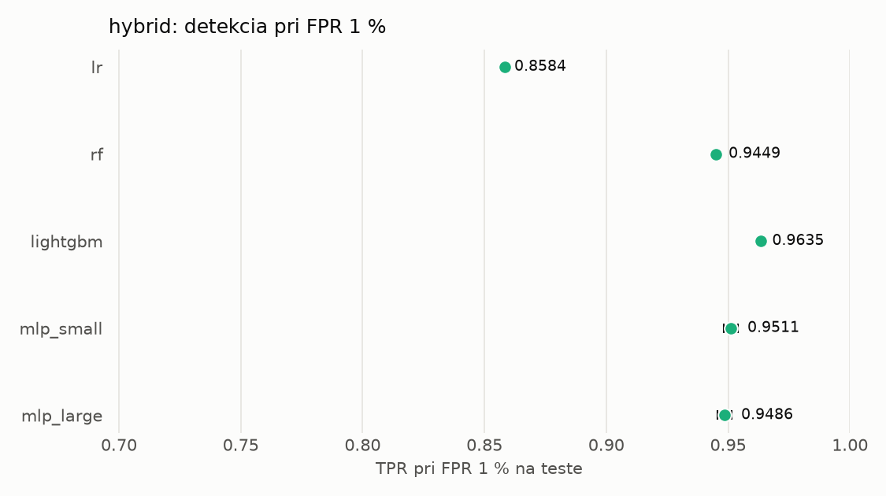

# Porovnanie modelov – hybrid

> Generované `src/evaluation/compare.py` (2026-11-22T21:38:10+01:00); použitý je posledný beh každého modelu.
> Metriky sú priemer cez seedy. \* = pri prahu určenom na validácii (FPR ≤ 1 %).
> CPU ms/vz. = medián latencie jednej vzorky na 1 vlákne vrátane transformácie vstupu (meranie hneď po tréningu,
> orientačné). Oficiálne merania spotreby sú v časti „Spotreba zdrojov pri inferencii“.

## Detekčná kvalita a orientačné časy
| model | ROC-AUC val | ROC-AUC test | TPR@FPR 1 % test | TPR@FPR 0,1 % test | F1 test* | FPR test* | gap train−val | CPU ms/vz. | CPU vz./s | GPU ms/vz. | parametre | MB | tréning s | ladenie min |
|---|---|---|---|---|---|---|---|---|---|---|---|---|---|---|
| [lr](../../hybrid/lr/20261122-213559/README.md) | 0.9885 | 0.9860 ± 0.0000 | 0.8584 | 0.6596 | 0.9176 | 0.0095 | 0.0005 | 0.011 | 2 291 459 | – | 296 | 0.01 | 0.3 | 0.0 |
| [rf](../../hybrid/rf/20261122-213601/README.md) | 0.9963 | 0.9953 ± 0.0001 | 0.9449 | 0.8864 | 0.9651 | 0.0075 | 0.0037 | 4.738 | 204 893 | – | 705 278 | 56.68 | 1.3 | 0.0 |
| [lightgbm](../../hybrid/lightgbm/20261122-213609/README.md) | 0.9976 | 0.9971 ± 0.0000 | 0.9635 | 0.9134 | 0.9741 | 0.0075 | 0.0024 | 0.144 | 107 039 | – | 398 970 | 22.27 | 16.4 | 0.0 |
| [mlp_small](../../hybrid/mlp_small/20261122-213710/README.md) | 0.9954 | 0.9939 ± 0.0003 | 0.9511 | 0.8721 | 0.9687 | 0.0080 | 0.0036 | 0.121 | 944 040 | 0.491 | 109 569 | 0.45 | 7.8 | 0.0 |
| [mlp_large](../../hybrid/mlp_large/20261122-213736/README.md) | 0.9958 | 0.9944 ± 0.0002 | 0.9486 | 0.8637 | 0.9675 | 0.0087 | 0.0029 | 0.159 | 551 703 | 0.547 | 317 697 | 1.29 | 10.4 | 0.0 |

## Nízka prevalencia malvéru (test, prah z validácie)
| model | TPR | FPR | precision @ 1 % | falošné na 1 skutočný poplach @ 1 % | precision @ 0.1 % | falošné na 1 skutočný poplach @ 0.1 % |
|---|---|---|---|---|---|---|
| lr | 0.8549 | 0.0095 | 0.476 | 1.10 | 0.082 | 11.13 |
| rf | 0.9387 | 0.0075 | 0.557 | 0.79 | 0.111 | 8.01 |
| lightgbm | 0.9558 | 0.0075 | 0.563 | 0.78 | 0.113 | 7.82 |
| mlp_small | 0.9459 | 0.0080 | 0.545 | 0.84 | 0.106 | 8.43 |
| mlp_large | 0.9442 | 0.0087 | 0.524 | 0.91 | 0.098 | 9.16 |

Prepočet: TPR a FPR nezávisia od podielu malvéru, preto sa dajú preniesť na nízku prevalenciu (v reálnej prevádzke je malvéru ~1 % alebo menej; v teste 54 %). „Falošné na 1 skutočný poplach“ = koľko neškodných súborov je označených na každý zachytený malvér.

## Spotreba zdrojov pri inferencii (benchmark, testovacia množina)
_Benchmark zatiaľ nebol spustený (`python -m src.evaluation.benchmark --approach hybrid`)._

## Grafy

