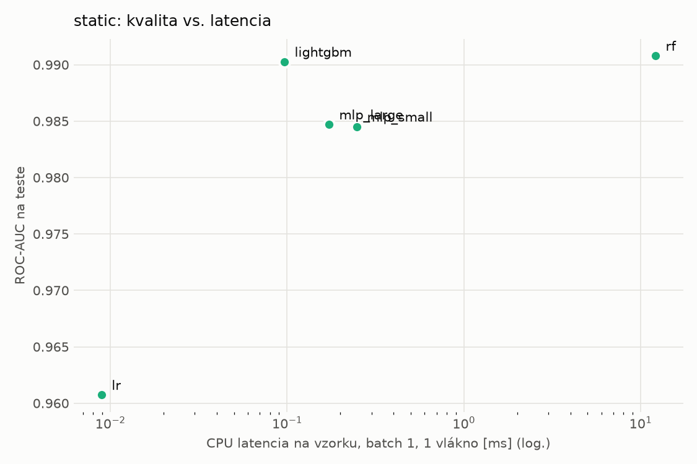
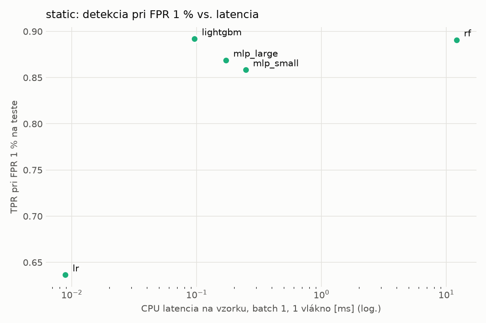
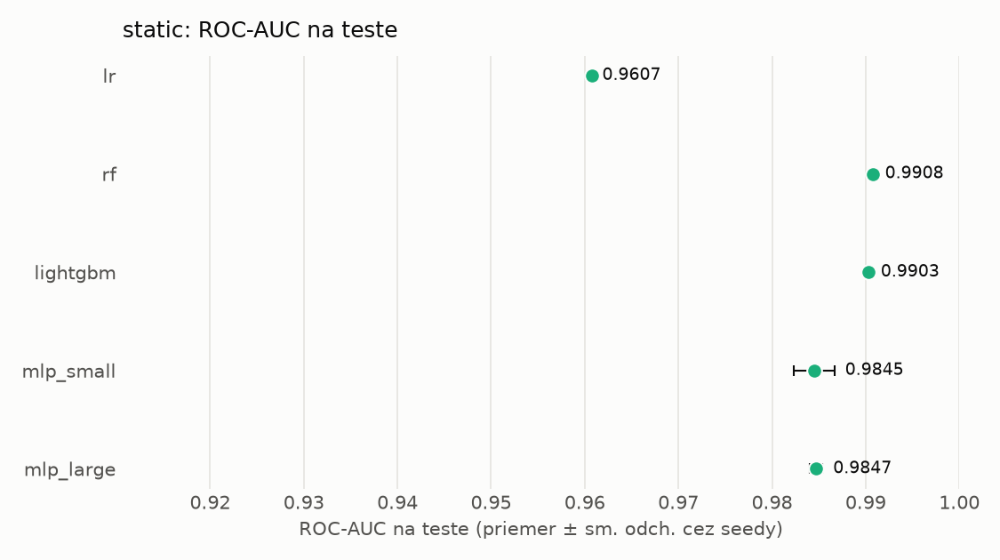
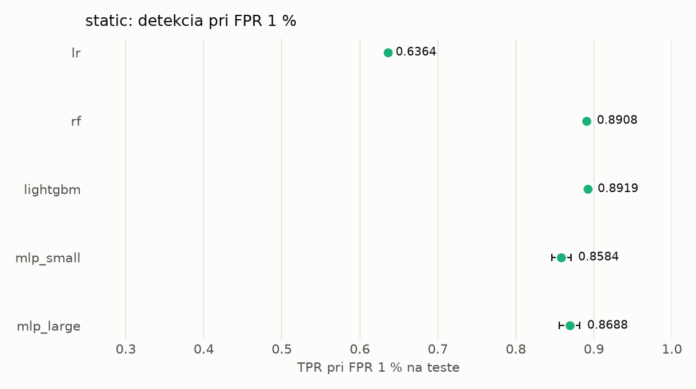

# Porovnanie modelov – static

> Generované `src/evaluation/compare.py` (2026-11-22T21:33:05+01:00); použitý je posledný beh každého modelu.
> Metriky sú priemer cez seedy. \* = pri prahu určenom na validácii (FPR ≤ 1 %).
> CPU ms/vz. = medián latencie jednej vzorky na 1 vlákne vrátane transformácie vstupu (meranie hneď po tréningu,
> orientačné). Oficiálne merania spotreby sú v časti „Spotreba zdrojov pri inferencii“.

## Detekčná kvalita a orientačné časy
| model | ROC-AUC val | ROC-AUC test | TPR@FPR 1 % test | TPR@FPR 0,1 % test | F1 test* | FPR test* | gap train−val | CPU ms/vz. | CPU vz./s | GPU ms/vz. | parametre | MB | tréning s | ladenie min |
|---|---|---|---|---|---|---|---|---|---|---|---|---|---|---|
| [lr](../../static/lr/20261122-213027/README.md) | 0.9740 | 0.9607 ± 0.0000 | 0.6364 | 0.2523 | 0.7726 | 0.0097 | 0.0030 | 0.009 | 3 993 916 | – | 165 | 0.01 | 0.2 | 0.0 |
| [rf](../../static/rf/20261122-213029/README.md) | 0.9952 | 0.9908 ± 0.0001 | 0.8908 | 0.7496 | 0.9213 | 0.0059 | 0.0048 | 12.112 | 149 581 | – | 2 202 940 | 176.59 | 1.7 | 0.0 |
| [lightgbm](../../static/lightgbm/20261122-213043/README.md) | 0.9953 | 0.9903 ± 0.0002 | 0.8919 | 0.7339 | 0.9299 | 0.0073 | 0.0047 | 0.096 | 187 057 | – | 340 294 | 18.77 | 9.1 | 0.0 |
| [mlp_small](../../static/mlp_small/20261122-213124/README.md) | 0.9926 | 0.9845 ± 0.0022 | 0.8584 | 0.6239 | 0.9034 | 0.0076 | 0.0056 | 0.248 | 1 222 279 | 0.656 | 76 033 | 0.32 | 13.9 | 0.0 |
| [mlp_large](../../static/mlp_large/20261122-213208/README.md) | 0.9934 | 0.9847 ± 0.0007 | 0.8688 | 0.6741 | 0.9098 | 0.0068 | 0.0057 | 0.172 | 888 698 | 0.540 | 250 625 | 1.02 | 18.2 | 0.0 |

## Nízka prevalencia malvéru (test, prah z validácie)
| model | TPR | FPR | precision @ 1 % | falošné na 1 skutočný poplach @ 1 % | precision @ 0.1 % | falošné na 1 skutočný poplach @ 0.1 % |
|---|---|---|---|---|---|---|
| lr | 0.6348 | 0.0097 | 0.399 | 1.51 | 0.062 | 15.20 |
| rf | 0.8585 | 0.0059 | 0.597 | 0.67 | 0.128 | 6.81 |
| lightgbm | 0.8746 | 0.0073 | 0.549 | 0.82 | 0.108 | 8.29 |
| mlp_small | 0.8294 | 0.0076 | 0.525 | 0.90 | 0.099 | 9.12 |
| mlp_large | 0.8396 | 0.0068 | 0.555 | 0.80 | 0.110 | 8.09 |

Prepočet: TPR a FPR nezávisia od podielu malvéru, preto sa dajú preniesť na nízku prevalenciu (v reálnej prevádzke je malvéru ~1 % alebo menej; v teste 54 %). „Falošné na 1 skutočný poplach“ = koľko neškodných súborov je označených na každý zachytený malvér.

## Spotreba zdrojov pri inferencii (benchmark, testovacia množina)
_Benchmark zatiaľ nebol spustený (`python -m src.evaluation.benchmark --approach static`)._

## Grafy

