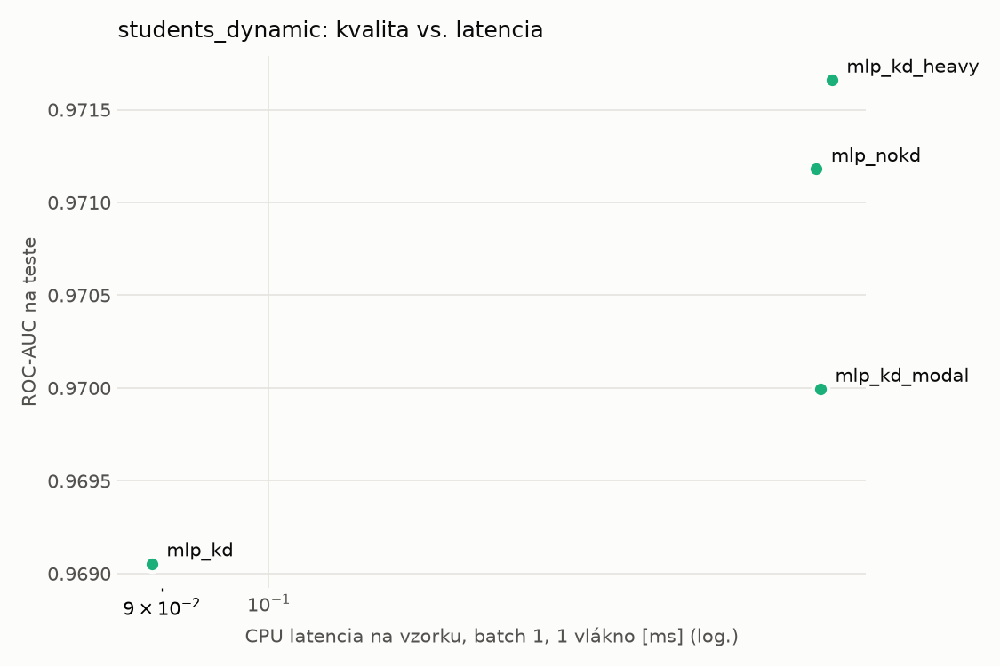
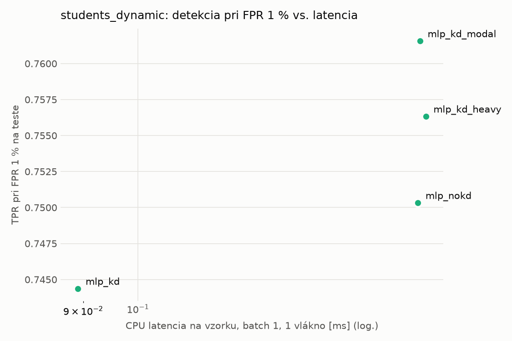
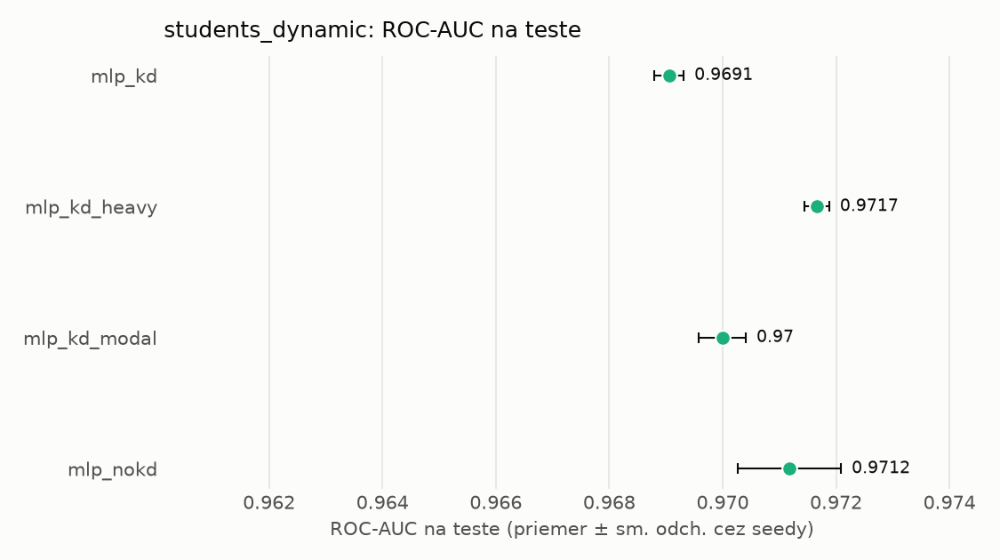
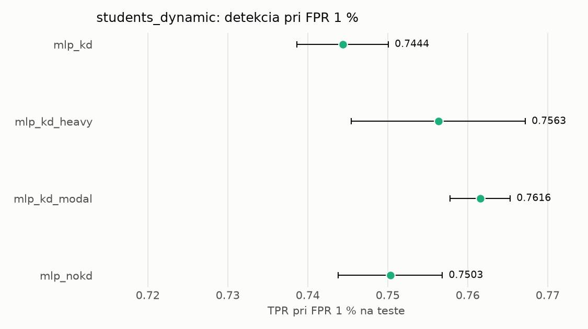

# Porovnanie modelov – students_dynamic

> Generované `src/evaluation/compare.py` (2026-11-22T21:47:39+01:00); použitý je posledný beh každého modelu.
> Metriky sú priemer cez seedy. \* = pri prahu určenom na validácii (FPR ≤ 1 %).
> CPU ms/vz. = medián latencie jednej vzorky na 1 vlákne vrátane transformácie vstupu (meranie hneď po tréningu,
> orientačné). Oficiálne merania spotreby sú v časti „Spotreba zdrojov pri inferencii“.

## Detekčná kvalita a orientačné časy
| model | ROC-AUC val | ROC-AUC test | TPR@FPR 1 % test | TPR@FPR 0,1 % test | F1 test* | FPR test* | gap train−val | CPU ms/vz. | CPU vz./s | GPU ms/vz. | parametre | MB | tréning s | ladenie min |
|---|---|---|---|---|---|---|---|---|---|---|---|---|---|---|
| [mlp_kd](../../students_dynamic/mlp_kd/20261122-214433/README.md) | 0.9706 | 0.9691 ± 0.0003 | 0.7444 | 0.5694 | 0.8456 | 0.0097 | 0.0040 | 0.089 | 7 724 059 | 0.266 | 8 641 | 0.04 | 11.0 | 0.0 |
| [mlp_kd_heavy](../../students_dynamic/mlp_kd_heavy/20261122-214629/README.md) | 0.9723 | 0.9717 ± 0.0002 | 0.7563 | 0.5689 | 0.8564 | 0.0098 | 0.0066 | 0.174 | 2 806 315 | 0.458 | 8 641 | 0.04 | 22.8 | 0.0 |
| [mlp_kd_modal](../../students_dynamic/mlp_kd_modal/20261122-214555/README.md) | 0.9720 | 0.9700 ± 0.0004 | 0.7616 | 0.5907 | 0.8564 | 0.0093 | 0.0031 | 0.172 | 6 001 767 | 0.282 | 8 641 | 0.04 | 10.6 | 0.0 |
| [mlp_nokd](../../students_dynamic/mlp_nokd/20261122-214508/README.md) | 0.9722 | 0.9712 ± 0.0009 | 0.7503 | 0.5711 | 0.8561 | 0.0107 | 0.0060 | 0.171 | 7 904 189 | 0.448 | 8 641 | 0.04 | 15.2 | 0.0 |

## Nízka prevalencia malvéru (test, prah z validácie)
| model | TPR | FPR | precision @ 1 % | falošné na 1 skutočný poplach @ 1 % | precision @ 0.1 % | falošné na 1 skutočný poplach @ 0.1 % |
|---|---|---|---|---|---|---|
| mlp_kd | 0.7389 | 0.0097 | 0.436 | 1.29 | 0.071 | 13.06 |
| mlp_kd_heavy | 0.7554 | 0.0098 | 0.437 | 1.29 | 0.071 | 13.02 |
| mlp_kd_modal | 0.7550 | 0.0093 | 0.452 | 1.21 | 0.076 | 12.24 |
| mlp_nokd | 0.7555 | 0.0107 | 0.416 | 1.40 | 0.066 | 14.15 |

Prepočet: TPR a FPR nezávisia od podielu malvéru, preto sa dajú preniesť na nízku prevalenciu (v reálnej prevádzke je malvéru ~1 % alebo menej; v teste 54 %). „Falošné na 1 skutočný poplach“ = koľko neškodných súborov je označených na každý zachytený malvér.

## Spotreba zdrojov pri inferencii (benchmark, testovacia množina)
_Benchmark zatiaľ nebol spustený (`python -m src.evaluation.benchmark --approach students_dynamic`)._

## Grafy

