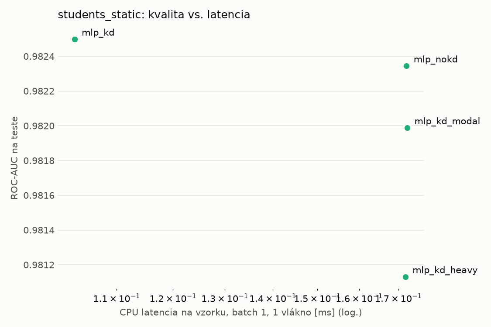
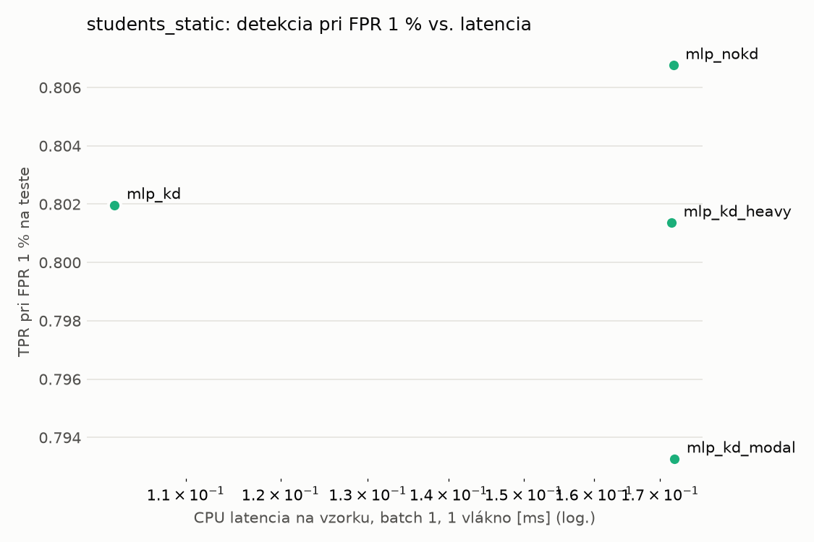
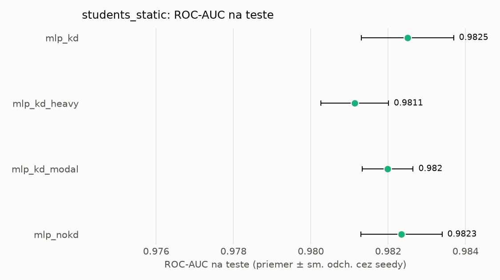
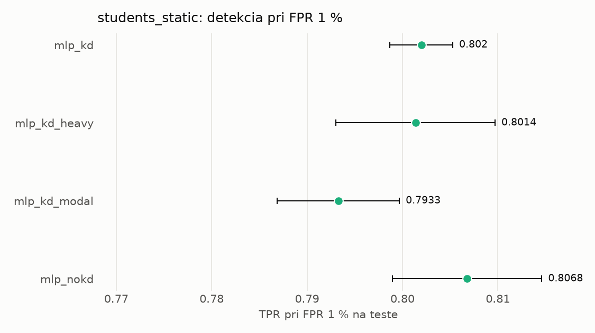

# Porovnanie modelov – students_static

> Generované `src/evaluation/compare.py` (2026-11-22T21:44:30+01:00); použitý je posledný beh každého modelu.
> Metriky sú priemer cez seedy. \* = pri prahu určenom na validácii (FPR ≤ 1 %).
> CPU ms/vz. = medián latencie jednej vzorky na 1 vlákne vrátane transformácie vstupu (meranie hneď po tréningu,
> orientačné). Oficiálne merania spotreby sú v časti „Spotreba zdrojov pri inferencii“.

## Detekčná kvalita a orientačné časy
| model | ROC-AUC val | ROC-AUC test | TPR@FPR 1 % test | TPR@FPR 0,1 % test | F1 test* | FPR test* | gap train−val | CPU ms/vz. | CPU vz./s | GPU ms/vz. | parametre | MB | tréning s | ladenie min |
|---|---|---|---|---|---|---|---|---|---|---|---|---|---|---|
| [mlp_kd](../../students_static/mlp_kd/20261122-214307/README.md) | 0.9914 | 0.9825 ± 0.0012 | 0.8020 | 0.5989 | 0.8811 | 0.0088 | 0.0046 | 0.103 | 2 381 497 | 0.286 | 10 753 | 0.05 | 4.9 | 0.0 |
| [mlp_kd_heavy](../../students_static/mlp_kd_heavy/20261122-214413/README.md) | 0.9909 | 0.9811 ± 0.0009 | 0.8014 | 0.6381 | 0.8748 | 0.0081 | 0.0047 | 0.172 | 2 683 555 | 0.291 | 10 753 | 0.05 | 4.8 | 0.0 |
| [mlp_kd_modal](../../students_static/mlp_kd_modal/20261122-214356/README.md) | 0.9909 | 0.9820 ± 0.0007 | 0.7933 | 0.6326 | 0.8758 | 0.0090 | 0.0044 | 0.172 | 3 408 521 | 0.271 | 10 753 | 0.05 | 5.0 | 0.0 |
| [mlp_nokd](../../students_static/mlp_nokd/20261122-214324/README.md) | 0.9913 | 0.9823 ± 0.0010 | 0.8068 | 0.5293 | 0.8816 | 0.0080 | 0.0054 | 0.172 | 3 074 819 | 0.314 | 10 753 | 0.05 | 10.0 | 0.0 |

## Nízka prevalencia malvéru (test, prah z validácie)
| model | TPR | FPR | precision @ 1 % | falošné na 1 skutočný poplach @ 1 % | precision @ 0.1 % | falošné na 1 skutočný poplach @ 0.1 % |
|---|---|---|---|---|---|---|
| mlp_kd | 0.7935 | 0.0088 | 0.478 | 1.09 | 0.083 | 11.02 |
| mlp_kd_heavy | 0.7830 | 0.0081 | 0.495 | 1.02 | 0.089 | 10.30 |
| mlp_kd_modal | 0.7853 | 0.0090 | 0.468 | 1.14 | 0.080 | 11.48 |
| mlp_nokd | 0.7939 | 0.0080 | 0.500 | 1.00 | 0.090 | 10.10 |

Prepočet: TPR a FPR nezávisia od podielu malvéru, preto sa dajú preniesť na nízku prevalenciu (v reálnej prevádzke je malvéru ~1 % alebo menej; v teste 54 %). „Falošné na 1 skutočný poplach“ = koľko neškodných súborov je označených na každý zachytený malvér.

## Spotreba zdrojov pri inferencii (benchmark, testovacia množina)
_Benchmark zatiaľ nebol spustený (`python -m src.evaluation.benchmark --approach students_static`)._

## Grafy

