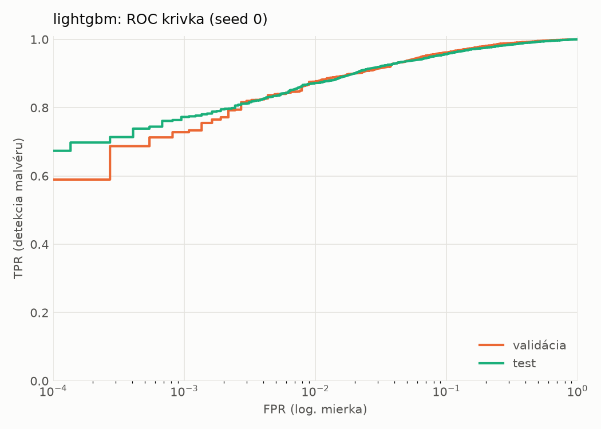
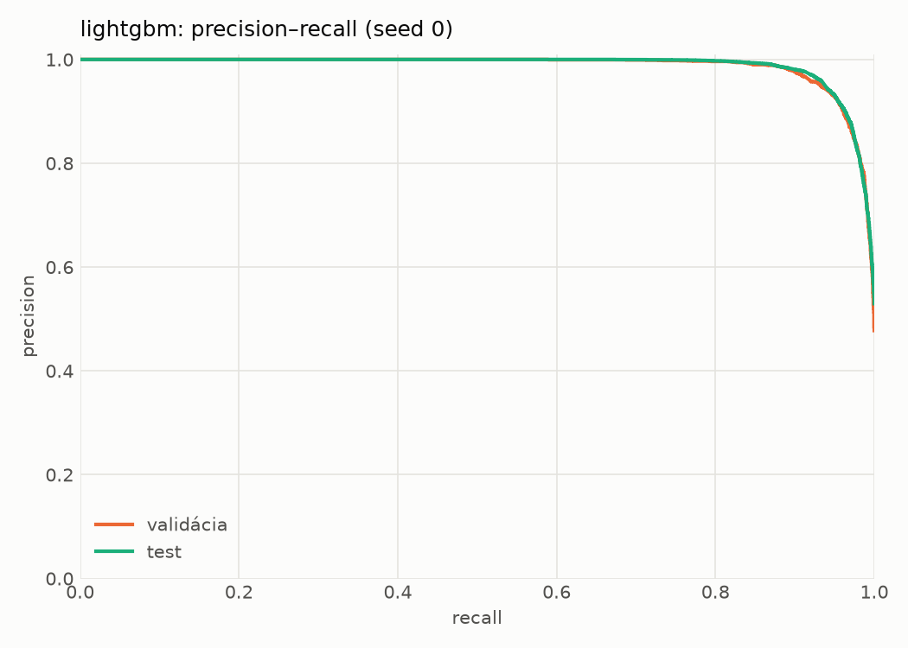
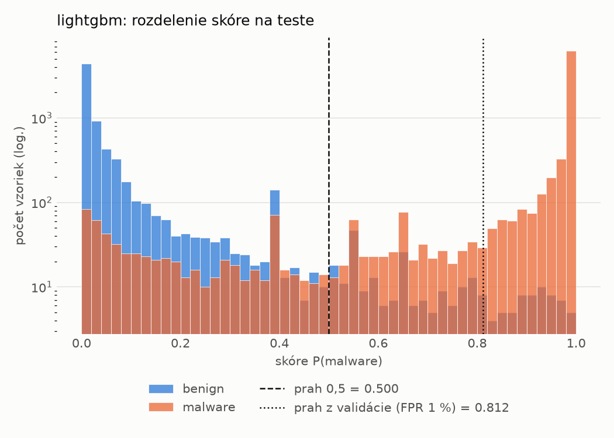
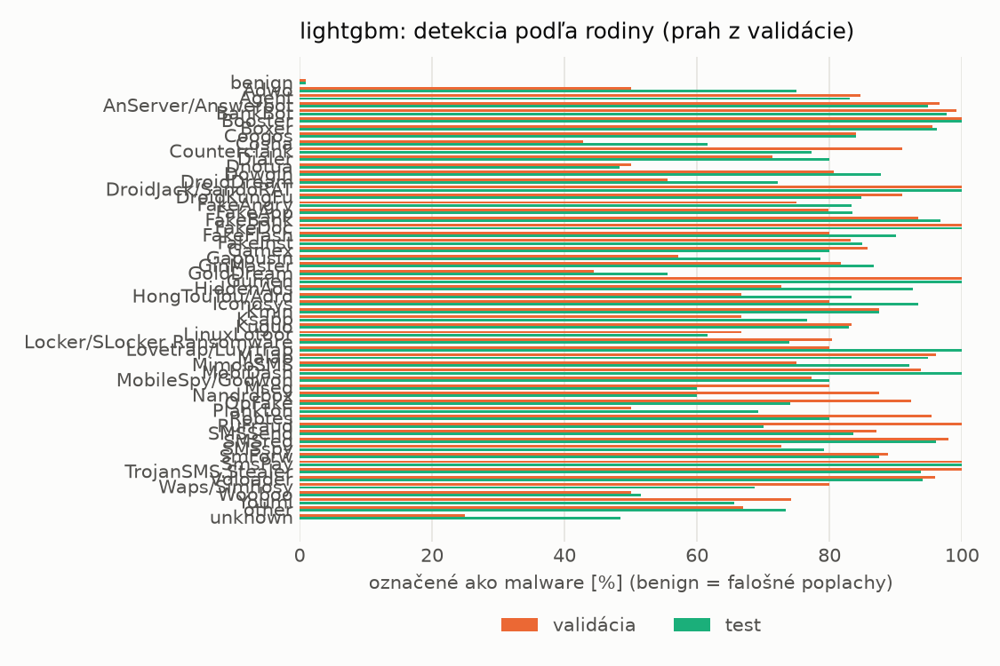
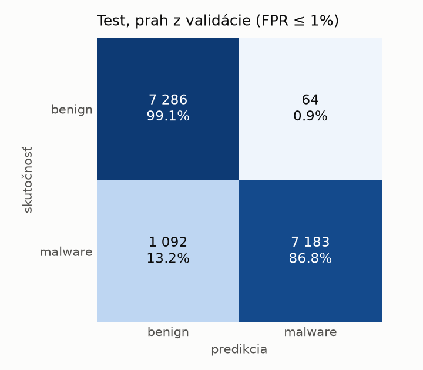
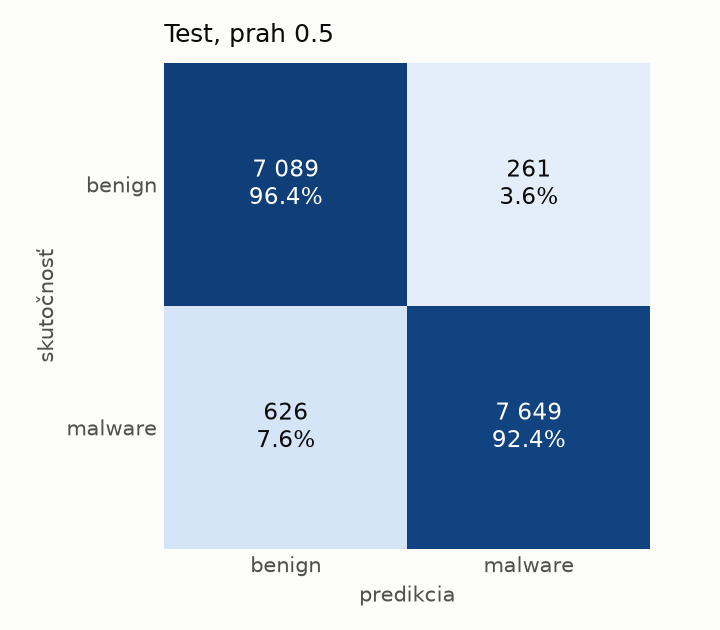
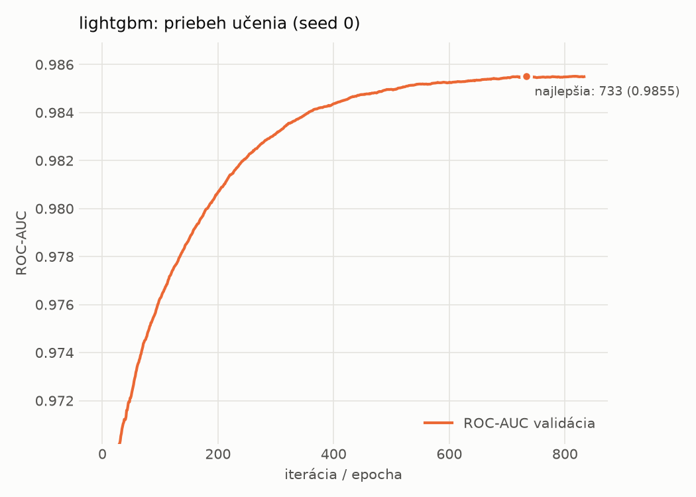

# dynamic/lightgbm – beh `20261122-213330`

> Automaticky generované (`src/training/run_tabular.py`). Konfigurácia: `config.yaml`, protokol: `protocol.yaml`.

- **Model:** `lightgbm` – LightGBM, gradient boosting stromov s early stopping na validácii (pôvodné hodnoty príznakov)
- **Ladenie:** bez ladenia – hyperparametre prevzaté z `runs_v4/real_full/full/dynamic/lightgbm/20261122-191914`
- **Finálne modely:** seedy [0, 1, 2]; hodnoty sú priemer ± smerodajná odchýlka cez seedy
- **Najlepšie hyperparametre:** `{"num_boost_round": 5000, "early_stopping_rounds": 100, "learning_rate": 0.017901592505193763, "num_leaves": 251, "min_child_samples": 52, "feature_fraction": 0.9358255991772038, "bagging_fraction": 0.8815171244905227, "lambda_l1": 0.02987319702672823, "lambda_l2": 0.017348460156736675}`

## Detekčná kvalita (bez prahu)
| metrika | train (podvzorka) | validácia | test |
|---|---|---|---|
| ROC-AUC | 0.9993 ± 0.0002 | 0.9856 ± 0.0001 | 0.9834 ± 0.0001 |
| PR-AUC | 0.9992 ± 0.0002 | 0.9872 ± 0.0001 | 0.9880 ± 0.0000 |
| TPR pri FPR 1 % | 0.9837 ± 0.0020 | 0.8772 ± 0.0011 | 0.8722 ± 0.0011 |
| TPR pri FPR 0,1 % | 0.9657 ± 0.0025 | 0.7231 ± 0.0156 | 0.7759 ± 0.0038 |
| log loss | 0.0397 ± 0.0066 | 0.1455 ± 0.0015 | 0.1599 ± 0.0030 |
| Brier skóre | 0.0096 ± 0.0013 | 0.0409 ± 0.0003 | 0.0440 ± 0.0000 |

Rozdiel ROC-AUC train − validácia: **0.0137** (veľký rozdiel = preučenie).

## Pri prahu z validácie (FPR ≤ 1% na validácii)
| metrika | train (podvzorka) | validácia | test |
|---|---|---|---|
| accuracy | 0.9787 ± 0.0029 | 0.9363 ± 0.0005 | 0.9254 ± 0.0012 |
| balanced accuracy | 0.9773 ± 0.0031 | 0.9338 ± 0.0005 | 0.9291 ± 0.0011 |
| precision | 0.9998 ± 0.0004 | 0.9882 ± 0.0002 | 0.9913 ± 0.0002 |
| recall (TPR) | 0.9548 ± 0.0059 | 0.8772 ± 0.0011 | 0.8666 ± 0.0024 |
| FPR | 0.0002 ± 0.0003 | 0.0096 ± 0.0002 | 0.0085 ± 0.0002 |
| F1 | 0.9768 ± 0.0033 | 0.9294 ± 0.0006 | 0.9248 ± 0.0013 |
| MCC | 0.9581 ± 0.0057 | 0.8768 ± 0.0008 | 0.8590 ± 0.0021 |

## Pri pevnom prahu 0.5
| metrika | train (podvzorka) | validácia | test |
|---|---|---|---|
| accuracy | 0.9866 ± 0.0011 | 0.9446 ± 0.0004 | 0.9439 ± 0.0006 |
| balanced accuracy | 0.9864 ± 0.0011 | 0.9439 ± 0.0003 | 0.9451 ± 0.0006 |
| precision | 0.9891 ± 0.0003 | 0.9551 ± 0.0016 | 0.9677 ± 0.0006 |
| recall (TPR) | 0.9823 ± 0.0020 | 0.9276 ± 0.0012 | 0.9250 ± 0.0007 |
| FPR | 0.0095 ± 0.0002 | 0.0399 ± 0.0015 | 0.0348 ± 0.0006 |
| F1 | 0.9857 ± 0.0012 | 0.9412 ± 0.0004 | 0.9459 ± 0.0006 |
| MCC | 0.9732 ± 0.0021 | 0.8891 ± 0.0008 | 0.8888 ± 0.0013 |

## Výpočtové nároky (seed 0, testovacia množina)
| meranie | hodnota |
|---|---|
| tréning finálneho modelu | 16.9 s (priemer cez seedy) |
| ladenie spolu | 0 s |
| počet parametrov / uzlov | 367 233 |
| veľkosť modelu na disku | 20.15 MB |
| CPU latencia modelu (batch 1, 1 vlákno) | 0.142 ms (p95 0.167) |
| CPU priepustnosť (24 vlákien) | 110 442 vzoriek/s |

## Grafy
| | |
|---|---|
|  |  |
|  |  |
|  |  |
|  |  |

## Súbory
`metrics.json` (všetky metriky po seedoch vrátane rodín), `timing.json`, `hpo_trials.csv`,
`predictions/<časť>_seed<N>.parquet` (sha256, family, label, score), `model/seed_<N>/`, `log.txt`.
