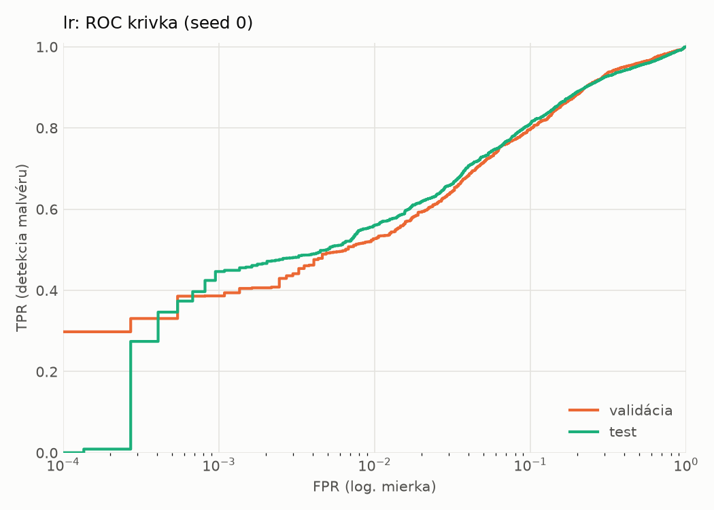
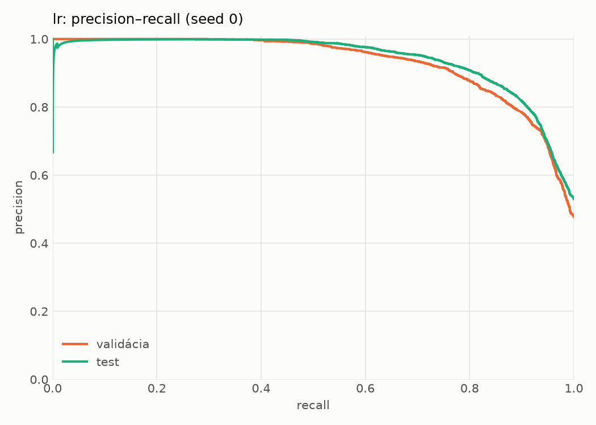
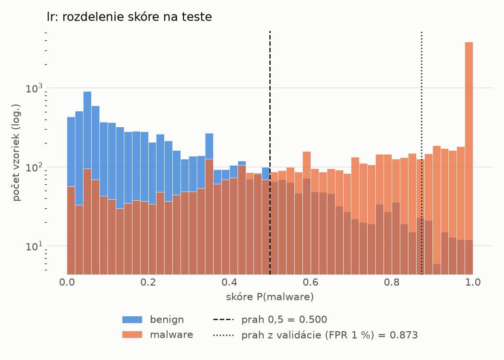
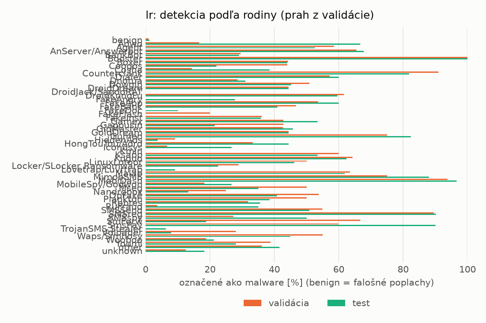
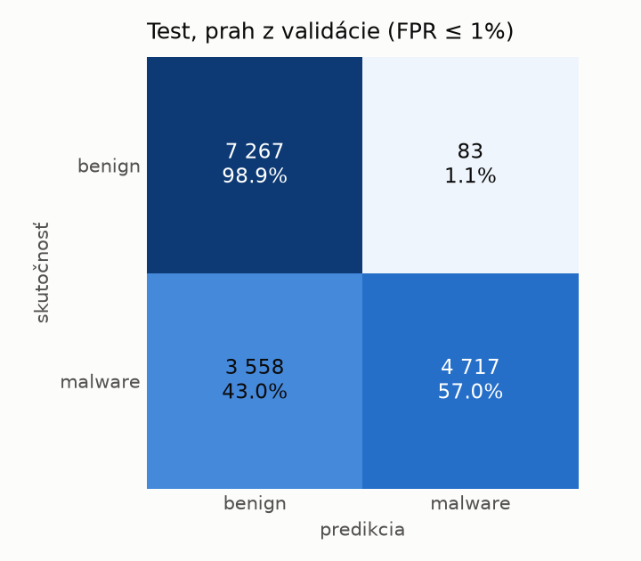
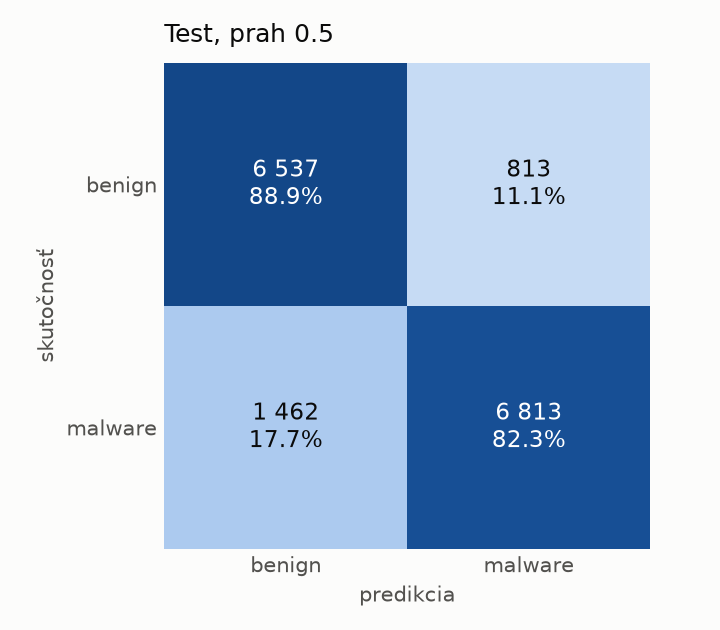

# dynamic/lr – beh `20261122-213308`

> Automaticky generované (`src/training/run_tabular.py`). Konfigurácia: `config.yaml`, protokol: `protocol.yaml`.

- **Model:** `logreg` – logistická regresia s L2 regularizáciou (vstup signed log1p + štandardizácia)
- **Ladenie:** bez ladenia – hyperparametre prevzaté z `runs_v4/real_full/full/dynamic/lr/20261122-191725`
- **Finálne modely:** seedy [0, 1, 2]; hodnoty sú priemer ± smerodajná odchýlka cez seedy
- **Najlepšie hyperparametre:** `{"max_iter": 2000, "C": 3.784688828069828}`

## Detekčná kvalita (bez prahu)
| metrika | train (podvzorka) | validácia | test |
|---|---|---|---|
| ROC-AUC | 0.9234 ± 0.0000 | 0.9238 ± 0.0000 | 0.9226 ± 0.0000 |
| PR-AUC | 0.9269 ± 0.0000 | 0.9315 ± 0.0000 | 0.9421 ± 0.0000 |
| TPR pri FPR 1 % | 0.4876 ± 0.0000 | 0.5271 ± 0.0000 | 0.5601 ± 0.0000 |
| TPR pri FPR 0,1 % | 0.3340 ± 0.0000 | 0.3864 ± 0.0000 | 0.4464 ± 0.0000 |
| log loss | 0.3510 ± 0.0000 | 0.3480 ± 0.0000 | 0.3515 ± 0.0000 |
| Brier skóre | 0.1077 ± 0.0000 | 0.1072 ± 0.0000 | 0.1077 ± 0.0000 |

Rozdiel ROC-AUC train − validácia: **-0.0003** (veľký rozdiel = preučenie).

## Pri prahu z validácie (FPR ≤ 1% na validácii)
| metrika | train (podvzorka) | validácia | test |
|---|---|---|---|
| accuracy | 0.7688 ± 0.0000 | 0.7689 ± 0.0000 | 0.7670 ± 0.0000 |
| balanced accuracy | 0.7542 ± 0.0000 | 0.7586 ± 0.0000 | 0.7794 ± 0.0000 |
| precision | 0.9729 ± 0.0000 | 0.9801 ± 0.0000 | 0.9827 ± 0.0000 |
| recall (TPR) | 0.5211 ± 0.0000 | 0.5271 ± 0.0000 | 0.5700 ± 0.0000 |
| FPR | 0.0128 ± 0.0000 | 0.0098 ± 0.0000 | 0.0113 ± 0.0000 |
| F1 | 0.6787 ± 0.0000 | 0.6855 ± 0.0000 | 0.7215 ± 0.0000 |
| MCC | 0.5850 ± 0.0000 | 0.5913 ± 0.0000 | 0.6045 ± 0.0000 |

## Pri pevnom prahu 0.5
| metrika | train (podvzorka) | validácia | test |
|---|---|---|---|
| accuracy | 0.8546 ± 0.0000 | 0.8497 ± 0.0000 | 0.8544 ± 0.0000 |
| balanced accuracy | 0.8525 ± 0.0000 | 0.8483 ± 0.0000 | 0.8564 ± 0.0000 |
| precision | 0.8635 ± 0.0000 | 0.8598 ± 0.0000 | 0.8934 ± 0.0000 |
| recall (TPR) | 0.8192 ± 0.0000 | 0.8189 ± 0.0000 | 0.8233 ± 0.0000 |
| FPR | 0.1142 ± 0.0000 | 0.1222 ± 0.0000 | 0.1106 ± 0.0000 |
| F1 | 0.8408 ± 0.0000 | 0.8388 ± 0.0000 | 0.8569 ± 0.0000 |
| MCC | 0.7080 ± 0.0000 | 0.6988 ± 0.0000 | 0.7117 ± 0.0000 |

## Výpočtové nároky (seed 0, testovacia množina)
| meranie | hodnota |
|---|---|
| tréning finálneho modelu | 0.3 s (priemer cez seedy) |
| ladenie spolu | 0 s |
| počet parametrov / uzlov | 132 |
| veľkosť modelu na disku | 0.01 MB |
| transformácia vstupu – latencia (1 vlákno) | 0.005 ms |
| transformácia vstupu – priepustnosť | 1 320 571 vzoriek/s |
| CPU latencia modelu (batch 1, 1 vlákno) | 0.004 ms (p95 0.005) |
| CPU priepustnosť (24 vlákien) | 4 023 432 vzoriek/s |

## Grafy
| | |
|---|---|
|  |  |
|  |  |
|  |  |
|  |  |

## Súbory
`metrics.json` (všetky metriky po seedoch vrátane rodín), `timing.json`, `hpo_trials.csv`,
`predictions/<časť>_seed<N>.parquet` (sha256, family, label, score), `model/seed_<N>/`, `log.txt`.
