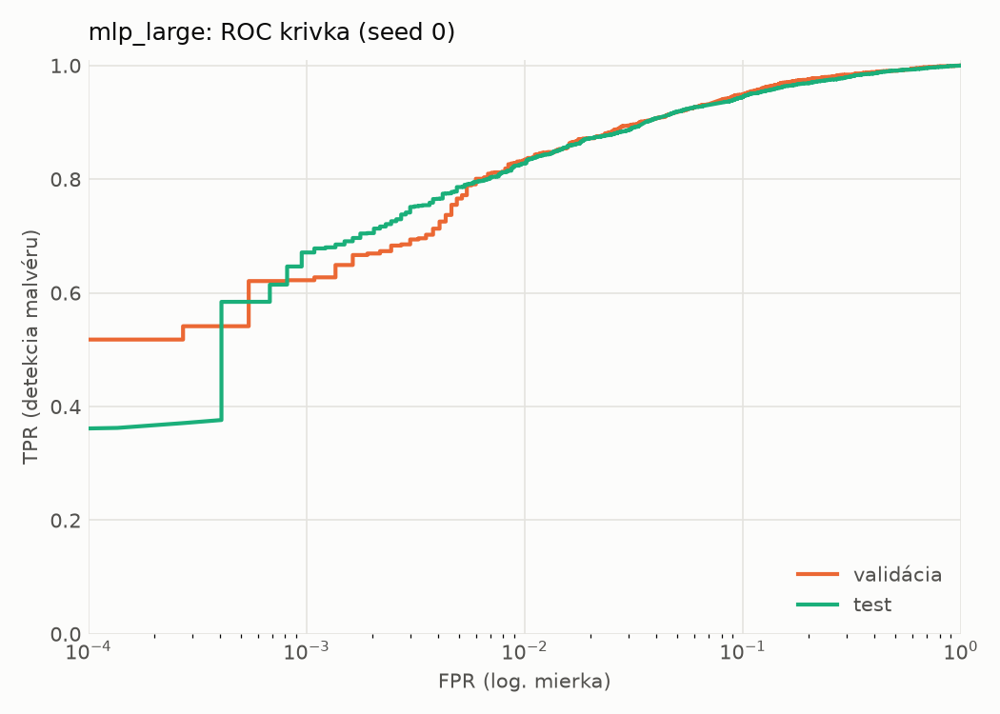
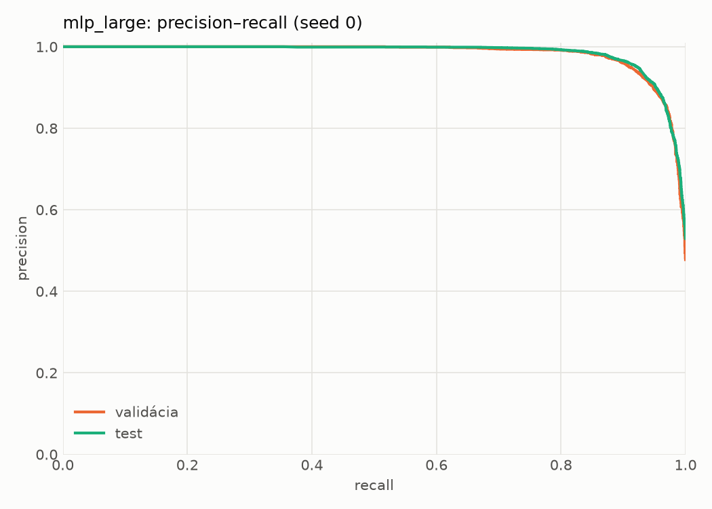
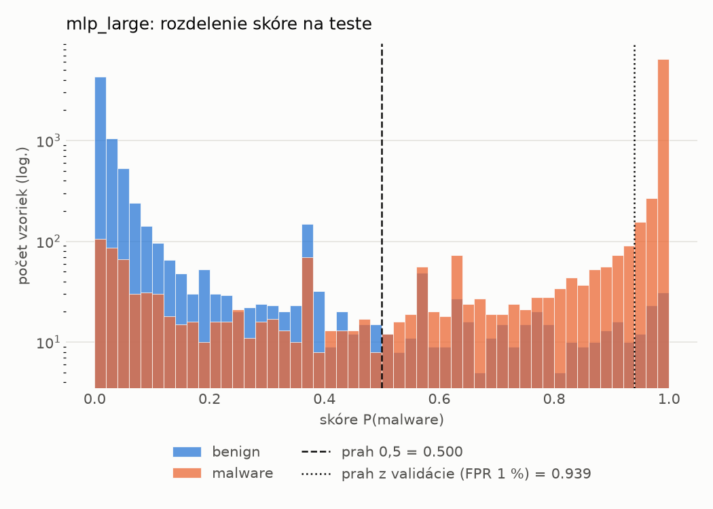
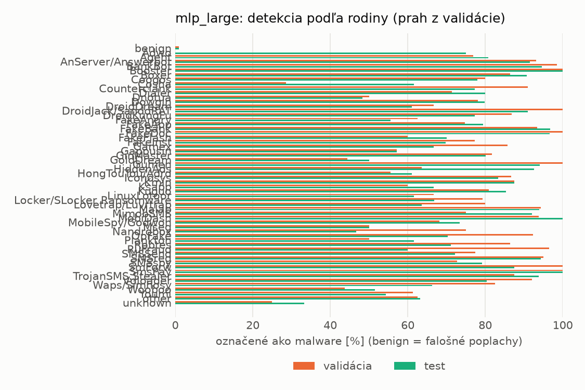
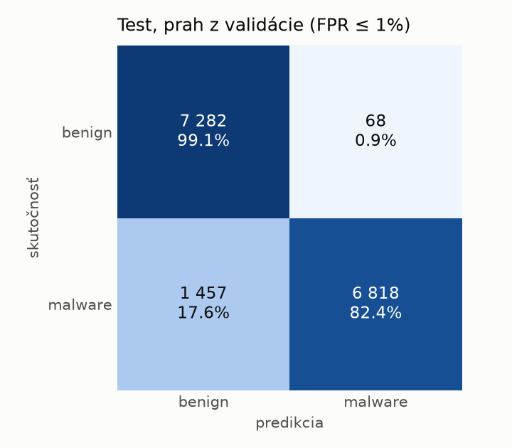
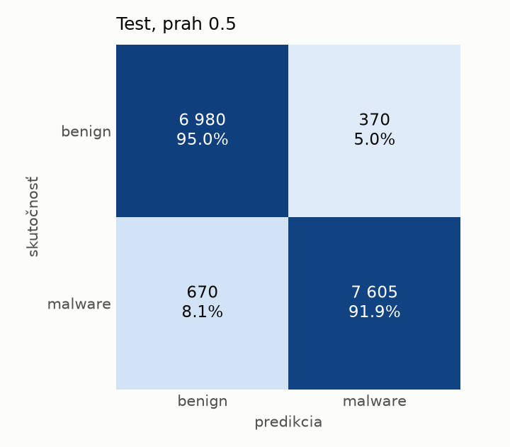
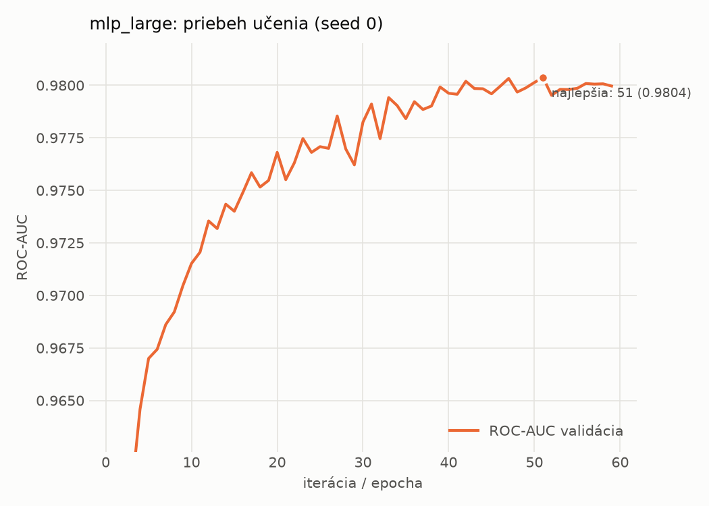

# dynamic/mlp_large – beh `20261122-213535`

> Automaticky generované (`src/training/run_tabular.py`). Konfigurácia: `config.yaml`, protokol: `protocol.yaml`.

- **Model:** `mlp` – veľká neurónová sieť (3–5 skrytých vrstiev, 512–2048 neurónov), kandidát na učiteľa
- **Ladenie:** bez ladenia – hyperparametre prevzaté z `runs_v4/real_full/full/dynamic/mlp_large/20261122-194320`
- **Finálne modely:** seedy [0, 1, 2]; hodnoty sú priemer ± smerodajná odchýlka cez seedy
- **Najlepšie hyperparametre:** `{"max_epochs": 100, "patience": 8, "hidden_layers": 3, "hidden_width": 512, "width_decay": 1.0, "dropout": 0.16077310300541978, "lr": 0.0005048635567863703, "weight_decay": 0.004783411439856203, "batch_size": 1024}`

## Detekčná kvalita (bez prahu)
| metrika | train (podvzorka) | validácia | test |
|---|---|---|---|
| ROC-AUC | 0.9916 ± 0.0008 | 0.9798 ± 0.0005 | 0.9781 ± 0.0003 |
| PR-AUC | 0.9919 ± 0.0007 | 0.9821 ± 0.0003 | 0.9838 ± 0.0002 |
| TPR pri FPR 1 % | 0.9054 ± 0.0083 | 0.8215 ± 0.0125 | 0.8252 ± 0.0026 |
| TPR pri FPR 0,1 % | 0.7917 ± 0.0127 | 0.6348 ± 0.0142 | 0.6753 ± 0.0234 |
| log loss | 0.1098 ± 0.0060 | 0.1793 ± 0.0009 | 0.1904 ± 0.0020 |
| Brier skóre | 0.0314 ± 0.0018 | 0.0502 ± 0.0005 | 0.0525 ± 0.0002 |

Rozdiel ROC-AUC train − validácia: **0.0117** (veľký rozdiel = preučenie).

## Pri prahu z validácie (FPR ≤ 1% na validácii)
| metrika | train (podvzorka) | validácia | test |
|---|---|---|---|
| accuracy | 0.9200 ± 0.0066 | 0.9096 ± 0.0060 | 0.8957 ± 0.0063 |
| balanced accuracy | 0.9147 ± 0.0071 | 0.9059 ± 0.0062 | 0.9011 ± 0.0058 |
| precision | 0.9979 ± 0.0001 | 0.9871 ± 0.0002 | 0.9916 ± 0.0013 |
| recall (TPR) | 0.8311 ± 0.0142 | 0.8215 ± 0.0125 | 0.8099 ± 0.0131 |
| FPR | 0.0016 ± 0.0001 | 0.0098 ± 0.0000 | 0.0078 ± 0.0014 |
| F1 | 0.9068 ± 0.0084 | 0.8967 ± 0.0075 | 0.8915 ± 0.0074 |
| MCC | 0.8486 ± 0.0118 | 0.8285 ± 0.0106 | 0.8082 ± 0.0101 |

## Pri pevnom prahu 0.5
| metrika | train (podvzorka) | validácia | test |
|---|---|---|---|
| accuracy | 0.9580 ± 0.0030 | 0.9329 ± 0.0011 | 0.9328 ± 0.0010 |
| balanced accuracy | 0.9570 ± 0.0032 | 0.9323 ± 0.0012 | 0.9340 ± 0.0008 |
| precision | 0.9673 ± 0.0009 | 0.9383 ± 0.0013 | 0.9564 ± 0.0024 |
| recall (TPR) | 0.9422 ± 0.0057 | 0.9200 ± 0.0037 | 0.9149 ± 0.0039 |
| FPR | 0.0281 ± 0.0007 | 0.0553 ± 0.0014 | 0.0469 ± 0.0029 |
| F1 | 0.9546 ± 0.0034 | 0.9291 ± 0.0014 | 0.9352 ± 0.0011 |
| MCC | 0.9158 ± 0.0060 | 0.8655 ± 0.0022 | 0.8665 ± 0.0017 |

## Výpočtové nároky (seed 0, testovacia množina)
| meranie | hodnota |
|---|---|
| tréning finálneho modelu | 5.9 s (priemer cez seedy) |
| ladenie spolu | 0 s |
| počet parametrov / uzlov | 596 481 |
| veľkosť modelu na disku | 2.41 MB |
| transformácia vstupu – latencia (1 vlákno) | 0.015 ms |
| transformácia vstupu – priepustnosť | 714 531 vzoriek/s |
| CPU latencia modelu (batch 1, 1 vlákno) | 0.174 ms (p95 0.357) |
| CPU priepustnosť (24 vlákien) | 649 413 vzoriek/s |
| GPU latencia (batch 1) | 0.551 ms (p95 0.592) |
| GPU priepustnosť | 2 456 298 vzoriek/s |
| GPU špičková pamäť | 123 MB |

## Grafy
| | |
|---|---|
|  |  |
|  |  |
|  |  |
|  |  |

## Súbory
`metrics.json` (všetky metriky po seedoch vrátane rodín), `timing.json`, `hpo_trials.csv`,
`predictions/<časť>_seed<N>.parquet` (sha256, family, label, score), `model/seed_<N>/`, `log.txt`.
