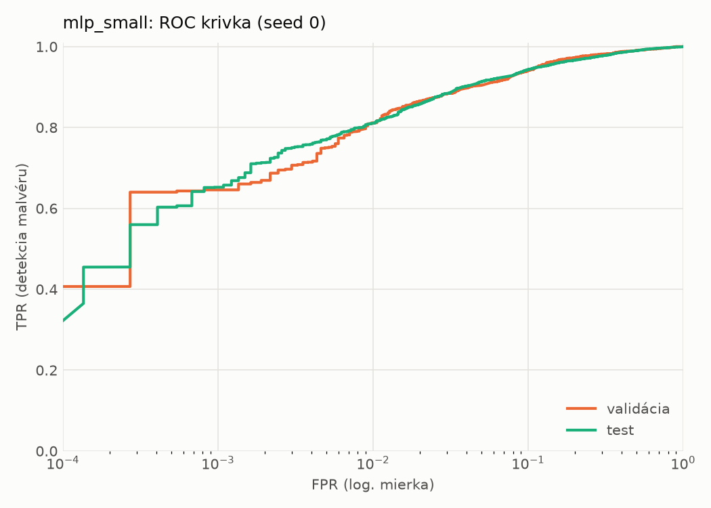
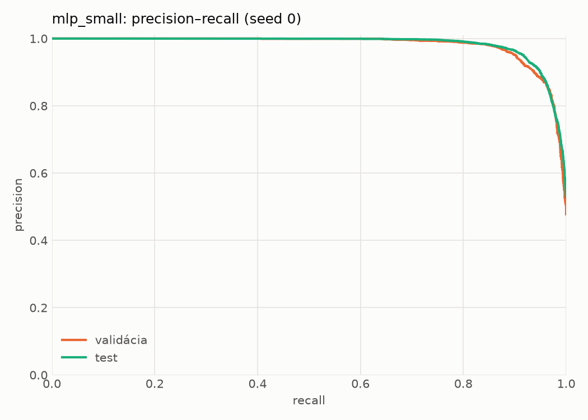
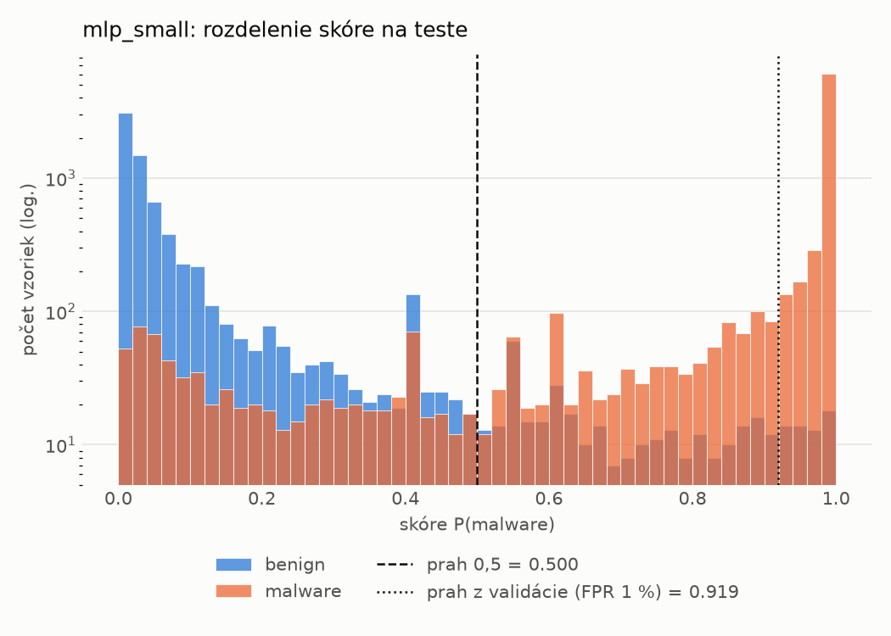
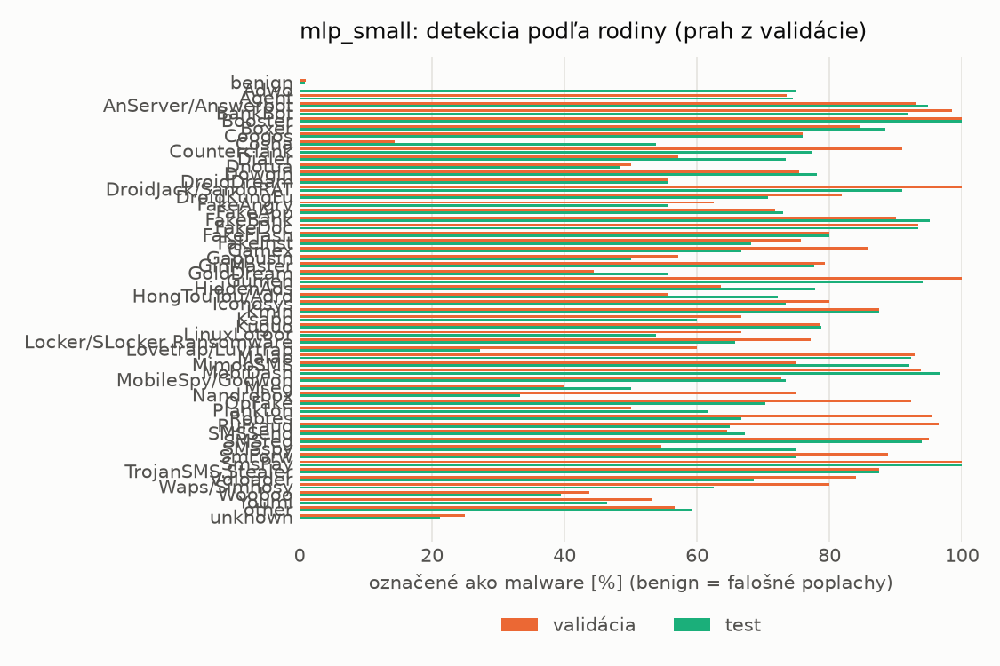
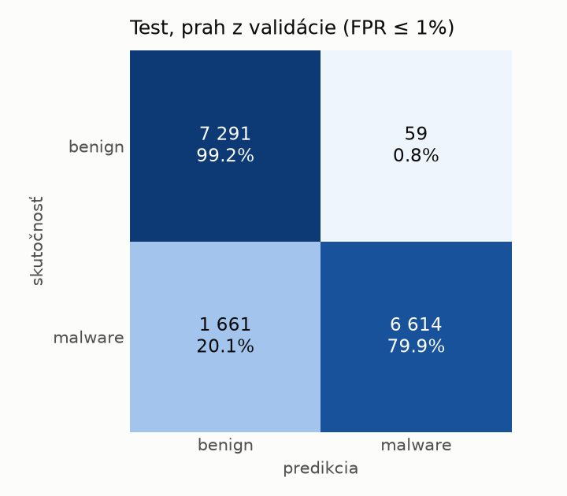
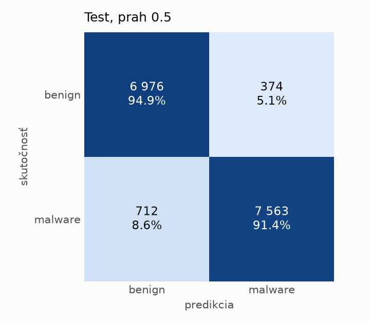
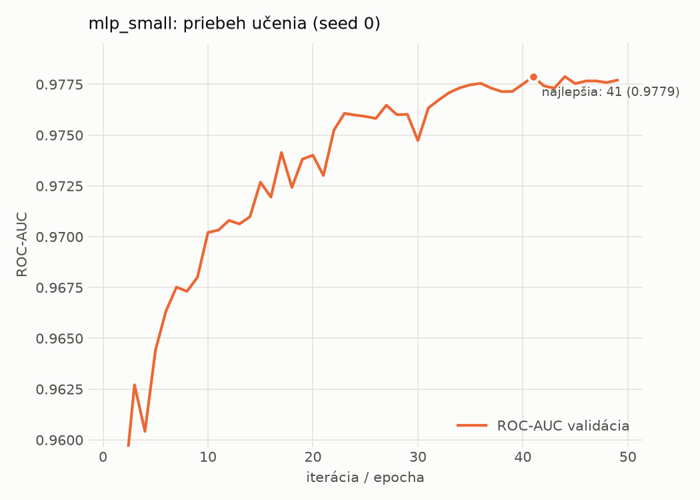

# dynamic/mlp_small – beh `20261122-213436`

> Automaticky generované (`src/training/run_tabular.py`). Konfigurácia: `config.yaml`, protokol: `protocol.yaml`.

- **Model:** `mlp` – malá neurónová sieť (1–2 skryté vrstvy), kandidát na ľahkého študenta
- **Ladenie:** bez ladenia – hyperparametre prevzaté z `runs_v4/real_full/full/dynamic/mlp_small/20261122-193213`
- **Finálne modely:** seedy [0, 1, 2]; hodnoty sú priemer ± smerodajná odchýlka cez seedy
- **Najlepšie hyperparametre:** `{"width_decay": 0.5, "max_epochs": 100, "patience": 8, "hidden_layers": 2, "hidden_width": 256, "dropout": 0.2449160262890371, "lr": 0.002872548733508973, "weight_decay": 4.509331245708397e-06, "batch_size": 256}`

## Detekčná kvalita (bez prahu)
| metrika | train (podvzorka) | validácia | test |
|---|---|---|---|
| ROC-AUC | 0.9879 ± 0.0013 | 0.9784 ± 0.0004 | 0.9770 ± 0.0004 |
| PR-AUC | 0.9885 ± 0.0011 | 0.9809 ± 0.0004 | 0.9830 ± 0.0005 |
| TPR pri FPR 1 % | 0.8777 ± 0.0101 | 0.8175 ± 0.0080 | 0.8168 ± 0.0085 |
| TPR pri FPR 0,1 % | 0.7491 ± 0.0217 | 0.6337 ± 0.0150 | 0.6645 ± 0.0144 |
| log loss | 0.1323 ± 0.0075 | 0.1804 ± 0.0019 | 0.1893 ± 0.0017 |
| Brier skóre | 0.0381 ± 0.0022 | 0.0519 ± 0.0006 | 0.0534 ± 0.0012 |

Rozdiel ROC-AUC train − validácia: **0.0095** (veľký rozdiel = preučenie).

## Pri prahu z validácie (FPR ≤ 1% na validácii)
| metrika | train (podvzorka) | validácia | test |
|---|---|---|---|
| accuracy | 0.9133 ± 0.0052 | 0.9077 ± 0.0038 | 0.8929 ± 0.0040 |
| balanced accuracy | 0.9077 ± 0.0056 | 0.9038 ± 0.0040 | 0.8984 ± 0.0038 |
| precision | 0.9956 ± 0.0010 | 0.9871 ± 0.0001 | 0.9911 ± 0.0002 |
| recall (TPR) | 0.8187 ± 0.0108 | 0.8175 ± 0.0080 | 0.8050 ± 0.0075 |
| FPR | 0.0032 ± 0.0007 | 0.0098 ± 0.0000 | 0.0081 ± 0.0002 |
| F1 | 0.8985 ± 0.0067 | 0.8943 ± 0.0049 | 0.8884 ± 0.0046 |
| MCC | 0.8362 ± 0.0094 | 0.8250 ± 0.0068 | 0.8033 ± 0.0067 |

## Pri pevnom prahu 0.5
| metrika | train (podvzorka) | validácia | test |
|---|---|---|---|
| accuracy | 0.9492 ± 0.0027 | 0.9289 ± 0.0033 | 0.9309 ± 0.0019 |
| balanced accuracy | 0.9483 ± 0.0027 | 0.9283 ± 0.0032 | 0.9321 ± 0.0020 |
| precision | 0.9559 ± 0.0037 | 0.9329 ± 0.0054 | 0.9555 ± 0.0033 |
| recall (TPR) | 0.9347 ± 0.0024 | 0.9170 ± 0.0024 | 0.9119 ± 0.0022 |
| FPR | 0.0380 ± 0.0033 | 0.0603 ± 0.0052 | 0.0478 ± 0.0037 |
| F1 | 0.9452 ± 0.0029 | 0.9249 ± 0.0033 | 0.9332 ± 0.0018 |
| MCC | 0.8981 ± 0.0055 | 0.8574 ± 0.0066 | 0.8626 ± 0.0039 |

## Výpočtové nároky (seed 0, testovacia množina)
| meranie | hodnota |
|---|---|
| tréning finálneho modelu | 19.3 s (priemer cez seedy) |
| ladenie spolu | 0 s |
| počet parametrov / uzlov | 67 585 |
| veľkosť modelu na disku | 0.28 MB |
| transformácia vstupu – latencia (1 vlákno) | 0.014 ms |
| transformácia vstupu – priepustnosť | 1 069 363 vzoriek/s |
| CPU latencia modelu (batch 1, 1 vlákno) | 0.104 ms (p95 0.115) |
| CPU priepustnosť (24 vlákien) | 2 675 330 vzoriek/s |
| GPU latencia (batch 1) | 0.391 ms (p95 0.421) |
| GPU priepustnosť | 1 654 612 vzoriek/s |
| GPU špičková pamäť | 72 MB |

## Grafy
| | |
|---|---|
|  |  |
|  |  |
|  |  |
|  |  |

## Súbory
`metrics.json` (všetky metriky po seedoch vrátane rodín), `timing.json`, `hpo_trials.csv`,
`predictions/<časť>_seed<N>.parquet` (sha256, family, label, score), `model/seed_<N>/`, `log.txt`.
