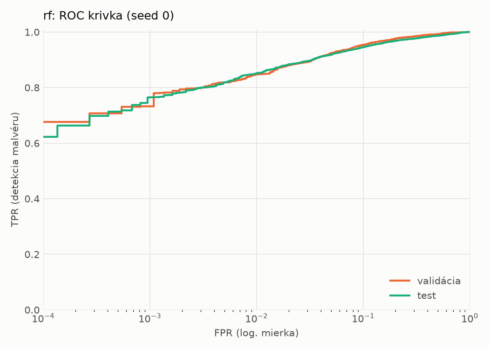
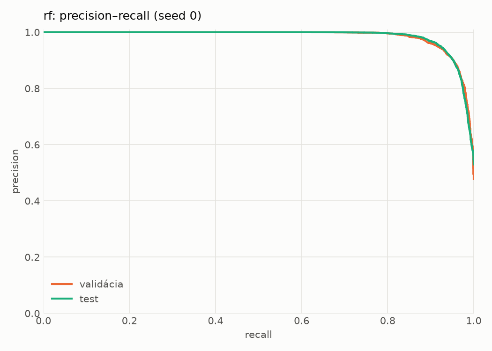
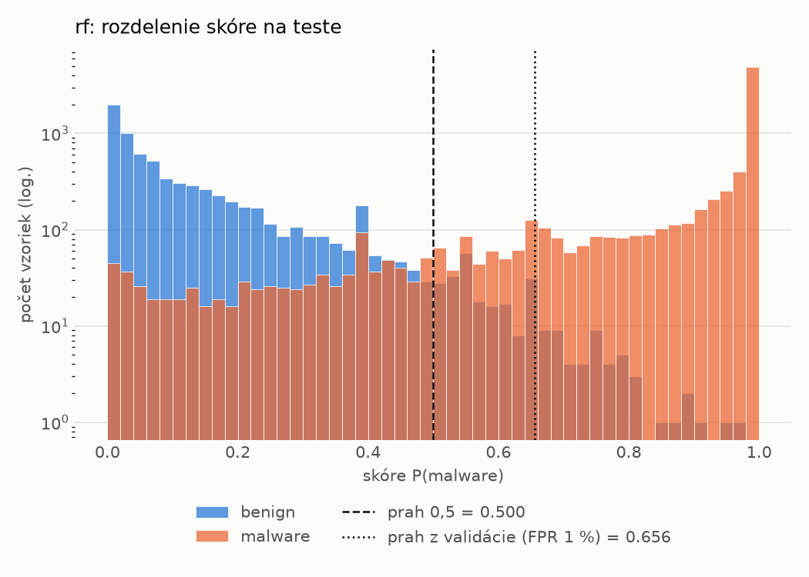
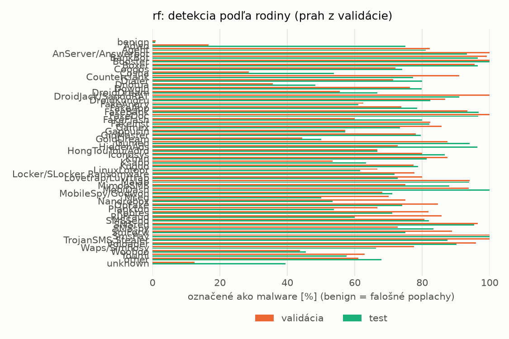
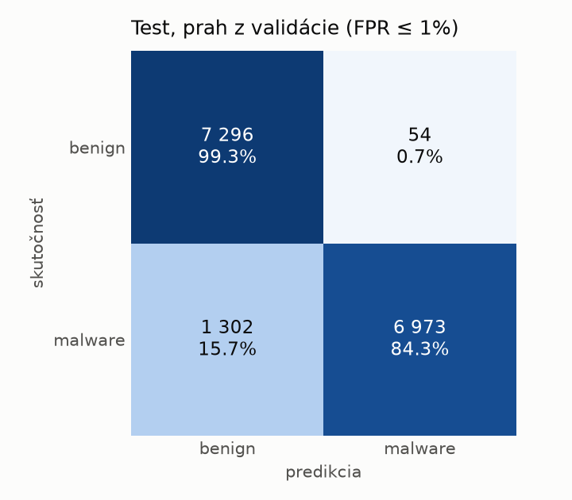
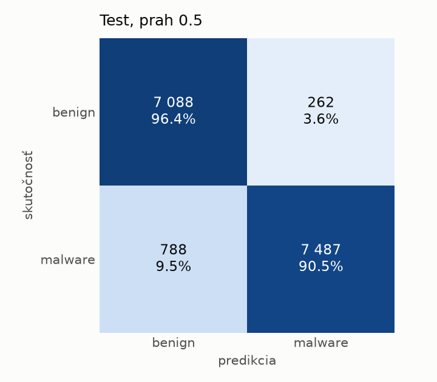

# dynamic/rf – beh `20261122-213310`

> Automaticky generované (`src/training/run_tabular.py`). Konfigurácia: `config.yaml`, protokol: `protocol.yaml`.

- **Model:** `random_forest` – Random Forest (pôvodné hodnoty príznakov)
- **Ladenie:** bez ladenia – hyperparametre prevzaté z `runs_v4/real_full/full/dynamic/rf/20261122-191738`
- **Finálne modely:** seedy [0, 1, 2]; hodnoty sú priemer ± smerodajná odchýlka cez seedy
- **Najlepšie hyperparametre:** `{"n_estimators": 500, "max_depth": 32, "min_samples_leaf": 1, "max_features": "sqrt"}`

## Detekčná kvalita (bez prahu)
| metrika | train (podvzorka) | validácia | test |
|---|---|---|---|
| ROC-AUC | 0.9991 ± 0.0000 | 0.9822 ± 0.0001 | 0.9775 ± 0.0000 |
| PR-AUC | 0.9991 ± 0.0000 | 0.9843 ± 0.0001 | 0.9843 ± 0.0000 |
| TPR pri FPR 1 % | 0.9863 ± 0.0003 | 0.8462 ± 0.0009 | 0.8428 ± 0.0070 |
| TPR pri FPR 0,1 % | 0.9614 ± 0.0002 | 0.7445 ± 0.0155 | 0.7627 ± 0.0026 |
| log loss | 0.0675 ± 0.0002 | 0.1773 ± 0.0002 | 0.1919 ± 0.0002 |
| Brier skóre | 0.0132 ± 0.0000 | 0.0505 ± 0.0001 | 0.0545 ± 0.0000 |

Rozdiel ROC-AUC train − validácia: **0.0169** (veľký rozdiel = preučenie).

## Pri prahu z validácie (FPR ≤ 1% na validácii)
| metrika | train (podvzorka) | validácia | test |
|---|---|---|---|
| accuracy | 0.9819 ± 0.0002 | 0.9215 ± 0.0004 | 0.9117 ± 0.0013 |
| balanced accuracy | 0.9807 ± 0.0002 | 0.9183 ± 0.0004 | 0.9162 ± 0.0013 |
| precision | 1.0000 ± 0.0000 | 0.9877 ± 0.0002 | 0.9920 ± 0.0004 |
| recall (TPR) | 0.9613 ± 0.0003 | 0.8462 ± 0.0009 | 0.8401 ± 0.0024 |
| FPR | 0.0000 ± 0.0000 | 0.0096 ± 0.0002 | 0.0076 ± 0.0004 |
| F1 | 0.9803 ± 0.0002 | 0.9115 ± 0.0005 | 0.9097 ± 0.0015 |
| MCC | 0.9641 ± 0.0003 | 0.8499 ± 0.0006 | 0.8354 ± 0.0023 |

## Pri pevnom prahu 0.5
| metrika | train (podvzorka) | validácia | test |
|---|---|---|---|
| accuracy | 0.9882 ± 0.0001 | 0.9367 ± 0.0006 | 0.9328 ± 0.0001 |
| balanced accuracy | 0.9879 ± 0.0001 | 0.9356 ± 0.0005 | 0.9345 ± 0.0001 |
| precision | 0.9908 ± 0.0000 | 0.9538 ± 0.0014 | 0.9665 ± 0.0006 |
| recall (TPR) | 0.9839 ± 0.0001 | 0.9117 ± 0.0005 | 0.9044 ± 0.0005 |
| FPR | 0.0081 ± 0.0000 | 0.0404 ± 0.0013 | 0.0353 ± 0.0007 |
| F1 | 0.9873 ± 0.0001 | 0.9323 ± 0.0006 | 0.9344 ± 0.0001 |
| MCC | 0.9763 ± 0.0001 | 0.8737 ± 0.0012 | 0.8676 ± 0.0002 |

## Výpočtové nároky (seed 0, testovacia množina)
| meranie | hodnota |
|---|---|
| tréning finálneho modelu | 2.9 s (priemer cez seedy) |
| ladenie spolu | 0 s |
| počet parametrov / uzlov | 4 149 800 |
| veľkosť modelu na disku | 332.38 MB |
| CPU latencia modelu (batch 1, 1 vlákno) | 15.412 ms (p95 15.724) |
| CPU priepustnosť (24 vlákien) | 115 571 vzoriek/s |

## Grafy
| | |
|---|---|
|  |  |
|  |  |
|  |  |
|  |  |

## Súbory
`metrics.json` (všetky metriky po seedoch vrátane rodín), `timing.json`, `hpo_trials.csv`,
`predictions/<časť>_seed<N>.parquet` (sha256, family, label, score), `model/seed_<N>/`, `log.txt`.
