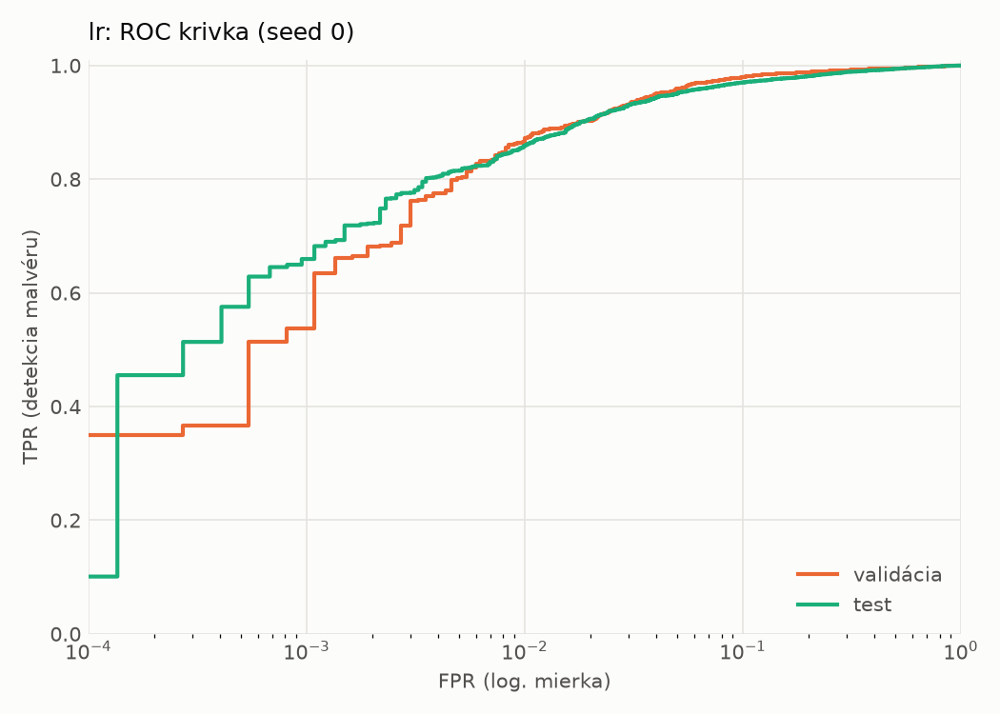
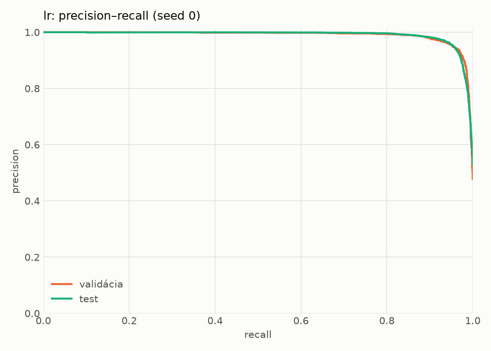
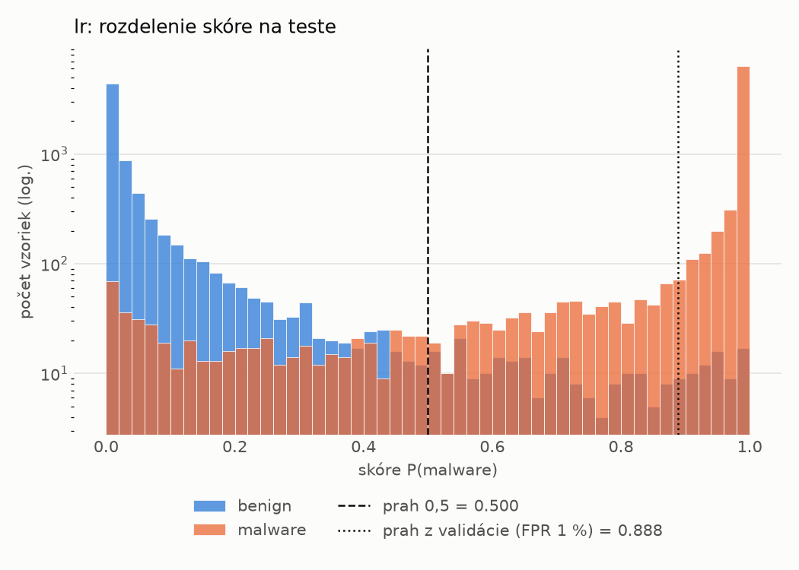
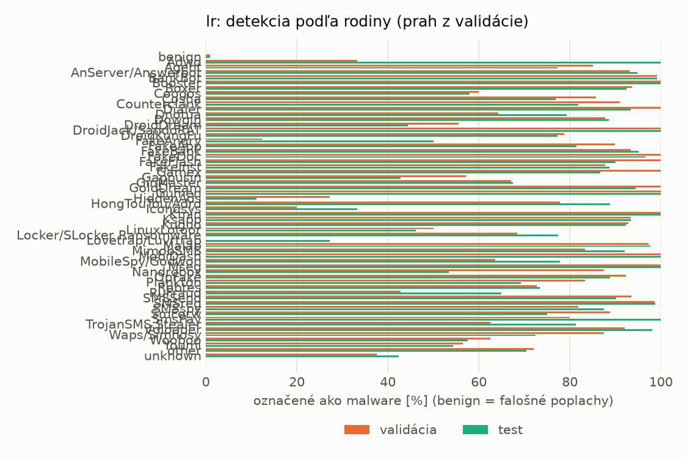
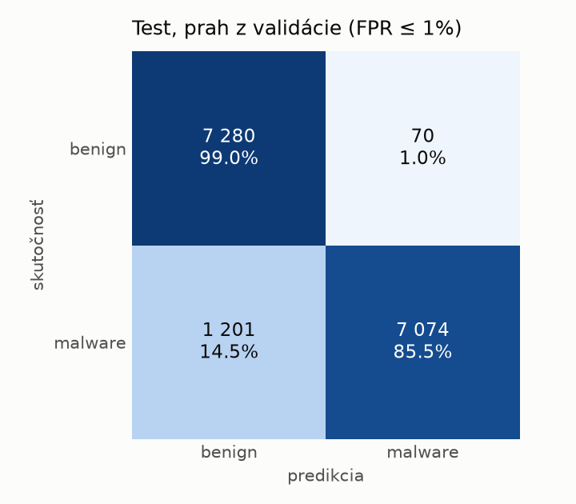
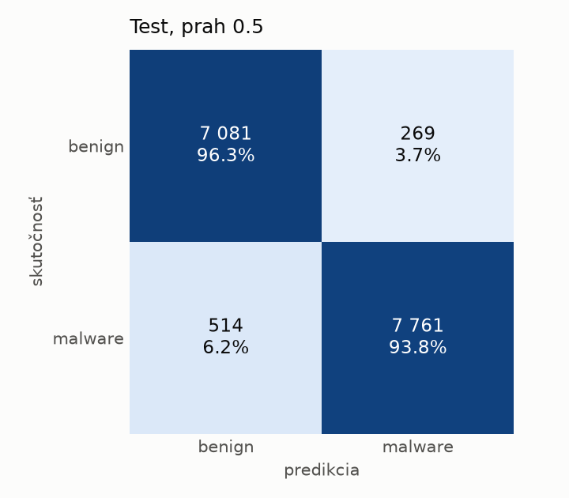

# hybrid/lr – beh `20261122-213559`

> Automaticky generované (`src/training/run_tabular.py`). Konfigurácia: `config.yaml`, protokol: `protocol.yaml`.

- **Model:** `logreg` – logistická regresia s L2 regularizáciou (vstup signed log1p + štandardizácia)
- **Ladenie:** bez ladenia – hyperparametre prevzaté z `runs_v4/real_full/full/hybrid/lr/20261122-195001`
- **Finálne modely:** seedy [0, 1, 2]; hodnoty sú priemer ± smerodajná odchýlka cez seedy
- **Najlepšie hyperparametre:** `{"max_iter": 2000, "C": 0.30240503427727145}`

## Detekčná kvalita (bez prahu)
| metrika | train (podvzorka) | validácia | test |
|---|---|---|---|
| ROC-AUC | 0.9890 ± 0.0000 | 0.9885 ± 0.0000 | 0.9860 ± 0.0000 |
| PR-AUC | 0.9895 ± 0.0000 | 0.9893 ± 0.0000 | 0.9894 ± 0.0000 |
| TPR pri FPR 1 % | 0.8705 ± 0.0000 | 0.8653 ± 0.0000 | 0.8584 ± 0.0000 |
| TPR pri FPR 0,1 % | 0.5749 ± 0.0000 | 0.5381 ± 0.0000 | 0.6596 ± 0.0000 |
| log loss | 0.1241 ± 0.0000 | 0.1297 ± 0.0000 | 0.1436 ± 0.0000 |
| Brier skóre | 0.0331 ± 0.0000 | 0.0347 ± 0.0000 | 0.0390 ± 0.0000 |

Rozdiel ROC-AUC train − validácia: **0.0005** (veľký rozdiel = preučenie).

## Pri prahu z validácie (FPR ≤ 1% na validácii)
| metrika | train (podvzorka) | validácia | test |
|---|---|---|---|
| accuracy | 0.9306 ± 0.0000 | 0.9305 ± 0.0000 | 0.9187 ± 0.0000 |
| balanced accuracy | 0.9265 ± 0.0000 | 0.9277 ± 0.0000 | 0.9227 ± 0.0000 |
| precision | 0.9885 ± 0.0000 | 0.9878 ± 0.0000 | 0.9902 ± 0.0000 |
| recall (TPR) | 0.8619 ± 0.0000 | 0.8653 ± 0.0000 | 0.8549 ± 0.0000 |
| FPR | 0.0088 ± 0.0000 | 0.0098 ± 0.0000 | 0.0095 ± 0.0000 |
| F1 | 0.9209 ± 0.0000 | 0.9225 ± 0.0000 | 0.9176 ± 0.0000 |
| MCC | 0.8660 ± 0.0000 | 0.8662 ± 0.0000 | 0.8470 ± 0.0000 |

## Pri pevnom prahu 0.5
| metrika | train (podvzorka) | validácia | test |
|---|---|---|---|
| accuracy | 0.9586 ± 0.0000 | 0.9550 ± 0.0000 | 0.9499 ± 0.0000 |
| balanced accuracy | 0.9581 ± 0.0000 | 0.9547 ± 0.0000 | 0.9506 ± 0.0000 |
| precision | 0.9613 ± 0.0000 | 0.9560 ± 0.0000 | 0.9665 ± 0.0000 |
| recall (TPR) | 0.9499 ± 0.0000 | 0.9494 ± 0.0000 | 0.9379 ± 0.0000 |
| FPR | 0.0337 ± 0.0000 | 0.0400 ± 0.0000 | 0.0366 ± 0.0000 |
| F1 | 0.9556 ± 0.0000 | 0.9527 ± 0.0000 | 0.9520 ± 0.0000 |
| MCC | 0.9169 ± 0.0000 | 0.9097 ± 0.0000 | 0.9001 ± 0.0000 |

## Výpočtové nároky (seed 0, testovacia množina)
| meranie | hodnota |
|---|---|
| tréning finálneho modelu | 0.3 s (priemer cez seedy) |
| ladenie spolu | 0 s |
| počet parametrov / uzlov | 296 |
| veľkosť modelu na disku | 0.01 MB |
| transformácia vstupu – latencia (1 vlákno) | 0.007 ms |
| transformácia vstupu – priepustnosť | 504 781 vzoriek/s |
| CPU latencia modelu (batch 1, 1 vlákno) | 0.004 ms (p95 0.005) |
| CPU priepustnosť (24 vlákien) | 2 291 459 vzoriek/s |

## Grafy
| | |
|---|---|
|  |  |
|  |  |
|  |  |
|  |  |

## Súbory
`metrics.json` (všetky metriky po seedoch vrátane rodín), `timing.json`, `hpo_trials.csv`,
`predictions/<časť>_seed<N>.parquet` (sha256, family, label, score), `model/seed_<N>/`, `log.txt`.
