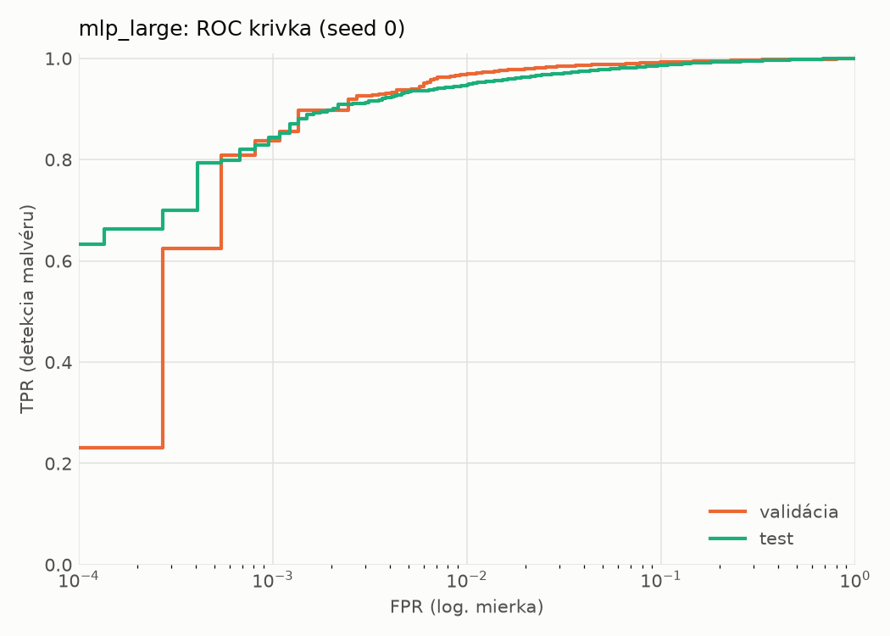
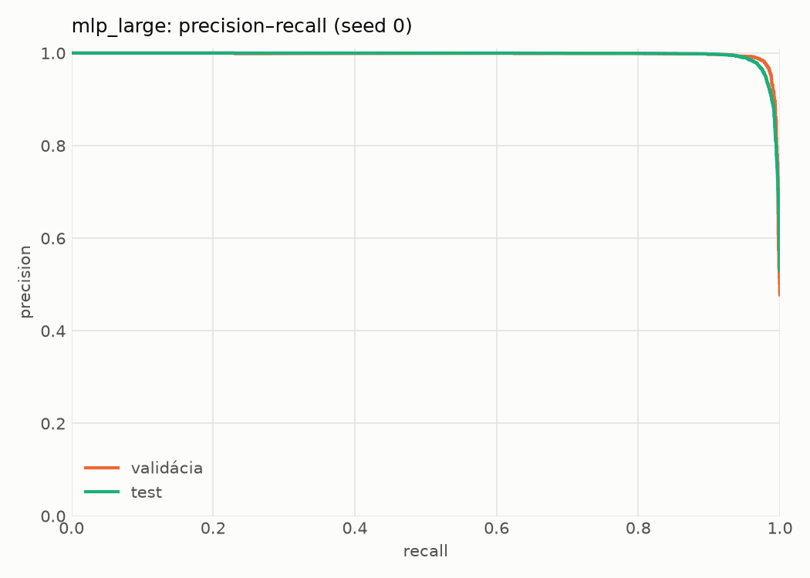
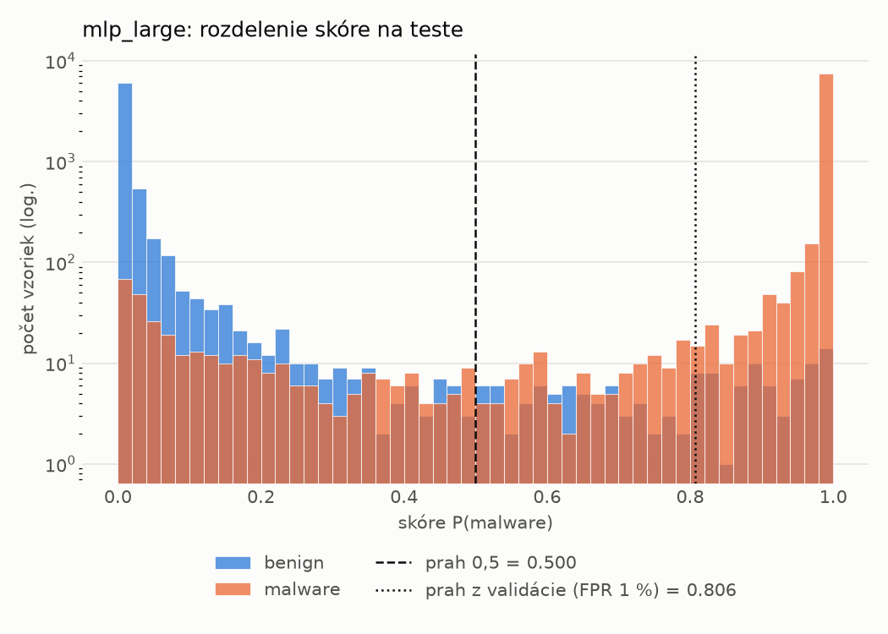
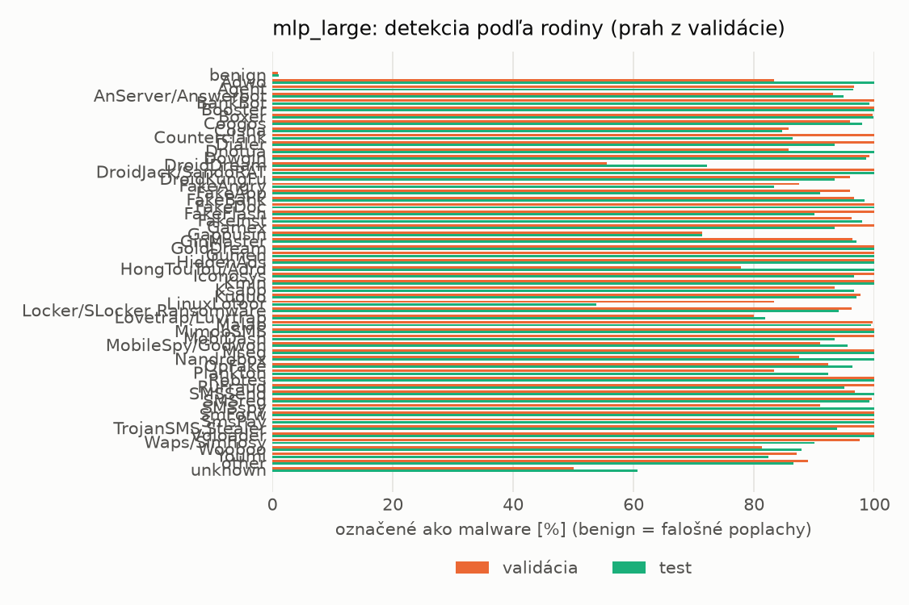
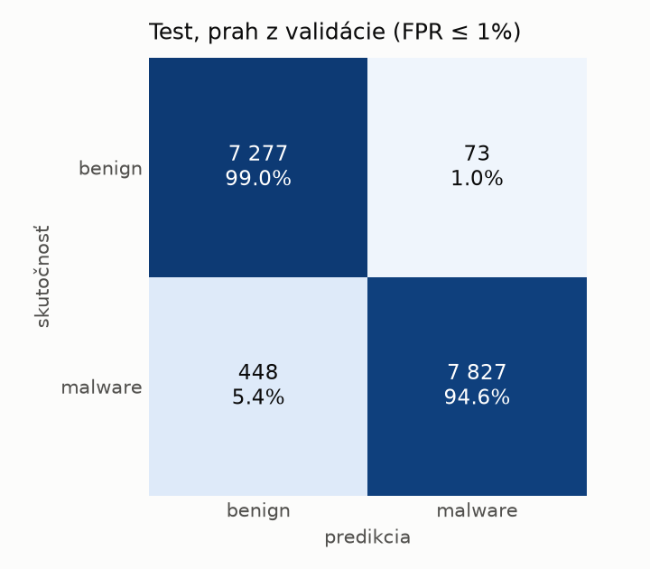
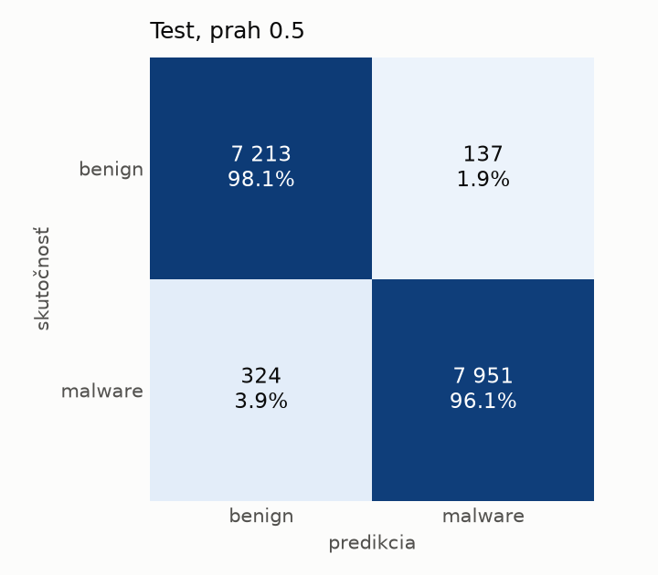
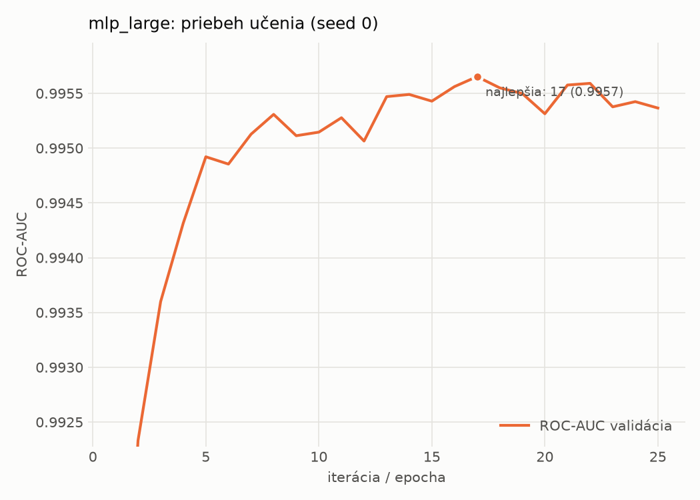

# hybrid/mlp_large – beh `20261122-213736`

> Automaticky generované (`src/training/run_tabular.py`). Konfigurácia: `config.yaml`, protokol: `protocol.yaml`.

- **Model:** `mlp` – veľká neurónová sieť (3–5 skrytých vrstiev, 512–2048 neurónov), kandidát na učiteľa
- **Ladenie:** bez ladenia – hyperparametre prevzaté z `runs_v4/real_full/full/hybrid/mlp_large/20261122-201300`
- **Finálne modely:** seedy [0, 1, 2]; hodnoty sú priemer ± smerodajná odchýlka cez seedy
- **Najlepšie hyperparametre:** `{"max_epochs": 100, "patience": 8, "hidden_layers": 3, "hidden_width": 512, "width_decay": 0.5, "dropout": 0.18171623767667733, "lr": 0.00010022812541545209, "weight_decay": 7.819097276436122e-06, "batch_size": 256}`

## Detekčná kvalita (bez prahu)
| metrika | train (podvzorka) | validácia | test |
|---|---|---|---|
| ROC-AUC | 0.9987 ± 0.0005 | 0.9958 ± 0.0001 | 0.9944 ± 0.0002 |
| PR-AUC | 0.9988 ± 0.0004 | 0.9956 ± 0.0010 | 0.9959 ± 0.0002 |
| TPR pri FPR 1 % | 0.9876 ± 0.0052 | 0.9651 ± 0.0042 | 0.9486 ± 0.0029 |
| TPR pri FPR 0,1 % | 0.9616 ± 0.0185 | 0.8384 ± 0.0192 | 0.8637 ± 0.0178 |
| log loss | 0.0348 ± 0.0084 | 0.0670 ± 0.0006 | 0.0893 ± 0.0010 |
| Brier skóre | 0.0085 ± 0.0022 | 0.0166 ± 0.0008 | 0.0236 ± 0.0006 |

Rozdiel ROC-AUC train − validácia: **0.0029** (veľký rozdiel = preučenie).

## Pri prahu z validácie (FPR ≤ 1% na validácii)
| metrika | train (podvzorka) | validácia | test |
|---|---|---|---|
| accuracy | 0.9858 ± 0.0029 | 0.9783 ± 0.0020 | 0.9664 ± 0.0011 |
| balanced accuracy | 0.9850 ± 0.0030 | 0.9777 ± 0.0021 | 0.9678 ± 0.0011 |
| precision | 0.9976 ± 0.0013 | 0.9891 ± 0.0002 | 0.9919 ± 0.0010 |
| recall (TPR) | 0.9721 ± 0.0050 | 0.9651 ± 0.0042 | 0.9442 ± 0.0026 |
| FPR | 0.0021 ± 0.0011 | 0.0097 ± 0.0002 | 0.0087 ± 0.0011 |
| F1 | 0.9847 ± 0.0032 | 0.9770 ± 0.0022 | 0.9675 ± 0.0012 |
| MCC | 0.9718 ± 0.0058 | 0.9566 ± 0.0040 | 0.9339 ± 0.0022 |

## Pri pevnom prahu 0.5
| metrika | train (podvzorka) | validácia | test |
|---|---|---|---|
| accuracy | 0.9901 ± 0.0029 | 0.9792 ± 0.0011 | 0.9701 ± 0.0004 |
| balanced accuracy | 0.9898 ± 0.0030 | 0.9791 ± 0.0012 | 0.9709 ± 0.0003 |
| precision | 0.9945 ± 0.0026 | 0.9793 ± 0.0020 | 0.9847 ± 0.0014 |
| recall (TPR) | 0.9844 ± 0.0044 | 0.9770 ± 0.0022 | 0.9585 ± 0.0020 |
| FPR | 0.0048 ± 0.0022 | 0.0189 ± 0.0019 | 0.0168 ± 0.0016 |
| F1 | 0.9894 ± 0.0031 | 0.9782 ± 0.0012 | 0.9714 ± 0.0004 |
| MCC | 0.9802 ± 0.0058 | 0.9582 ± 0.0023 | 0.9405 ± 0.0007 |

## Výpočtové nároky (seed 0, testovacia množina)
| meranie | hodnota |
|---|---|
| tréning finálneho modelu | 10.4 s (priemer cez seedy) |
| ladenie spolu | 0 s |
| počet parametrov / uzlov | 317 697 |
| veľkosť modelu na disku | 1.29 MB |
| transformácia vstupu – latencia (1 vlákno) | 0.017 ms |
| transformácia vstupu – priepustnosť | 282 392 vzoriek/s |
| CPU latencia modelu (batch 1, 1 vlákno) | 0.143 ms (p95 0.219) |
| CPU priepustnosť (24 vlákien) | 551 703 vzoriek/s |
| GPU latencia (batch 1) | 0.547 ms (p95 0.581) |
| GPU priepustnosť | 959 761 vzoriek/s |
| GPU špičková pamäť | 206 MB |

## Grafy
| | |
|---|---|
|  |  |
|  |  |
|  |  |
|  |  |

## Súbory
`metrics.json` (všetky metriky po seedoch vrátane rodín), `timing.json`, `hpo_trials.csv`,
`predictions/<časť>_seed<N>.parquet` (sha256, family, label, score), `model/seed_<N>/`, `log.txt`.
