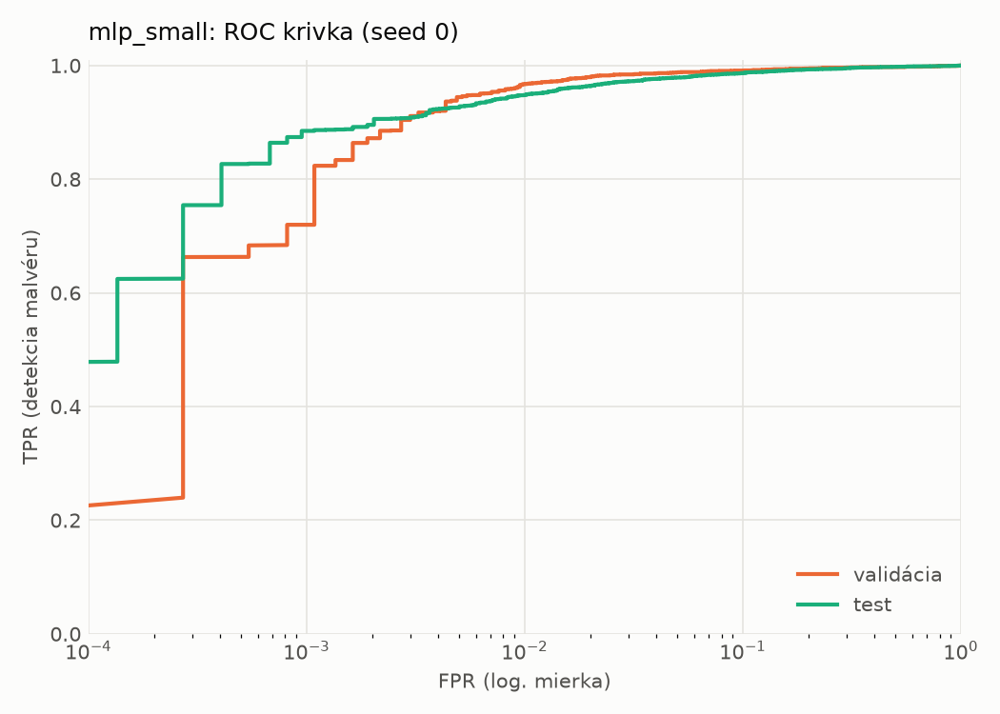
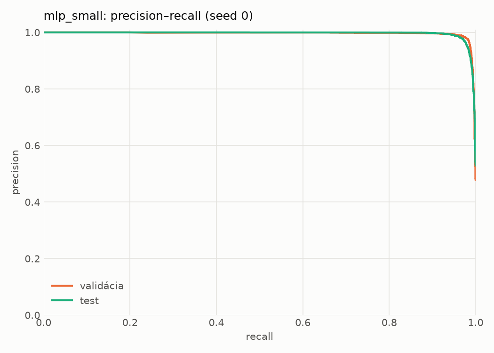
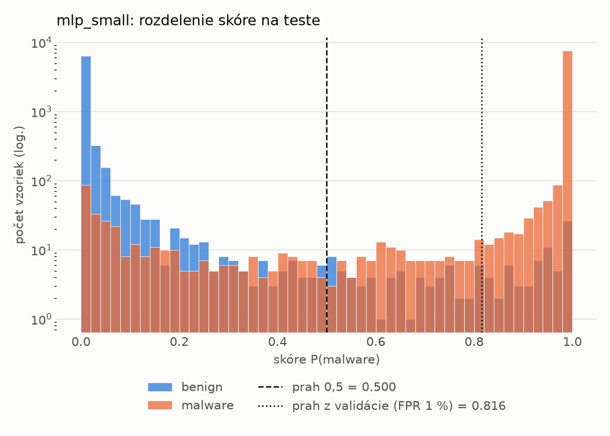
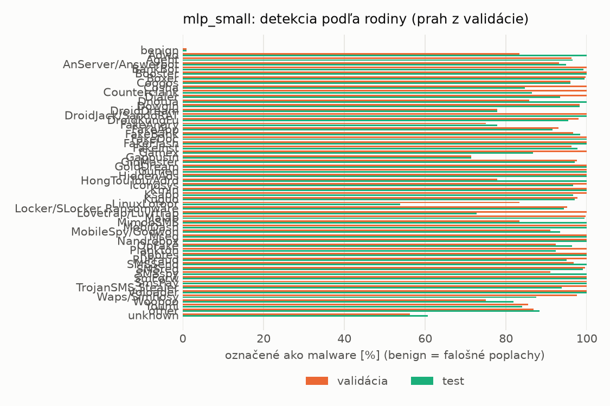
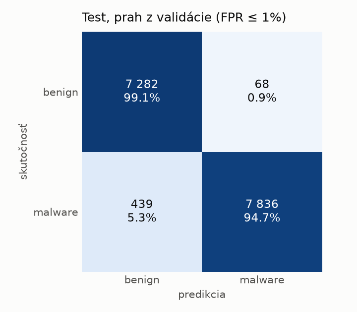
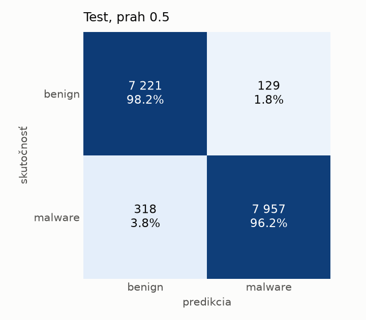
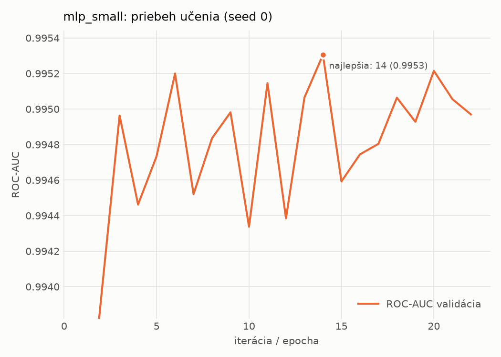

# hybrid/mlp_small – beh `20261122-213710`

> Automaticky generované (`src/training/run_tabular.py`). Konfigurácia: `config.yaml`, protokol: `protocol.yaml`.

- **Model:** `mlp` – malá neurónová sieť (1–2 skryté vrstvy), kandidát na ľahkého študenta
- **Ladenie:** bez ladenia – hyperparametre prevzaté z `runs_v4/real_full/full/hybrid/mlp_small/20261122-200826`
- **Finálne modely:** seedy [0, 1, 2]; hodnoty sú priemer ± smerodajná odchýlka cez seedy
- **Najlepšie hyperparametre:** `{"width_decay": 0.5, "max_epochs": 100, "patience": 8, "hidden_layers": 2, "hidden_width": 256, "dropout": 0.19625503285105284, "lr": 0.0008594281758471675, "weight_decay": 0.001025897876119634, "batch_size": 256}`

## Detekčná kvalita (bez prahu)
| metrika | train (podvzorka) | validácia | test |
|---|---|---|---|
| ROC-AUC | 0.9990 ± 0.0000 | 0.9954 ± 0.0002 | 0.9939 ± 0.0003 |
| PR-AUC | 0.9992 ± 0.0000 | 0.9959 ± 0.0003 | 0.9957 ± 0.0001 |
| TPR pri FPR 1 % | 0.9918 ± 0.0005 | 0.9695 ± 0.0020 | 0.9511 ± 0.0029 |
| TPR pri FPR 0,1 % | 0.9776 ± 0.0083 | 0.7546 ± 0.0379 | 0.8721 ± 0.0112 |
| log loss | 0.0269 ± 0.0011 | 0.0749 ± 0.0026 | 0.0937 ± 0.0013 |
| Brier skóre | 0.0065 ± 0.0003 | 0.0163 ± 0.0002 | 0.0227 ± 0.0005 |

Rozdiel ROC-AUC train − validácia: **0.0036** (veľký rozdiel = preučenie).

## Pri prahu z validácie (FPR ≤ 1% na validácii)
| metrika | train (podvzorka) | validácia | test |
|---|---|---|---|
| accuracy | 0.9889 ± 0.0004 | 0.9803 ± 0.0010 | 0.9676 ± 0.0003 |
| balanced accuracy | 0.9882 ± 0.0004 | 0.9799 ± 0.0010 | 0.9690 ± 0.0003 |
| precision | 0.9993 ± 0.0006 | 0.9892 ± 0.0002 | 0.9926 ± 0.0012 |
| recall (TPR) | 0.9770 ± 0.0003 | 0.9695 ± 0.0020 | 0.9459 ± 0.0009 |
| FPR | 0.0006 ± 0.0005 | 0.0097 ± 0.0002 | 0.0080 ± 0.0013 |
| F1 | 0.9881 ± 0.0004 | 0.9792 ± 0.0011 | 0.9687 ± 0.0002 |
| MCC | 0.9780 ± 0.0008 | 0.9607 ± 0.0020 | 0.9363 ± 0.0006 |

## Pri pevnom prahu 0.5
| metrika | train (podvzorka) | validácia | test |
|---|---|---|---|
| accuracy | 0.9921 ± 0.0007 | 0.9801 ± 0.0006 | 0.9718 ± 0.0007 |
| balanced accuracy | 0.9919 ± 0.0007 | 0.9801 ± 0.0006 | 0.9725 ± 0.0007 |
| precision | 0.9951 ± 0.0011 | 0.9794 ± 0.0009 | 0.9854 ± 0.0012 |
| recall (TPR) | 0.9880 ± 0.0007 | 0.9790 ± 0.0005 | 0.9610 ± 0.0009 |
| FPR | 0.0043 ± 0.0009 | 0.0189 ± 0.0008 | 0.0161 ± 0.0014 |
| F1 | 0.9915 ± 0.0008 | 0.9792 ± 0.0006 | 0.9730 ± 0.0007 |
| MCC | 0.9842 ± 0.0015 | 0.9601 ± 0.0012 | 0.9438 ± 0.0015 |

## Výpočtové nároky (seed 0, testovacia množina)
| meranie | hodnota |
|---|---|
| tréning finálneho modelu | 7.8 s (priemer cez seedy) |
| ladenie spolu | 0 s |
| počet parametrov / uzlov | 109 569 |
| veľkosť modelu na disku | 0.45 MB |
| transformácia vstupu – latencia (1 vlákno) | 0.017 ms |
| transformácia vstupu – priepustnosť | 287 432 vzoriek/s |
| CPU latencia modelu (batch 1, 1 vlákno) | 0.105 ms (p95 0.115) |
| CPU priepustnosť (24 vlákien) | 944 040 vzoriek/s |
| GPU latencia (batch 1) | 0.491 ms (p95 0.729) |
| GPU priepustnosť | 754 984 vzoriek/s |
| GPU špičková pamäť | 121 MB |

## Grafy
| | |
|---|---|
|  |  |
|  |  |
|  |  |
|  |  |

## Súbory
`metrics.json` (všetky metriky po seedoch vrátane rodín), `timing.json`, `hpo_trials.csv`,
`predictions/<časť>_seed<N>.parquet` (sha256, family, label, score), `model/seed_<N>/`, `log.txt`.
