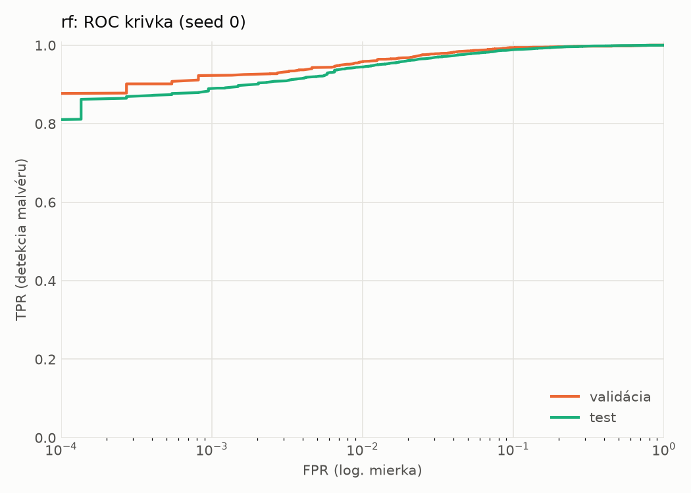
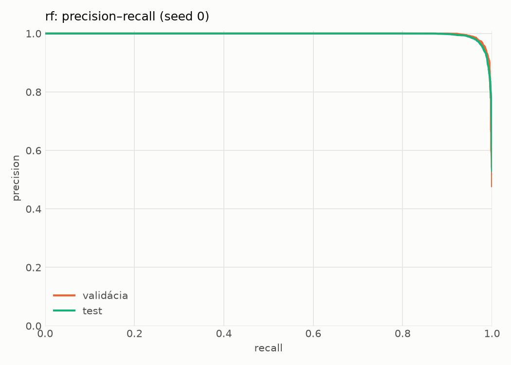
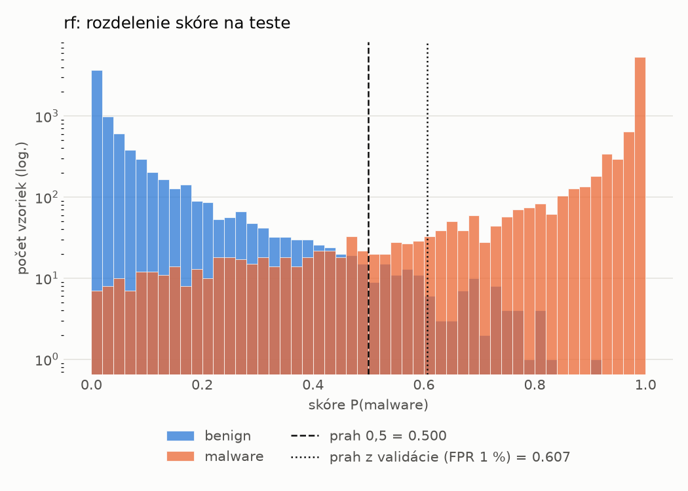
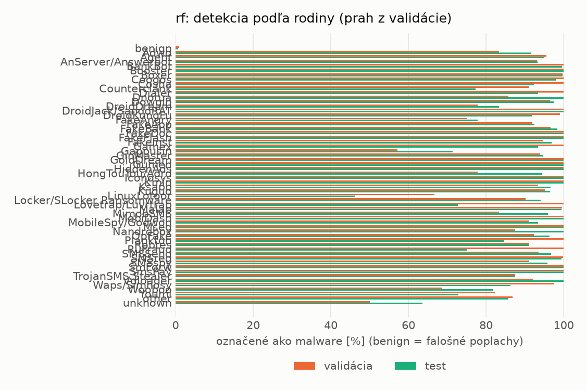
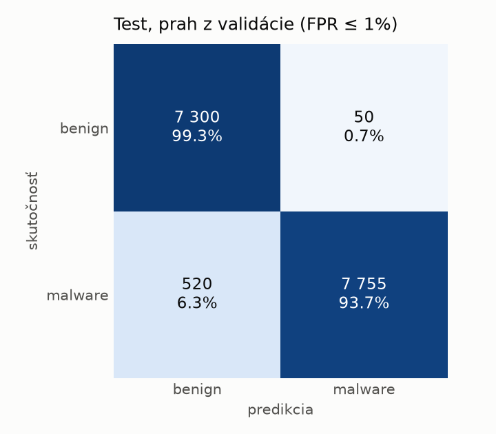
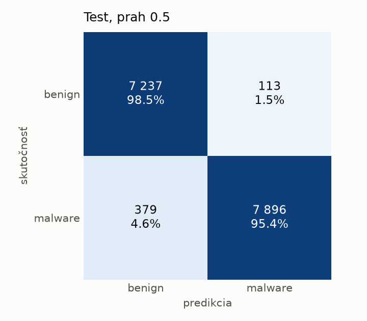

# hybrid/rf – beh `20261122-213601`

> Automaticky generované (`src/training/run_tabular.py`). Konfigurácia: `config.yaml`, protokol: `protocol.yaml`.

- **Model:** `random_forest` – Random Forest (pôvodné hodnoty príznakov)
- **Ladenie:** bez ladenia – hyperparametre prevzaté z `runs_v4/real_full/full/hybrid/rf/20261122-195013`
- **Finálne modely:** seedy [0, 1, 2]; hodnoty sú priemer ± smerodajná odchýlka cez seedy
- **Najlepšie hyperparametre:** `{"n_estimators": 150, "max_depth": 32, "min_samples_leaf": 1, "max_features": 0.05}`

## Detekčná kvalita (bez prahu)
| metrika | train (podvzorka) | validácia | test |
|---|---|---|---|
| ROC-AUC | 1.0000 ± 0.0000 | 0.9963 ± 0.0000 | 0.9953 ± 0.0001 |
| PR-AUC | 1.0000 ± 0.0000 | 0.9968 ± 0.0000 | 0.9964 ± 0.0000 |
| TPR pri FPR 1 % | 1.0000 ± 0.0000 | 0.9573 ± 0.0012 | 0.9449 ± 0.0014 |
| TPR pri FPR 0,1 % | 1.0000 ± 0.0000 | 0.9129 ± 0.0085 | 0.8864 ± 0.0027 |
| log loss | 0.0243 ± 0.0001 | 0.0874 ± 0.0008 | 0.0994 ± 0.0007 |
| Brier skóre | 0.0027 ± 0.0000 | 0.0214 ± 0.0002 | 0.0260 ± 0.0002 |

Rozdiel ROC-AUC train − validácia: **0.0037** (veľký rozdiel = preučenie).

## Pri prahu z validácie (FPR ≤ 1% na validácii)
| metrika | train (podvzorka) | validácia | test |
|---|---|---|---|
| accuracy | 0.9997 ± 0.0002 | 0.9746 ± 0.0005 | 0.9640 ± 0.0009 |
| balanced accuracy | 0.9996 ± 0.0002 | 0.9739 ± 0.0005 | 0.9656 ± 0.0008 |
| precision | 1.0000 ± 0.0000 | 0.9892 ± 0.0003 | 0.9929 ± 0.0006 |
| recall (TPR) | 0.9993 ± 0.0004 | 0.9573 ± 0.0012 | 0.9387 ± 0.0021 |
| FPR | 0.0000 ± 0.0000 | 0.0095 ± 0.0003 | 0.0075 ± 0.0006 |
| F1 | 0.9996 ± 0.0002 | 0.9730 ± 0.0005 | 0.9651 ± 0.0009 |
| MCC | 0.9993 ± 0.0004 | 0.9495 ± 0.0009 | 0.9296 ± 0.0017 |

## Pri pevnom prahu 0.5
| metrika | train (podvzorka) | validácia | test |
|---|---|---|---|
| accuracy | 1.0000 ± 0.0001 | 0.9745 ± 0.0002 | 0.9687 ± 0.0002 |
| balanced accuracy | 1.0000 ± 0.0001 | 0.9743 ± 0.0002 | 0.9696 ± 0.0002 |
| precision | 1.0000 ± 0.0000 | 0.9776 ± 0.0009 | 0.9857 ± 0.0003 |
| recall (TPR) | 0.9999 ± 0.0001 | 0.9689 ± 0.0010 | 0.9548 ± 0.0005 |
| FPR | 0.0000 ± 0.0000 | 0.0203 ± 0.0008 | 0.0156 ± 0.0003 |
| F1 | 1.0000 ± 0.0001 | 0.9732 ± 0.0002 | 0.9700 ± 0.0002 |
| MCC | 0.9999 ± 0.0001 | 0.9489 ± 0.0004 | 0.9379 ± 0.0003 |

## Výpočtové nároky (seed 0, testovacia množina)
| meranie | hodnota |
|---|---|
| tréning finálneho modelu | 1.3 s (priemer cez seedy) |
| ladenie spolu | 0 s |
| počet parametrov / uzlov | 705 278 |
| veľkosť modelu na disku | 56.68 MB |
| CPU latencia modelu (batch 1, 1 vlákno) | 4.738 ms (p95 4.997) |
| CPU priepustnosť (24 vlákien) | 204 893 vzoriek/s |

## Grafy
| | |
|---|---|
|  |  |
|  |  |
|  |  |
|  |  |

## Súbory
`metrics.json` (všetky metriky po seedoch vrátane rodín), `timing.json`, `hpo_trials.csv`,
`predictions/<časť>_seed<N>.parquet` (sha256, family, label, score), `model/seed_<N>/`, `log.txt`.
