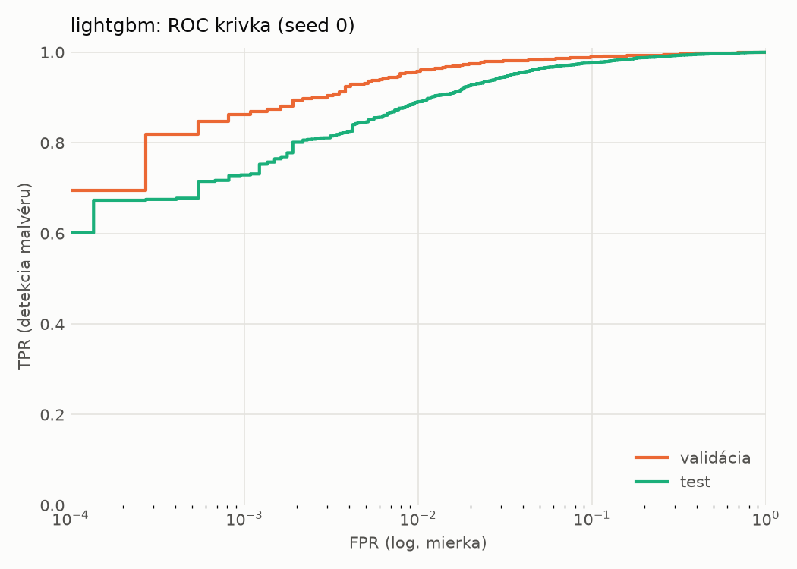
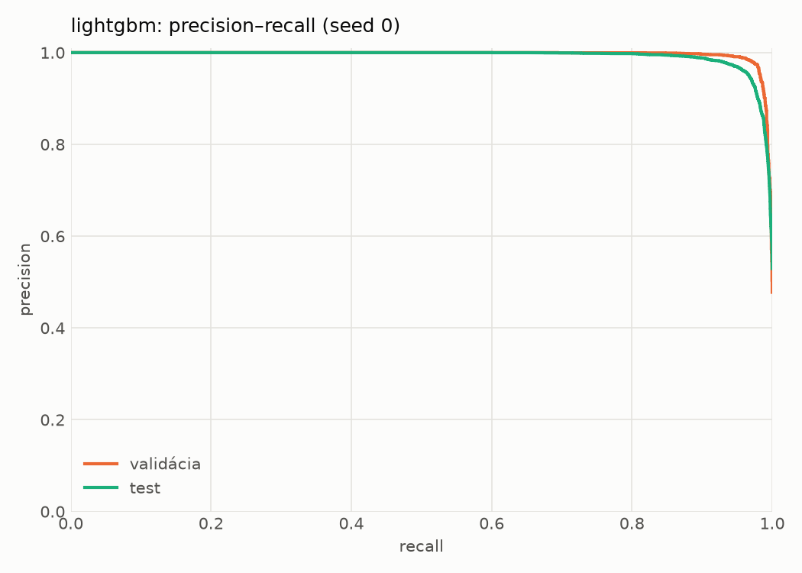
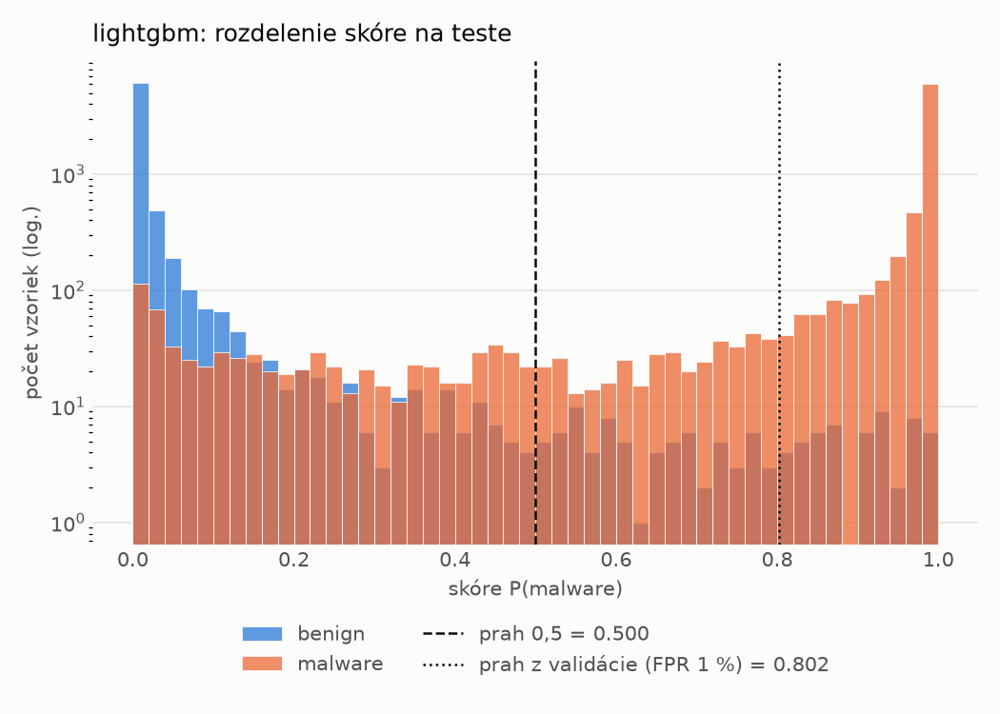
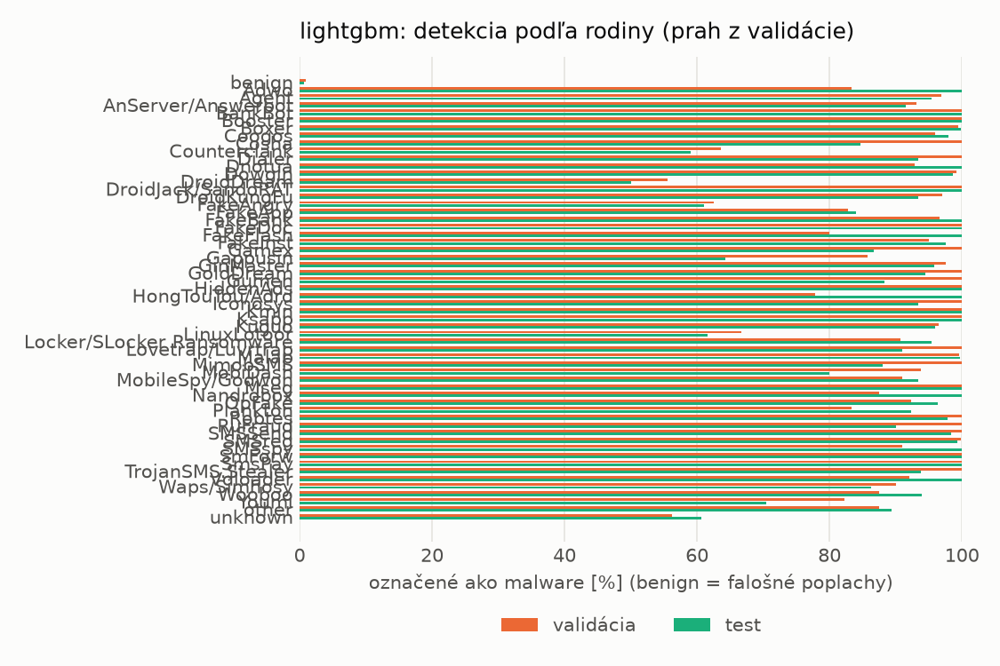
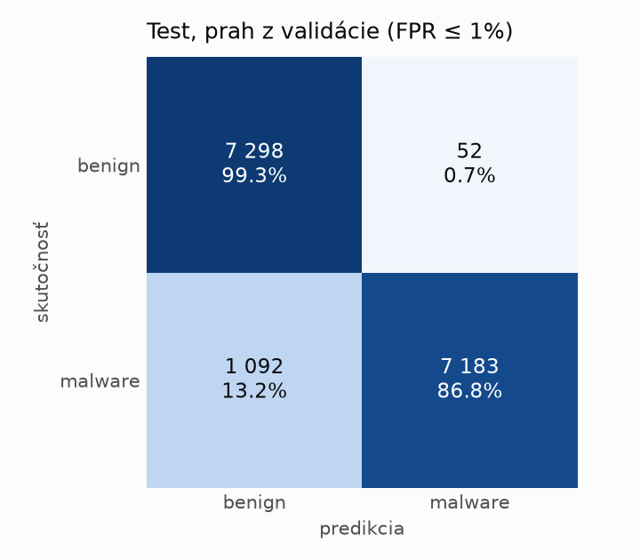
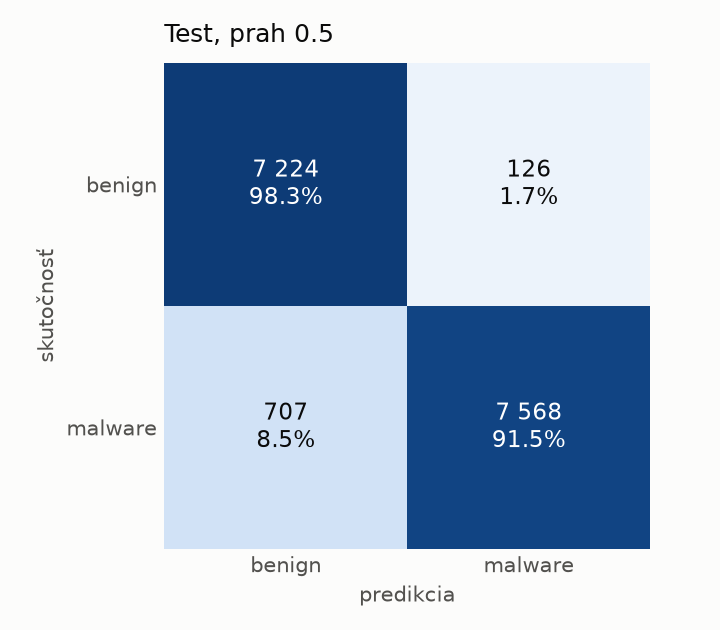
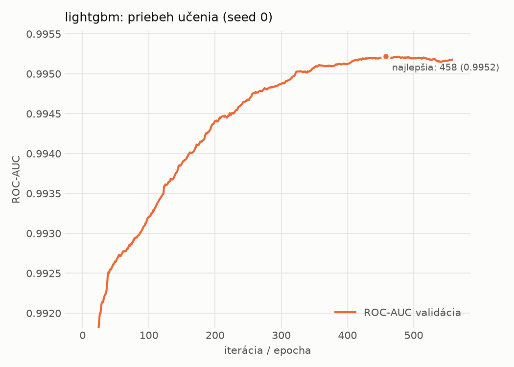

# static/lightgbm – beh `20261122-213043`

> Automaticky generované (`src/training/run_tabular.py`). Konfigurácia: `config.yaml`, protokol: `protocol.yaml`.

- **Model:** `lightgbm` – LightGBM, gradient boosting stromov s early stopping na validácii (pôvodné hodnoty príznakov)
- **Ladenie:** bez ladenia – hyperparametre prevzaté z `runs_v4/real_full/full/static/lightgbm/20261122-184829`
- **Finálne modely:** seedy [0, 1, 2]; hodnoty sú priemer ± smerodajná odchýlka cez seedy
- **Najlepšie hyperparametre:** `{"num_boost_round": 5000, "early_stopping_rounds": 100, "learning_rate": 0.015567978603457627, "num_leaves": 372, "min_child_samples": 12, "feature_fraction": 0.7551391358223217, "bagging_fraction": 0.6871892431836363, "lambda_l1": 1.3651906778474808e-06, "lambda_l2": 0.003382199534052785}`

## Detekčná kvalita (bez prahu)
| metrika | train (podvzorka) | validácia | test |
|---|---|---|---|
| ROC-AUC | 1.0000 ± 0.0000 | 0.9953 ± 0.0001 | 0.9903 ± 0.0002 |
| PR-AUC | 1.0000 ± 0.0000 | 0.9960 ± 0.0001 | 0.9926 ± 0.0002 |
| TPR pri FPR 1 % | 0.9999 ± 0.0001 | 0.9612 ± 0.0031 | 0.8919 ± 0.0034 |
| TPR pri FPR 0,1 % | 0.9999 ± 0.0001 | 0.8446 ± 0.0156 | 0.7339 ± 0.0097 |
| log loss | 0.0101 ± 0.0042 | 0.0741 ± 0.0010 | 0.1483 ± 0.0049 |
| Brier skóre | 0.0011 ± 0.0007 | 0.0184 ± 0.0003 | 0.0398 ± 0.0002 |

Rozdiel ROC-AUC train − validácia: **0.0047** (veľký rozdiel = preučenie).

## Pri prahu z validácie (FPR ≤ 1% na validácii)
| metrika | train (podvzorka) | validácia | test |
|---|---|---|---|
| accuracy | 0.9960 ± 0.0026 | 0.9764 ± 0.0015 | 0.9302 ± 0.0032 |
| balanced accuracy | 0.9957 ± 0.0027 | 0.9757 ± 0.0015 | 0.9337 ± 0.0030 |
| precision | 1.0000 ± 0.0000 | 0.9890 ± 0.0000 | 0.9927 ± 0.0003 |
| recall (TPR) | 0.9914 ± 0.0054 | 0.9612 ± 0.0031 | 0.8746 ± 0.0062 |
| FPR | 0.0000 ± 0.0000 | 0.0098 ± 0.0000 | 0.0073 ± 0.0003 |
| F1 | 0.9957 ± 0.0027 | 0.9749 ± 0.0016 | 0.9299 ± 0.0034 |
| MCC | 0.9919 ± 0.0051 | 0.9529 ± 0.0029 | 0.8677 ± 0.0056 |

## Pri pevnom prahu 0.5
| metrika | train (podvzorka) | validácia | test |
|---|---|---|---|
| accuracy | 0.9996 ± 0.0004 | 0.9772 ± 0.0004 | 0.9478 ± 0.0013 |
| balanced accuracy | 0.9995 ± 0.0004 | 0.9771 ± 0.0004 | 0.9498 ± 0.0013 |
| precision | 0.9999 ± 0.0002 | 0.9771 ± 0.0006 | 0.9840 ± 0.0007 |
| recall (TPR) | 0.9992 ± 0.0007 | 0.9751 ± 0.0005 | 0.9163 ± 0.0020 |
| FPR | 0.0001 ± 0.0002 | 0.0209 ± 0.0006 | 0.0167 ± 0.0007 |
| F1 | 0.9995 ± 0.0004 | 0.9761 ± 0.0005 | 0.9490 ± 0.0014 |
| MCC | 0.9991 ± 0.0008 | 0.9543 ± 0.0009 | 0.8981 ± 0.0026 |

## Výpočtové nároky (seed 0, testovacia množina)
| meranie | hodnota |
|---|---|
| tréning finálneho modelu | 9.1 s (priemer cez seedy) |
| ladenie spolu | 0 s |
| počet parametrov / uzlov | 340 294 |
| veľkosť modelu na disku | 18.77 MB |
| CPU latencia modelu (batch 1, 1 vlákno) | 0.096 ms (p95 0.122) |
| CPU priepustnosť (24 vlákien) | 187 057 vzoriek/s |

## Grafy
| | |
|---|---|
|  |  |
|  |  |
|  |  |
|  |  |

## Súbory
`metrics.json` (všetky metriky po seedoch vrátane rodín), `timing.json`, `hpo_trials.csv`,
`predictions/<časť>_seed<N>.parquet` (sha256, family, label, score), `model/seed_<N>/`, `log.txt`.
