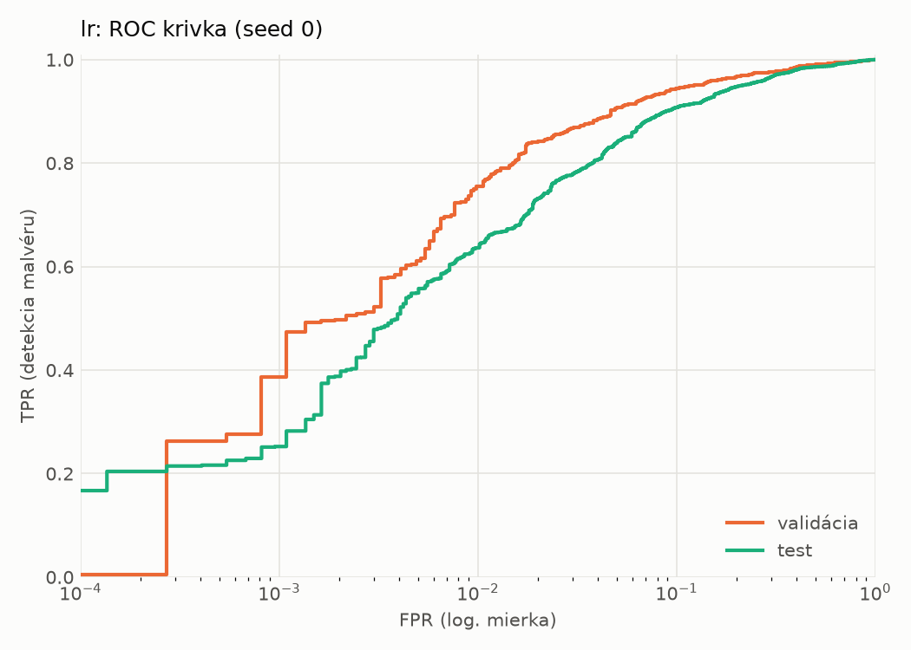
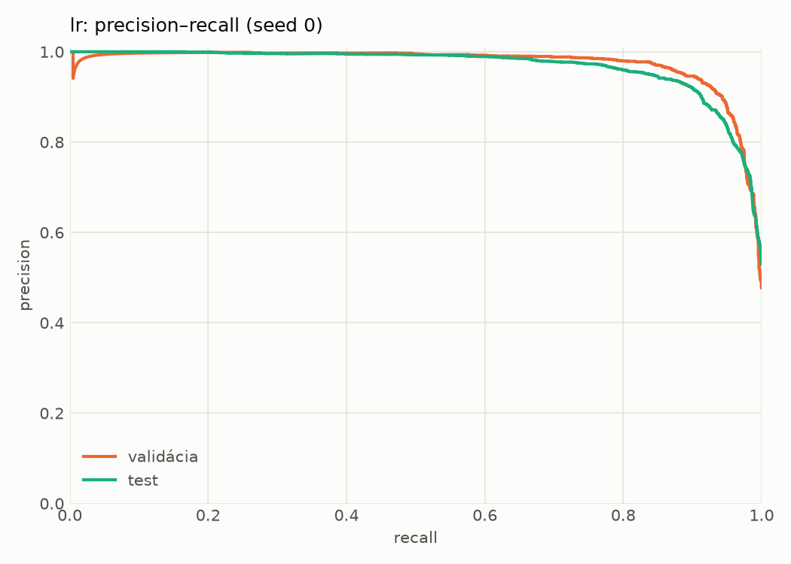
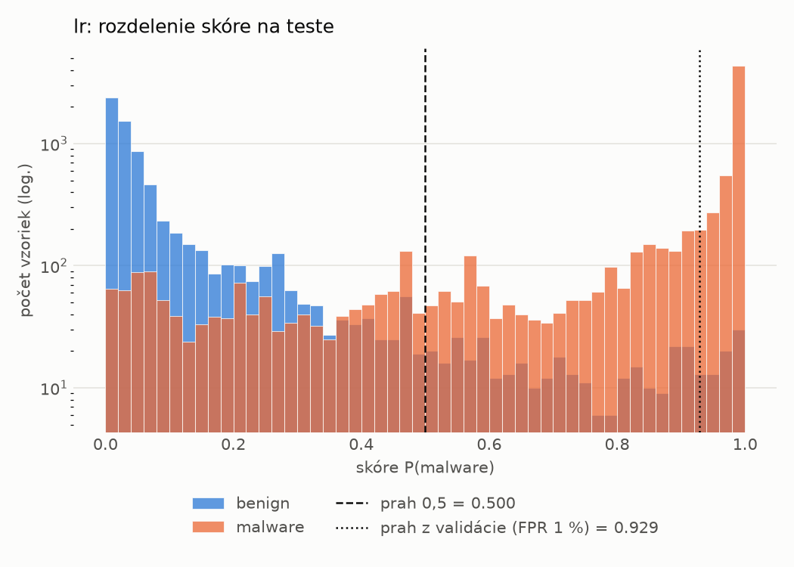
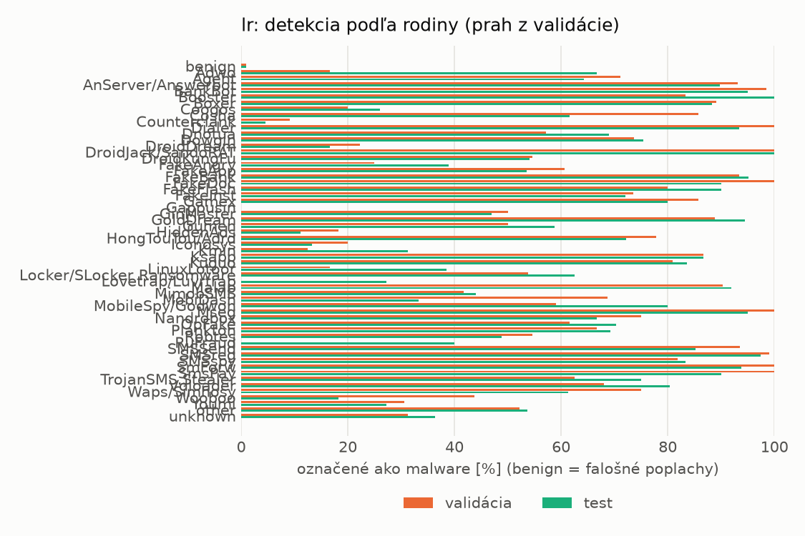
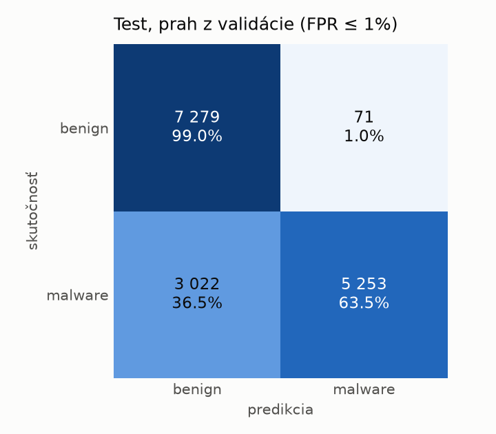
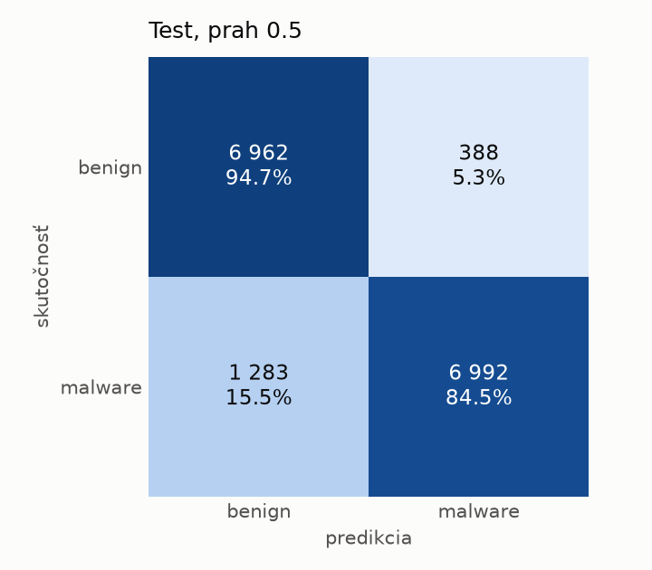

# static/lr – beh `20261122-213027`

> Automaticky generované (`src/training/run_tabular.py`). Konfigurácia: `config.yaml`, protokol: `protocol.yaml`.

- **Model:** `logreg` – logistická regresia s L2 regularizáciou (vstup signed log1p + štandardizácia)
- **Ladenie:** bez ladenia – hyperparametre prevzaté z `runs_v4/real_full/full/static/lr/20261122-184714`
- **Finálne modely:** seedy [0, 1, 2]; hodnoty sú priemer ± smerodajná odchýlka cez seedy
- **Najlepšie hyperparametre:** `{"max_iter": 2000, "C": 2.1423021757741068}`

## Detekčná kvalita (bez prahu)
| metrika | train (podvzorka) | validácia | test |
|---|---|---|---|
| ROC-AUC | 0.9770 ± 0.0000 | 0.9740 ± 0.0000 | 0.9607 ± 0.0000 |
| PR-AUC | 0.9766 ± 0.0000 | 0.9749 ± 0.0000 | 0.9683 ± 0.0000 |
| TPR pri FPR 1 % | 0.7143 ± 0.0000 | 0.7543 ± 0.0000 | 0.6364 ± 0.0000 |
| TPR pri FPR 0,1 % | 0.3237 ± 0.0000 | 0.3861 ± 0.0000 | 0.2523 ± 0.0000 |
| log loss | 0.1873 ± 0.0000 | 0.2002 ± 0.0000 | 0.2661 ± 0.0000 |
| Brier skóre | 0.0513 ± 0.0000 | 0.0552 ± 0.0000 | 0.0781 ± 0.0000 |

Rozdiel ROC-AUC train − validácia: **0.0030** (veľký rozdiel = preučenie).

## Pri prahu z validácie (FPR ≤ 1% na validácii)
| metrika | train (podvzorka) | validácia | test |
|---|---|---|---|
| accuracy | 0.8699 ± 0.0000 | 0.8775 ± 0.0000 | 0.8020 ± 0.0000 |
| balanced accuracy | 0.8619 ± 0.0000 | 0.8723 ± 0.0000 | 0.8126 ± 0.0000 |
| precision | 0.9834 ± 0.0000 | 0.9860 ± 0.0000 | 0.9867 ± 0.0000 |
| recall (TPR) | 0.7347 ± 0.0000 | 0.7543 ± 0.0000 | 0.6348 ± 0.0000 |
| FPR | 0.0109 ± 0.0000 | 0.0098 ± 0.0000 | 0.0097 ± 0.0000 |
| F1 | 0.8411 ± 0.0000 | 0.8547 ± 0.0000 | 0.7726 ± 0.0000 |
| MCC | 0.7572 ± 0.0000 | 0.7722 ± 0.0000 | 0.6583 ± 0.0000 |

## Pri pevnom prahu 0.5
| metrika | train (podvzorka) | validácia | test |
|---|---|---|---|
| accuracy | 0.9314 ± 0.0000 | 0.9291 ± 0.0000 | 0.8931 ± 0.0000 |
| balanced accuracy | 0.9301 ± 0.0000 | 0.9283 ± 0.0000 | 0.8961 ± 0.0000 |
| precision | 0.9421 ± 0.0000 | 0.9382 ± 0.0000 | 0.9474 ± 0.0000 |
| recall (TPR) | 0.9095 ± 0.0000 | 0.9117 ± 0.0000 | 0.8450 ± 0.0000 |
| FPR | 0.0493 ± 0.0000 | 0.0550 ± 0.0000 | 0.0528 ± 0.0000 |
| F1 | 0.9255 ± 0.0000 | 0.9247 ± 0.0000 | 0.8933 ± 0.0000 |
| MCC | 0.8624 ± 0.0000 | 0.8580 ± 0.0000 | 0.7920 ± 0.0000 |

## Výpočtové nároky (seed 0, testovacia množina)
| meranie | hodnota |
|---|---|
| tréning finálneho modelu | 0.2 s (priemer cez seedy) |
| ladenie spolu | 0 s |
| počet parametrov / uzlov | 165 |
| veľkosť modelu na disku | 0.01 MB |
| transformácia vstupu – latencia (1 vlákno) | 0.005 ms |
| transformácia vstupu – priepustnosť | 1 106 477 vzoriek/s |
| CPU latencia modelu (batch 1, 1 vlákno) | 0.004 ms (p95 0.005) |
| CPU priepustnosť (24 vlákien) | 3 993 916 vzoriek/s |

## Grafy
| | |
|---|---|
|  |  |
|  |  |
|  |  |
|  |  |

## Súbory
`metrics.json` (všetky metriky po seedoch vrátane rodín), `timing.json`, `hpo_trials.csv`,
`predictions/<časť>_seed<N>.parquet` (sha256, family, label, score), `model/seed_<N>/`, `log.txt`.
