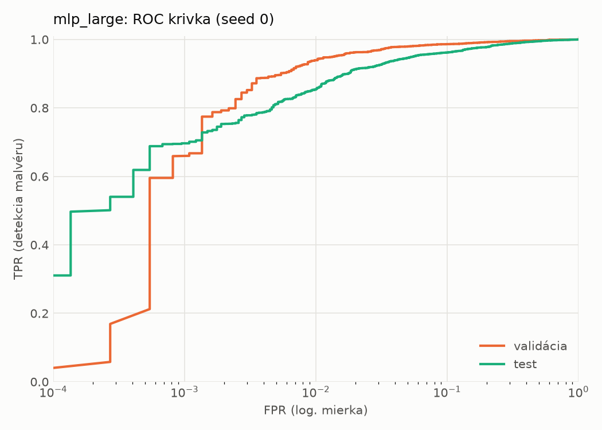
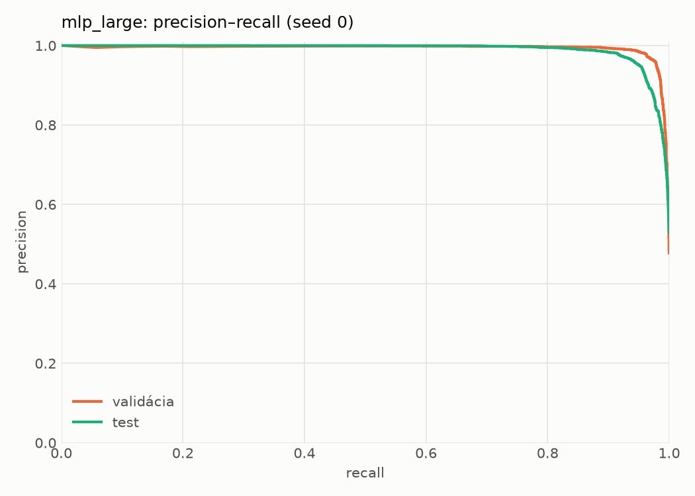
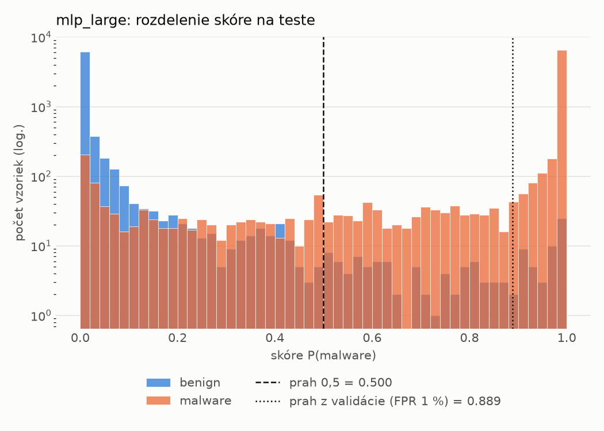
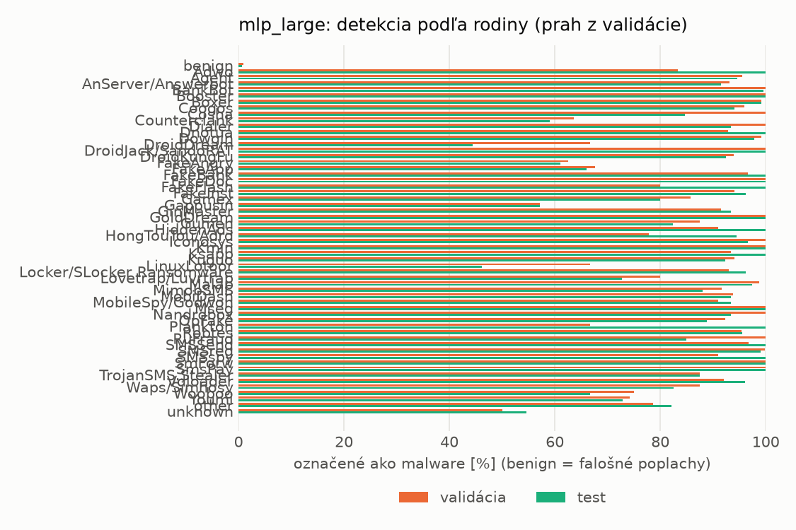
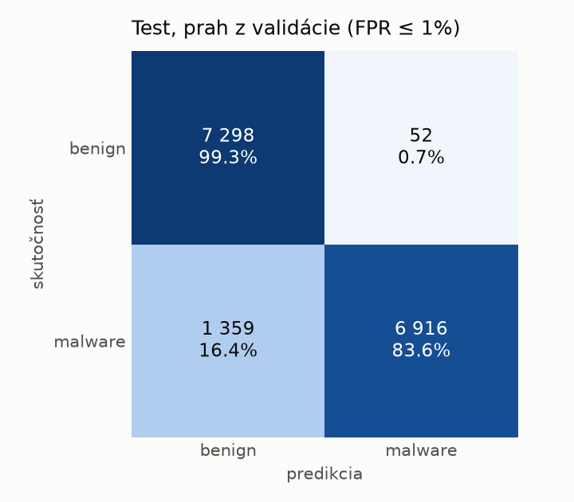
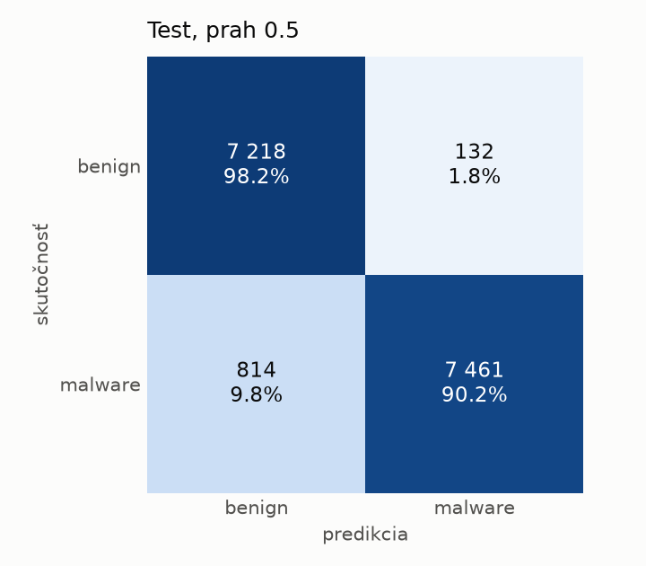
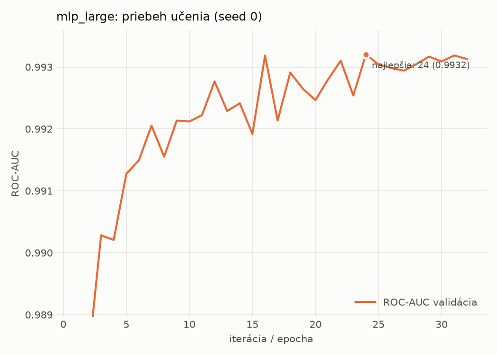

# static/mlp_large – beh `20261122-213208`

> Automaticky generované (`src/training/run_tabular.py`). Konfigurácia: `config.yaml`, protokol: `protocol.yaml`.

- **Model:** `mlp` – veľká neurónová sieť (3–5 skrytých vrstiev, 512–2048 neurónov), kandidát na učiteľa
- **Ladenie:** bez ladenia – hyperparametre prevzaté z `runs_v4/real_full/full/static/mlp_large/20261122-190815`
- **Finálne modely:** seedy [0, 1, 2]; hodnoty sú priemer ± smerodajná odchýlka cez seedy
- **Najlepšie hyperparametre:** `{"max_epochs": 100, "patience": 8, "hidden_layers": 3, "hidden_width": 512, "width_decay": 0.5, "dropout": 0.18301180344828658, "lr": 0.000378062291460712, "weight_decay": 1.421525321060219e-06, "batch_size": 256}`

## Detekčná kvalita (bez prahu)
| metrika | train (podvzorka) | validácia | test |
|---|---|---|---|
| ROC-AUC | 0.9991 ± 0.0001 | 0.9934 ± 0.0002 | 0.9847 ± 0.0007 |
| PR-AUC | 0.9991 ± 0.0001 | 0.9933 ± 0.0003 | 0.9886 ± 0.0004 |
| TPR pri FPR 1 % | 0.9859 ± 0.0019 | 0.9407 ± 0.0027 | 0.8688 ± 0.0131 |
| TPR pri FPR 0,1 % | 0.9634 ± 0.0031 | 0.7379 ± 0.0735 | 0.6741 ± 0.0420 |
| log loss | 0.0336 ± 0.0029 | 0.1012 ± 0.0012 | 0.1928 ± 0.0065 |
| Brier skóre | 0.0091 ± 0.0008 | 0.0233 ± 0.0003 | 0.0461 ± 0.0014 |

Rozdiel ROC-AUC train − validácia: **0.0057** (veľký rozdiel = preučenie).

## Pri prahu z validácie (FPR ≤ 1% na validácii)
| metrika | train (podvzorka) | validácia | test |
|---|---|---|---|
| accuracy | 0.9790 ± 0.0014 | 0.9666 ± 0.0014 | 0.9119 ± 0.0078 |
| balanced accuracy | 0.9776 ± 0.0014 | 0.9655 ± 0.0014 | 0.9164 ± 0.0073 |
| precision | 0.9994 ± 0.0001 | 0.9888 ± 0.0002 | 0.9929 ± 0.0005 |
| recall (TPR) | 0.9557 ± 0.0029 | 0.9407 ± 0.0027 | 0.8396 ± 0.0152 |
| FPR | 0.0005 ± 0.0001 | 0.0097 ± 0.0002 | 0.0068 ± 0.0006 |
| F1 | 0.9771 ± 0.0015 | 0.9642 ± 0.0015 | 0.9098 ± 0.0087 |
| MCC | 0.9585 ± 0.0026 | 0.9340 ± 0.0026 | 0.8360 ± 0.0133 |

## Pri pevnom prahu 0.5
| metrika | train (podvzorka) | validácia | test |
|---|---|---|---|
| accuracy | 0.9877 ± 0.0010 | 0.9708 ± 0.0011 | 0.9415 ± 0.0019 |
| balanced accuracy | 0.9872 ± 0.0011 | 0.9706 ± 0.0012 | 0.9437 ± 0.0017 |
| precision | 0.9934 ± 0.0007 | 0.9724 ± 0.0024 | 0.9820 ± 0.0022 |
| recall (TPR) | 0.9802 ± 0.0021 | 0.9664 ± 0.0028 | 0.9061 ± 0.0053 |
| FPR | 0.0057 ± 0.0006 | 0.0251 ± 0.0023 | 0.0187 ± 0.0025 |
| F1 | 0.9868 ± 0.0011 | 0.9694 ± 0.0012 | 0.9425 ± 0.0021 |
| MCC | 0.9753 ± 0.0020 | 0.9415 ± 0.0023 | 0.8861 ± 0.0033 |

## Výpočtové nároky (seed 0, testovacia množina)
| meranie | hodnota |
|---|---|
| tréning finálneho modelu | 18.2 s (priemer cez seedy) |
| ladenie spolu | 0 s |
| počet parametrov / uzlov | 250 625 |
| veľkosť modelu na disku | 1.02 MB |
| transformácia vstupu – latencia (1 vlákno) | 0.015 ms |
| transformácia vstupu – priepustnosť | 621 080 vzoriek/s |
| CPU latencia modelu (batch 1, 1 vlákno) | 0.157 ms (p95 0.328) |
| CPU priepustnosť (24 vlákien) | 888 698 vzoriek/s |
| GPU latencia (batch 1) | 0.540 ms (p95 0.583) |
| GPU priepustnosť | 1 608 205 vzoriek/s |
| GPU špičková pamäť | 137 MB |

## Grafy
| | |
|---|---|
|  |  |
|  |  |
|  |  |
|  |  |

## Súbory
`metrics.json` (všetky metriky po seedoch vrátane rodín), `timing.json`, `hpo_trials.csv`,
`predictions/<časť>_seed<N>.parquet` (sha256, family, label, score), `model/seed_<N>/`, `log.txt`.
