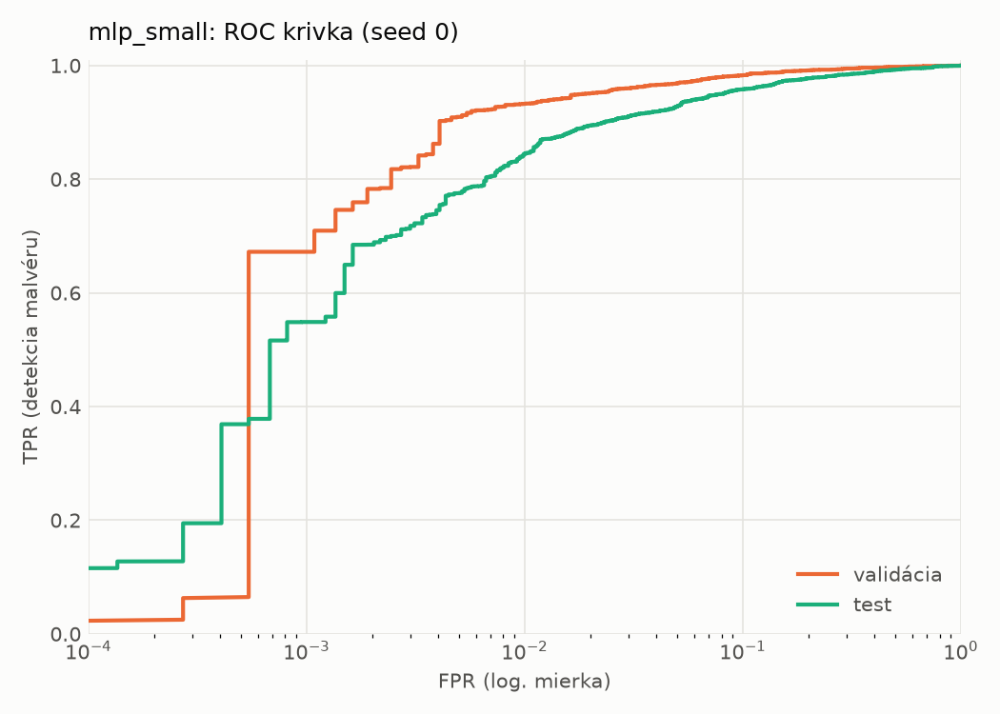
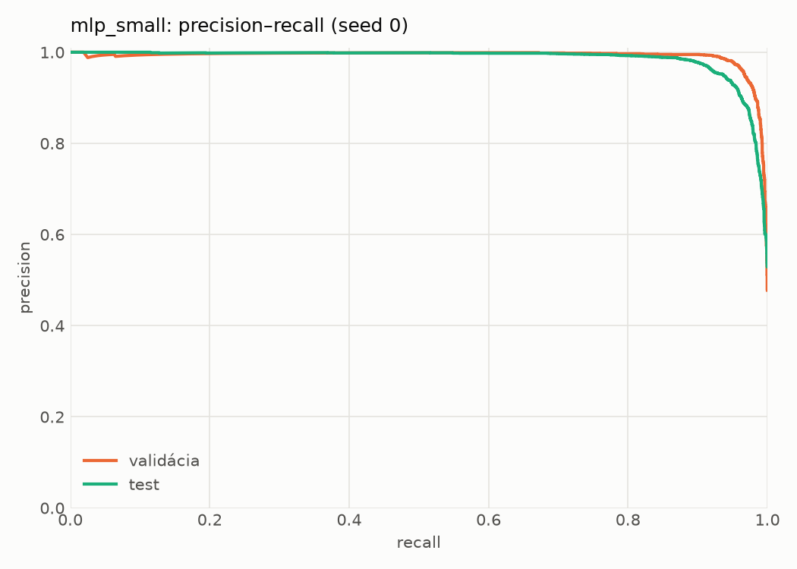
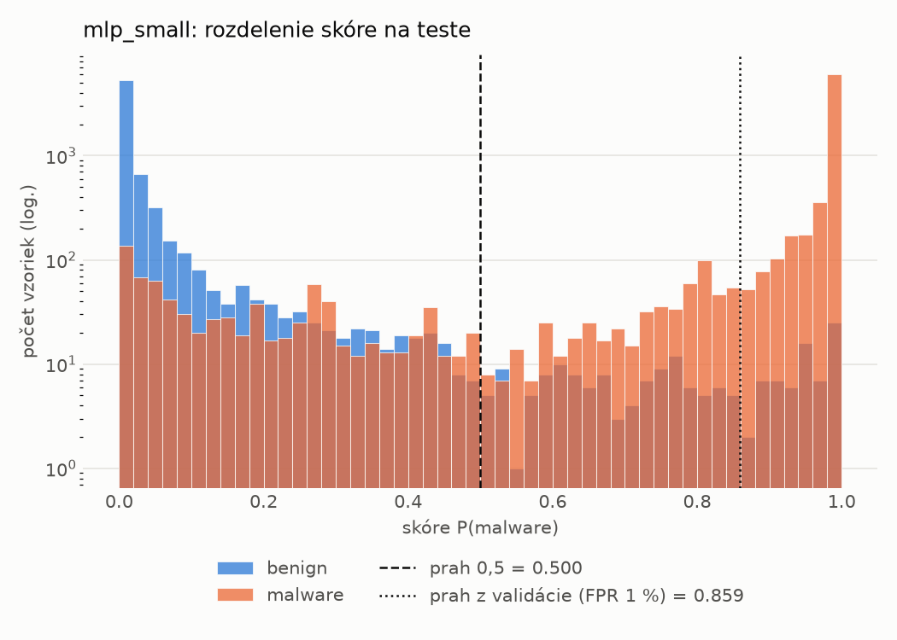
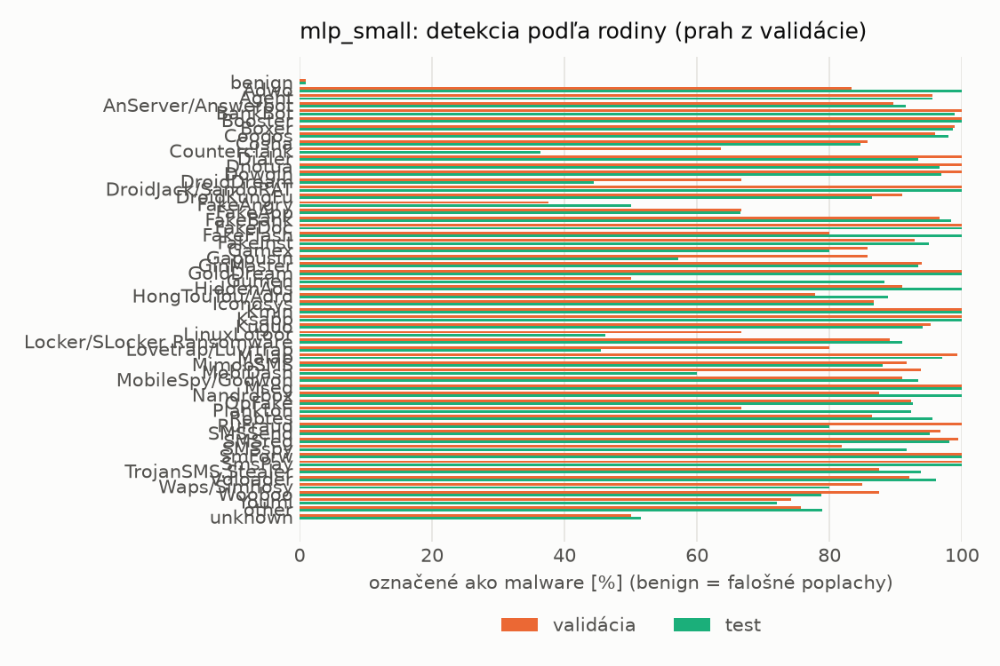
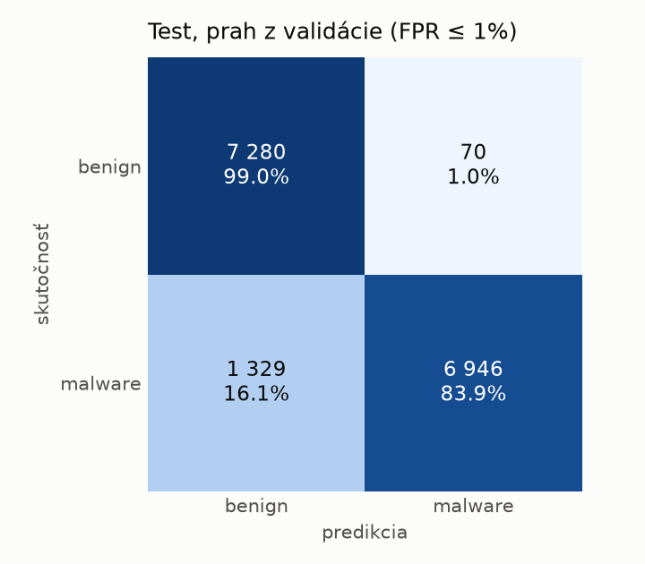
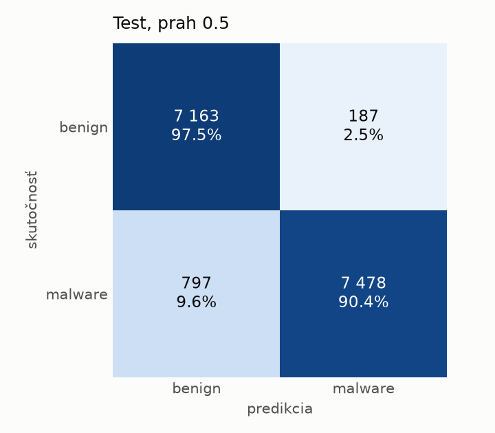
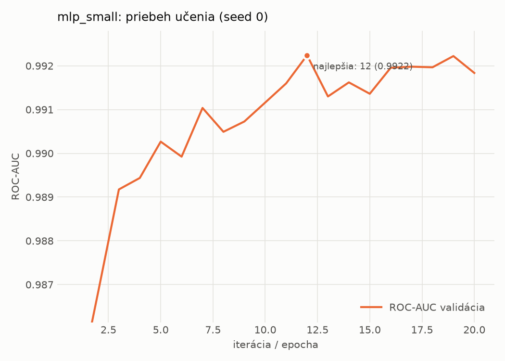

# static/mlp_small – beh `20261122-213124`

> Automaticky generované (`src/training/run_tabular.py`). Konfigurácia: `config.yaml`, protokol: `protocol.yaml`.

- **Model:** `mlp` – malá neurónová sieť (1–2 skryté vrstvy), kandidát na ľahkého študenta
- **Ladenie:** bez ladenia – hyperparametre prevzaté z `runs_v4/real_full/full/static/mlp_small/20261122-190134`
- **Finálne modely:** seedy [0, 1, 2]; hodnoty sú priemer ± smerodajná odchýlka cez seedy
- **Najlepšie hyperparametre:** `{"width_decay": 0.5, "max_epochs": 100, "patience": 8, "hidden_layers": 2, "hidden_width": 256, "dropout": 0.05428236214064427, "lr": 0.00041374253133077954, "weight_decay": 5.569517746104647e-06, "batch_size": 256}`

## Detekčná kvalita (bez prahu)
| metrika | train (podvzorka) | validácia | test |
|---|---|---|---|
| ROC-AUC | 0.9983 ± 0.0010 | 0.9926 ± 0.0004 | 0.9845 ± 0.0022 |
| PR-AUC | 0.9983 ± 0.0009 | 0.9924 ± 0.0008 | 0.9882 ± 0.0017 |
| TPR pri FPR 1 % | 0.9775 ± 0.0112 | 0.9322 ± 0.0031 | 0.8584 ± 0.0120 |
| TPR pri FPR 0,1 % | 0.9393 ± 0.0272 | 0.7096 ± 0.0329 | 0.6239 ± 0.0668 |
| log loss | 0.0463 ± 0.0130 | 0.1012 ± 0.0029 | 0.1780 ± 0.0073 |
| Brier skóre | 0.0123 ± 0.0038 | 0.0252 ± 0.0019 | 0.0461 ± 0.0028 |

Rozdiel ROC-AUC train − validácia: **0.0056** (veľký rozdiel = preučenie).

## Pri prahu z validácie (FPR ≤ 1% na validácii)
| metrika | train (podvzorka) | validácia | test |
|---|---|---|---|
| accuracy | 0.9729 ± 0.0037 | 0.9626 ± 0.0013 | 0.9061 ± 0.0044 |
| balanced accuracy | 0.9712 ± 0.0039 | 0.9613 ± 0.0014 | 0.9109 ± 0.0041 |
| precision | 0.9984 ± 0.0012 | 0.9890 ± 0.0005 | 0.9920 ± 0.0018 |
| recall (TPR) | 0.9437 ± 0.0068 | 0.9322 ± 0.0031 | 0.8294 ± 0.0100 |
| FPR | 0.0013 ± 0.0010 | 0.0095 ± 0.0005 | 0.0076 ± 0.0018 |
| F1 | 0.9703 ± 0.0041 | 0.9597 ± 0.0015 | 0.9034 ± 0.0052 |
| MCC | 0.9467 ± 0.0071 | 0.9263 ± 0.0024 | 0.8258 ± 0.0071 |

## Pri pevnom prahu 0.5
| metrika | train (podvzorka) | validácia | test |
|---|---|---|---|
| accuracy | 0.9838 ± 0.0043 | 0.9684 ± 0.0034 | 0.9427 ± 0.0054 |
| balanced accuracy | 0.9833 ± 0.0043 | 0.9682 ± 0.0033 | 0.9448 ± 0.0053 |
| precision | 0.9896 ± 0.0051 | 0.9698 ± 0.0046 | 0.9804 ± 0.0042 |
| recall (TPR) | 0.9756 ± 0.0041 | 0.9638 ± 0.0024 | 0.9101 ± 0.0074 |
| FPR | 0.0090 ± 0.0045 | 0.0275 ± 0.0043 | 0.0205 ± 0.0044 |
| F1 | 0.9826 ± 0.0046 | 0.9668 ± 0.0035 | 0.9439 ± 0.0054 |
| MCC | 0.9675 ± 0.0087 | 0.9366 ± 0.0068 | 0.8882 ± 0.0105 |

## Výpočtové nároky (seed 0, testovacia množina)
| meranie | hodnota |
|---|---|
| tréning finálneho modelu | 13.9 s (priemer cez seedy) |
| ladenie spolu | 0 s |
| počet parametrov / uzlov | 76 033 |
| veľkosť modelu na disku | 0.32 MB |
| transformácia vstupu – latencia (1 vlákno) | 0.015 ms |
| transformácia vstupu – priepustnosť | 671 844 vzoriek/s |
| CPU latencia modelu (batch 1, 1 vlákno) | 0.233 ms (p95 0.245) |
| CPU priepustnosť (24 vlákien) | 1 222 279 vzoriek/s |
| GPU latencia (batch 1) | 0.656 ms (p95 0.682) |
| GPU priepustnosť | 1 339 408 vzoriek/s |
| GPU špičková pamäť | 82 MB |

## Grafy
| | |
|---|---|
|  |  |
|  |  |
|  |  |
|  |  |

## Súbory
`metrics.json` (všetky metriky po seedoch vrátane rodín), `timing.json`, `hpo_trials.csv`,
`predictions/<časť>_seed<N>.parquet` (sha256, family, label, score), `model/seed_<N>/`, `log.txt`.
