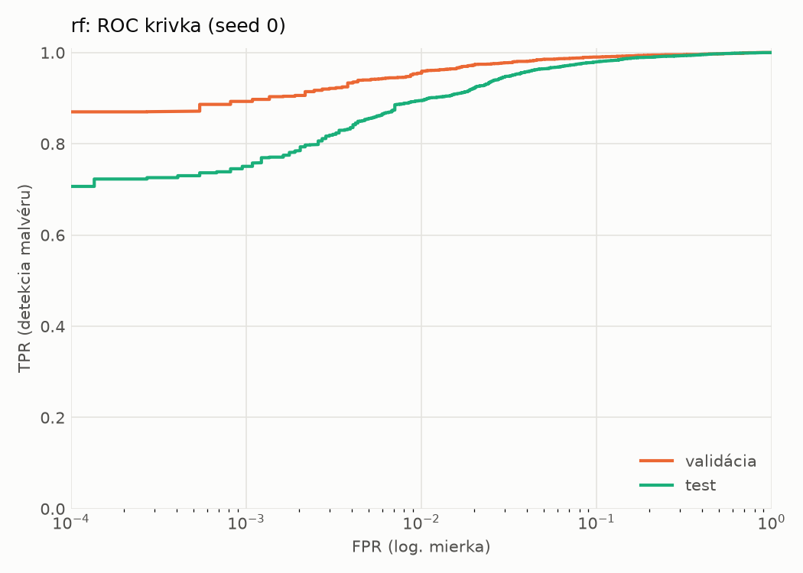
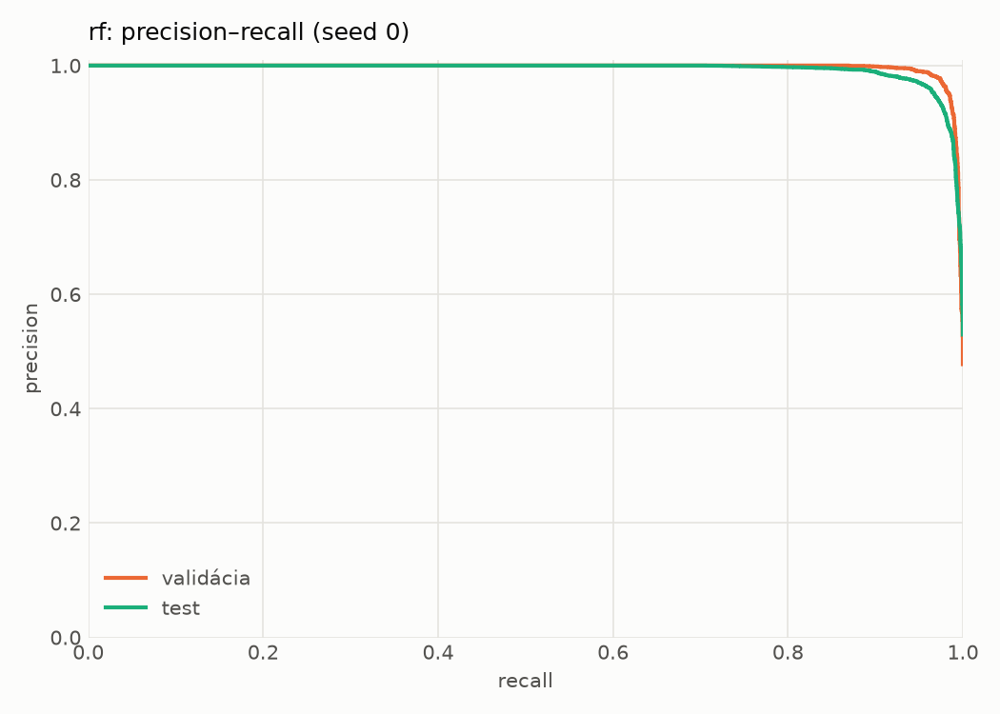
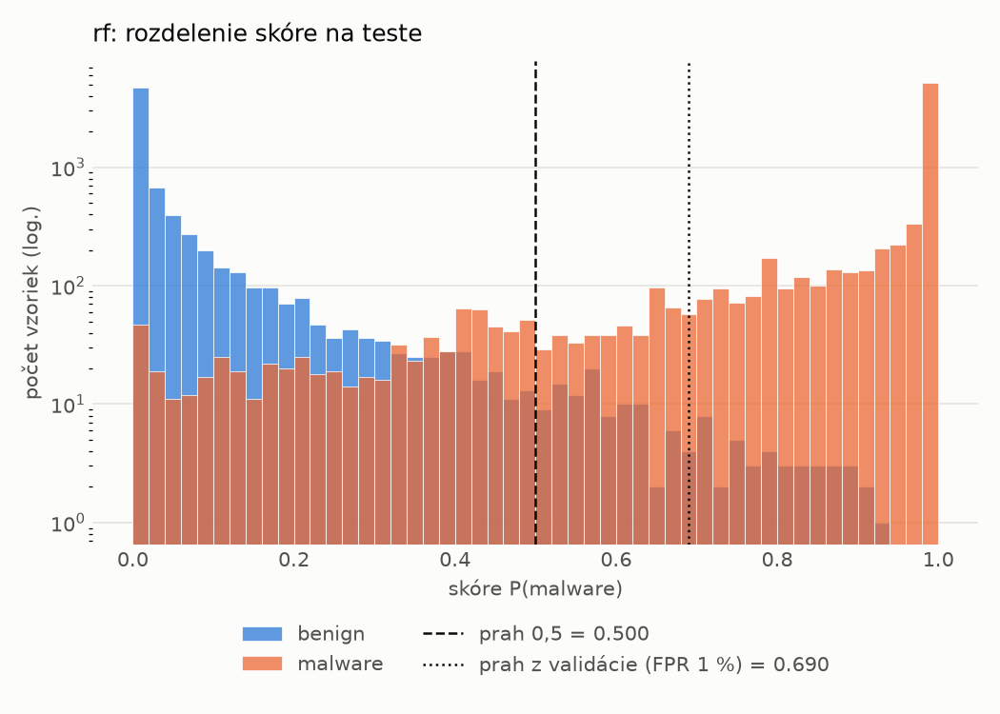
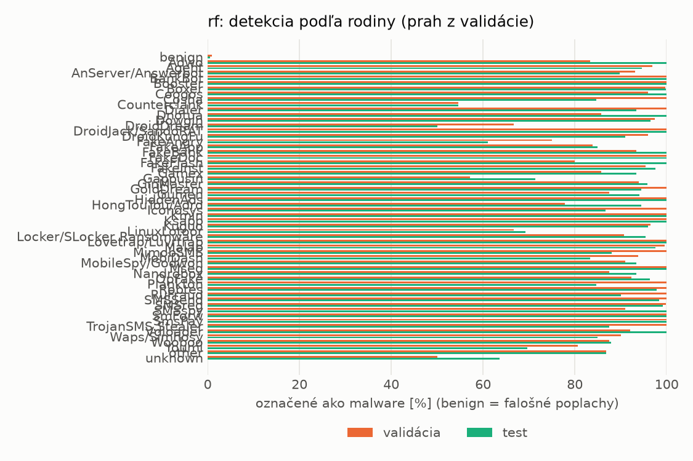
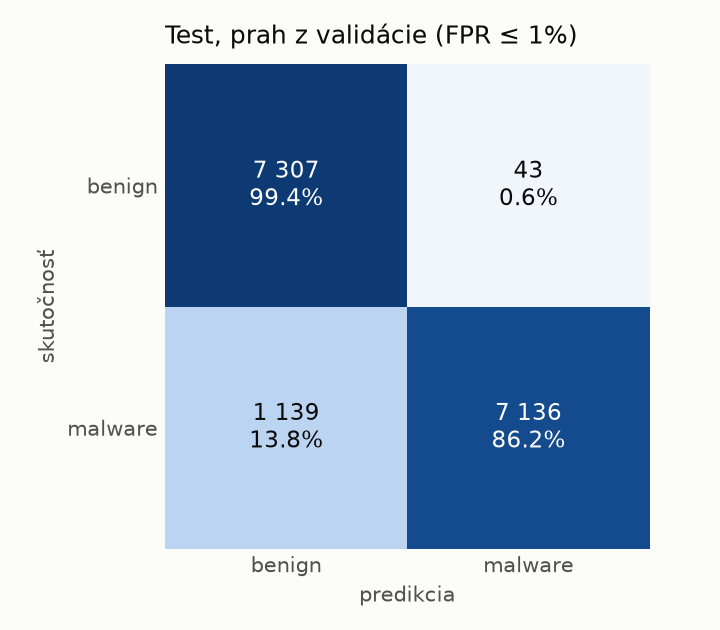
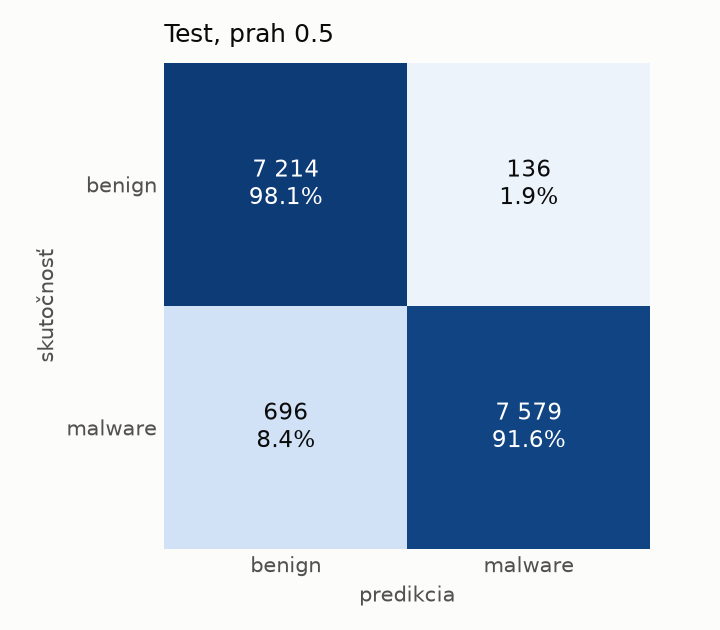

# static/rf – beh `20261122-213029`

> Automaticky generované (`src/training/run_tabular.py`). Konfigurácia: `config.yaml`, protokol: `protocol.yaml`.

- **Model:** `random_forest` – Random Forest (pôvodné hodnoty príznakov)
- **Ladenie:** bez ladenia – hyperparametre prevzaté z `runs_v4/real_full/full/static/rf/20261122-184723`
- **Finálne modely:** seedy [0, 1, 2]; hodnoty sú priemer ± smerodajná odchýlka cez seedy
- **Najlepšie hyperparametre:** `{"n_estimators": 400, "max_depth": 32, "min_samples_leaf": 1, "max_features": "sqrt"}`

## Detekčná kvalita (bez prahu)
| metrika | train (podvzorka) | validácia | test |
|---|---|---|---|
| ROC-AUC | 1.0000 ± 0.0000 | 0.9952 ± 0.0001 | 0.9908 ± 0.0001 |
| PR-AUC | 1.0000 ± 0.0000 | 0.9961 ± 0.0000 | 0.9930 ± 0.0001 |
| TPR pri FPR 1 % | 1.0000 ± 0.0000 | 0.9550 ± 0.0002 | 0.8908 ± 0.0035 |
| TPR pri FPR 0,1 % | 1.0000 ± 0.0000 | 0.8946 ± 0.0048 | 0.7496 ± 0.0056 |
| log loss | 0.0216 ± 0.0002 | 0.0810 ± 0.0003 | 0.1374 ± 0.0015 |
| Brier skóre | 0.0028 ± 0.0000 | 0.0206 ± 0.0000 | 0.0388 ± 0.0003 |

Rozdiel ROC-AUC train − validácia: **0.0048** (veľký rozdiel = preučenie).

## Pri prahu z validácie (FPR ≤ 1% na validácii)
| metrika | train (podvzorka) | validácia | test |
|---|---|---|---|
| accuracy | 0.9962 ± 0.0001 | 0.9735 ± 0.0001 | 0.9223 ± 0.0018 |
| balanced accuracy | 0.9959 ± 0.0001 | 0.9727 ± 0.0001 | 0.9263 ± 0.0017 |
| precision | 1.0000 ± 0.0000 | 0.9892 ± 0.0000 | 0.9940 ± 0.0000 |
| recall (TPR) | 0.9919 ± 0.0002 | 0.9550 ± 0.0002 | 0.8585 ± 0.0033 |
| FPR | 0.0000 ± 0.0000 | 0.0095 ± 0.0000 | 0.0059 ± 0.0000 |
| F1 | 0.9959 ± 0.0001 | 0.9718 ± 0.0001 | 0.9213 ± 0.0019 |
| MCC | 0.9924 ± 0.0002 | 0.9474 ± 0.0002 | 0.8543 ± 0.0031 |

## Pri pevnom prahu 0.5
| metrika | train (podvzorka) | validácia | test |
|---|---|---|---|
| accuracy | 0.9997 ± 0.0002 | 0.9752 ± 0.0007 | 0.9471 ± 0.0004 |
| balanced accuracy | 0.9997 ± 0.0002 | 0.9752 ± 0.0007 | 0.9490 ± 0.0003 |
| precision | 0.9999 ± 0.0001 | 0.9728 ± 0.0010 | 0.9822 ± 0.0002 |
| recall (TPR) | 0.9994 ± 0.0003 | 0.9753 ± 0.0006 | 0.9168 ± 0.0010 |
| FPR | 0.0001 ± 0.0001 | 0.0249 ± 0.0010 | 0.0187 ± 0.0003 |
| F1 | 0.9996 ± 0.0002 | 0.9741 ± 0.0007 | 0.9484 ± 0.0004 |
| MCC | 0.9993 ± 0.0003 | 0.9503 ± 0.0014 | 0.8966 ± 0.0007 |

## Výpočtové nároky (seed 0, testovacia množina)
| meranie | hodnota |
|---|---|
| tréning finálneho modelu | 1.7 s (priemer cez seedy) |
| ladenie spolu | 0 s |
| počet parametrov / uzlov | 2 202 940 |
| veľkosť modelu na disku | 176.59 MB |
| CPU latencia modelu (batch 1, 1 vlákno) | 12.112 ms (p95 12.459) |
| CPU priepustnosť (24 vlákien) | 149 581 vzoriek/s |

## Grafy
| | |
|---|---|
|  |  |
|  |  |
|  |  |
|  |  |

## Súbory
`metrics.json` (všetky metriky po seedoch vrátane rodín), `timing.json`, `hpo_trials.csv`,
`predictions/<časť>_seed<N>.parquet` (sha256, family, label, score), `model/seed_<N>/`, `log.txt`.
