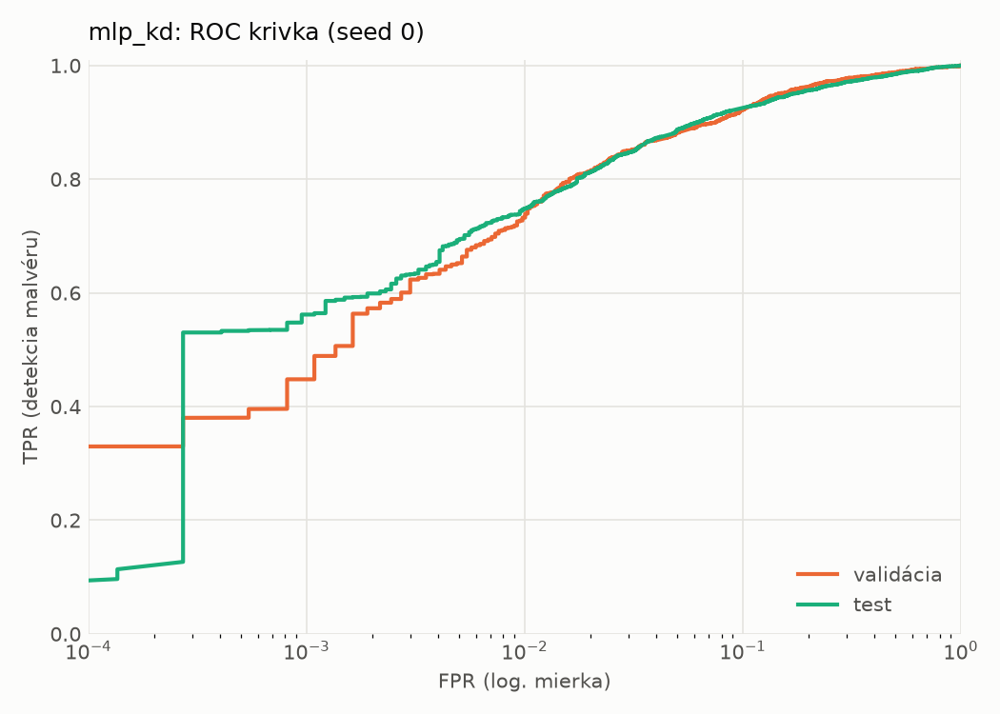
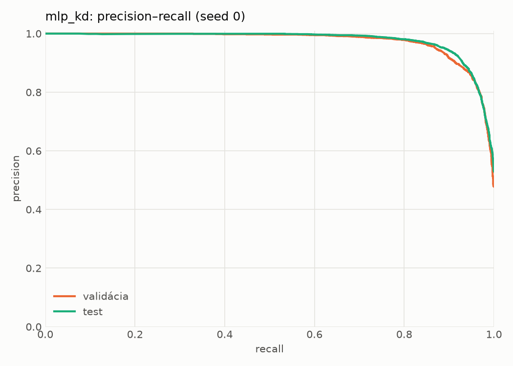
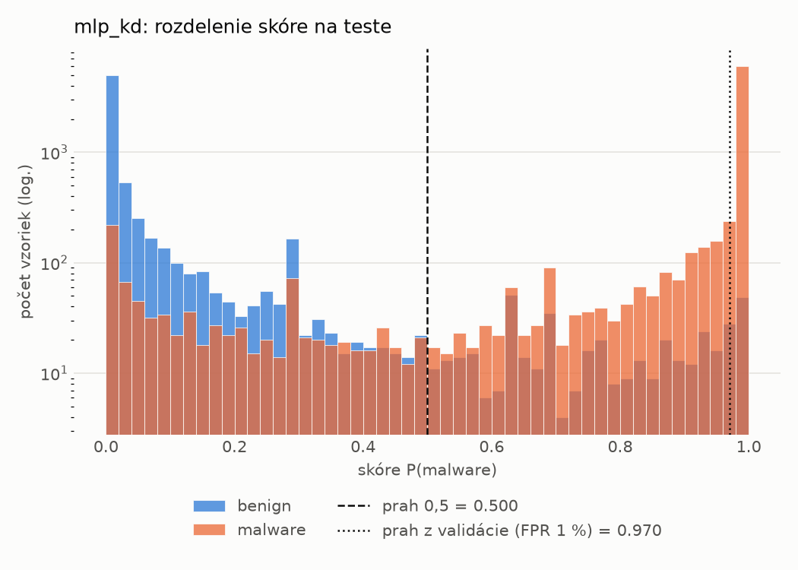
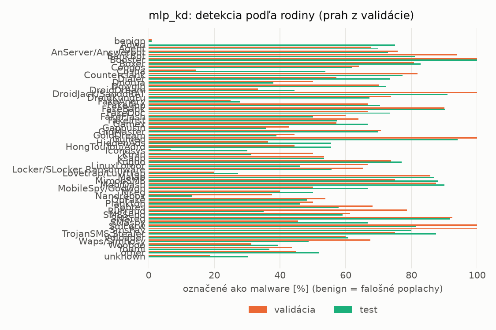
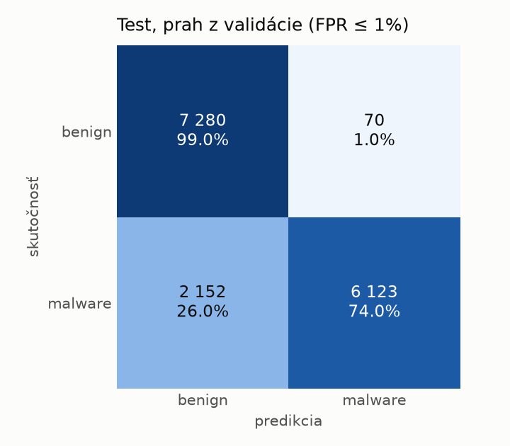
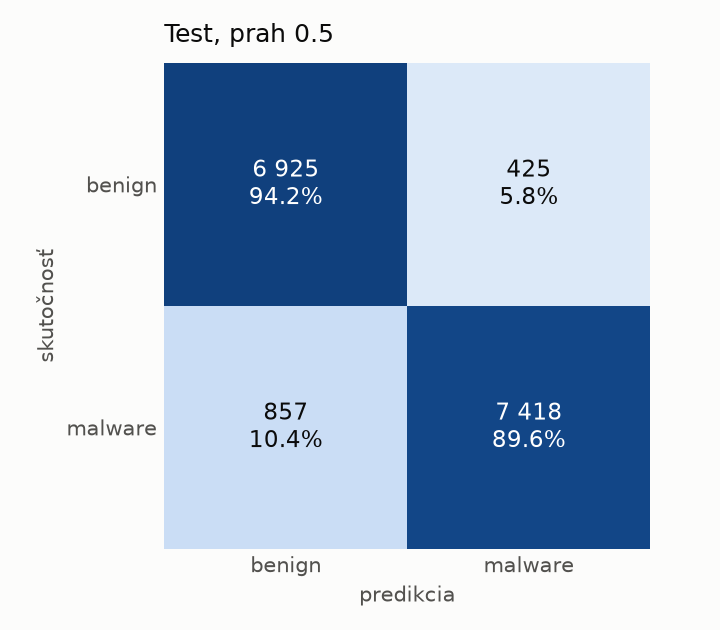
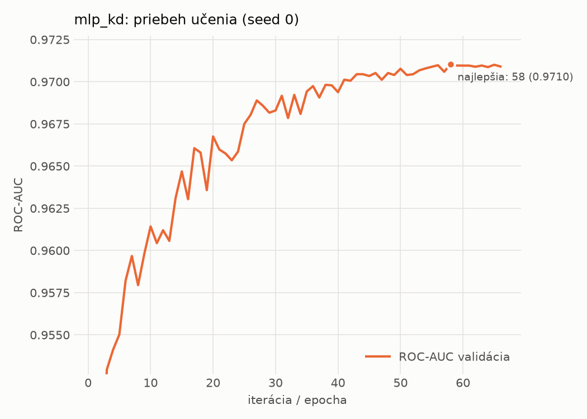

# dynamic/mlp_kd – beh `20261122-214433`

> Automaticky generované (`src/training/run_tabular.py`). Konfigurácia: `config.yaml`, protokol: `protocol.yaml`.

- **Model:** `mlp` – študent – malé MLP učené destiláciou z hybridného učiteľa
- **Ladenie:** bez ladenia – hyperparametre prevzaté z `runs_v4/real_full/full/students_dynamic/mlp_kd/20261122-205301`
- **Finálne modely:** seedy [0, 1, 2]; hodnoty sú priemer ± smerodajná odchýlka cez seedy
- **Najlepšie hyperparametre:** `{"hidden_layers": 1, "max_epochs": 100, "patience": 8, "hidden_width": 64, "dropout": 0.03643763137351852, "lr": 0.0028753520300020953, "weight_decay": 0.00022273244560059002, "batch_size": 512, "kd_alpha": 0.33129867518829337, "kd_temperature": 1.9602594769462303}`

## Detekčná kvalita (bez prahu)
| metrika | train (podvzorka) | validácia | test |
|---|---|---|---|
| ROC-AUC | 0.9747 ± 0.0007 | 0.9706 ± 0.0004 | 0.9691 ± 0.0003 |
| PR-AUC | 0.9763 ± 0.0009 | 0.9733 ± 0.0003 | 0.9768 ± 0.0003 |
| TPR pri FPR 1 % | 0.7766 ± 0.0087 | 0.7323 ± 0.0012 | 0.7444 ± 0.0057 |
| TPR pri FPR 0,1 % | 0.5489 ± 0.0338 | 0.4922 ± 0.0627 | 0.5694 ± 0.0121 |
| log loss | 0.2120 ± 0.0060 | 0.2424 ± 0.0029 | 0.2553 ± 0.0060 |
| Brier skóre | 0.0572 ± 0.0014 | 0.0642 ± 0.0007 | 0.0656 ± 0.0010 |

Rozdiel ROC-AUC train − validácia: **0.0040** (veľký rozdiel = preučenie).

## Pri prahu z validácie (FPR ≤ 1% na validácii)
| metrika | train (podvzorka) | validácia | test |
|---|---|---|---|
| accuracy | 0.8698 ± 0.0006 | 0.8670 ± 0.0006 | 0.8572 ± 0.0007 |
| balanced accuracy | 0.8615 ± 0.0006 | 0.8613 ± 0.0006 | 0.8646 ± 0.0006 |
| precision | 0.9903 ± 0.0007 | 0.9856 ± 0.0000 | 0.9885 ± 0.0002 |
| recall (TPR) | 0.7292 ± 0.0009 | 0.7323 ± 0.0012 | 0.7389 ± 0.0012 |
| FPR | 0.0063 ± 0.0004 | 0.0098 ± 0.0000 | 0.0097 ± 0.0001 |
| F1 | 0.8399 ± 0.0007 | 0.8403 ± 0.0008 | 0.8456 ± 0.0008 |
| MCC | 0.7589 ± 0.0011 | 0.7542 ± 0.0010 | 0.7442 ± 0.0011 |

## Pri pevnom prahu 0.5
| metrika | train (podvzorka) | validácia | test |
|---|---|---|---|
| accuracy | 0.9254 ± 0.0021 | 0.9141 ± 0.0006 | 0.9161 ± 0.0020 |
| balanced accuracy | 0.9240 ± 0.0024 | 0.9133 ± 0.0006 | 0.9176 ± 0.0017 |
| precision | 0.9363 ± 0.0041 | 0.9225 ± 0.0040 | 0.9468 ± 0.0025 |
| recall (TPR) | 0.9023 ± 0.0087 | 0.8954 ± 0.0044 | 0.8918 ± 0.0063 |
| FPR | 0.0542 ± 0.0042 | 0.0688 ± 0.0042 | 0.0565 ± 0.0032 |
| F1 | 0.9189 ± 0.0028 | 0.9087 ± 0.0007 | 0.9184 ± 0.0023 |
| MCC | 0.8504 ± 0.0039 | 0.8279 ± 0.0012 | 0.8339 ± 0.0034 |

## Výpočtové nároky (seed 0, testovacia množina)
| meranie | hodnota |
|---|---|
| tréning finálneho modelu | 11.0 s (priemer cez seedy) |
| ladenie spolu | 0 s |
| počet parametrov / uzlov | 8 641 |
| veľkosť modelu na disku | 0.04 MB |
| transformácia vstupu – latencia (1 vlákno) | 0.015 ms |
| transformácia vstupu – priepustnosť | 1 151 191 vzoriek/s |
| CPU latencia modelu (batch 1, 1 vlákno) | 0.074 ms (p95 0.081) |
| CPU priepustnosť (24 vlákien) | 7 724 059 vzoriek/s |
| GPU latencia (batch 1) | 0.266 ms (p95 0.299) |
| GPU priepustnosť | 2 251 246 vzoriek/s |
| GPU špičková pamäť | 59 MB |

## Grafy
| | |
|---|---|
|  |  |
|  |  |
|  |  |
|  |  |

## Súbory
`metrics.json` (všetky metriky po seedoch vrátane rodín), `timing.json`, `hpo_trials.csv`,
`predictions/<časť>_seed<N>.parquet` (sha256, family, label, score), `model/seed_<N>/`, `log.txt`.
