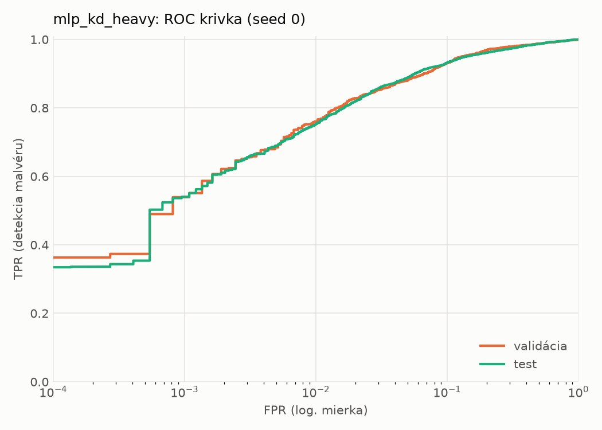
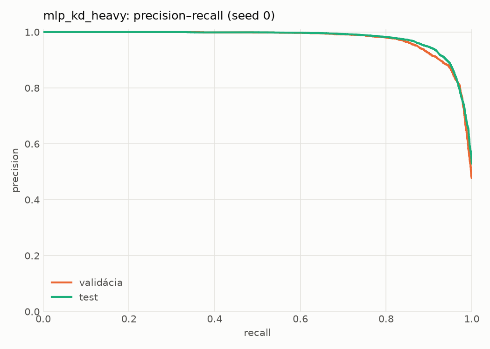
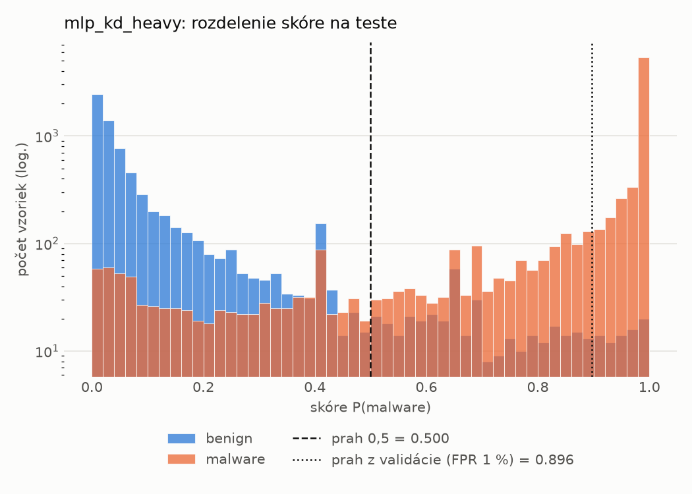
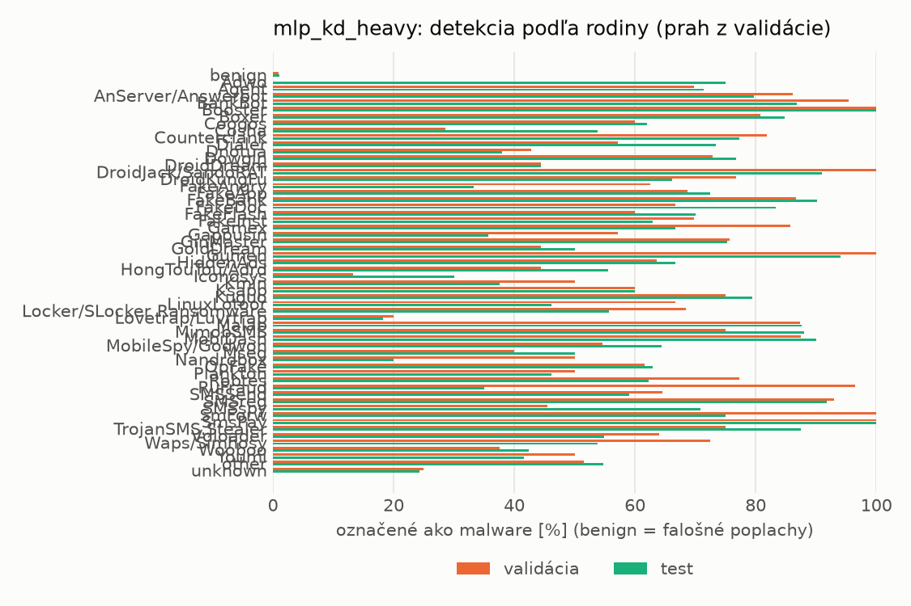
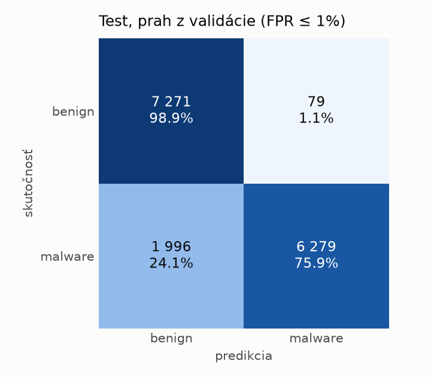
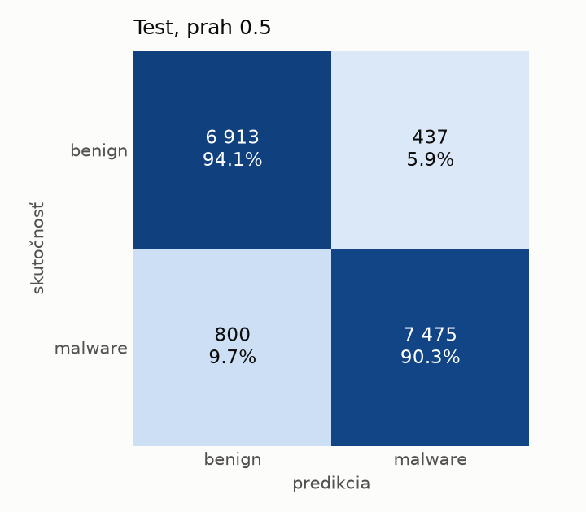
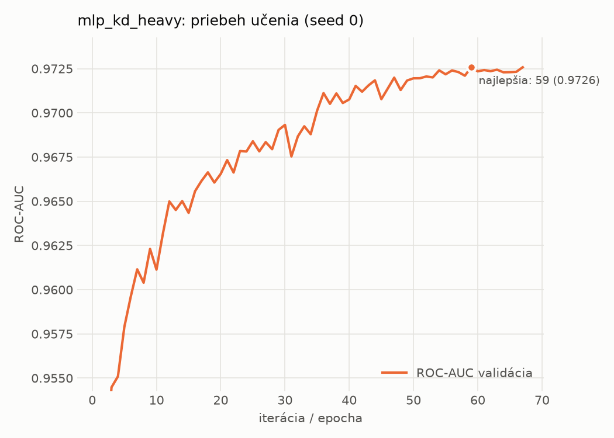

# dynamic/mlp_kd_heavy – beh `20261122-214629`

> Automaticky generované (`src/training/run_tabular.py`). Konfigurácia: `config.yaml`, protokol: `protocol.yaml`.

- **Model:** `mlp` – študent – malé MLP učené destiláciou z mlp_large hybridu (V4)
- **Ladenie:** bez ladenia – hyperparametre prevzaté z `runs_v4/real_full/full/students_dynamic/mlp_kd_heavy/20261122-211545`
- **Finálne modely:** seedy [0, 1, 2]; hodnoty sú priemer ± smerodajná odchýlka cez seedy
- **Najlepšie hyperparametre:** `{"hidden_layers": 1, "max_epochs": 100, "patience": 8, "hidden_width": 64, "dropout": 0.029123066185724737, "lr": 0.0017081972585601675, "weight_decay": 1.0334419171964511e-06, "batch_size": 256, "kd_alpha": 0.8514630095462001, "kd_temperature": 1.2684929468645387}`

## Detekčná kvalita (bez prahu)
| metrika | train (podvzorka) | validácia | test |
|---|---|---|---|
| ROC-AUC | 0.9789 ± 0.0009 | 0.9723 ± 0.0003 | 0.9717 ± 0.0002 |
| PR-AUC | 0.9802 ± 0.0008 | 0.9749 ± 0.0005 | 0.9786 ± 0.0001 |
| TPR pri FPR 1 % | 0.7998 ± 0.0113 | 0.7553 ± 0.0046 | 0.7563 ± 0.0109 |
| TPR pri FPR 0,1 % | 0.5591 ± 0.0135 | 0.5158 ± 0.0462 | 0.5689 ± 0.0265 |
| log loss | 0.1778 ± 0.0035 | 0.2070 ± 0.0015 | 0.2106 ± 0.0020 |
| Brier skóre | 0.0513 ± 0.0011 | 0.0597 ± 0.0005 | 0.0606 ± 0.0007 |

Rozdiel ROC-AUC train − validácia: **0.0066** (veľký rozdiel = preučenie).

## Pri prahu z validácie (FPR ≤ 1% na validácii)
| metrika | train (podvzorka) | validácia | test |
|---|---|---|---|
| accuracy | 0.8819 ± 0.0024 | 0.8780 ± 0.0022 | 0.8658 ± 0.0026 |
| balanced accuracy | 0.8744 ± 0.0025 | 0.8728 ± 0.0023 | 0.8728 ± 0.0025 |
| precision | 0.9916 ± 0.0008 | 0.9860 ± 0.0001 | 0.9886 ± 0.0012 |
| recall (TPR) | 0.7544 ± 0.0046 | 0.7553 ± 0.0046 | 0.7554 ± 0.0048 |
| FPR | 0.0056 ± 0.0005 | 0.0098 ± 0.0000 | 0.0098 ± 0.0010 |
| F1 | 0.8569 ± 0.0032 | 0.8554 ± 0.0030 | 0.8564 ± 0.0032 |
| MCC | 0.7801 ± 0.0043 | 0.7731 ± 0.0038 | 0.7581 ± 0.0044 |

## Pri pevnom prahu 0.5
| metrika | train (podvzorka) | validácia | test |
|---|---|---|---|
| accuracy | 0.9320 ± 0.0018 | 0.9178 ± 0.0011 | 0.9206 ± 0.0007 |
| balanced accuracy | 0.9310 ± 0.0020 | 0.9173 ± 0.0011 | 0.9218 ± 0.0005 |
| precision | 0.9395 ± 0.0008 | 0.9213 ± 0.0028 | 0.9462 ± 0.0017 |
| recall (TPR) | 0.9139 ± 0.0043 | 0.9053 ± 0.0029 | 0.9012 ± 0.0031 |
| FPR | 0.0519 ± 0.0008 | 0.0707 ± 0.0029 | 0.0576 ± 0.0022 |
| F1 | 0.9265 ± 0.0022 | 0.9132 ± 0.0011 | 0.9232 ± 0.0008 |
| MCC | 0.8636 ± 0.0036 | 0.8353 ± 0.0021 | 0.8421 ± 0.0010 |

## Výpočtové nároky (seed 0, testovacia množina)
| meranie | hodnota |
|---|---|
| tréning finálneho modelu | 22.8 s (priemer cez seedy) |
| ladenie spolu | 0 s |
| počet parametrov / uzlov | 8 641 |
| veľkosť modelu na disku | 0.04 MB |
| transformácia vstupu – latencia (1 vlákno) | 0.015 ms |
| transformácia vstupu – priepustnosť | 730 782 vzoriek/s |
| CPU latencia modelu (batch 1, 1 vlákno) | 0.159 ms (p95 0.170) |
| CPU priepustnosť (24 vlákien) | 2 806 315 vzoriek/s |
| GPU latencia (batch 1) | 0.458 ms (p95 0.499) |
| GPU priepustnosť | 2 470 903 vzoriek/s |
| GPU špičková pamäť | 89 MB |

## Grafy
| | |
|---|---|
|  |  |
|  |  |
|  |  |
|  |  |

## Súbory
`metrics.json` (všetky metriky po seedoch vrátane rodín), `timing.json`, `hpo_trials.csv`,
`predictions/<časť>_seed<N>.parquet` (sha256, family, label, score), `model/seed_<N>/`, `log.txt`.
